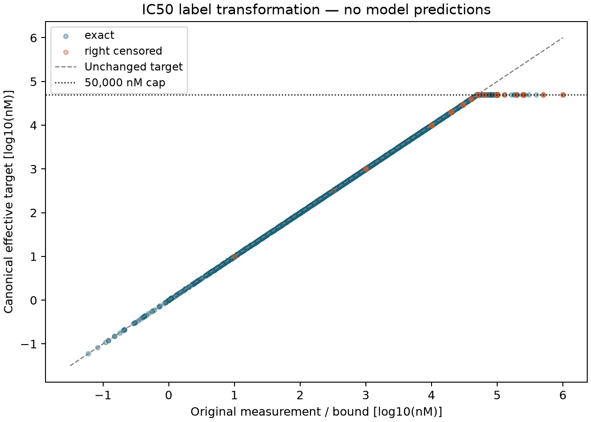

# Corrected human IC50 target-policy audit and stopped fit

**Outcome: the fitting attempt stopped before optimization.** No checkpoint or
prediction exists, so there are no training/validation/test performance metrics.
The original raw-target contract conflicts with Presto's established target clamp.
This family records that failure and preserves its prospective plan; it does not
change baseline targets after seeing results. [Presto #110](https://github.com/pirl-unc/presto/issues/110)
owns the canonical qualification fix and a future family must declare its effective
label policy before another fit. Agent/model: Codex (GPT-6), 2026-10-16.

## Inspect the evidence

[Download the complete audit and preserved attempt](https://github.com/pirl-unc/presto/releases/tag/corrected-human-target-policy-audit-v1).
All large files live in datacache; release `publication.json` and `SHA256SUMS` bind
standalone reports, the full source-linked table and the original interrupted archive.

| Partition | IC50 observations | Exact values | Values above cap | Changed exact targets | Changed right-censor bounds |
|---|---:|---:|---:|---:|---:|
| Train | 2,074 | 1,599 | 157 | 39 | 118 |
| Validation | 265 | 210 | 31 | 8 | 23 |
| Test | 275 | 214 | 23 | 7 | 16 |

All 2,614 rows join uniquely to their frozen observation/source context. The source
range is 0.06–1,000,000 nM. No value is below the 0.001 nM floor. In total, 211
physical values or bounds change, including 54 exact measurements and 157
right-censored bounds. The original operators remain explicit; blank and `=`
are exact under the existing loader policy, `>`/`>=` are right censored. Float32
rounding is recorded separately from physical clipping.

- `ic50-raw-effective-targets.tsv`: every IC50 observation, source/observation IDs,
  PMID/DOI/reference and assay links, original/resolved MHC alleles, cell type/line,
  condition and attribution status, assay method, raw value/unit/operator, effective
  target, label kind and interpretation. Missing context remains empty/unknown.
- `target-policy-counts.tsv` and `target-policy-audit.json`: counts, numeric source
  ranges, policy, released producer and analysis dependency versions.
- `target-policy-preview.tsv`: two rows per partition/clipping/label-kind group,
  sorted by identity, with selected inspection columns. This is not a random sample.
- `target-policy.png`: label transformation only, explicitly not model predictions.
- `run.tar.gz`, `inventory.json`, `summary.json`: 25 verified original files from
  the manually interrupted attempt, source/code/config hashes and interruption reason.
- `reproduce.tar.gz`: original recipe/config/source snapshots, exact producers and
  input pins, manual preservation/recovery scripts and analysis code.

## Why this stopped

Released Presto 0.1.13's canonical IC50 loss uses
`log10(clip(raw_nM, 0.001, 50000))`, retaining the original qualifier. The
[prospective plan](../agents/codex/plans/corrected-human-fit.md) instead required
`log10(raw_nM)` for source-verified targets and fixed baselines. Clipping an exact
measurement changes its regression target; clipping a censor boundary changes
the constraint. Both transformations must be explicit in scientific acceptance.
The raw native Hitlist measurements remain unchanged.

Review identified this mismatch while canonical admission was still running. The
process was quiesced, its files archived through datacache, and then terminated
with SIGTERM. This was a deliberate stop, not a timeout, convergence failure or
completed preflight. No `initial_checkpoint.pt`, selected checkpoint, prediction
CSV or optimizer result exists. The buffered training log was not fully flushed;
the preserved bytes are not presented as a complete execution log. The full
prospective manifest gate did not finish in this attempt.

The current launcher has a tested fail-fast guard before catalog/model work. It
rejects the original raw-target contract against the released canonical transform.
`reproduce/source/` remains the exact original executed recipe, before this guard;
use the immutable tag to inspect the historical attempt. The original manifest,
source cohort, support minima, baseline design and budget are not rebound.

## Reproduction and resources

Original commit `124c85b6da23d4c74dbef961999936c573025192` was clean at launch, tagged
`experiment-corrected-human-fit-20261016`. The actual installed producers are
**Presto 0.1.13 / Hitlist 1.78.0**; repository version 0.1.15 records this investigation.
The [corrected native human export](https://github.com/pirl-unc/hitlist/releases/tag/human-cohort-corrected-v1)
and [verified preflight](https://github.com/pirl-unc/presto/releases/tag/corrected-human-preflight-v1)
remain immutable. Public input URLs, sizes and SHA-256 values are in
`reproduce/frozen-inputs.json`; the native manifest is
`b180eba804532f633a6d61bb350584dbe24f8df4b4b96f02c6ec492c60144372`.

Original launch: `PATH` started with the existing shared environment, with the
released datacache 1.27.1 import shim on `PYTHONPATH`; then
`bash experiments/2026-10-16_0840_codex_corrected-human-fit/reproduce/launch.sh`.
No shared-environment packages were modified. Modal app
`ap-NHWJGaFjbR7PiL1j7pvlbd` requested eight CPUs, 64 GiB RAM, 512 GiB scratch,
**no GPU**, one Torch/BLAS thread and zero loader workers. The app started at
08:56:49 UTC; the preservation receipt is timestamped 09:07:24 UTC. Those timestamps
are application elapsed time, not a complete runner runtime or peak-RSS measurement.
The receipt retains the observed process status at interruption.

The unexecuted optimization contract remains two epochs of at most 100 batches,
shuffled batch 64, expanded d32/l1/h4 full-profile model, learning rate 0.001,
weight decay 0.01, canonical uncertainty weighting, all explicit regularizers and
synthetic ratios zero, complete bags/validation and checkpoint reload before final
evaluation. The prior plan records all loss/output mappings and quality rules.
Train-only baseline arithmetic was checked during prelaunch validation; no held-out
baseline or Presto predictions were generated. There is no preferred fitted model.

To reproduce the **audit without training**, use the released 0.1.13 wheel with
its ordinary dependencies and run `analysis/target_policy.py /path/to/downloads`
where the download directory contains `run.tar.gz`, `inventory.json` and `summary.json`.
Omitting the argument uses the recorded local datacache paths. It verifies every archive member,
replays the actual canonical transform, joins every source row and creates the
full table, preview, counts and plot. The analysis receipt records exact paths and
hashes; different analysis code gets its own datacache namespace.

## Qualification limits and next step

The 9,053-observation cohort and 7,241/906/906 partitions are unchanged. Known
peptide/observation/pMHC/origin overlap checks passed in the earlier preflight, but
studies overlap and donor/specimen/acquisition identities remain unknown. Other
outputs remain undeclared, elution is positive-only, and kinetics is sparse.

The next PR must expose the effective affinity-label policy and changed-measurement
counts in canonical preflight and bind them into prospective manifests. Historical
clipping stays reproducible. A new fitting family must explicitly match baseline
target space and additionally report errors against raw measurements; altering the
scientific objective is a separate decision. #48/#53 and Hitlist #678 remain open.

Validation: formatting/lint, seven focused evidence/guard tests and the full local
suite (2,276 passed, four explicit skips) pass. The original recipe also passed CI.
Final artifact verification, final-head CI, review, merge and distribution are
recorded in the PR/release receipts.
