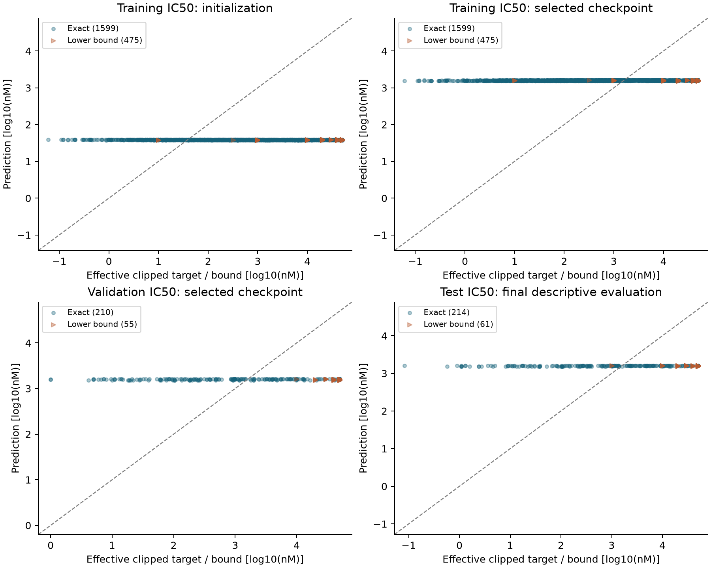
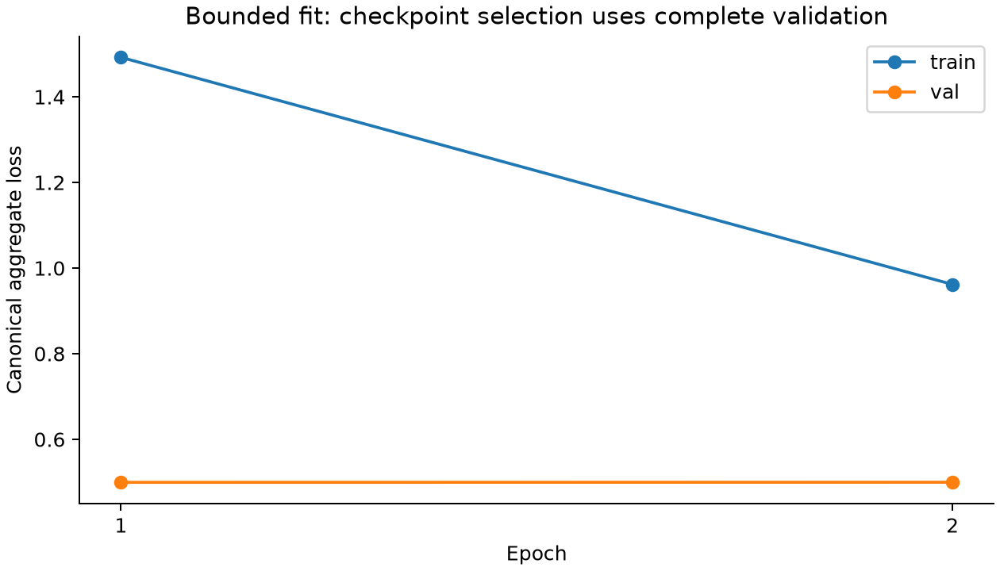

# Frozen IC50 fit: fitting check passes, quality screen fails

Agent/model: Codex / GPT-6. Completed one registered CPU-only condition on
2026-10-16. The 200-step finite fitting check passes, but the prespecified
validation screen fails. Ridge remains the preferred exact-IC50 baseline.
This is exploratory peptide-disjoint evidence, not biological independence or
all-output readiness. The selected predictions are nearly constant; #117 tracks
prospective diagnosis. No rule, budget, split or checkpoint selection was changed.

## Outcome and baselines

Exact training RMSE improves from **1.607139 to 1.337708 log10(nM)**, compared
with 1.215906 for the train mean and 1.089282 for ridge. All 200 optimizer steps
are finite, with no aborted batches or nonfinite tracked elements; the direct
IC50 output receives gradients in all 200 batches (3,645 repeated label exposures,
not distinct observations). Full validation aggregate selects **epoch 1**, reloaded
in a fresh model. Reconciled complete validation/test losses are
0.499515671 / 0.549559624. These aggregate losses are not IC50 quality metrics.

| Split | Predictor | Effective RMSE | Raw RMSE | Effective Spearman |
| --- | --- | ---: | ---: | ---: |
| val | Presto | 1.165477 | 1.173963 | 0.363285 |
| val | Train mean | 1.137633 | 1.149279 | undefined |
| val | Ridge | 1.037626 | 1.047534 | 0.415286 |
| test | Presto | 1.310036 | 1.320948 | 0.337271 |
| test | Train mean | 1.248686 | 1.263942 | undefined |
| test | Ridge | 1.138279 | 1.151585 | 0.393923 |

Validation has 210 exact IC50 values and 55 right-censored bounds; test has
214 exact and 61 right-censored. The paired peptide-bootstrap 95% validation
Presto-minus-baseline RMSE intervals are **[-0.075366, 0.124810]** versus the
mean and **[0.020137, 0.239649]** versus ridge (1,000 resamples; seed 4242;
100 exact-value validation peptides). Positive validation Spearman alone does
not pass the registered screen. Test intervals are [-0.052456, 0.152977] and
[0.054817, 0.276002], respectively, and are descriptive.

Selected validation/test predictions span only 3.183692–3.211115 /
3.183695–3.210799 log10(nM). At the physical <=500 nM cutoff, both splits have
zero predicted binders: recall 0, F1 0, balanced accuracy .5 and undefined
precision. Accuracy is .656604/.672727, AUROC .671782/.695195 and AP
.528632/.553159. Censored-bound satisfaction is 0/55 and 2/61. The full metric
matrix includes MAE, Pearson, censor-aware error and every baseline in both
spaces; undefined constant-predictor correlations are explicit in independent
metrics. See [#117](https://github.com/pirl-unc/presto/issues/117).

## Frozen inputs and optimization

The actual executed clean recipe is `1067714c768af2e4f3184154c85903bb3c46cf4b` (tag
`experiment-effective-target-fit-20261016`). Actual producers are released
**Presto 0.1.16 / Hitlist 1.78.0**; the repository's 0.1.17 version records this
experiment and is not its producer. Presto wheel SHA-256:
`0eecf96f12308580e5f59047c77364a2b5386cc5b1b133527dcb34e3ec8253a5`.
The native human-source/HLA manifest is
`b180eba804532f633a6d61bb350584dbe24f8df4b4b96f02c6ec492c60144372`.
All 9,053 original selected observations and 7,241/906/906 partitions are exact.
Direct IC50 has 2,074/265/275 observations; no endpoint is relabeled as KD.

The [11-asset prospective contract](https://github.com/pirl-unc/presto/releases/tag/effective-target-fit-contract-v1)
was published before launch. Its new manifest hash is
`a90c6d620554635079a5e8ec5927ec3050822d8fa7327279d54327924c7bd661`.
Only target-policy declarations and the producer-only frozen-policy receipt
changed from the stopped raw-target attempt. All source, assignment, membership,
parent, label and supervision fingerprints stayed fixed. The complete canonical
gate passed at 11:08:16 UTC before the initial checkpoint at 11:08:18 UTC.
Only direct IC50 was declared (50 observations, distinct peptides and exact
values per split); the other 220 outputs remain undeclared.

Targets use the existing float32 `log10(clip(nM, .001, 50000))` policy and
original censor direction. The gate reproduced 211 clipped observations,
including 54 exact values; raw measurements/units/operators are retained.
Baselines fit only the 1,599 exact training IC50 values in effective space:
constant mean and fixed ridge alpha=1 using length, 20 amino-acid fractions and
MHC class I/II, scaled on training only. Presto optimizes all active measured
families, censored objectives and auxiliaries; this differs from baseline scope.

Fresh expanded d32/l1/h4 model (409,850 parameters), two epochs × 100 shuffled
batches of 64, seed/data seed 42; AdamW lr .001, weight decay .01, 5% warmup then
cosine decay to .0001, uncertainty weighting. Complete validation and MIL bags;
no pretraining, generated negatives, live auxiliary sources, PCGrad, AMP or
compilation; all declared consistency/orthogonality/sparsity/contrastive priors
zero. Source caps use reservoir sampling and frozen relative-deficit-v2 whole
components, strict resolved MHC, mask_unresolved and no flanks.
`reproduce/launch.json`, `source/`, producer/dependency/source pins and
[the prospective plan](../agents/codex/plans/effective-target-fit.md) retain details.

The immutable original plan called the optimizer “Adam”; #114 records the
AdamW/warmup-cosine wording correction at 10:50:46 UTC, before model construction.
No executed code/configuration changed. Both the original plan and additive
protocol note are downloadable; archive timestamps independently verify timing.

Runtime: **4489.710 seconds**, runner peak RSS
**14,530,875,392 bytes** (children excluded). Requested and used CPU,
8 CPU / 64 GiB RAM / 512 GiB scratch, zero GPU and loader workers, one Torch/BLAS
thread. The 90-minute work / 95-minute function limits were unchanged. Start
2026-10-16T10:40:08.692109+00:00; finish 2026-10-16T11:55:05.148727+00:00. All acquisition and generated
artifacts use shared datacache generations.

## Evidence and limitations

[Download the complete qualification release](https://github.com/pirl-unc/presto/releases/tag/effective-target-fit-qualification-v1). Start with
[ic50-inspection.tsv](https://github.com/pirl-unc/presto/releases/download/effective-target-fit-qualification-v1/ic50-inspection.tsv): all 2,614 measured IC50 rows,
source IDs, peptide, original/resolved MHC, assay endpoint/unit/operator,
raw/effective targets, predictions, residuals/censor satisfaction, citations,
cell types/conditions and assay method. Native context, exact membership,
coverage, target policies, uncertainty, output-update reports and species audit
are separate downloads. The archive contains every held-out prediction, all
90 verified files, full loss ledgers, initial/selected checkpoints, logs and
source snapshots; inventory.json, publication.json and SHA256SUMS bind the bytes.
Independent analysis recomputes source joins, ridge coefficients, metrics,
bootstrap intervals, output-update criteria and all persisted held-out losses.
The reproducibility archive includes launch and analysis scripts.

- Zero peptide/observation/pMHC/known-origin overlap does not establish biological
  independence. Studies overlap; 8,966 rows lack reviewed experimental origin;
  all 9,053 donor/specimen/acquisition identities are unknown. Labels were
  inspected during qualification, so test performance is exploratory.
- Human-source/HLA selection is not human-host-only. The additive
  [source-species.tsv](https://github.com/pirl-unc/presto/releases/download/effective-target-fit-qualification-v1/source-species.tsv) preserves 30 native/context columns
  for every selected observation. Eight elution rows record rat hosts and human
  HLA (7 train, 1 validation, no IC50); native species context remains partial.
  8,956 selected rows have unknown reviewed species context. The historical
  consumer conflates host with MHC-species supervision; #115 tracks the repair.
  Shared-objective impact is unquantified; no native attribution is invented.
- #116 records numerical reporting defects: original mean-baseline Pearson has
  tiny finite rounding artifacts instead of undefined correlation; four exact
  training 500 nM labels cross the effective float32/log cutoff boundary. Raw
  physical metrics retain them. Independent metrics normalize constant Pearson
  to null and restore the declared float32 serialization type. Original run
  bytes remain unchanged; neither issue changes held-out quality decisions.
- Positive-only elution, sparse kinetics and missing measured processing/T-cell/
  TCR-response evidence do not validate other outputs. #48/#53 and Hitlist #678
  remain open. MHCflurry is outside this work.

Validation before publication: 90 archive members, all 9,053 source/partition
joins and all 2,614 IC50 targets independently verify; plots were inspected.
Nine experiment regressions pass against the actual released producer. Repository
lint/format and strict docs pass; the full local suite previously passed 2,281
with four skips, and final publication CI/release checks are recorded in the PR.

## Public verification and replay

All 30 public downloads independently verify. The current analysis replay also
reproduces all five derived artifacts byte-for-byte from the downloaded run;
`results/public-replay.json` records the hashes. #118 isolates datacache namespaces
by input location so public replay cannot collide with the original local
generation. This cache-only change does not alter metrics or published bytes.
The immutable public recipe bundle records publication commit f5f6b52; the
current repository verifier contains the additive replay correction.
