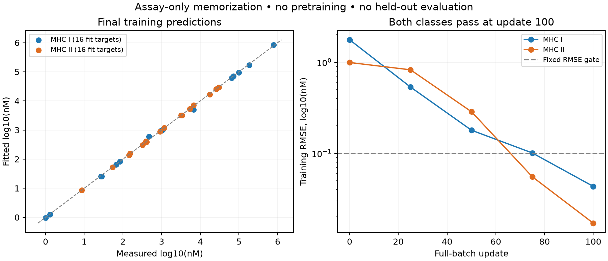

# Real IC50 memorization with supplied MHC metadata

Status: completed. The fixed training-only gate passed after 100 updates.
Agent/model: Codex / GPT-6. Plan:
[modular-assay-only-memorization.md](../agents/codex/plans/modular-assay-only-memorization.md).

One assay-only condition uses 16 class-I and 16 explicitly paired class-II
observations from pinned Hitlist v4. No auxiliary pretraining/replay, no synthetic
data, no held-out evaluation. All outcomes are raw exact log10(nM). This tests
optimization/capacity, not generalization, useful auxiliary transfer or the
completion of the holistic model. The full prospective contract and fixed
pass/fail/resource rules are in the linked plan; inputs/launcher/results will be
frozen in this directory and the shared cohort area before optimization.

No validation/test split is used intentionally: all 32 observations are fit
targets. Historical held-out peptides are excluded during preparation. Future
independent evaluation must account for these 32 newly exposed inputs.

Preparation scanned 814,268 raw rows and found 26,619 eligible candidates.
There were 841 contradictory exact-input groups and zero conflicting original
assay IDs among eligible candidates. Excluding those groups and collapsing
consistent repeated inputs left 24,146 possible diagnostic inputs. The fixed hash
selected 16 per class. All 32 source values replay exactly as unclipped log10(nM).
Target ranges are 0–5.89345 for class I and 0.93802–4.48144 for class II.

The selected inputs are in
[`data/modular_cohorts/2026-10-21-memorization-control`](../../data/modular_cohorts/2026-10-21-memorization-control).
The frozen manifest SHA-256 is
`74f6ff7e208a239bb5d83c295bcb950e07effd999f571d7a615ff1410a2f94ee`.
The curation/prelaunch receipts and selected catalog records are in `results/`.
Large source/candidate disposition files are under `artifacts/` and pinned by
`results/disposition-artifacts.json`. Original preparation code is preserved as
`reproduce/source/preparation-launch.py`; the later launcher only changes the
raw-artifact destinations before fitting, not selection or target policy.

Prelaunch gate arithmetic was checked with exact predictions and a deliberately
failed class-II spread condition; both behaved as intended. This is a software
check, not a measured model result. The application source `51b5f61` passes the
full regression (2,454 passed, four skipped), strict docs and pinned lint.

## Executed recipe and result

The model/launcher/data commit was `122b611124563b653fbddbbce30f921ea0f14fff`.
Tracked files were clean at launch; the redirected `launch_logs/fit.txt` was the
only untracked item in the launch receipt. Runtime used Python 3.12.6, Torch
2.14.1, NumPy 2.5.4, mhcseqs 2.6.13 and mhcgnomes 3.64.6. The shared environment
was unchanged. Exact argv, versions and single-thread environment overrides are
in `reproduce/launch.json`; the executed launcher is frozen under
`reproduce/source/launch.py`. `reproduce/launch.sh` reruns preparation and fitting
into caller-supplied fresh directories using the recorded local environment.

One condition: fresh shared width-128, two-layer, four-head sequence encoder,
direct IC50 readout and learned class-II register pooling. Human molecular species
and MHC class were supplied. There were no identity tasks, pretraining, replay,
generated labels, APC/MS/TCR branches or auxiliary losses. AdamW used constant
`lr=0.0003`, zero weight decay/dropout, seed 42 and full batches of 32. All
allocated parameters were trainable. Each exact observation contributed one
squared standardized log10(nM) residual with scalers fit on these training rows.

The declared limits were 2,000 updates or 20 minutes. Gate checks occurred every
25 steps. Overall RMSE passed at step 75, but class-I RMSE was 0.10084, so the
run correctly continued. Both classes and overall passed all fixed RMSE,
Spearman and spread criteria at step 100. Optimization/evaluation plus checkpoint
replay took 33.05 seconds; peak process RSS was 716,193,792 bytes. Local CPU,
one Torch/BLAS thread, no GPU/Modal requested or used.

| Training subset | N | RMSE log10(nM) | Spearman | Pearson | Prediction/target SD | <=500 nM accuracy |
| --- | ---: | ---: | ---: | ---: | ---: | ---: |
| Overall | 32 | 0.03294 | 0.99927 | 0.99976 | 0.99978 | 0.96875 |
| Class I | 16 | 0.04333 | 1.00000 | 0.99973 | 1.00000 | 0.93750 |
| Class II | 16 | 0.01711 | 0.99706 | 0.99987 | 0.99897 | 1.00000 |

Initial overall RMSE was 1.43145 with an SD ratio of 0.02760. A training-mean
comparator has RMSE 1.42546 and zero spread. These are same-target capacity
comparisons, not validation/test baselines. Full threshold accuracy, balanced
accuracy, precision, recall, F1, AUROC and AUPRC are in `results/summary.json`.
Overall standardized training loss is 0.00053406. Validation/test metrics are
intentionally absent; all 32 rows are fit targets.

All 32 allocated parameter tensors had real gradient-driven updates and no
exposed input feature lacked an update. Register pooling had such updates on all
100 steps (maximum weight-gradient norm 0.08092). A separate process loaded the
checkpoint and reproduced every saved prediction and metric exactly; the public
predictor also passed its support guards. This does not establish correct
biological register localization. Forward register diagnostics are retained.

Artifacts include initial, every gate-check and final per-example predictions,
history, coverage, fresh-process verification, register diagnostics, source
dispositions and input/census receipts. Raw initial/latest/final checkpoints are
under the directory named by `results/summary.json:raw_artifacts`, with the final
checkpoint hash recorded there. No fitted weights are needed to recompute the
reported metrics from the committed final prediction dump. The first posthoc
register-dump attempt failed on tensor JSON serialization after numerical replay
had passed; the corrected verifier converted tensors and succeeded without
retraining. Both logs are preserved.

## Decision and remaining work

The assay-only network can fit these real targets with nonconstant predictions,
including class-II sliding-core inputs. This removes a basic capacity/optimizer
failure for this new subset. It neither establishes the old model's collapse
cause nor proves benefit from annotation pretraining. The new cohort, raw target
policy and architecture differ from the historical failed fit, so those old
held-out errors are not comparable with this training score.

There is no qualified serving model or comparative winner for generalization.
Next: qualified full-cohort exact/censored fits with matched mean/ridge baselines,
independent held-out evaluation, and separate pretraining/replay comparisons.
The full APC, processing, MS-anchor/transfer, TCR, continuation and scientific
qualification requirements remain active.
