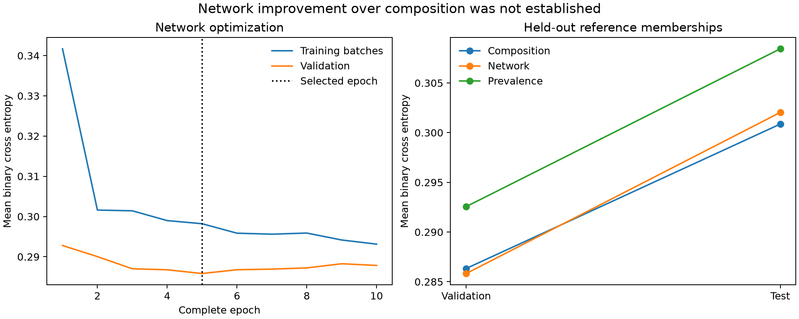

# Peptide-source reference pretraining

**Completed, 2026-10-21 UTC. Codex / GPT-6. The prespecified validation screen
failed:** the network beat prevalence but did not establish improvement over
amino-acid composition. Composition had lower held-out test cross entropy.
This is a bounded auxiliary reference-membership diagnostic. No affinity,
MHC/TCR annotation, processing, MS or biological species-origin output is qualified.

## Data and admission

The [prospective plan](../agents/codex/plans/weirdo-reference-pretraining.md)
was registered before preparation. It fixes three source hashes, label-blind
5,000/1,000/1,000 train/validation/test eight-mers (Python seeds 42/43/44), all ten
reference divisions and a complete selected-row reference audit. Each category
is an independent present/absent membership in the pinned reference. Overlapping
memberships are retained; absence is not biological absence from all organisms.
No synthetic sequences/labels or measured assay values are included.

| Pinned source | SHA256 |
| --- | --- |
| `weirdo/data/swissprot-sequences.csv` | `e9c44a34fcd3f8fb1f4151d489985dd5578a947eda3e62213d5109ace36e115d` |
| `weirdo/data/category-splits/splits.npz` | `99b21eb93196cf2b0a0b1ae4bbb63066224a6864e48dd3a8d47fe67bd34fcf79` |
| `weirdo/data/category-splits/splits.json` | `571356e92fd1da71cf173be9f5e59c6aa128467f347de37aa30815d78923fc1f` |

All 7,000 labels and source folds independently agree with exact occurrences
across all 569,516 reference proteins. No selected peptide occurs across folds.
Source folds use CRC32 of `category-predictor-v1:<UniProt mnemonic prefix>` with
70/15/15 boundaries. Connected components joining all shared source families
number 3,486 train / 705 validation / 723 test; these are not verified homology
clusters. All validation categories have at least 32 positives and 574 negatives,
so the fixed minimum-support check is met without reselection.

Successful preparation on frozen source `de3cdfc` took 8.9635 seconds, peak RSS
561,709,056 bytes. [Preparation report](attempts/reference-groups/results/preparation.json)
contains label counts, all pins and the full occurrence-audit path/hash. Selected
records and per-example audit summaries are in that attempt's `results/` gzip
files; actual argv/environment and frozen source are under its `reproduce/`.

The [manifest](../../data/modular_cohorts/2026-10-21-weirdo-reference/manifest.json)
SHA256 is `ca008ea769c6dc5332cb14f4ef1d7bd125c79064223692596608588b8e4cff8f`.
Normalized observations remain beside it as a generated 18.96 MB JSONL file,
SHA256 `8cbd609b018cb7b8c7816de7289be368c6ac775ee92fe92932590018ad67c38e`.
The frozen preparation rebuilds it from the pinned inputs.

The initial preparation (`42689fd`) failed in 0.1085 seconds because the actual
archive lacks `*_groups` arrays assumed by the adapter. Its failure, NPZ headers,
source and launch log are retained at the family root. Before fitting, an explicit
amendment preserved the hashes, rows, seeds, labels and recipe and required
reference-derived grouping in a separate attempt. All 7,000 absent buckets remain
unknown as supplied evidence and are recorded separately from reconstructed
values; zero supplied-bucket comparisons are claimed. No rows were relabeled or
reselected. The old table-verification score compares another k-mer table and
is distinct from this complete selected-row audit.

## Conditions and execution

Frozen fit source: `1d3c96b` (full hash and actual dirty status in
[launch receipt](reproduce/launch.json)). Tracked sources were clean; the generated
cohort and redirected comparison log were untracked. No source changed during
fitting. Actual invocation was:

```sh
PYTHONPATH=/private/tmp/presto-modular-imports OMP_NUM_THREADS=1 \
OPENBLAS_NUM_THREADS=1 MKL_NUM_THREADS=1 \
/Users/iskander/code/shared-virtual-env/bin/python \
experiments/2026-10-21_0512_codex_weirdo-reference-pretraining/code/launch.py
```

Use [reproduce/launch.sh](reproduce/launch.sh) from that frozen source with fresh
experiment/cohort output paths to rerun preparation and fitting. Import shim
`/private/tmp/presto-modular-imports/presto` points to the isolated checkout.
The receipt records Python/package versions, exact argv, environment and pins;
`reproduce/fit-source/` preserves the executed launcher and model/trainer sources.
The run used local CPU, one Torch/BLAS thread, no requested or observed GPU/Modal.

- **Prevalence:** independent `(positive_count + 0.5)/(n + 1)` training priors;
  threshold 0.5 gives the majority-decision comparator.
- **Composition:** ten independent L2 logistic regressions on 20 residue
  frequencies, fixed `C=1`, `lbfgs`, max 1,000 iterations, no tuning/class weighting.
  All converged (7–23 iterations). Training coefficients/intercepts are preserved.
- **Network:** shared 128-wide, two-layer/four-head sequence encoder and ten
  independent membership logits. No MHC/TCR/assay head, pretrained weights or
  auxiliary replay. Mean binary CE over all ten labels; each peptide contributes
  equally. AdamW 0.0003, weight decay 0.0001, dropout 0.1, seed 42, batch 64;
  at most 20 complete epochs, patience five after at least five epochs. The
  configurable `identity_weight=0.1` is inactive in this auxiliary-only run.
  The canonical `fit_index` trainer was called in a bounded child process.

Validation mean CE selected epoch **5 / 395 updates**; training ended after
10 complete epochs / 790 updates. Unique training data comprise 5,000 peptides
and 50,000 category labels; total exposures were 50,000 peptides / 500,000 labels.
The selected checkpoint has 250,000 label exposures. The network child took
64.30 seconds (trainer-reported fit/finalization 58.82 s), baseline fitting 0.067 s,
and the whole comparison/replay/report 69.93 s. Peak child/parent RSS was
908,427,264 / 468,910,080 bytes. The fixed 900-second child ceiling was not reached.

## Results

Mean binary cross entropy, lower is better. Every split has complete labels for
all categories, so observation-mean and macro category-mean CE coincide.

| Condition | Train CE | Validation CE | Test CE |
| --- | ---: | ---: | ---: |
| Training prevalence | 0.303358 | 0.292560 | 0.308435 |
| Composition logistic | 0.294973 | 0.286331 | **0.300864** |
| Modular peptide-source | 0.295201 | **0.285826** | 0.302032 |

Paired network-minus-baseline validation CE, with 2,000 whole-component bootstrap
resamples over the 705 connected source groups, seed 20261021:

| Comparator | Mean difference | 95% interval | Upper bound below zero? |
| --- | ---: | --- | --- |
| Prevalence | -0.006734 | [-0.009581, -0.003564] | Yes |
| Composition | -0.000506 | [-0.001971, 0.001117] | No |

The joint prespecified screen therefore **failed**; no neural winner is accepted.
Test was evaluated once after checkpoint selection, and did not change the recipe.
The model has nonconstant outputs: per-category test probability SD ranges from
0.0092 to 0.1108, AUROC 0.5501–0.6510. That variation is not evidence of strong
classification or affinity transfer. Exact IC50 regression and 500 nM binding
metrics are inapplicable because this family contains no affinity targets.



All 29 allocated parameter tensors and all exposed features passed the required
training-coverage gate. A fresh process reproduced all 640 labels for the first
64 training peptides exactly; it did not rescore test. Selected checkpoint SHA256:
`9ef86689e34959c606fa7a5365cf48096d26eeb2c938af95bf8c03bd09e85e99`.

## Evidence and interpretation

- [Full metrics, screen and hashed raw artifacts](results/comparison.json).
- [Overall CSV](results/overall-metrics.csv), [per-category CSV](results/category-metrics.csv),
  all nine condition/split prediction gzip files under `results/` (including every
  validation/test example), calibration bins/Brier/ECE and probability spread.
- Network history, coverage, admission, resolved configuration and summary copied
  into `results/network-*.json`; baseline coefficients in `results/baseline-parameters.json`.
- [Fresh-process checkpoint verification](results/checkpoint-replay.json).
- `launch_logs/network.log`, `launch_logs/comparison.log`, and frozen reproduction.
- Raw checkpoints/evaluation caches remain in
  `/private/tmp/presto-modular-model/artifacts/2026-10-21_0512_codex_weirdo-reference-pretraining/fit/`;
  every file is hashed in the comparison receipt. No checkpoint is promoted.

Eight focused metric/reference checks passed before fitting. Independent sklearn
recomputation agrees with AP/AUROC/CE in all 90 condition/split/category cases.
`analysis/report.py` renders saved outputs only; no predictions or selection are
rerun. The broad software regression is recorded separately in the project task log.

This result supports a verified auxiliary data path and an executable supervised
pretraining subset. It does not establish a useful improvement over composition,
exact species-of-origin inference, length/taxon generalization, or transferable
binding features. The earlier 32-row assay-only memorization result remains a
separate capacity diagnostic. Full-cohort affinity baselines, controlled auxiliary
transfer/replay, MHC/TCR annotations, APC contrasts, MS anchors/transfer, qualified
paired-TCR data and qualified serving remain unfinished requirements of #130.
