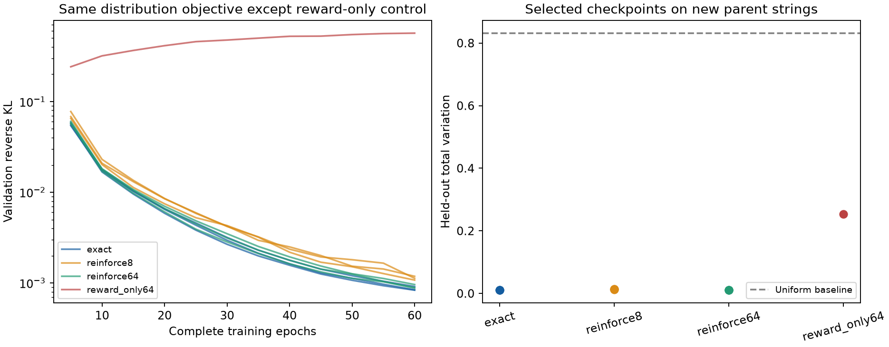

# Exact versus discrete learning of synthetic span distributions

Completed October 21, 2026. Agent: Codex / GPT-6.

**Both learning methods work on this controlled synthetic task.** Exact
differentiable training gives the lowest mean held-out distribution error;
REINFORCE with 64 samples is close, and eight samples also pass the prospective
recovery screen. Reward-only optimization concentrates the distribution too
much and fails that screen. This is an algorithm prototype on integer strings,
not a biological processing model or a real-assay result.

The [prospective specification](../agents/codex/plans/discrete-distribution-comparison.md)
and executable sources were committed before fitting. All ten fits completed;
no recipe changes, additional seeds or test-driven extensions were made.

## Results

Total variation (TV) is half the sum of absolute probability differences across
all 70 candidate spans, averaged across examples; zero is perfect. Values below
are means over seeds 42/43/44, except uniform and the single-seed reward-only
diagnostic. Reverse KL is KL(prediction || target).

| Condition | Train reverse KL | Validation reverse KL | Validation TV | Test reverse KL | Test TV | Test noncompatible-mass MAE |
| --- | ---: | ---: | ---: | ---: | ---: | ---: |
| Uniform | 5.443876 | 5.431799 | 0.836928 | 5.514706 | 0.831593 | 0.252382 |
| Exact differentiable | 0.000814 | 0.000863 | 0.009968 | 0.001915 | **0.010716** | 0.002794 |
| REINFORCE, 8 samples | 0.001109 | 0.001129 | 0.012481 | 0.002274 | 0.013602 | 0.003634 |
| REINFORCE, 64 samples | 0.000873 | 0.000910 | 0.010509 | 0.001941 | 0.011359 | 0.003061 |
| Reward only, 64 samples, seed 42 | 0.251173 | 0.241687 | 0.236445 | 0.268665 | 0.253689 | 0.089269 |

All three seeds of each matched method pass the prespecified validation screen:
reverse KL at most 25% of uniform, TV at most 0.10 and noncompatible-mass MAE at
most 0.05. Test data do not determine that decision. The reward-only diagnostic
fails the latter two criteria. Its different objective is intentional.

| Condition | Test TV, seed 42 | Seed 43 | Seed 44 | Test probability RMSE | Test Pearson | Test Spearman | Test selected-distribution TV |
| --- | ---: | ---: | ---: | ---: | ---: | ---: | ---: |
| Exact | 0.011005 | 0.010718 | 0.010425 | 0.001920 | 0.999626 | 0.996217 | 0.011675 |
| REINFORCE 8 | 0.013101 | 0.013900 | 0.013804 | 0.002140 | 0.999531 | 0.995669 | 0.014982 |
| REINFORCE 64 | 0.011493 | 0.011579 | 0.011004 | 0.001941 | 0.999617 | 0.996052 | 0.012418 |
| Reward only | 0.253689 | — | — | 0.034111 | 0.915622 | 0.912259 | 0.246907 |

The complete [metric table](results/metrics.csv) and
[summary JSON](results/summary.json) retain all conditions and splits; the JSON
also retains context groups, forward KL, cross-entropy, Jensen–Shannon divergence,
entropy and probability spread. Correlations compare probabilities over the
same finite support, not affinities. Uniform correlations are undefined.
IC50, log10(nM), censoring and 500 nM binding metrics do not apply here.

The target assigns 73.125% of average test mass to the arbitrary noncompatible
category. Exact, REINFORCE 8 and REINFORCE 64 retain 73.111%, 73.080% and 73.105%.
This checks preservation of products outside a selected subset; the arithmetic
category is not a binding label. Mean test entropy is 1.664 nats for the target,
1.669/1.666/1.669 for the matched methods and 1.135 for reward-only.

All matched conditions select epoch 60. Reward-only selects epoch 5; its
validation TV subsequently worsens to 0.415 by epoch 60. Only the selected
checkpoint receives the test evaluation; there is no final-epoch test result.

## Exact data and model contract

- **Data:** 144 unique length-16 strings over integer symbols 0–7, split by parent
  into 96/24/24 train/validation/test. Four generic contexts per parent,
  (−1,−1), (−1,+1), (+1,−1), (+1,+1), give 384/96/96 rows. All contexts of a
  parent stay together. NumPy data seed 20261021; short substrings intentionally
  overlap across otherwise disjoint parents. No amino-acid sequences or real
  biological datasets are used.
- **Support:** every contiguous span of length 1–5: 70 per parent. The first
  action chooses a start; the second chooses a valid length conditional on that
  start. Invalid spans are masked. Decoding returns actual substrings and
  coordinates. Sampling retains repeated draws as a multiset; deduplication
  would change empirical frequencies.
- **Features:** first/last symbol one-hot (8+8), eight symbol fractions,
  length/5, its square and start/15: 27 values. Concatenate these, their products
  with each context coordinate, and both context coordinates: 83 values.
  Start features are the valid-length mean at that start.
- **Teacher:** independent fixed 83-element normal coefficient vectors,
  SD 1.25, seed 20261022, for start and conditional-length logits. Normalize
  starts and then valid lengths. Every span has positive target probability.
  [Coefficients](results/teacher.json) and complete input/target records in the
  raw bundle supply a known probability oracle.
- **Student:** two separate 83→32→1 Tanh MLPs, for starts and conditional lengths,
  with masked softmaxes. Final scalar biases are disabled because they cancel
  within each softmax. All six trainable parameter tensors receive nonzero
  gradients and change in every fit. Methods have matched architecture, initial
  weights and minibatch order per seed. Coverage alone is not evidence of
  recovery; the held-out distribution metrics provide that evidence.
- **Evaluation-only selection:** compatibility means length ≥3 and
  (first + last) mod 3 ≠ 0. Fixed response is 0.2 + 0.8×(last + 1)/8.
  The secondary distribution is proportional to product probability ×
  compatibility × response. These factors are not learned and do not enter
  fitting, reward or support. No learned pMHC/MS supervision or biological
  assay-label-to-output mapping is present.

## Training objective and estimators

The matched objective, weight one with no other loss, is the finite sum of
q(s)×[log q(s) − log p_target(s)]. Exact training differentiates this sum.
REINFORCE draws 8 or 64 actual start/length action pairs per row and uses the
score-function surrogate: the mean of detached (cost − baseline) times
log q(sample). Cost is log q(sample) − log p_target(sample); the baseline is the
mean cost of the other draws in the same row, independent of the current action.
The expected extra derivative of log q is zero. An enumeration test checks
the estimator's exact expectation on a small categorical problem.

Reward-only removes log q from the cost, intentionally removing entropy from the
objective. It is a diagnostic for concentration, not another implementation of
the same loss. These are two-step discrete actions; there is no PPO, critic,
continuous relaxation, GFlowNet or mechanistic processing trajectory.

Adam uses learning rate 0.003, zero weight decay, batch 16, 60 complete epochs and
1,440 updates. No pretraining, checkpoint initialization, dropout, early stopping
or synthetic assay labels. Model seeds are 42/43/44; minibatch RNG is 10000 + seed,
sampling RNG 20000 + seed. Full validation every five epochs selects minimum
exact reverse KL; test follows selection once. Float32, deterministic algorithms
and one CPU thread are used.

## Gradient variance, work and runtime

The prespecified probe uses the first four training rows and seed-42
initialization, with 128 independent estimates per budget. Exact gradient norm
is 1.2021. [Complete probe](results/gradient-probe.json):

| Samples | Mean-estimate relative error | Mean single-estimate relative error | Mean single-estimate cosine | Sum of parameter variances |
| --- | ---: | ---: | ---: | ---: |
| 8 | 0.08416 | 1.09213 | 0.66255 | 1.76852 |
| 64 | 0.04071 | 0.37596 | 0.93774 | 0.20771 |

The 64-sample estimator has about 8.5 times less summed gradient variance in
this particular probe, not a universal variance or convergence advantage.

| Condition | Logical fitting target terms per run | Mean fit seconds, including validation |
| --- | ---: | ---: |
| Exact | 1,612,800 | 1.515 |
| REINFORCE 8 | 184,320 | 1.122 |
| REINFORCE 64 | 1,474,560 | 3.937 |
| Reward only 64 | 1,474,560 | 3.412 |

Both methods compute dense policy logits and share a precomputed teacher
dataset. These are logical fitting lookups, not external oracle calls; evaluation
and probe work is outside the counts. Eight samples consume 8.75 times fewer
target terms without establishing a corresponding total compute saving.
Timings are one sequential local execution, not a repeated or isolated hardware
benchmark.

Whole-family runtime is 26.784 seconds; peak process RSS is 388,694,016 bytes.
Platform: macOS 26.5 arm64, Python 3.12.6, Torch 2.14.1, NumPy 2.5.4.
OMP_NUM_THREADS, OPENBLAS_NUM_THREADS and MKL_NUM_THREADS are 1; PYTHONHASHSEED
is 0. Torch reports one thread. No GPU or Modal was requested or used.

## Verification and reproducibility

Executed commit: adab28ad8ac389a5f3a395b0b8dfd6e89253221c.
Executable experiment source was committed and frozen. Dirty state consisted of
tasks/todo.md and two untracked pending planning documents; the exact status is
in [execution.json](results/execution.json) and the tracked diff is in the archive.
Launcher SHA256:
e66c3a5cffc0d512989094ad653ba7ea4f3ff56778d3b298fecb8e809eee5945.

- Six focused tests pass: finite-difference gradients, exact expectation of the
  leave-one-out estimator, masks/multiset decoding, splits, metric behavior and
  invalid sample-count rejection.
- [Independent verification](results/independent-verification.json) imports no
  trainer. It reconstructs all 576 teacher rows with NumPy/SciPy, verifies all 99
  original artifact hashes, recomputes 30 condition/split metric sets and 120
  context groups, checks matched initialization and selected epochs, and decodes
  all 61,440 saved discrete draws with their log probabilities.
- [Fresh-process replay](results/fresh-process-replay.json) loads all ten selected
  checkpoints and exactly matches saved predictions on four training rows.
  It does not rescore test or establish bitwise training resumption.
- The [compressed raw bundle](results/raw-run.tar.gz) preserves complete
  per-example train/validation/test predictions, inputs/targets, selected
  checkpoints, last states, validation histories, sampled multisets and runtime
  receipts. [Package verification](results/package-verification.json) checks
  every archive member against the original bytes. No raw run was overwritten.
- Sources/invocations are under [reproduce/](reproduce/).
  [Execution logs](launch_logs/) are retained. Explicit Ruff checks include
  experiment scripts despite the repository's usual experiment exclusions.

From the repository root, the original command is:

    bash experiments/2026-10-21_1700_codex_discrete-distribution-comparison/reproduce/launch.sh

The launcher defaults to the recorded interpreter path. Set
PRESTO_EXPERIMENT_PYTHON to an equivalent environment and PRESTO_SYNTHETIC_OUTPUT
to a new directory for another run; it refuses to overwrite an existing output
directory. A fresh run records its own source/environment and is not the archived
original execution.

To inspect evidence without fitting, set experiment_dir to this family directory:

    tar -xzf "$experiment_dir/results/raw-run.tar.gz" -C "$experiment_dir/results"
    python "$experiment_dir/analysis/verify.py"
    OMP_NUM_THREADS=1 OPENBLAS_NUM_THREADS=1 MKL_NUM_THREADS=1 \
      python "$experiment_dir/reproduce/source/launch.py" replay \
      --output "$experiment_dir/results/run"

The analyzer requires NumPy, SciPy and Matplotlib; replay also requires Torch.
Analysis versions are in its receipt. Execute analysis/verify.py; its identical
copy under reproduce/source/ is a provenance snapshot whose relative paths
assume the original analysis location. Analysis regenerates derived tables/plots
only. [Post-run invocation record](reproduce/verification.json) preserves the
commands and environment used for the original audit and replay.

## Decision and limits

Keep exact differentiable enumeration as the reference on manageable finite
support. The discrete policy-gradient implementation is a working comparator:
it samples discrete substrings, preserves multiplicity and learns the same
distributional objective. Retain entropy/distribution matching rather than
optimizing only a scalar preference for likely products.

This deliberately favorable known-oracle task has matched teacher/student
features, small finite support, fully positive targets and overlapping short
substrings across parent splits. It does not test sparse observations, unknown
support, long sequences, unseen contexts or latent-path identifiability.
Selection/response factors are known, not fitted. No species, APC machinery,
gene loss, MHC restriction, affinity, stability, MS detectability or TCR module
is trained. Application model/trainer code is unchanged; implementation is
experiment-local.

Relative to the [processing design](../../docs/processing_model_design.md), this
closes the basic finite-distribution algorithm comparison only. It does not
resolve Presto's nearly constant real IC50 predictions or qualify the proposed
biological system. No synthetic checkpoint is promoted into Presto.
