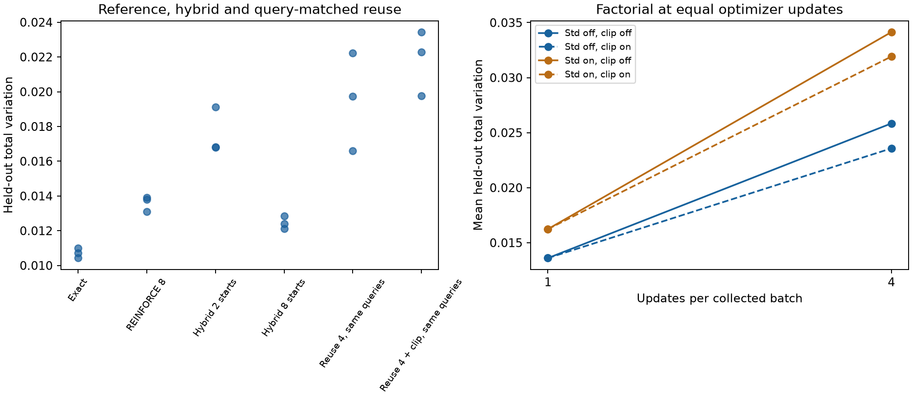

# GRPO ingredients, reuse and partial enumeration

Completed October 22, 2026; Codex / GPT-6. All 69 prespecified fits completed
without failures. All pass the bounded recovery screen, but the simplest
references remain strongest on the original target. This is a generic
integer-symbol algorithm experiment, not a biological availability or
concentration model.

The [prospective contract](../agents/codex/plans/grpo-ingredient-factorial.md)
was committed with frozen source before fitting. This family tests all four
requested optimizer ingredients and a hybrid. The subsequent partial-observation,
whole-multiset and biological-data stages in the
[active program](../agents/codex/plans/availability-learning-program.md) remain open.

## Outcomes and decisions

- **Exact enumeration remains preferred on this small support.** Mean test TV
  0.010716 versus 0.013602 for original REINFORCE-8. Both reproduce their earlier
  saved predictions exactly across all three seeds and all three splits.
- **Group standardization did not improve recovery.** With fresh samples and no
  reference penalty it changes test TV from 0.013602 to 0.016237; with four updates
  per batch, unclipped TV changes from 0.025839 to 0.034137. This is a matched
  factorial result on this task, not a universal statement about GRPO.
- **Clipping is inactive on fresh first updates.** All 12 paired seed/std/beta
  comparisons at reuse=1 have identical predictions. With reuse=4, beta=0 and
  standardization off, clipping modestly changes TV from 0.025839 to 0.023572.
  Its activity is small: approximately 0.645% of sampled terms on the fourth
  update in that condition. It is a safeguard to evaluate, not an automatic gain.
- **Reuse trades accuracy for target evaluations.** At 1,440 optimizer updates,
  fourfold reuse uses 46,080 target terms rather than 184,320 and learns less
  accurately. At the same 184,320 target terms, reuse needs 5,760 optimizer
  updates and yields TV 0.019524 without clipping or 0.021820 with clipping,
  still worse than fresh REINFORCE-8 at 0.013602. It costs approximately four
  times the fit runtime in this local implementation. Scoring the oracle is cheap
  here; no expensive external-oracle runtime advantage has been tested.
- **Reference KL changes the answer.** At beta=0.1, exact fitting gets TV 0.011521
  to its regularized optimum but 0.041213 to the original target. The penalty
  cannot be described as an accuracy improvement on the unregularized target.
- **Hybrid helps at a larger scoring budget, not at roughly matched cost.**
  Sampling eight starts and enumerating lengths gives TV 0.012454 using about
  698,104 target terms. Two starts give TV 0.017576 using 174,864 terms, versus
  REINFORCE-8's 184,320 terms and lower error. The short conditional enumeration
  does not automatically pay for the loss of independent start draws.

These are means of three seeds, not significance claims. The screen checks all
three seeds for validation TV to the declared optimum <=0.10 and noncompatible
mass MAE <=0.05; all 69 seeds pass. This loose basic-recovery screen does not make
all methods equally good. Test never chooses a recipe or an extra condition.

## Complete comparison

Each row averages seeds 42/43/44. `c` means ratio clipping, `s` group-standard-
deviation normalization, `r` updates per collected batch and `b` reference-KL
coefficient. Main rows have 1,440 updates; query-matched rows have 5,760.
TV is mean total variation over complete 70-candidate distributions (zero is
perfect). For beta zero, the objective optimum is the original target.

| Condition | Val TV to optimum | Test TV to original | Test TV to optimum | Target terms | Fit seconds |
| --- | ---: | ---: | ---: | ---: | ---: |
| factorial-c0-s0-r1-b0 | 0.012481 | 0.013602 | 0.013602 | 184,320 | 1.289 |
| factorial-c0-s0-r1-b0.1 | 0.013109 | 0.040631 | 0.014254 | 184,320 | 1.284 |
| factorial-c0-s0-r4-b0 | 0.023842 | 0.025839 | 0.025839 | 46,080 | 1.123 |
| factorial-c0-s0-r4-b0.1 | 0.023702 | 0.045973 | 0.024887 | 46,080 | 1.116 |
| factorial-c0-s1-r1-b0 | 0.014671 | 0.016237 | 0.016237 | 184,320 | 1.291 |
| factorial-c0-s1-r1-b0.1 | 0.016437 | 0.043769 | 0.016429 | 184,320 | 1.298 |
| factorial-c0-s1-r4-b0 | 0.029204 | 0.034137 | 0.034137 | 46,080 | 1.132 |
| factorial-c0-s1-r4-b0.1 | 0.032619 | 0.049927 | 0.033001 | 46,080 | 1.129 |
| factorial-c1-s0-r1-b0 | 0.012481 | 0.013602 | 0.013602 | 184,320 | 1.344 |
| factorial-c1-s0-r1-b0.1 | 0.013109 | 0.040631 | 0.014254 | 184,320 | 1.338 |
| factorial-c1-s0-r4-b0 | 0.021277 | 0.023572 | 0.023572 | 46,080 | 1.174 |
| factorial-c1-s0-r4-b0.1 | 0.023066 | 0.045247 | 0.023850 | 46,080 | 1.186 |
| factorial-c1-s1-r1-b0 | 0.014671 | 0.016237 | 0.016237 | 184,320 | 1.324 |
| factorial-c1-s1-r1-b0.1 | 0.016437 | 0.043769 | 0.016429 | 184,320 | 1.343 |
| factorial-c1-s1-r4-b0 | 0.029980 | 0.031918 | 0.031918 | 46,080 | 1.193 |
| factorial-c1-s1-r4-b0.1 | 0.031141 | 0.049685 | 0.030860 | 46,080 | 1.159 |
| exact-b0 | 0.009968 | 0.010716 | 0.010716 | 1,612,800 | 1.025 |
| exact-b0.1 | 0.010880 | 0.041213 | 0.011521 | 1,612,800 | 1.009 |
| original-reinforce8 | 0.012481 | 0.013602 | 0.013602 | 184,320 | 1.064 |
| hybrid-starts2 | 0.015567 | 0.017576 | 0.017576 | 174,864 | 1.034 |
| hybrid-starts8 | 0.011287 | 0.012454 | 0.012454 | 698,104 | 1.044 |
| query-matched-c0-r4 | 0.018304 | 0.019524 | 0.019524 | 184,320 | 4.222 |
| query-matched-c1-r4 | 0.019333 | 0.021820 | 0.021820 | 184,320 | 4.344 |

The [full metric table](results/metrics.csv) and [raw summary](results/summary.json)
preserve every seed and split, original/regularized losses, forward/reverse KL,
RMSE/Pearson/Spearman on probabilities, entropy, noncompatible-mass error and
selected-distribution TV. The summary also contains all context strata, exact
selection steps, gradient/update coverage and reuse diagnostics. The uniform
baseline test TV remains 0.831593. No IC50, nM, censoring or 500 nM binding metrics
apply: there are no assay targets in this family.

## Frozen data and model

This reuses the exact earlier teacher, dataset and features: 144 unique length-16
strings over integers 0–7, 70 spans of lengths 1–5, four generic contexts per
parent. Parent-disjoint 96/24/24 splits yield 384/96/96 rows; short substrings
intentionally overlap. Data seed 20261021, teacher seed 20261022. The oracle is a
fixed linear start/conditional-length model with positive probability on every
valid span. Full targets are known; no partial observations are used yet.

Span features are first/last symbol one-hot, symbol composition, normalized
length/squared length/start; their interactions with two context coordinates
produce 83 inputs. Two separate 83→32→1 Tanh MLPs predict start and conditional
length. Final scalar biases are disabled. Six parameter tensors receive nonzero
gradients and change in every fit. Matched conditions use identical initial
weights; the initial policy for each seed is a frozen reference.

The arbitrary compatibility tag and fixed response from the prior family are
retained only for evaluation. They are not binding labels or learned MS factors.
Repeated draws are retained. Candidate support and full target probabilities
are unchanged across conditions.

## Objectives and implementation

The declared objective is KL(q || target) + beta × KL(q || reference), beta zero
or 0.1. Its unrestricted optimum is proportional to
`target**(1/(1+beta)) * reference**(beta/(1+beta))`. Evaluate against both targets.

The full factorial crosses clipping off/on (ratio bounds 0.8–1.2), group
standardization off/on (population SD + 1e-6), reuse 1/4 and beta 0/0.1.
All sampled factorial conditions draw eight actual starts and conditional
lengths. The original frozen REINFORCE-8 implementation is a separate control.

For reuse, sampling probabilities and sampled target/reference values are
cached. Every update recomputes current density costs and a leave-one-out
baseline, detaches centered costs, and applies importance ratios. The clipped
cost surrogate takes the maximum of the ordinary and clipped terms. This is a
**GRPO-style ingredient comparison with recomputed density costs**, not canonical
fixed-reward/frozen-advantage GRPO or token-wise language-model clipping.
Unclipped/unstandardized importance gradients match the declared objective for
a fixed evaluation policy. Adaptive fitting to reused finite samples can still
bias learning; clipping and empirical standardization can change gradients.

The hybrid samples 2 or 8 starts and exactly sums over valid conditional lengths.
Detached conditional probabilities weight the score-function terms; the baseline
uses other starts' conditional expected costs. Invalid entries are masked before
multiplication. Unit tests enumerate the estimator's expectation exactly.

Adam learning rate .003, zero weight decay, batch 16, float32, no pretraining,
dropout or early stop. Model seeds 42/43/44; minibatch seeds 10000+seed, action
seeds 20000+seed. Main budget 1,440 updates: reuse 1 collects 1,440 batches/60
source passes, reuse 4 collects 360 batches/15 passes. Query-matched controls
collect 1,440 batches with four updates each. Full validation every 120 steps
selects minimum declared objective; test is evaluated once after selection.

Both methods still compute dense policy logits. Logical target terms are
separate from dense model work, validation, and the precomputed oracle/reference
cost. No statement about long-sequence or proteome-wide scalability follows.

## Gradient evidence and limitations

The [fixed probe](results/gradient-probe.json) uses four training rows, seed-42
initialization, 128 draws per estimator, and an independently specified parameter
perturbation for off-policy evaluation. It precedes all fits.

| Beta-zero, on-policy estimator | Mean-estimate relative error | Mean-estimate cosine | Sum of parameter variances | Target terms across probe |
| --- | ---: | ---: | ---: | ---: |
| REINFORCE-8 | 0.079714 | 0.996864 | 1.826842 | 4,096 |
| Group-standardized | 0.748277 | 0.988222 | 0.125551 | 4,096 |
| Hybrid 2 starts | 0.155966 | 0.991650 | 6.936423 | 4,409 |
| Hybrid 8 starts | 0.062945 | 0.998044 | 0.970183 | 17,672 |

The standardized estimator's lower raw variance partly reflects rescaling;
it is not evidence of a more accurate gradient. Finite probe averages do not
establish asymptotic bias magnitudes. The predetermined perturbation kept all
sampled importance ratios within the clipping interval, so that off-policy probe
does not exercise active clipping. Training diagnostics and a separate analytic
branch test do exercise active clipping; this limitation is retained rather than
choosing a stronger perturbation after inspecting results.

## Execution, verification and reproduction

Executed source commit: `4a31eaa097e5494d490a2a5101bc612ec84348ce`.
Launcher SHA256: `893ca18d317ea726daaeb34c8ff45c222ab4d70de0ab95bed49ad6a7cb81b5da`.
Frozen base SHA256: `e66c3a5cffc0d512989094ad653ba7ea4f3ff56778d3b298fecb8e809eee5945`.
Source and plan were frozen before fitting. Dirty state was limited to task and
pending planning documents; the complete status/diff is retained in the raw run.

Local CPU, one Torch/BLAS thread; no requested/observed GPU or Modal. Actual
macOS 26.5 arm64, Python 3.12.6, Torch 2.14.1, NumPy 2.5.4. OMP, OPENBLAS and MKL
thread counts 1; PYTHONHASHSEED 0; deterministic Torch algorithms enabled.
Whole-family elapsed 108.284 seconds; peak RSS 392,314,880 bytes. Fit times include
validation in one sequential execution; not an isolated repeated runtime study.

- Six prior tests plus ten new checks passed before fitting (16 total). A
  post-run active-clipping branch test also passed; no fitting source changed.
- [Independent audit](results/independent-verification.json) imports no trainer:
  all 576 teacher rows reconstructed; raw hashes/source/plan verified; 1,035
  split/context metric sets recomputed; all 69 counts, selections and parameter
  coverage records checked; fresh-policy clipping pairs matched.
- [Checkpoint replay](results/fresh-process-replay.json): all 69 selected models
  exactly reproduce four saved training-row predictions in a fresh process.
- [Reference replay](results/reference-replay.json): all nine initial-policy
  split arrays exactly reconstructed; all 18 saved-array comparisons with the
  prior exact/REINFORCE fits match bit for bit. No checkpoint reselection occurs.
- [Verified raw bundle](results/raw-run.tar.gz) retains the dataset, per-example
  predictions, references, checkpoints/last optimizer states, histories and
  receipts. [Archive audit](results/package-verification.json) checks every member
  against the original bytes. Prediction NPZ arrays are keyed by train/validation/
  test and use the corresponding filtered order of the shared dataset JSONL.
  Inputs, targets and identities are stored once, not duplicated per condition.
- [Sources and commands](reproduce/), [post-run invocation record](reproduce/verification.json)
  and [logs](launch_logs/) preserve the executed contract. Run analysis scripts
  from analysis/; reproduce/source copies are provenance snapshots.

From repository root:

    bash experiments/2026-10-22_1120_codex_grpo-ingredient-factorial/reproduce/launch.sh

The launcher refuses an existing output. Set PRESTO_EXPERIMENT_PYTHON to an
equivalent interpreter and PRESTO_FACTORIAL_OUTPUT to a new directory to rerun.
For the archived original, set experiment_dir to this directory, then:

    tar -xzf "$experiment_dir/results/raw-run.tar.gz" -C "$experiment_dir/results"
    python "$experiment_dir/analysis/verify.py"
    OMP_NUM_THREADS=1 OPENBLAS_NUM_THREADS=1 MKL_NUM_THREADS=1 \
      python "$experiment_dir/reproduce/source/launch.py" replay \
      --output "$experiment_dir/results/run"

The prior-array comparison additionally requires the previous family's expanded
raw bundle. Analysis requires NumPy/SciPy/Matplotlib; fitting/replay requires Torch.
Package creation refuses an existing archive. No biological checkpoint is promoted.

## Handoff

Status: completed algorithm-control family. Next step: partial-observation and
whole-multiset comparisons under an explicit observation process, then source-
qualified biological data. Open questions: latent recovery under missing/censored
observations, concentration calibration, precursor normalization, and real-data
benefit. These remain part of the full active goal, not failures to be hidden by
this favorable known-oracle task.
