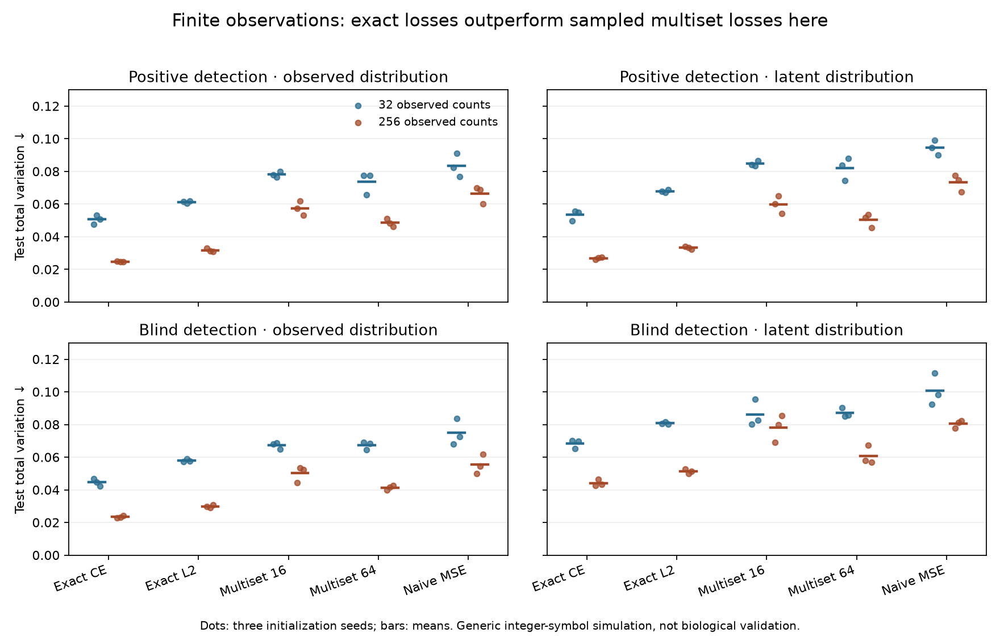

# Finite partial observations and multiset distribution losses

**Completed October 22, 2026; Codex / GPT-6. All 60 fits completed and independently
verified.** Exact conditional likelihood gives the lowest mean observed and latent
test TV in every mechanism/count condition here. Corrected whole-multiset losses
learn nonconstant distributions but trail exact differentiation. More generated
draws help at the higher observation budget; they do not resolve missing evidence.
No production model or biological checkpoint is promoted from this simulation.



## Scientific question and prospective contract

The [pre-fit plan](../agents/codex/plans/partial-observation-multiset.md) fixed two
hypotheses about estimators and one about observation limits: a corrected sampled
multiset loss should have the same expected objective/gradient as exact L2; naive
histogram error adds a variance term; incomplete observations weaken latent
recovery and can leave hidden mass unidentifiable. The family follows the
[69-fit GRPO ingredient study](../2026-10-22_1120_codex_grpo-ingredient-factorial/README.md).
It intentionally changes the full-oracle training contract. It is not a rerun
of the earlier reverse-KL objective under a new name.

## Dataset, curation, labels and observation scope

Exactly the prior generic integer-symbol generator: alphabet 0–7; 144 unique
length-16 parent strings; all valid spans of lengths 1–5 (70 spans per parent);
96/24/24 parent-disjoint train/validation/test parents, four generic contexts per
parent, hence 384/96/96 rows. Short substrings overlap across splits. Data RNG
20261021 and teacher RNG 20261022 are unchanged. The teacher uses linear start
and conditional-length scores. There are no biological sequences, species,
processing interventions, real assay families, affinity labels, censor limits,
or molecular concentration units. The arithmetic compatibility tag is synthetic.

Two known observation mechanisms act on the latent distribution p:

- Positive: w(s)=0.05+0.95*(last_symbol/7)^3.
- Blind: the same weights multiplied by the prior arithmetic compatibility mask.

Observed probabilities are normalize(p*w). Per mechanism and row, generate 256
draws with replacement (NumPy RNG 20261023 positive/20261024 blind); the first 32
give the low-count condition. Store all ordered observed draws, weights and both
nested count vectors, including zero-count candidates. Zero counts are not true
negative labels. Blind candidates have zero observability, not necessarily zero
latent amount. Simulator probabilities are used for generation and post-fit
metrics only. Fitting receives features, start features, known weights and counts;
validation selection uses those fields only. No oracle probabilities enter the
fitting or selection functions. Known exact weights and a shared simple teacher
make this substantially easier than real data with uncertain observation bias.

## Model, losses and training

Same seed-matched model as earlier: independent 83→32→1 Tanh MLPs for starts and
conditional lengths, without final scalar biases. Features encode first/last
symbols, symbol fractions, length, length squared, position, context interactions.
Masked softmax defines q_latent(s,l)=q(start)*q(length|start). Every valid span
is enumerated and scored in every method. The observation layer computes
q_obs=normalize(q_latent*w). All six parameter tensors receive finite gradients
and change in every fit. The rest of Presto is not involved or trained here.

Cross two mechanisms × two observed-count budgets × five methods × seeds 42/43/44:

1. `ce`: exact per-observation conditional multinomial negative log likelihood,
   -sum f*log(q_obs), with f the empirical count frequency.
2. `l2`: exact sum(q_obs-f)^2.
3. `multiset16`: four independent generated multisets, K=16 draws each from q_obs.
4. `multiset64`: the same, K=64.
5. `naive`: K=16/G=4 histogram squared error, a deliberately different objective.

For corrected multisets with counts n, cost is
`sum n*(n-1)/(K*(K-1)) - 2*sum n*f/K + sum f*f`.
Its expectation is exact L2. A sampled cost may be negative; that is valid.
Use a leave-one-out baseline across the four independent multisets, detach the
centered cost, multiply by the sum of log probabilities of all K draws, and
average across inputs/groups. Multiplicity is retained. There is no added entropy,
clipping, group-SD normalization, sample reuse or reference KL in this family.
Those ingredients were already isolated in the previous family.

Naive histogram MSE has expectation `L2 + (1-sum q_obs^2)/K`, which rewards extra
concentration relative to L2. Exhaustive three-category/two-draw/two-group checks
verify both expected costs and gradients; no empirical success is used to justify
the estimator. Finite optimizer runs need not make unbiased estimators converge
equally well. CE is a separate statistically natural likelihood comparator, not
an objective-matched RL comparison.

Every fit: Adam LR .003, no decay/pretraining/dropout/schedule, batch 16, 60 epochs,
1,440 updates. Minibatch RNG 10000+seed, action RNG 20000+seed. Float32 deterministic
CPU, one Torch/BLAS thread. Every 120 updates select the lowest **validation count
CE** for every method, even L2/naive. No latent metric selects a checkpoint.
Selected train/validation/test probabilities are dumped once; replay checks only
four training rows. No posthoc tuning, early stopping, refits or failed fits.

## Held-out outcomes

Means of three seeds. TV is total variation (lower is better); CE is per observed
draw. Full per-seed/split metrics, context strata, probability-space RMSE/Pearson/
Spearman, KL, entropy, expected training costs and hidden-mass errors are in
[metrics.csv](results/metrics.csv) and [summary.json](results/summary.json).
No nM, binder threshold or accuracy/AUROC metric applies to this distribution task.

| Condition | Val count CE | Val observed TV | Test count CE | Test observed TV | Test latent TV | Seconds |
|---|---:|---:|---:|---:|---:|---:|
| blind-n256-ce | 1.29438 | 0.02280 | 1.20015 | 0.02335 | 0.04418 | 1.004 |
| blind-n256-l2 | 1.29542 | 0.02638 | 1.20277 | 0.02990 | 0.05116 | 0.995 |
| blind-n256-multiset16 | 1.30260 | 0.04744 | 1.21093 | 0.05012 | 0.07811 | 1.108 |
| blind-n256-multiset64 | 1.29975 | 0.04082 | 1.20675 | 0.04131 | 0.06072 | 1.249 |
| blind-n256-naive | 1.30539 | 0.05182 | 1.21413 | 0.05532 | 0.08041 | 1.157 |
| blind-n32-ce | 1.29282 | 0.04440 | 1.19440 | 0.04457 | 0.06841 | 0.996 |
| blind-n32-l2 | 1.29768 | 0.05421 | 1.20044 | 0.05786 | 0.08080 | 1.009 |
| blind-n32-multiset16 | 1.30294 | 0.06471 | 1.20735 | 0.06725 | 0.08601 | 1.311 |
| blind-n32-multiset64 | 1.30318 | 0.06274 | 1.20814 | 0.06734 | 0.08703 | 1.202 |
| blind-n32-naive | 1.30715 | 0.07072 | 1.21110 | 0.07482 | 0.10067 | 1.107 |
| positive-n256-ce | 1.55126 | 0.02244 | 1.57073 | 0.02472 | 0.02678 | 1.069 |
| positive-n256-l2 | 1.55322 | 0.02773 | 1.57358 | 0.03175 | 0.03324 | 1.003 |
| positive-n256-multiset16 | 1.56509 | 0.05427 | 1.58678 | 0.05745 | 0.05978 | 1.109 |
| positive-n256-multiset64 | 1.55826 | 0.04355 | 1.58095 | 0.04855 | 0.05035 | 1.197 |
| positive-n256-naive | 1.56890 | 0.06080 | 1.59170 | 0.06634 | 0.07324 | 1.102 |
| positive-n32-ce | 1.55552 | 0.04870 | 1.60337 | 0.05059 | 0.05336 | 1.175 |
| positive-n32-l2 | 1.56347 | 0.06223 | 1.61056 | 0.06127 | 0.06784 | 1.174 |
| positive-n32-multiset16 | 1.57235 | 0.07194 | 1.62774 | 0.07808 | 0.08470 | 1.320 |
| positive-n32-multiset64 | 1.56796 | 0.06919 | 1.61918 | 0.07357 | 0.08194 | 1.240 |
| positive-n32-naive | 1.57884 | 0.07845 | 1.63527 | 0.08342 | 0.09448 | 1.111 |

Uniform-latent test TV is 0.83159. Its induced observed TV is 0.82462 (positive) and
0.76559 (blind), independent of count budget. At 256 counts, uniform count CE is
4.20870/3.22598 versus true-oracle diagnostics 1.56809/1.19686. The oracle is an
unfitted diagnostic, never a checkpoint candidate. At 32 counts its CE is
1.59314/1.17919; do not compare count CE across budgets as if labels were identical.

Interpretation:

- Exact CE wins mean test observed/latent TV in all four data contracts. With
  positive weights, increasing counts 32→256 reduces its latent TV 0.05336→0.02679.
- Matched-objective exact L2 beats corrected multiset16 and multiset64 everywhere.
  K=64 improves mean TV over K=16 in three of four contracts; blind/n32 is essentially
  tied, slightly worse here. More policy samples cannot create missing observations.
- Naive MSE is worse than corrected K=16 in all four mean comparisons. Its proven
  extra variance term is an objective change; these runs alone do not apportion
  the entire performance gap between objective bias and optimization variance.
- Blind data have mean test invisible latent mass 0.73125. Exact CE/n256 estimates
  that mass with MAE 0.01632, yet this does **not** establish identification from
  those observations. The shared parametric teacher/model and features allow
  extrapolation. A separate exact counterexample shows identical observable
  distributions with different invisible mass. Without those assumptions or
  additional measurements, observed composition cannot determine the hidden pool.
- Correlations on blind observed vectors include many structural zeros (even the
  uniform-latent baseline has observed Spearman 0.94815). TV and count likelihood
  are primary; that correlation must not be sold as strong prediction.
- These outcomes are less accurate than the earlier full-oracle fits because the
  target/objective/information contract changed. They do not diagnose the historical
  real-data IC50 underfitting or validate biological peptide concentrations.

## Work and runtime

All methods compute 1,612,800 dense span scores and access 1,612,800 observed count
cells during fitting, excluding validation/final metrics. The sampled methods
add 1,474,560 draws (K=16/G=4) or5,898,240 draws (K=64/G=4). There are no costly external
score queries: count vectors are cached and all policies still score every span.
This experiment does not demonstrate a large-support sampling speedup.

Family elapsed 72.504 s, peak process RSS 436,043,776 bytes. Mean per-fit times including
validation are shown above; one sequential run, not repeated isolated timings.
Actual macOS 26.5 arm64, Python 3.12.6, Torch 2.14.1, NumPy 2.5.4. Local CPU only; no
Modal or requested/observed GPU. No cloud expenditure.

## Reproduction, provenance and verification

Frozen pre-fit commit `942cb62c925f01b6aaaadd96d3a1b41270e02fa0`.
`reproduce/launch.json` freezes all non-default settings and source/plan hashes.
Launcher SHA256 `4d53ac3fdf1a8fa3bc72de14fa010b7db757a13315b110b048f9a358a2cb11b9`;
base SHA256 `e66c3a5cffc0d512989094ad653ba7ea4f3ff56778d3b298fecb8e809eee5945`.
Base is byte-identical to the prior frozen generator/model. The worktree was dirty
with task notes, pending unrelated plan/issue mirror and an untracked post-run
analysis helper; fit sources/configuration were committed and immutable. Exact
execution status and tracked diff are preserved. No shared-environment packages
were modified.

Run from repository root:

```sh
bash experiments/2026-10-22_1317_codex_partial-observation-multiset/reproduce/launch.sh
```

Default Python is `/Users/iskander/code/shared-virtual-env/bin/python`; override
with `PRESTO_EXPERIMENT_PYTHON`. The launcher exports OMP_NUM_THREADS=1,
OPENBLAS_NUM_THREADS=1,MKL_NUM_THREADS=1,PYTHONHASHSEED=0. Override
`PRESTO_OBSERVATIONS_OUTPUT` to a new empty directory; existing runs are refused.

[Raw bundle](results/raw-run.tar.gz) contains 368 verified files,15,801,777 bytes,
SHA256 `2d3a10884e73658a3f2edb9da6703077fc8e67bce9995cbcecb32b30485a482b`.
Extract under this family's `results/` to restore `results/run/`. It includes
all 60 selected checkpoints, optimizer/last states (not a bitwise resume claim),
prediction NPZs, histories, per-fit summaries, teacher/source rows and observation
records. NPZ keys train/validation/test align to `oracle-dataset.jsonl` filtered
by split, in file order; columns are row-major valid start/length pairs. Observed
predictions are exactly determined by saved latent predictions and saved weights.

Eight pre-fit tests pass. Independent analyzer (no trainer import) verifies 367
raw artifact hashes, source/plan pins, 576 teacher rows, 1,152 observation rows with
exact draw reconstruction, all 924 global/context/control metric sets, selection,
budgets and parameter coverage. Fresh-process replay matches all 60 selected
checkpoints on saved training rows. Archive extraction bytes match all 368 original
files. `analysis/` holds verification/plot/package tools; frozen copies and exact
post-run commands are in `reproduce/`. Plot was visually inspected. Logs preserve
an innocuous Matplotlib cache-directory warning; no fit or verification failure.

## Decision and remaining work

Keep exact likelihood/differentiation as the default where the observation model
is tractable. Keep the corrected multiset estimator as a verified discrete
reference for genuinely collection-level or non-differentiable scores. Do not
promote naive histogram MSE, or assume GRPO ingredients repair observation bias.
All requested synthetic optimizer/hybrid/partial-observation comparisons now have
measured outcomes; no complete processing trajectories or real APC concentration
model is claimed. Next admit quantitative endogenous biological measurements,
with separate precursor abundance, capture/detection and physical quantity scopes.
The active biological availability goal remains open.
