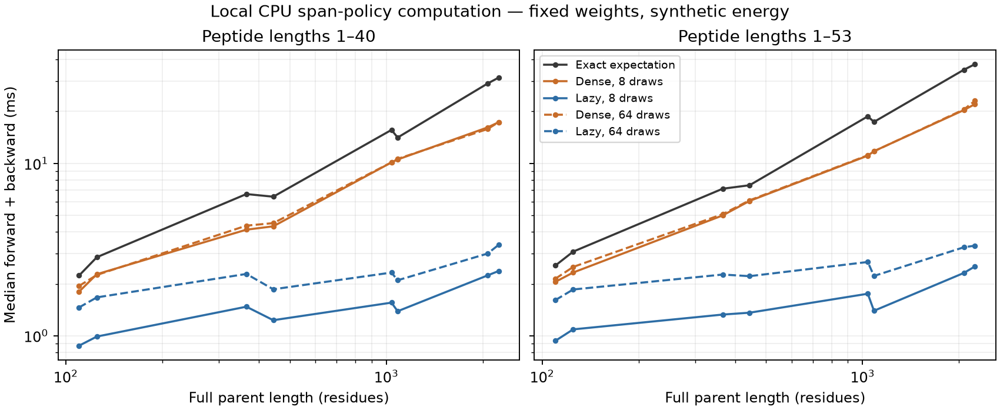

# Variable-length span policy: exact versus lazy computation

Completed October 22, 2026; Codex / GPT-6. **Lazy conditional scoring preserves
the policy and sampled gradient while reducing actual network work.** This is a
computational prerequisite for biological availability fitting, not a biological
fit, concentration calibration or replacement of the full availability goal.

The new `models/peptide_availability.py` module models
`p(start,length | full parent sequence, supplied context)`. The prior prototype
scored every conditional length before sampling; this implementation scores all
starts, samples starts, and evaluates length distributions only for distinct
sampled starts. It retains repeated draws in the output multiset.

## Frozen workload and model

Eight unmodified full proteins from the verified human MAPP and mouse PXD057588
reference audits. Per species, one protein is selected from each length band
64–127, 256–511, 1,024–2,047 and 2,048–4,095 by smallest sequence hash, then
accession. Selection uses no assay labels. Original input hashes, full sequences,
accessions and selection criteria are preserved; these are workload fixtures,
not a biologically representative or independent evaluation cohort.

Both length supports 1–40 and 1–53 are tested. Fixed amino-acid one-hot/prefix-sum
features represent composition, termini, adjacent residues, length and position.
Two small tanh MLPs (hidden 32) produce start and conditional-length scores:
**5,536 parameters in 6 tensors**. A log-valid-length-count start offset makes
zero learned scores uniform over valid spans. Final scalar layers omit a bias
that would cancel under softmax. No MHC-affinity filter removes nonbinders or
short products. Two supplied synthetic context values `[0.25,-0.5]` exercise the
context input; they are not species, cytokine or gene-loss labels.

Seed 42 weights remain fixed; **zero optimizer updates**. The mathematical energy
is a declared function of span composition, position and length. Exact loss is
`sum q*(log(q)+energy)`, reverse KL to normalized `exp(-energy)` up to a constant.
REINFORCE uses fresh samples and a leave-one-out baseline of `log(q)+energy`.
There is no clipping, standardization, sample reuse or reference-policy penalty.
Prior factorial/synthetic results are unchanged. This energy is not a biological
oracle and no biological quality metric is being estimated.

Local CPU: four intra-op threads, one inter-op, float32, Python 3.12.6/PyTorch 2.14.1.
For each of 16 parent/support cases and five conditions, 4 calls warm up and 12 are
measured; seeded random interleaving changes condition order across repetitions.
Timing includes feature preparation, forward, cost, backward, gradient extraction
and gradient clearing, with work-count hooks. It excludes input loading and model
construction. There is no GPU/Modal or CPU/MPS comparison in this family.

## Measured computation

Across all 16 cases, dense/lazy speed ratios range **2.06–8.79× for 8 draws** and
**1.33–6.91× for 64 draws**. These are repeated timings on one local workload/model,
not a general hardware ranking or evidence that sampled optimization converges
faster. Full raw times and sampled spans are retained.

Representative human protein: 2,240 residues, peptide lengths 1–40.

| Condition | Median forward/backward | Conditional-network rows | Cost queries |
|---|---:|---:|---:|
| Exact expectation | 31.371 ms | 89,600.0 | 88,820 |
| Dense REINFORCE, 8 draws | 17.296 ms | 89,600.0 | 8 |
| Lazy REINFORCE, 8 draws | 2.374 ms | 320.0 | 8 |
| Dense REINFORCE, 64 draws | 17.309 ms | 89,600.0 | 64 |
| Lazy REINFORCE, 64 draws | 3.364 ms | 2,513.3 | 64 |

All conditions also score 2,240 starts. Conditional-network rows include masked
boundary-crossing cells: full enumeration scores 89,600 rows for 88,820 valid spans.
The 64-draw lazy condition averages 2,513 conditional rows, 35.65× less work, and is
5.15×faster than dense 64. It is 9.32× faster than the exact expected-cost backward
pass here, but its gradient is stochastic. No reward-query count is substituted
for actual network work. Forward hooks verify those counts.

The family runs in 13.45 s and peaks at 0.719 GiB process RSS. This is a family-wide
peak, not isolated per-condition memory. Lazy sampling still needs O(L) start
scoring and O(min(K,L)W) conditional scoring. Chunked exact enumeration limits
inference working tensors; retaining all differentiable chunks still retains
their training graphs. No bounded-memory backward claim is made.

## Probability and gradient fidelity

- All 512 seed-matched dense/lazy sample pairs agree, including repeated draws.
- Selected log probabilities agree exactly in the executed float32 comparisons;
  maximum absolute parameter-gradient difference is 1.77e-8.
- Independent NumPy feature construction, both MLPs, normalization and analytic
  backpropagation reproduce all 678,190 span probabilities and all 16 exact gradient
  vectors. Source selection, every raw work/timing summary, all 26 primary output
  hashes and the gradient-probe summaries independently replay.
- Fourteen meaningful unit tests pass: exhaustive support/normalization, uniform
  base measure, composition/flanks, chunk invariance, dense/lazy gradients,
  repeated samples, empirical frequencies, invalid inputs and actual scored rows.
  Every one of the six parameter tensors receives a gradient in the software
  test; this is not a biological training or feature-exposure claim.

Sampling noise remains. Each row below compares the **mean of 128 independent
REINFORCE estimates** with the exact gradient, using fixed weights and the same
synthetic energy. It does not describe one training update or convergence.

| Longest-band case, lengths 1–40 | Draws per estimate | Relative L2 error of mean | Cosine with exact gradient |
|---|---:|---:|---:|
| human | 64 | 0.106 | 0.9946 |
| human | 8 | 0.341 | 0.9437 |
| mouse | 64 | 0.104 | 0.9949 |
| mouse | 8 | 0.279 | 0.9617 |

**Decision:** retain exact enumeration as the gradient reference; use lazy scoring
for sampled comparisons because it preserves the objective while avoiding
unnecessary length-network evaluations. Sample count remains an accuracy/work
tradeoff. Do not infer biological benefit or select future training recipes from
these timing results alone.

## Integration boundary and remaining work

This is a normalized product-distribution primitive. Per-precursor yield,
clearance/residence time, calibrated concentration, capture/detection response,
MHC selection and typed APC machinery context remain outside it. It has not yet
been fitted or wired into the canonical mixed-assay trainer. The biological
source-admission/recipe contracts in Hitlist #739 and MAPP #752 remain in force.
No measurement or inferred context is silently substituted for a synthetic input.
The next biological comparison must use the shared source generation, the same
observable objective in exact/REINFORCE conditions, explicit parent ambiguity and
holdouts, baseline controls and actual held-out predictive results.

## Reproduction and artifacts

[Launch](reproduce/launch.sh) freezes commands/env; [launch metadata](reproduce/launch.json)
records dirty 24f1d2b, hardware/software, all conditions and code hashes.
`reproduce/source/` contains exact executed model/launcher/verifier snapshots.
[Summary](results/summary.json), [timing table](results/timing_summary.csv),
[independent verification](results/independent-verification.json),
[raw calls/draws](results/timings_and_draws.jsonl.gz), selected full parents,
reference span probabilities/energies, fixed checkpoints and gradient arrays
permit replay. Run the frozen launcher and then `code/verify.py` in a fresh
experiment copy with the same source inputs; completed outputs reject overwrite.
The independent numerical/summary replay took 1.141 s. No package installation or shared environment change occurred.

No predictive train/validation/test split, assay loss, regression/binding metrics
or predictive dumps apply: this is fixed-weight computation and derivative
verification. Full mathematical references and draws are supplied instead.
Pretraining and biological training are absent; all costs are explicitly synthetic.

Reference-sequence attribution: The UniProt Consortium, [UniProtKB](https://www.uniprot.org/),
[CC BY 4.0](https://rest.uniprot.org/help/license); sequences are unchanged and
selected from the two prior hash-pinned reference audits. Their association with
a measured peptide does not turn the synthetic energy into biological evidence.

Status: computational comparison complete; broader availability goal active.
