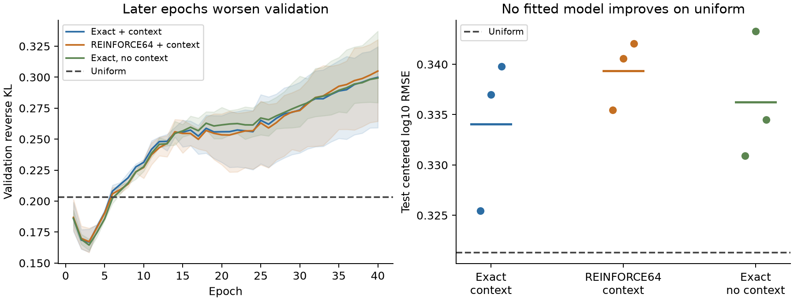

# First biological MAPP exact-versus-sampled comparison

All nine local fits completed and passed independent replay, but **none improved held-out reverse KL or composition RMSE over uniform**. Exact differentiation and fresh REINFORCE64 gave similar results. This is a useful negative biological result, not a trained intracellular-concentration model.

Registered October 22, 2026 at 23:30 America/New_York; fitted October 23. Agent/model: Codex / GPT-6. The broader availability goal remains active.

## Results

| Method | Validation KL | Test KL | Test TV | Test log10 RMSE | Test Spearman | Condition-change RMSE | Seconds/fit |
|---|---:|---:|---:|---:|---:|---:|---:|
| exact-context | 0.1668 ± 0.0076 | 0.3039 ± 0.0078 | 0.2759 ± 0.0059 | 0.3341 ± 0.0062 | 0.0090 ± 0.0412 | 0.1565 ± 0.0001 | 6.09 |
| reinforce64-context | 0.1673 ± 0.0082 | 0.3119 ± 0.0034 | 0.2804 ± 0.0033 | 0.3394 ± 0.0028 | -0.0011 ± 0.0395 | 0.1565 ± 0.0001 | 6.18 |
| exact-no-context | 0.1645 ± 0.0037 | 0.3079 ± 0.0082 | 0.2783 ± 0.0054 | 0.3362 ± 0.0052 | -0.0182 ± 0.0106 | 0.1566 ± 0.0000 | 6.00 |
| Uniform | 0.2031 | 0.2890 | 0.2705 | 0.3213 | undefined | 0.1566 | unfitted |

Values are means ± population SD across seeds 42/43/44; seed variation is not biological uncertainty. Test has 14 parent sequences, validation 15. Uniform is the preferred baseline under this contract. Among fitted models, the context-free control has the best mean validation KL; exact with context has the lowest mean test KL, but test outcomes were not used to choose or refit a model.

Every selected checkpoint is epoch 2 or 3 of 40. Validation improves initially and then worsens, so more epochs at the same configuration are not supported. Exact models predict nonconstant composition, but test centered log10 SD is only 0.086–0.146 versus target 0.525, and pooled test Spearman is near zero. Treatment-change SD is only 0.00088–0.00114 versus target 0.176; the context-free control predicts exactly zero change. A trained context weight is not evidence of useful context learning. No causal diagnosis of the earlier IC50 collapse follows from this experiment.

| Model | Split | Centered log10 RMSE | Pearson | Spearman | Prediction SD | Condition-change SD |
|---|---|---:|---:|---:|---:|---:|
| exact-context | validation | 0.2630 | 0.5148 | 0.4195 | 0.1164 | 0.0009 |
| exact-context | test | 0.3341 | 0.0173 | 0.0090 | 0.1237 | 0.0010 |
| exact-no-context | validation | 0.2614 | 0.5336 | 0.4370 | 0.1233 | 0.0000 |
| exact-no-context | test | 0.3362 | 0.0123 | -0.0182 | 0.1276 | 0.0000 |
| reinforce64-context | validation | 0.2638 | 0.5117 | 0.4184 | 0.1283 | 0.0009 |
| reinforce64-context | test | 0.3394 | 0.0125 | -0.0011 | 0.1366 | 0.0010 |

The curve band is the range across seeds. Test points are individually selected checkpoints, with a mean bar. Macro error weights each parent/condition equally; pooled correlations and SD give each peptide value equal weight. They therefore weight large sets differently. Full per-seed train/validation/test metrics, two-peptide and at-least-three-peptide strata are in [comparison.csv](results/comparison.csv), [independent metrics](results/independent-metrics.json) and [aggregate metrics](results/aggregate-metrics.json). Test strata contain seven parents each; validation has eight two-peptide and seven larger sets.

Uniform correlations are mathematically undefined. The original evaluator produced tiny centering residuals (SD about 1.6e-16) and spurious ranks; raw files are preserved and independently reproduced, while the report/CSV render uniform correlation as undefined and SD as zero. This reporting correction changes no fit, checkpoint, KL or RMSE. See [metric notes](results/metric-notes.json).

## Training-only diagnostic after fitting

A [documented posthoc check](reproduce/posthoc-train-diagnostic.md) evaluates the saved initial and final checkpoints on training observations only, using the independent NumPy forward path. No optimizer ran, no checkpoint was reselected, and no additional test checkpoint was evaluated. [Metrics](results/posthoc-train-diagnostic.json) and [every prediction](results/posthoc-train-predictions.jsonl.gz) are preserved.

Initial training reverse KL is 0.329–0.338; selected-checkpoint training KL is 0.246–0.274; final-epoch training KL falls to **0.0227–0.0304**. Final training centered-log10 RMSE is 0.113–0.127 and Spearman is 0.729–0.784. The model can fit much of this training objective while validation worsens. This experiment therefore demonstrates a generalization failure; it does not establish that optimizer updates or gradient estimation are the bottleneck. Condition effects also grow on training data at later epochs, without justifying their use on held-out proteins. The result cannot diagnose the separate historical IC50 experiment or distinguish insufficient independent data, observation noise and representation bias.

## Exact source and admission

This experiment consumes the **shared Hitlist recipe**, not a separate Presto workbook curator. Source generation manifest is `55f7a3d50df5d162e55bf1d66fbcf413a35fc927fd08c266f90d981068a053c2`; actual input is `/private/tmp/hitlist-v2-mapp-reference-second`. Recipe implementation is in [Hitlist draft PR760](https://github.com/pirl-unc/hitlist/pull/760), code commit `80b69d3` / documentation head `effa0ed`, built on source/reference PR758; the frozen producer snapshots record the pre-commit dirty state.

Data are human HEK293 proteasome-associated MAPP fragments from PXD009092, untreated and TNF+IFN, using original published nonimputed log10 medians of three filtered runs, including filter zeros. Selection requires canonical 20-residue peptides/parents; no reverse or contaminant; one source protein group; at least two positive filtered runs and one direct-MS/MS-bearing run per condition; reported peptide PEP ≤0.01; one distinct modern full parent sequence; and source-leading coordinate/flank agreement. Peptide PEP is not a resolution of the source global-FDR discrepancy. All alternative identical-sequence accessions and repeated positions remain; one peptide observation is never multiplied by reference joins.

The initial three-peptide recipe failed its prospective minimum-split gate: 51/7/7 train/validation/test parents. **No model was fitted on it.** A [documented pre-fit amendment](reproduce/admission-amendment-min2.md) admits two-peptide sets, the minimum nontrivial composition, without changing other eligibility rules, source-component graph, split salt, old targets or old partitions. Both immutable exports are archived. No outcome-driven recipe or seed search occurred.

The extended recipe `mapp_captured_composition_min2_v1` admits 616 peptides / 101 full proteins: 72/15/14 parents and 144/30/28 protein-condition examples. Input manifest is `df78d02f8200809c659e43adfae29866c48b712122b740379106994622f4ac80`. Maximum parent length is 2,752; sequences are not truncated. Independent original TSV/XLSX/FASTA and graph replay checks all 10,673 disposition rows, 1,232 contributor rows, labels, positions and partitions. The old structural-support predicate reproduces 2,272 peptides.

Splits hash connected components built over **all source peptides before selection**, joining shared modern full sequences and original protein groups, including excluded bridges. There are 1,938 source components; largest has 1,410 peptides. The original fixed salt and 70/15/15 bucket ranges are unchanged. These constrain exact source overlap; they do not certify homology or independent specimens. Full modern reviewed-human isoform reference is release 2026_03; the original 2016 search FASTA remains unavailable.

## Model, label and training contract

`PeptideAvailabilityPolicy` takes the full parent sequence and optional treatment coordinate (UT=0, TNF+IFN=1). Two hidden-32 tanh MLPs predict hierarchical `p(start) p(length | start)` over lengths 1–40. Features are residues at termini/flanks, amino-acid composition, normalized position and length, plus the optional context. This is a span distribution, not a physical cleavage/transport simulator.

For each admitted peptide, sum probability over all its positions, then normalize among that parent's observed candidate set. The target similarly normalizes original linear intensities using a stable log-softmax. A shared parent-wide scale cancels. Peptide-specific capture/MS response does not. Unobserved peptides are not negatives, and the objective cannot identify total mass outside the admitted set, absolute yield, clearance, or free concentration. The source search began at six residues; short-fragment support is a model capability without direct labels here. A saved counterexample reduces selected mass fourfold while leaving all observable targets/predictions unchanged.

Exact and sampled arms minimize the same `KL(q_observed || target)` with unit weight per parent/condition. REINFORCE64 uses replacement draws, detached log-ratio costs and a leave-one-out baseline; no clipping, group standardization, sample reuse, reference KL, dropout or pretraining. Both score all selected candidates before sampling, so this comparison has **no sampling-related network score saving**. This is a biological reference comparison following synthetic GRPO ablations, not evidence against RL for an expensive discrete trajectory objective.

Three seeds 42/43/44; Adam lr 0.003, no weight decay; batch eight; 40 epochs / 720 updates per fit. Exact and sampled context arms start with identical weights and share example order. The context-free control is a separate architecture (5,408 versus 5,472 parameters). Lowest mean validation reverse KL selects the checkpoint; test is evaluated only after selection, with no tuning from its outcomes. No MHC binding, elution, TCR, stability or synthetic biological labels train in this family. nM/binder-threshold metrics do not apply to this captured-intensity endpoint.

All six parameter tensors receive finite gradients and change in each selected model. **704 parameter elements remain without nonzero gradients**: unsupported alphabet/boundary columns and additional features absent from this admitted training support. Thus 4,768/5,472 context-model elements and 4,704/5,408 no-context elements have recorded nonzero gradients. Numerical coverage does not establish effect identification, including normalization-invariant directions. [Independent verification](results/independent-results-verification.json) lists exact untouched input columns; masks and initial/selected/final states are preserved. No broader-vocabulary or full-model-training claim is warranted.

## Runtime and verification

Nine fits: 54.98 s total; mean 6.09 s exact-context, 6.18 s REINFORCE64-context, 6.00 s no-context. Peak process RSS 500,154,368 bytes (0.466 GiB). Local macOS arm64 CPU, four intra-op / one inter-op thread; no Modal or GPU. The small fit is not representative of full architecture training. Admission took 9.95 s (original) / 9.19 s (extended), roughly 1.9 GiB peak; independent source replay took 3.90/3.91 s.

Per fit, training scores 2,501,760 start rows, 1,017,600 padded conditional rows and 36,720 admitted candidates/occurrences. Exact evaluates 36,720 target terms; REINFORCE draws/evaluates 368,640 terms. Evaluation work is excluded from these training counters but included in fit runtime. Sampling is slightly slower on this small observed set.

Exhaustive categorical estimator expectation matches exact gradients to 5.55e-17. Selected-position probability/gradient agrees with complete span enumeration to 8.33e-17. On one frozen train example, 128 REINFORCE64 gradient estimates have mean relative error 0.00186 and cosine 0.9999998; this is one local probe, not a universal variance bound. Independent NumPy feature construction and MLP evaluation replay all 11,088 peptide prediction values from selected checkpoints: maximum log-probability error 1.35e-6. All metrics, work counts, checkpoint selection, changed weights, coverage masks, source hashes and matched initialization verify. No fit was rerun.

## Reproduction and artifacts

[Prospective plan](reproduce/plan.md), [exact commands](reproduce/launch.sh), [registration](reproduce/launch.json), [training environment/git receipt](reproduce/training.json), and frozen source copies under `reproduce/source/`. Training commit: `8242200fa1d1e8a3361fc343dffb1e491d728d45`; dirty status records unrelated notes/untracked outputs. Model and executed training code hashes are pinned separately. Python 3.12.6, Torch 2.14.1, NumPy 2.5.4; the shared environment was not changed.

- [Both admitted cohorts](results/admitted-cohorts.tar.gz), with hash receipt, complete source/recipe manifests, sequences, dispositions, contributors and targets. Original source bytes remain in the shared package/datacache.
- [Complete training artifacts](results/training-artifacts.tar.gz): initial/selected/final states, optimizer/RNG states at final epoch, coverage masks, histories, all-split predictions and summaries for nine fits, plus uniform predictions. Every original artifact hash appears in the independent verification receipt.
- Original raw output directory: `/private/tmp/presto-modular-model/artifacts/2026-10-22_2330_codex_mapp-biological-comparison`. Prediction dumps include held-out validation/test peptide IDs, parent/component, condition, raw log10 intensities, target and predicted log probabilities, and explicitly unidentified selected mass.
- Logs retained byte-for-byte as deterministic gzip files under `launch_logs/`. `code/verify_results.py` imports neither the producer's metrics nor policy implementation; `code/report.py` generates summaries without fitting.

Launchers intentionally refuse existing immutable output destinations. Reproduction requires the pinned shared source generation and a fresh output workspace or unpacked recipe outputs; do not overwrite the archived run. Recorded absolute paths and import overrides identify the exact executed environment.

## Decision and next work

Retain uniform as the held-out reference. Keep exact differentiation as the lower-variance development path while retaining REINFORCE as a matched comparator. A new plan should test simpler identifiable observed-set features and explicit treatment interactions, with training-only capacity/gradient checks and source replicate-variation auditing. The current test set is now observed; future iterations on this cohort are development results until a genuinely untouched source/specimen evaluation exists.

Independent precursor quantity/condition pairing remains [Hitlist #757](https://github.com/pirl-unc/hitlist/issues/757). Newly filed [Hitlist #759](https://github.com/pirl-unc/hitlist/issues/759) requests the study's controlled proteasome-inhibition and known-substrate panels as a more diagnostic biological comparison, with full shared metadata and source eligibility. Shared recipes remain within [#739](https://github.com/pirl-unc/hitlist/issues/739); this scoped recipe does not finish the unified major release. Separate observation-response calibration, yield, clearance and machinery coverage remain necessary for the full concentration objective. The broader architecture and earlier real-data IC50 issues are not resolved by this family.

Software closure: Hitlist recipe/catalog focused tests pass (14); the normal complete suite passes 3,243 tests / 10 warnings in 327.51 s with the memory guard intact. Production code was frozen at `80b69d3`; later changes are documentation only. Format/lint and strict docs pass. Presto strict docs and isolated experiment-script formatting/lint pass. Source PR758 final-commit unit, integration, lint and docs CI all pass. Recipe PR760 remains draft with its own CI pending; this report does not declare either PR merged or released.
