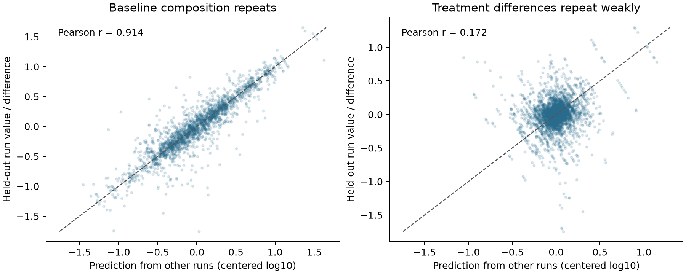

# MAPP run repeatability and parsimonious sequence models

Baseline captured-peptide composition is reproducible across runs, but within-parent treatment differences are much less reproducible. Thirty smaller, regularized fits train every allocated parameter and produce explicit treatment responses; **none improves development-test KL or RMSE over uniform**. These results narrow the problem to an observation/generalization question, rather than demonstrating a need for a different policy-gradient algorithm.

Registered October 23, 2026 at 00:37 America/New_York; Codex / GPT-6. [Stage A plan](reproduce/plan.md) precedes source materialization/analysis. [Stage B specification](reproduce/stage-b-plan.md) was fixed after the repeatability result and before any new fit. The full goal remains machinery-conditioned peptide availability modulo precursor abundance, including short/nonbinding products, MS response and downstream pMHC selection; it is not completed by this diagnostic.

## What repeats across runs

A shared Hitlist recipe retains all 3,696 run observations from the original 616-peptide min2 cohort. Requiring finite positive values in all six runs leaves 391 peptides before the parent gate; 22 lose their remaining multi-peptide parent set. The complete-case analysis therefore has **369 peptides / 71 proteins**, with 55/7/9 inherited train/validation/test parents. Of the base peptides, 225 have an incomplete positive six-run profile; there are 284 nonpositive run values: 50 background-filtered zeros and 234 reported zeros without positive evidence. All originals and additional exclusion reasons remain in the export. No zero is logged, imputed, or relabeled biological absence.

For each parent and run, log10 intensity is centered over the same complete peptide set. Predicting a held-out run from the other two runs of that condition gives pooled Pearson **0.914**, Spearman **0.909**, and macro RMSE **0.1553**, versus **0.3547** for uniform composition. Predicting a held-out UT-to-TNF+IFN difference from the other two runs of each arm gives Pearson **0.172**, Spearman **0.178**, and RMSE **0.2197**, worse than **0.1916** for zero change.

| Scope | Parents | Composition RMSE: other runs / uniform | Composition Pearson | Change RMSE: other runs / zero | Change Pearson |
|---|---:|---:|---:|---:|---:|
| all | 71 | 0.1553 / 0.3547 | 0.9136 | 0.2197 / 0.1916 | 0.1719 |
| train | 55 | 0.1461 / 0.3538 | 0.9230 | 0.2066 / 0.1759 | 0.1881 |
| validation | 7 | 0.2030 / 0.3399 | 0.8327 | 0.2871 / 0.2500 | 0.1746 |
| test | 9 | 0.1670 / 0.3716 | 0.9072 | 0.2362 / 0.2283 | 0.1263 |

All nine UT/TNF held-out-run combinations are used; none is asserted to be a paired specimen. These overlapping folds are acquisition repeatability, not independent biological tests. The publication's biological-triplicate description does not invent an exact run-to-specimen crosswalk. Labels called validation/test retain the earlier source partition for description; they are not a new blind test.

The macro RMS condition-mean change is 0.1236 log10 units; the expected sampling-noise RMS estimated from within-arm run variance is 0.1036. Their mean-square difference is +0.004554, without truncating negative parent estimates; 41/71 parents have positive adjusted estimates. This is conditional on the variance assumptions, not a precise biological noise ceiling or evidence that treatment has no biological effect. Complete-case selection and uncertain physical replication remain limitations.

Raw per-parent estimates, every fold prediction, correlations and dispersion by inherited split are in [parent effects](results/parent-effects.json), [prediction dump](results/run-predictions.jsonl.gz), and [complete summary](results/repeatability-summary.json).

## Smaller models and exact versus sampled training

Stage B uses the **original 616-peptide / 101-parent median cohort unchanged**, not the smaller complete-run subset: 72/15/14 train/validation/test parents and 144/30/28 condition distributions. All candidates currently have one exact position, checked before fitting. The peptide's length, canonical composition, terminal residues, adjacent residues/boundary and relative parent positions provide 105 raw sequence features. The context model adds explicit treatment × sequence-feature interactions. Scores are linear and normalized among the provided observed parent set; there is no intercept, class head, MHC filter, supplied untreated measurement or hidden peptide identifier.

Training-only within-parent centering, RMS scaling and pivoted QR remove zero/redundant directions before allocating parameters: length-only has 1, sequence-only 92, and sequence-plus-treatment 184. All allocated parameters receive nonzero gradients and change in every final fit. The six selected models also have complete recorded gradient/update coverage. This is an experimental conditional scorer; it does not model unobserved-set mass or physical processing trajectories, and is not the production mixed-assay trainer.

Fifteen deterministic exact fits cover three representations × five L2 weights (0, 0.001, 0.01, 0.1, 1). Fifteen REINFORCE64 fits cover the interaction representation × the same L2 weights × seeds 42/43/44. All start uniform from zero weights. Each receives 1,000 full-batch Adam updates at lr 0.03, with the common mean reverse-KL objective plus the same analytic L2 penalty, no weight decay/dropout/pretraining. Sampling uses fresh replacement draws and a leave-one-out baseline, with no clipping, standardization, reuse or reference KL.

Validate unpenalized KL at update 0 and every 25 updates; preserve the earliest best checkpoint. Choose regularization by validation only, then evaluate six selected models on all splits. Unselected fits intentionally have validation prediction dumps and **no test predictions**. The prior test has already been observed and all results below are **development evidence**. No feature, regularizer, epoch or seed was added after outcomes. nM regression and binder-threshold metrics do not apply to this captured-intensity endpoint.

| Model | Parameters | L2 / selected update | Validation KL | Development-test KL | Test log10 RMSE | Test Spearman | Change RMSE |
|---|---:|---:|---:|---:|---:|---:|---:|
| length / exact | 1 | 0 / 25 | 0.1919 | 0.2972 | 0.3258 | -0.0663 | 0.1566 |
| sequence / exact | 92 | 1 / 875 | 0.1694 | 0.2928 | 0.3246 | -0.0225 | 0.1566 |
| interaction / exact | 184 | 1 / 25 | 0.1646 | 0.2908 | 0.3241 | 0.0500 | 0.1712 |
| interaction / reinforce64 / seed42 | 184 | 1 / 500 | 0.1601 | 0.2971 | 0.3290 | 0.0524 | 0.1749 |
| interaction / reinforce64 / seed43 | 184 | 1 / 475 | 0.1594 | 0.2940 | 0.3269 | -0.0042 | 0.1717 |
| interaction / reinforce64 / seed44 | 184 | 1 / 625 | 0.1533 | 0.3095 | 0.3358 | -0.0422 | 0.1768 |
| Uniform | 0 | — | 0.2031 | 0.2890 | 0.3213 | undefined | 0.1566 |

The interaction exact model is the best exact architecture by validation, but uniform remains the development-test reference. Sequence-based winners all use the strongest registered L2 weight; no stronger value was tried. Exact interaction test Pearson is 0.0154; all Pearson/Spearman, forward/reverse KL, TV, log10 RMSE, dispersion and condition-change metrics are retained in [model metrics CSV](results/model-metrics.csv) and [independent metrics JSON](results/independent-linear-metrics.json). The table's validation KL is the checkpoint-selection batch metric; all-split re-evaluation can differ by float32 rounding as documented below.

Explicit interaction models produce condition-change SD 0.062–0.074 on the development test, versus about 0.001 for the previous nonlinear selected models. Their change RMSE nevertheless worsens to 0.171–0.177 versus 0.1566 for zero change. Making outputs less constant did not make them more accurate. The regularized exact scorer's overall test RMSE 0.3241 is closer to uniform 0.3213 than the earlier nonlinear mean 0.3341, but the different optimizer, batch and training budget prevent attributing that contextual comparison solely to representation.

## Training support and identification

Eight raw sequence-feature columns have no within-parent variation in training: first C/P, last W, preceding I/P/V/W and following P. This means those linear contrasts are unidentifiable in training, not necessarily that a residue never appears anywhere. Together with universal one-hot/composition dependencies, these give the 92-dimensional training contrast space. No labels enter feature selection.

The saved training projection has negligible residual on training rows, but 12/112 validation and **144/202 development-test peptide-condition feature rows** have residual above 1e-6 outside that span. These count centered rows, so a new contrast can affect every row of its parent set. All allocated weights changing does not establish coverage of those missing contrasts. Feature names, scales, QR pivots/rank, omitted directions and exact residual audits are in [feature contracts](results/feature-contracts.json). No broader serving or unseen-state qualification is claimed.

Both stages study **captured intensity conditional on observed candidates**, not free peptide concentrations. Within-parent normalization removes precursor-wide scale, but also removes genuine parent-wide changes in processing yield. A weak redistribution signal therefore cannot show that APC machinery has little effect on total product abundance. A concentration-oriented model still needs separate yield/clearance information, precursor estimates, and peptide-specific capture/MS response; pMHC selection remains downstream. The source search covered 6–40 residues, so no short-fragment negative or binder-only filter is introduced.

## Shared source contract and independent verification

[Hitlist draft PR760](https://github.com/pirl-unc/hitlist/pull/760), code commit `b94289d`, adds `mapp_complete_run_composition_v1` through the same shared recipe/catalog API. Source package: `/private/tmp/hitlist-v2-mapp-reference-second`, manifest `55f7a3d50df5d162e55bf1d66fbcf413a35fc927fd08c266f90d981068a053c2`. Complete-run recipe manifest: `23bcfeb4067fa4f47f0b1db702d6ae79f97a9c32a1366ff3de322c99f210b9bf`. Original min2 manifest remains `df78d02f8200809c659e43adfae29866c48b712122b740379106994622f4ac80`.

The base contract remains human HEK293 PXD009092, UT/TNF+IFN; canonical peptides/parents, no reverse/contaminant, one source group and distinct full parent sequence, replicated positive quantities, direct MS/MS support, reported peptide PEP ≤0.01, and original leading coordinate/flank agreement. The modern reviewed-human isoform reference is 2026_03; original 2016 search-reference and global-FDR discrepancies remain. Original nonimputed publisher medians include filter zeros; repeated accessions/positions do not duplicate measurements. The all-source component graph and split salt are unchanged. Exact sequence/group connectivity is not homology or specimen independence.

The new export carries all original channel/measurement records, run/file/replicate IDs, context/missingness/filter status and direct-evidence contributors, including ineligible base peptides. Independent original TSV replay checks every run value, acquisition and evidence link, all 10,673 dispositions, new eligibility and target arithmetic. Both old recipe generations were regenerated and all 16 files remain byte-identical, including manifests. This adds a diagnostic without silently revising earlier labels.

A separate scalar-statistics implementation replays all 1,065 fold records / 5,535 peptide predictions and 71 variance records, maximum difference 1.78e-15. The linear preflight matches analytic NumPy gradients to 1.25e-16 and finite differences to 7.97e-12. The mean of 128 sampled gradient estimates has relative error 0.01374; raw estimates and standard-error norm are retained. Independent sequence-to-feature reconstruction, QR selection, NumPy scores, checkpoint selection, optimizer/work counts and metric replay verify all 30 fits, all six selected test models and 10,080 prediction values, maximum logq error 4.14e-7.

The first result-verification attempt compared validation-only selection metrics with predictions recomputed in a differently padded all-split batch. Its strict check caught a 2.4e-9 KL difference. Both real dumps are retained; verification now checks each metric against its own prediction dump and separately records the batch-shape logq difference (at most 2.39e-7). This changes no fit, selected checkpoint, source target or saved prediction. The initial verifier/log and corrected verifier are preserved.

## Runtime, artifacts and software checks

Stage A materialization plus both old-recipe replays: 27.18 s, 2.13 GiB peak RSS. Independent admission replay: 3.66 s, 3.49 GiB peak. Analysis: 0.097 s / 148 MiB; scalar replay: 0.226 s. Stage B fitting and selected-model evaluation: **25.81 s / 427 MiB peak process RSS**, 30,000 actual optimizer updates. Local macOS arm64 CPU only, one Torch intra-op/interop thread; no Modal/cloud training. These small observation models are not a benchmark of the full architecture.

Each fit scores 918,000 valid candidates (16,128,000 padded slots). Exact evaluates 918,000 target terms; REINFORCE evaluates 9,216,000 sampled terms and saves no candidate scores here. Runtime includes selection/evaluation; work counters cover training. Gradient/source/feature preflight occurs before the reported fitting clock.

[Exact commands](reproduce/launch.sh), [registration](reproduce/launch.json), [source admission receipt](reproduce/admission.json), [analysis receipt](reproduce/analysis.json) and [training receipt](reproduce/linear-training.json) freeze code, dirty Git state and environment. Presto execution commit is `dccafe1`; Hitlist source execution commit is `b94289d`. Python 3.12.6, Torch 2.14.1, NumPy 2.5.4. The initial registration records the provisional `0040` directory name; it was renamed to `0037` before computation, and the execution receipts identify the actual paths. The shared environment was not modified. Every executed source snapshot, including the failed verifier, is retained under `reproduce/source/`.

- [Complete-run recipe archive](results/complete-run-recipe.tar.gz): all-source dispositions, source/recipe manifests, full parents, median examples, contributors and all base run observations.
- [All linear fitting artifacts](results/linear-artifacts.tar.gz): 30 initial/selected/final parameter states, final optimizer/RNG states, gradient masks/maxima, histories, validation predictions, and six all-split prediction dumps. Each raw artifact hash is in the independent verification receipt.
- [Archive hashes and raw directory paths](results/artifact-receipts.json), [run repeatability predictions](results/run-predictions.jsonl.gz), and complete JSON/CSV summaries. Logs are stored byte-for-byte as deterministic gzip files.

Twenty focused Hitlist tests, format/lint and strict docs pass. Two normal local full-suite attempts were refused before tests launched by the unchanged memory guard (2.25 and 1.22 GiB available versus 2.5 required). Hosted unit CI passes on Python 3.10–3.14; the retrieved Python 3.11 log records **3,247 passed / 2 skipped / 397 warnings** in 217.11 s. The skips are optional local Ensembl release data and MHCflurry, not recipe tests. Indexed-corpus integration passes 96 tests (20m01s job), and coverage, lint and documentation CI also pass at Hitlist commit `b94289d`. The subsequent Hitlist `d9b929c` commit changes only task review notes; its checks are pending at report closure. No local full-suite pass is claimed for the new recipe code.

## Decision and next biological step

Retain uniform as the observed-distribution development reference; exact differentiation remains the simpler computational development method here. These experiments do not justify more GRPO tuning. Stable baseline signal, weak unshrunk treatment repeatability and incomplete feature contrast coverage point toward two next tasks: test a separate MS-response representation on appropriately curated non-MHC data, and recover controlled processing-perturbation/known-substrate observations. A future transfer experiment must separate observation-response learning from processing/yield claims and reserve untouched biological evaluation; it must not tune repeatedly against this now-inspected test set.

[Hitlist #759](https://github.com/pirl-unc/hitlist/issues/759) owns controlled inhibitor/reporter panel recovery; [#757](https://github.com/pirl-unc/hitlist/issues/757) owns independent precursor estimates and defensible condition/specimen links. [Hitlist #762](https://github.com/pirl-unc/hitlist/issues/762) requests known-load non-MHC peptide response calibration, with PXD004886 as a source candidate requiring qualification. The additional run recipe belongs to [#739](https://github.com/pirl-unc/hitlist/issues/739), not a separate curation system. Existing shared run quantities have been used rather than requested again. Absolute/relative yield, clearance, APC machinery variation, independent MS calibration, broader protein/sequence coverage and full model integration remain open. No concentration model or qualified new biological predictor is declared.
