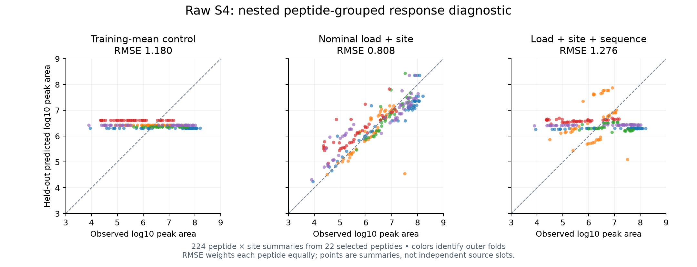

# Raw-S4 nominal-response admission and local grouped diagnostic

**The load/site baseline produces nonconstant held-out predictions and beats the mean control. Adding sequence features under the prespecified shared ridge penalty makes performance worse.** This qualifies a small conditional MS-response diagnostic, not transferable sequence detectability, processing supervision or intracellular concentration. All source admission,295 fits,12,544 validation predictions and672 outer-test predictions passed independent replay.

| Condition | Equal-peptide RMSE | Equal-peptide MAE | Pooled Pearson | Pooled Spearman | Prediction SD |
|---|---:|---:|---:|---:|---:|
| Training-mean control |1.1796|1.0142|−0.4165|−0.4507|0.1020|
| Nominal load + site |**0.8084**|**0.5150**|**0.8805**|**0.9013**|0.8610|
| Load + site + sequence |1.2762|1.0896|−0.0277|−0.0814|0.3644|

All target/error units are log10 arbitrary raw peak area. Actual target SD is1.1120. Pearson/Spearman are ordinary pooled correlations; RMSE/MAE weight each peptide equally, regardless of sites or repeated source slots. The mean control is constant within each fold; its pooled predictions vary because each fold has a different training mean. Its within-fold correlations are undefined, not roundoff-derived scores.

## Source and scientific contract

- Agent/model: Codex / GPT-6; registered October23,2026 before materialization/fitting. Presto50dbfad registration with existing dirty notes/plan recorded; clean executed Hitlist `96b923283de3250883244098067a2601a6f074e4`, unreleased2.0.3 branch in [draft#767](https://github.com/pirl-unc/hitlist/pull/767).
- [Prespecified experiment plan](reproduce/plan.md), [Hitlist recipe spec](reproduce/hitlist-plan.md), [exact invocation/config/source hashes](reproduce/launch.json), [launch commands](reproduce/launch.sh), [fitting/independent replay registration](reproduce/fit.json). No shared-environment installation or upgrades.
- Source: the independently qualified PXD004886 generation at `/private/tmp/hitlist-v2-calibration-203-canonical`, exact manifest hash in launch.json. Original public Data1/2/4/8/13/14/15 and article XML provenance/rights remain in the [source audit](../2026-10-23_0316_codex_shared-ms-calibration/README.md). Source peptide standards were selected for LC/MS performance, and nominal dilution groups were assigned using prior response. This is a selected panel, not an unbiased peptide population.
- Shared canonical recipe: `ms_calibration_raw_s4_nominal_response_v1`, exposed through EvidenceStore/catalog/materialize/CLI and the common verifier. Output kind is `registered_response`, distinct from a probability distribution. Full source inputs, context, every raw-slot disposition and contributor are retained. No Presto-only workbook training adapter.
- The measured pool is synthetic standards added **after** digestion of a HEK293 background. It supplies instrument response under nominal loading. There is no APC/machinery perturbation, precursor processing label, MHC restriction/affinity/stability/capture label or free intracellular concentration measurement. Reference-protocol injection volume is distinct from individual-run metadata.
- RawS4 only. Both raw/normalized source rows remain in the source receipt, but3,069 normalized rows are outside the target scope. No curve positions, non-MHC elution negatives, imputation, synthetic labels or thresholded binder targets were used. The source does not resolve per-position censor/saturation mechanisms; positives are modeled conditionally on being reported.
- Nominal load is fmol on column, not certified molarity of a specific chemical form. It remains a covariate; response is not divided by load. Reporter annotations and standard/group/source-site metadata remain separate. Response-informed group and peptide identity are audit fields, never features. This single-dose-per-peptide slice cannot identify a causal load slope separately from sequence-specific response and panel selection.

## Admission results

The shared recipe preserves all3,069 planned raw source slots. It admits1,974 positive observations and excludes1,095 slots, with every applicable reason retained. Reason counts overlap:697 lack positive finite reported response;396 have unresolved nominal isotope annotations;198 belong to multiple raw forms for one nominal standard;198 have unresolved explicit aggregation labels.

The form policy leaves23 possible canonical sequences. One, `APPPGGWPLQPR`, has no positive rawS4 response, so the fitted cohort has **22 peptides and224 peptide×site summaries** across11 sites. This peptide remains unobserved/excluded; it is not a measured zero. [Independent original-XML admission](results/independent-admission.json) replays every slot, form/load join, exclusion, summary, contribution and fold. The verifier's initial unexecuted exactly23-observed assertion was corrected before its first execution to use original-source set equality; [the amendment](reproduce/verifier-amendment.md) and original verifier are retained. No source/admission/modeling policy changed.

Examples are medians of positive log10 raw response within reporter×site, with min/max/count and exact measurement IDs. Missing slots remain in dispositions. Multiple CNNVLYIR forms sharing one nominal load, explicitly summed raw reporters, and the four isotope-annotation mismatches are excluded. The curve-only SMD2.sum4 identity does not create a second raw form; no cross-asset aggregation equivalence is assumed.

[Complete recipe archive](results/recipe-export.tar.gz) contains all8 original export files, independently compared byte-for-byte: source manifest/tables, contract, dispositions, contributors, examples, summary and manifest. [Archive verification](results/recipe-archive-verification.json). Original export path and source manifest hashes are in launch.json and [independent admission](results/independent-admission.json).

## Fixed training and evaluation

No pretraining, neural network, RL, optimizer schedule, synthetic examples, IC50 or biological availability loss was used in this observation-only diagnostic. All295 fits are local closed-form linear models. The purpose is to qualify a simple response term before coupling it to processing/presentation.

Fold assignment is response-independent: sort all30 panel sequences by SHA256(recipe ID + ':' + sequence), then rank modulo5. All sites/slots of a peptide remain together. Outer folds contain51,45,33,42,53 summaries respectively (5,5,3,4,5 observed peptides). This is exact peptide grouping, not homology or specimen independence: for example AFGYYGPLR and AFSYYGPLR are close sequences in different folds. There is **no untouched external biological test**; results are nested grouped diagnostic cross-validation on one selected panel.

For each outer fold, choose ridge alpha using only the remaining four folds as inner validation, from the fixed grid `[0.0001,0.001,0.01,0.1,1,10,100]`. Selection minimizes aggregated inner out-of-fold equal-peptide MSE. All candidate validation outputs are preserved, not only the selected score. The objective is weighted MSE + alpha×squared standardized coefficients; the intercept is unpenalized. Each training peptide has total weight1 regardless of its number of sites. Centering/scaling and constant-column removal use only training examples.

- Mean: weighted training-target mean only.
- Context: log10 nominal load plus11 site indicators;12 varying coefficients plus intercept.
- Sequence: same context features plus peptide length and20 amino-acid fractions. Methionine fraction has zero exposure and is removed, leaving32 varying coefficients plus intercept. No unexposed sequence coefficient is allocated. These fits do not train the full Presto architecture.

| Outer fold | Context selected alpha | Context inner-val RMSE | Context test RMSE | Sequence selected alpha | Sequence test RMSE |
|---|---:|---:|---:|---:|---:|
|0|0.1|0.9032|0.5263|100|1.3924|
|1|0.0001|0.3649|1.3398|1|1.3046|
|2|0.1|0.8434|0.3107|10|0.8033|
|3|0.1|0.7885|0.7297|10|1.3286|
|4|0.1|0.8999|0.5655|100|1.3136|

Exact inner validation metrics for every candidate, selected alpha and outer fold are in [selections.json](results/selections.json); all training and held-out fold metrics are in [fold-metrics.json](results/fold-metrics.json).

## Verification and artifacts

- [Checkpoints for all295 fits](results/checkpoints.json.gz): training/evaluation IDs, coefficients, scalers, retained/dropped feature columns and metrics.
- [All12,544 inner-validation predictions](results/validation-predictions.jsonl.gz), [all672 outer-test predictions](results/outer-test-predictions.csv), [pooled metrics](results/pooled-metrics.json), [per-peptide](results/per-peptide-metrics.json) and [per-site](results/per-site-metrics.json) metrics, [summary table](results/summary.csv).
- [Independent model replay](results/independent-fit-verification.json) reconstructs every source-derived feature and split, uses augmented least squares instead of the producer's normal-equation solve, verifies alpha selection and all prediction/metric outputs. Maximum coefficient difference1.53e-11; maximum prediction difference7.93e-11. Every fitted coefficient has training exposure; train/test peptide groups are disjoint.
- [Source admission execution](results/admission-execution.json):18.60s, peak744MiB. Independent XML admission:0.082s, peak66MiB. [Fit execution](results/fit-execution.json):295 fits in0.742s, peak106MiB. Independent fit replay:0.852s, peak91MiB. These are tiny closed-form model timings, not comparable to full Presto CPU/MPS training throughput. No Modal/GPU used. [Runtime versions](results/runtime-environment.json).
- Format/lint,61 focused tests and strict docs pass. The normal full Hitlist runner refused before pytest because0.30GiB was available versus2.5GiB required; the guard was not bypassed. Exact software commands/logs are retained. Previous published Hitlistad60a8f and Presto50dbfad full hosted CI pass; current recipe96b9232 CI is a separate check.

## Interpretation and next action

Context is the preferred reference under this narrow contract. The prespecified sequence-augmented model increases equal-peptide RMSE by0.4677 log10 units. A1000-draw paired peptide bootstrap gives95% interval `[0.1533,0.7886]` for sequence-minus-context RMSE, conditional on this selected22-peptide panel. This is not an external-population uncertainty interval and does not establish a general absence of sequence information.

The [coefficient diagnostic](results/coefficient-diagnostics.json) identifies a confounded model comparison: sequence models select alpha1–100, whereas context selects0.0001–0.1. A shared penalty shrinks the useful load coefficient too: context0.589–0.837 versus sequence0.0054–0.271 in original log-load units. This is observed shrinkage, not proof of its sole causal contribution. A future prespecified ablation should retain the context model while separately regularizing the sequence contribution, including an exact zero-sequence option. Reusing these exposed outer folds would be a development diagnostic, not a fresh independent test.

[Hitlist#762](https://github.com/pirl-unc/hitlist/issues/762) owns broader known-load peptide coverage, source form/transition/dilution reconciliation, missingness and acquisition metadata. The present result strengthens the need for broader, less response-selected calibration data; it does not authorize treating this model as general detectability or applying its coefficients to MAPP/MHC elution.

The next biological availability target remains the inhibitor and known-substrate panels in [Hitlist#759](https://github.com/pirl-unc/hitlist/issues/759), with precursor links tracked separately. Those can test machinery-sensitive processing more directly. Preserve exact enumeration and REINFORCE as fixed availability references when admitting those data. No RL-versus-differentiable comparison is claimed from an assay without processing trajectories. Prior biological MAPP fits still failed uniform; old IC50 underfitting and the requested concentration model remain unresolved.
