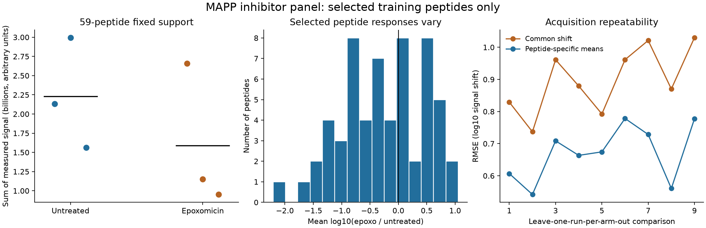

# Controlled MAPP data and training-only response repeatability

The shared source and recipe independently verify. A selected 59-peptide training
subset shows repeatable peptide-specific epoxomicin responses beyond a common
shift: leave-run-out RMSE 0.6761 versus 0.9031 log10 units. This is acquisition
repeatability, not a fitted sequence model or held-out biological prediction.
Only 2.56% of training peptides with any qualifying alpha6 signal survive the
complete-case rule. The next exact/sampled fit is specified, not run.

Agent/model: Codex / GPT-6; registered October 23, 2026 before real source generation.
Presto registration `a52157c86220b98d64a5aad8a9fd92f263def046`, with unrelated
working-tree changes recorded in [launch.json](reproduce/launch.json). Executed
Hitlist clean `1da88e6e194b9623bd982f63ee59fa2a61411cb0`, candidate 2.0.6,
package schema 9/catalog 13. This is an experimental generation, not a release claim.
No cloud/GPU, environment modification, author outreach or synthetic labels.

## Dataset and source contract

The source-preserving shared Hitlist adapter admits original PXD009508 inhibitor
and capture-control results plus PXD007263 cytokine time-course results. Original
archives, ten MaxQuant tables, project/file manifests and two later protein
references are pinned in the copied source contracts. All data curation, metadata
normalization, source queries and admission recipes reside in Hitlist. Presto's
scripts verify and analyze the exported data; they do not replace that adapter.

| Source | Peptides | Evidence rows | Acquisitions | Reported peptide/run quantities |
|---|---:|---:|---:|---:|
| PXD009508 |6,060|19,581|18|109,080|
| PXD007263 |3,146|27,196|12|37,752|
| Total |9,206|46,777|30|146,832|

PXD009508 records literal alpha6/iso/gap capture labels crossed with ut/epoxo and
three numbered acquisitions per arm. Capture and live-cell treatment remain
separate. Epoxomicin 1µM/4h is explicitly publication-level context, not a supplied
per-specimen dosing receipt or measured residual activity. The exact alpha6 gene
alias, biological specimen, aliquot and pairing identifiers remain unknown.
PXD007263 retains literal TNF labels and 0/1/2/6h exposure separately from the
paper's TNF-alpha-plus-IFN-gamma context; no single cytokine identity is invented.
Exposure time is not time since substrate synthesis or proteolytic cleavage.

Species Homo sapiens is project-scoped; HEK293 is publication-scoped. All search
parameters, raw records, direct-MS/MS/matching counts, unique punctuation aliases,
confidence values, reverse/contaminant flags and contributor edges survive. All
900 evidence rows with unreported intensity remain missing. Reported zeros are
not biological negatives. Later 2023canonical/2026_03isoform sequences retain all
exact parent alternatives; the original Human_UP_2016_02 FASTA remains unavailable.
No MHC restriction, affinity, ligand-length or binder filter is introduced.

The registered `mapp_controlled_run_intensity_v1` recipe requires nonreverse,
noncontaminant, standard20-amino-acid peptide, finite peptide PEP<=.01, one source
group, positive reported quantity and positive reconstructed evidence sum. It
retains every excluded result with every reason; a source protein group is not
an assertion of a unique actual precursor. Target is log10 arbitrary captured
fragment MS intensity. Direct-MS/MS evidence is counted but not required in
every recipe row. No imputation, pseudocount or censor-bound invention.

The recipe admits 21,607 positive observations: 9,404 inhibitor/control and 12,203
cytokine time-course. Train/validation/test counts are 14,862/4,072/2,673; 125,225
source results retain exclusions. Components join identical peptides and shared
full reference-protein sequences across both references/projects, including
excluded bridges, then hash into 70/15/15% buckets without quantity outcomes.
There are 1,488 components. This is neither homology separation nor independent
study/specimen validation. Full reason counts are in [recipe-summary.json](results/recipe-summary.json).

## Independent verification

[Independent verifier](code/verify.py) imports no Hitlist code. It checks 218 files,
all 183 predecessor files byte-for-byte,16 pinned assets,57,954 original source
records, all quantities and193,609 contributor edges. All 17 canonical queries
reproduce direct Parquet rows: 1,098,915 mixed-grain rows, not independent assays.

Reference sequence/accession files are byte-identical to the earlier independently
Biopython-verified generation. A separate character-level Aho-Corasick scanner
checks every occurrence of every new peptide across all 62,984 reference records:
16,354 canonical and24,185 isoform occurrences. Claims, alias resolutions,
coordinates, flanks, coverage and connected components independently replay.
Every exported native table, admission, exclusion, log10 target, source context
and split independently agrees. No held-out aggregate response was calculated.
[Full verification](results/independent-verification.json).

## Training-only signal contract and outcomes

Before observing responses, freeze alpha6 peptides in training components with
three positive admitted runs per arm and at least one direct-MS/MS identification
in each arm. Among 2,301 training peptides with any qualifying alpha6 signal,
59 peptides across 40 components meet this rule. Validation/test eligibility counts
are 14 peptides/5 components and 14 peptides/9 components; their responses remain
unevaluated. [Complete eligibility counts](results/contrast-eligibility-counts.json).

For each of 9 choices of one withheld untreated and one withheld treated run,
predict each peptide's log10 response difference from the other two runs in
each arm. Compare against the mean difference across all selected training
peptides. These empirical means are repeatability diagnostics; no sequence model,
neural parameters, pretraining, RL policy or synthetic data is fitted. Numbered
acquisitions are not physically paired specimens. Squared log10 contrast error
has weight 1 per peptide/comparison. No IC50 or 500 nM metrics apply.

| Endpoint on the same59 peptides | Common-shift RMSE | Peptide-specific RMSE | Mean MSE improvement | Component-bootstrap95% interval |
|---|---:|---:|---:|---:|
| Raw captured signal shift |0.90314|0.67608|0.35858|[0.18812,0.55524]|
| Fixed-support normalized composition shift |0.85018|0.60351|0.35858|[0.19023,0.54767]|

All 9 comparisons improve. The 1000-draw bootstrap resamples parent components
(seed 20261023), conditional on these six acquisitions. It does not resample
specimens, runs or studies and is not a causal biological confidence interval.
The identical average MSE improvement after within-run normalization follows
algebraically from removing a global offset; it is not independent confirmation.
The frozen raw-signal lower-interval>0 decision gate passes.

Mean raw log10 shift is -0.26690; median -0.28603; between-peptide SD 0.73540.
The mean detected-signal total under epoxomicin is 0.71187 times untreated on the
fixed 59-peptide support. Across all qualifying positive training alpha6 signals
(with different observed supports), that ratio is 0.23338. Neither is a molar
concentration or a negative-label estimate. Their difference highlights selection
and missing-observation problems. A normalized distribution alone cannot encode
a global change in detected signal; preserve totals and composition separately.

All 1,062 empirical predictions, 59 six-run source profiles, selection reasons,
run totals and bootstrap draws are retained. A [separate scalar replay](analysis/verify_signal.py)
recomputes predictions, metrics and bootstrap draws independently; it passes.
[Summary](results/signal-summary.json), [verification](results/signal-independent-verification.json).
There are deliberately no validation/test outcome metrics or predictions in this
family: the next protocol is frozen before looking at those responses.

## Resources, software checks and failed attempt

| Stage | Wall seconds | Peak process RSS GiB |
|---|---:|---:|
| Real source/catalog/query/recipe generation |135.712|5.031|
| Independent full source/reference/recipe verification |27.962|2.521|
| Training signal computation |0.207|0.261|

Local macOS 26.5 arm64/Python 3.12.6 CPU; OPENBLAS_NUM_THREADS=1,
OMP_NUM_THREADS=1. Admission additionally uses PYTHONPATH=/private/tmp/hitlist-mapp-controls.
No requested/observed Modal GPU. Runtime is one execution, not a hardware ranking.

Hitlist format/lint,78 focused tests and strict docs pass. The normal full local
suite refused before collection at 2.10 and 2.47 GiB available versus its unchanged
2.5 GiB requirement; both logs are retained. This is not a full-suite pass.
Parent feature 46df42d's hosted unit/integration/release checks pass, but are not
checks of this new source head. Review, current hosted checks and release remain
separate. Main advanced to 2.0.5 while this experiment ran; draft stack/version
reconciliation must preserve the pinned experimental generation rather than
relabeling its receipts.

The first diagnostic entrypoint was named signal.py and shadowed Python's stdlib
signal module during a SciPy import. It failed before reading any data. The full
failed script/config/log are in reproduce/failed-attempt-1. Rename-only correction
to run_signal.py was refrozen before launch; data, model and decision rule did
not change. No shared environment package was installed or modified.

## Reproduction, artifacts and next experiment

Run the stage launchers in order: `reproduce/launch.sh`, `reproduce/verify.sh`,
`reproduce/signal.sh`; then run the two scripts under analysis/ for independent
metric replay and the figure. Every launcher/config/source snapshot is retained.
The source producer requires a fresh output destination; preserve prior outputs
and record new destination overrides for reruns. Raw originals stay outside Git:

- Original archives/tables: `/private/tmp/presto-mapp-controlled-assets`.
- Exact source asset layout: `/private/tmp/hitlist-mapp-controlled-assets`.
- Combined source: `/private/tmp/hitlist-v2-controlled-206-canonical`;
  manifest `3b14b05532c6ed24132c37ef7f297eaf0047325e3c822d4293344a44a92cec30`.
- Full portable recipe: `artifacts/2026-10-23_0645_codex_controlled-mapp-signal/recipe`;
  manifest `f8bcf7a7b1fd74b998e79854ee8a1eaa10ea8e2c840392872513c2a1e6d20264`.
- Original data/recipe manifests, row counts and every metric/prediction needed
  for the reported diagnostic are in results/. Source-download URLs and hashes
  are in reproduce/source/hitlist/data/evidence_revisions/mapp_controlled_assets.json.

The [next frozen fit](reproduce/next-fit-spec.md) tests four sequence features plus
one fitted detected-signal scale, conditional on observed untreated quantities.
Exact enumeration and fresh REINFORCE 32/128 share the objective and fixed training
budget; common-shift, no-change and ridge controls remain. Validation/test have
only 14 peptides each, so no broad qualification follows even from a positive fit.
This next experiment is planned, not executed. Known-substrate span/cut kinetics
still need Hitlist #770, precursor context #757, MS-response calibration #762, and
run/capture/reporter metadata #759. Full biological availability remains unresolved.
