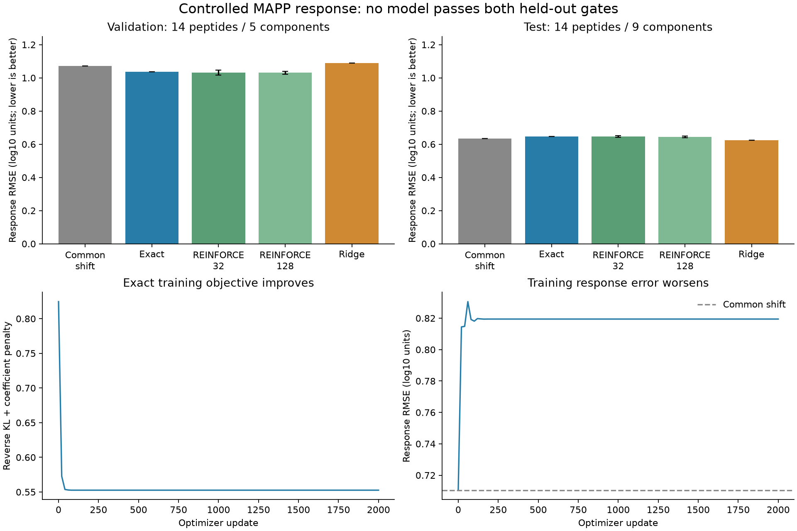

# Controlled inhibitor response: exact versus sampled learning

All seven policy fits and the ridge control completed, and independent replay
passes. **No model passes the frozen validation-and-test response-accuracy gate.**
Exact and REINFORCE policies produce nonconstant responses and improve test
composition KL, but do not beat a common-shift control on test response RMSE.
Ridge slightly improves test RMSE but worsens validation RMSE. No model is promoted.

Agent/model: Codex / GPT-6. Registered October 23, 2026 at 07:21 America/New_York
before implementation, contrast materialization or held-out response evaluation.
[Prior frozen plan](reproduce/plan.md), [launch contract](reproduce/launch.json),
[executed-source freeze](reproduce/training-launch.json). Registration/training
checkout: Presto80ffa7e with recorded unrelated dirty notes and this uncommitted
family; exact executed scripts are copied and hashed. Shared contrast code:
clean Hitlist0be964d, candidate2.0.6 on draft772. All execution is local CPU.

## Data, outputs and selection

The shared Hitlist `mapp_controlled_complete_alpha6_response_v1` recipe consumes
PXD009508 human HEK293 alpha6 captures, untreated and epoxomicin. It reuses the
previous registered run recipe and source generation without changing any input
value, split or exclusion. Nonreverse/noncontaminant standard20 peptide, PEP<=.01,
one source protein group, positive reported/replayed quantities; all three runs
in both arms and at least one direct-MS/MS record in each arm. No affinity or
MHC-length restriction, no missing-value imputation, no biological-negative labels.
The six values and source measurement IDs, all run admissions/exclusions, all
source tables/context/contributors and every peptide disposition remain exported.

Arithmetic mean captured-MS intensity across three acquisitions is computed
separately per arm. Numbered acquisitions are not paired biological specimens.
The source context retains publication-scoped dose/duration/cell identity,
project species, unknown capture-gene/specimen/aliquot links and later reference
alternatives. No inferred genetic KO or residual proteasome activity. Only the
inhibitor alpha6 endpoint is fitted; capture controls and cytokine time-course
records remain curated but are not labels in this experiment.

| Split | Peptides | Sequence/parent components | Source run quantities |
|---|---:|---:|---:|
| Training |59|40|354|
| Validation |14|5|84|
| Test |14|9|84|

These are same-study groups with exact sequence/parent separation, not homology
or independent specimen/study validation. Complete cases are only2.56% of the
training peptides with any qualifying alpha6 signal and are selected using both
arms' detection. The task therefore conditions on a selected observed support;
it cannot evaluate unobserved products, detection probability or prospective
peptide discovery. Validation/test outcomes were first evaluated after all
models were fixed. They are now observed development evidence for future work.

The shared API materializes this contrast; there is no Presto source curator.
Independent source replay verifies all9,206 peptide decisions, all87 selected
members and522 original values/IDs/means. All eight prior run-export files remain
byte-identical, including the source tables and manifest. Prior training-signal
membership and all354 training values also agree exactly. [Admission proof](results/independent-admission.json).

## Five-coefficient conditional response model

Inputs are peptide sequence and **observed untreated mean intensity** for each
candidate. This baseline measurement is required on validation/test too. Treated
measurements are labels only. Four sequence features: log length, fraction
AVILMFYW, fraction KR, fraction DE; training-only mean/population-SD scaling.
No learned sequence encoder or internal-order motif features, no pretraining,
MHC, TCR, TAP, precursor abundance, clearance or MS-response head.

For each split's declared candidate set, let u and e be the untreated/treated
mean intensity vectors, U=sum(u), E=sum(e), q0=u/U and q1=e/E.

```
p_i(w) = softmax(log(q0_i) + standardized_features_i @ w)
beta = log(E_train / U_train)
predicted_treated_intensity_i = U * exp(beta) * p_i(w)
```

Four w coefficients learn composition; beta is the separately fitted training
log detected-signal ratio, with an exact closed-form squared-error solution.
All four features have training rank/support; all four weights get nonzero
gradients and change in every fit. Every allocated coefficient is fitted.
This is measured captured response conditional on untreated data, not a
concentration model or a simulator of cleavage trajectories.

## Fixed training comparison

Exact and sampled policies minimize `KL(p||q1) + 0.1*||w||²/2` with natural logs.
Beta's scalar squared-error objective is fitted separately and shared. Initialize
w=0; Adam lr0.03, betas0.9/0.999, eps1e-8; full support; float64; 2,000 updates;
no early stopping, validation selection, dropout or pretraining. Use the final
checkpoint. One deterministic exact fit; REINFORCE K32/K128 with three seeds
20261023/24/25. Fresh replacement samples, detached log-ratio costs, leave-one-out
baseline; no clipping, group standardization, reuse or reference-policy KL.
Coefficient regularization is not a reference-policy KL.

Controls: no change (original untreated quantities); common shift (same untreated
composition, fitted beta); ridge regression of ln(e/u) on the same four features
and an unpenalized intercept, minimizing mean squared error +0.1*sum(slopes²).
Ridge has a different objective/scale fit; it is a predictive baseline rather
than an estimator comparison. No synthetic biological examples were used. A
small synthetic mathematical fixture checked gradients before biological fitting.

Pre-fit checks: finite-difference maximum gradient error8.21e-11; exhaustive
K2 leave-one-out expectation error4.16e-17. In4,096 K32 Monte Carlo groups, all
coordinate mean errors were below0.57 estimated standard errors, inside the
prospective6-standard-error tolerance. [Mathematical checks](results/math-checks.json).

## Held-out results

Response is log10(epoxomicin mean / untreated mean). Its RMSE equals log10 treated
intensity RMSE because the untreated baseline is supplied. Correlations differ
between response and intensity; both are retained in the full results.

| Condition | Validation response RMSE | Test response RMSE | Validation reverse KL | Test reverse KL |
|---|---:|---:|---:|---:|
| No change |1.16807|0.74509|1.33880|0.33326|
| Common shift |1.07057|**0.63536**|1.33880|0.33326|
| Exact |1.03605|0.64789|1.62046|0.30000|
| REINFORCE32 |1.03276 ±0.01488|0.64603 ±0.00463|1.63194|0.30133|
| REINFORCE128 |1.03141 ±0.00881|0.64421 ±0.00426|1.61507|0.29804|
| Ridge |1.09002|0.62374|1.26770|0.38587|

Sampled values are means over all three seeds; ± is population SD across seeds,
not biological uncertainty. All seeds individually fail the frozen combined gate.
The common-shift control remains the required response reference; no fitted model
has lower RMSE on both validation and test with nonzero response spread.
Ridge's small test improvement cannot rescue its worse validation performance.
All fitted-model test paired-MSE component-bootstrap95% intervals cross zero.
The bootstrap resamples nine test parent components,1,000draws/seed20261023;
it is conditional on these acquisitions, not a population or causal guarantee.

Exact response Spearman is-0.433 on validation and+0.569 on test; test response
prediction SD0.237. These models are not constant, but direction and accuracy do
not generalize consistently. Constant controls' response correlations are
explicitly undefined. Complete train/validation/test loss, forward/reverse KL,
TV, RMSE, Pearson, Spearman and spread for every condition are in
[comparison.csv](results/comparison.csv) and [metrics.json](results/metrics.json).
All870 per-example predictions are in [predictions.jsonl.gz](results/predictions.jsonl.gz).
No IC50/nM/binder metrics apply to this assay.



## What changed our interpretation

The exact objective converges: its final full gradient norm is4.92e-16. Training
reverse KL falls0.82458→0.53192 (penalized objective0.55264), while training
response RMSE **worsens0.71048→0.81946**. This is not an explanation requiring
more optimizer steps. It shows that improving this distribution objective is
not equivalent to improving equal-peptide response error, even on training data.
The observation model, loss weighting and limited features remain substantive
questions; this experiment does not isolate a single biological cause.

A posthoc training-only check of saved states finds that one treated peptide has
31.4% of normalized measured signal and five have65.3%; intensity effective
support1/sum(q1²) is6.81 among59 training peptides. Reverse KL and unweighted
log-response regression consequently measure different aspects of fit. The
exact standardized length coefficient is+0.573; ridge's is-0.296 under its
separate objective/intercept. These differences are not proof that sequence
biology is absent. [Saved-state diagnostic](results/training-objective-diagnostic.json).
No new model was fitted or selected for this analysis.

K128 reduces sampling noise relative toK32. At initial weights, mean-gradient
L2 error across64groups is0.01330 versus0.04685, and mean individual squared
error0.07652 versus0.34456. Near the exact optimum, the true gradient approaches
zero while sampled estimates remain noisy; relative error is then uninformative.
All absolute gradients, individual estimates, variances and norms are preserved.
Neither sampled arm consistently improves predictive results over exact.

## Runtime, work and independent proof

Local macOS26.5 arm64/Python3.12.6/Torch2.14.1/NumPy2.5.4, CPU one thread,
float64; OMP/OPENBLAS/MKL threads1. No GPU/Modal, environment changes or author
outreach. Seven policy fits make14,000 optimizer updates. Whole fit/evaluation
family2.866s, peakRSS0.331GiB. This tiny conditional model is not a hardware or
full-Presto throughput benchmark.

| Method | Optimizer seconds/fit | Training policy rows | Logical target terms |
|---|---:|---:|---:|
| Exact |0.218|118,000|118,000|
| REINFORCE32 |0.246 mean|118,000|64,000|
| REINFORCE128 |0.250 mean|118,000|256,000|

Sampling still constructs probabilities for all59 candidates. Fewer logical
label terms are not an expensive-oracle or neural-network speedup. Diagnostics,
history evaluations and terminal predictions have separate work/time receipts.
The original model counters omitted four exact-gradient reference calls during
probes; [corrected work accounting](results/work-accounting.json) explicitly adds
236 policy/target rows per fit. Original counters and timed execution are kept;
no fit or prediction was changed for this reporting correction.

Independent NumPy feature construction, Adam/REINFORCE updates and checkpoint
replay reproduce all14,000 updates and28 saved checkpoints, including optimizer
moments and sampling RNG state. Maximum weight difference8.60e-16. Independent
augmented least squares reproduces ridge; all870 predictions,30 split metric sets,
bootstrap draws and decision gates replay. [Independent proof](results/independent-results.json).
Verifier0.480s/0.205GiB. Shared materialization/base conservation64.04s/3.303GiB;
independent source/contrast replay1.319s. All raw failures/checks/logs are retained.

Hitlist format/lint,50 focused tests and strict docs pass. Its normal local full
suite refused before collection at0.64GiB available versus its unchanged2.5GiB
guard; no local full pass is claimed. Earlier source1da88e6 passes full hosted Tests and Docs. Current contrast head
0be964d has no workflow run while draft772 reports a merge conflict after upstream
changed. New release-preparation edits in the shared Hitlist checkout are
preserved; reconciliation to planned2.0.7 is separate from these pinned results.
Current-head full CI, review and release are still pending.

## Reproduction and next step

Run `reproduce/admission.sh` against fresh output destinations, then the frozen
mathematical check and `reproduce/launch.sh`; run both analysis scripts for
independent replay and reporting. Configs, exact source snapshots and script
hashes are retained. Never overwrite immutable prior outputs. Data paths:

- Combined source `/private/tmp/hitlist-v2-controlled-206-canonical`, manifest
  `3b14b05532c6ed24132c37ef7f297eaf0047325e3c822d4293344a44a92cec30`.
- Original run export `artifacts/2026-10-23_0645_codex_controlled-mapp-signal/recipe`,
  manifest `f8bcf7a7b1fd74b998e79854ee8a1eaa10ea8e2c840392872513c2a1e6d20264`.
- Shared contrast `artifacts/2026-10-23_0721_codex_controlled-mapp-fit/contrast`,
  manifest `db0333e4dc7b48cb0cb7bbadd3533d286434e26fa17d94046e7b6ea873b07d28`.
- Checkpoints, all model coefficients, optimizer/RNG states, histories, gradient
  estimates and all split predictions are directly in results/; no hidden model
  artifact directory or external checkpoint is required.

As prespecified, do not tune further against these14 test peptides. Next biological
work is the known-substrate digestion time course in Hitlist#770, which can test
production and fragmentation over measured time. The existing exact span-mass
and discrete cut-partition design retains the full fragment pool, including
single residues and nonbinders, while separating the MS observation process.
That work requires source qualification and a coherent observation likelihood;
no kinetic or intracellular concentration model is established here. Full
availability objective remains active; precursor/MS/APC limitations remain.
