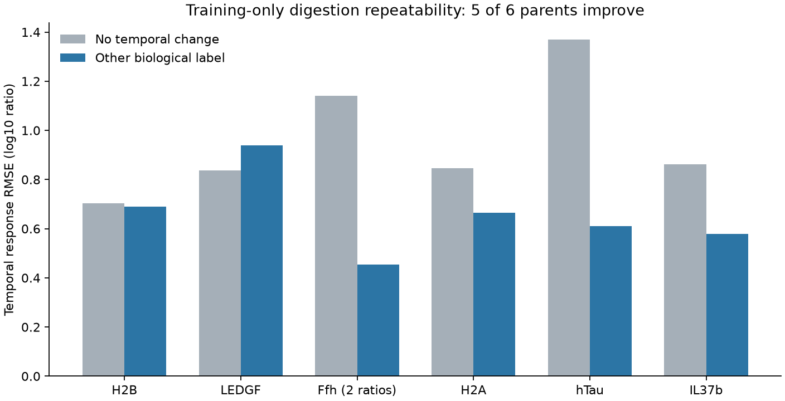

# Training-only digestion temporal repeatability

**Matched biological-label temporal responses beat no change in five of six training proteins.** The prespecified descriptive continuation gate passes. This is a measurement-repeatability diagnostic, not a sequence model or held-out prediction result.

Registered and executed2026-10-23, Codex / GPT-6. Input is the independently verified shared `digestion_contiguous_timecourses_v1` reviewed export, manifest `42cda75e98c3144c5b0226d24b5ebee7d17c687ad6559a6c94d7e6d51b13e33d`. Exact source/curation and exclusions are in family1123. No additional peptide, time, protein or outcome filtering; original grouped splits remain fixed. Training uses23,054 curves/11,527 peptide-condition pairs in seven conditions and six constructs. Validation/test responses remain unevaluated.

## Observation and comparison

For each peptide/condition, take the earliest common positive physical time as a supplied measured reference. Response at each later common time is log10(signal(t)/signal(reference)). Predict a source biological-label response from the mean of the other labels for that same peptide/condition. No change predicts0. Both conditions use the same eligible support. Source arbitrary MS units remain original; temporal ratios could cancel a constant peptide-specific response only under that assumption. Background processing, selection, reference noise and any time-varying measurement effect remain.

Average squared errors over times within curve, then curves within condition, conditions within construct and equally over constructs. The gate requires lower macro MSE and improvement in at least half the training constructs. No optimizer, fitted parameters, pretraining, synthetic biological labels or assay loss weights. This is a diagnostic with supplied matched measurements; it is not a deployable zero-shot predictor.

| Metric | Cross-label prediction | No change |
|---|---:|---:|
| Equal-parent log10 RMSE |0.67267|0.98579|
| Pooled log10 RMSE |0.61799|1.08604|
| Pooled Pearson |0.81557|undefined|
| Pooled Spearman |0.75792|undefined|
| Pooled prediction SD |1.01755|0|

Target SD1.01755; both directions are retained, so cross-label target/prediction marginal SDs are equal by construction. The pooled correlation is descriptive and gives large peptide sets greater weight. Parent improvements: H2B small; H2A, Ffh, hTau and IL37b stronger; LEDGF worsens (cross-label MSE0.88280 versus no-change0.70080). All parents remain. [Per-parent comparison](results/comparison.csv) and [full metrics](results/metrics.json).

## Verification and decision

All67,576 train-only response/prediction records, raw reference and target signals, original curve IDs and counterpart IDs are preserved in results/predictions.jsonl.gz. Independent scalar log subtraction and hierarchical error recomputation verify every row, parent metric, overall RMSE/Pearson and gate without importing the producer. No binding/nM metrics apply; no validation/test prediction dumps are produced because this deliberately preserves those outcomes for the prospectively specified kinetic fit. No held-out performance claim is made.

Actual launch.json/launch.sh, source snapshot, verification command/hash, Presto5a10094 and dirty state are recorded. Local CPU only; OMP/OPENBLAS threads1, no Modal/GPU. Diagnostic1.347s/0.936GiB peakRSS. Six parents and correlated overlapping fragments do not establish population-level repeatability. All curves share the publication's filtering/background procedure; no independent concentration calibration follows.

Proceed to a bounded ordered sequence-to-bond-rate model with exact fragment expectations and measured-reference temporal prediction. Keep no-change/constant-rate controls and qualify sampled gradient variance/bias before costly RL fitting. Passing this gate does not promote an availability model. Full APC precursor/machinery/transport/clearance/MS-response requirements remain open.

Subsequent exposure note: an independent upstream recipe review inspected descriptive validation/test repeatability. This family itself evaluated training only, and its gate/model plan did not use those summaries. Preserve the existing split, document this exposure in future fits, and avoid claiming completely untouched source outcomes. No held-out kinetic model results exist yet. [Next model specification](../agents/codex/plans/biological-independent-cut-fit.md).
