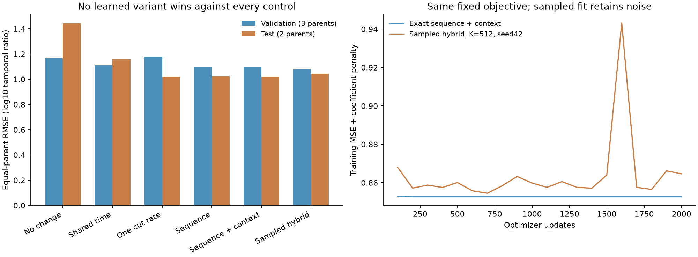
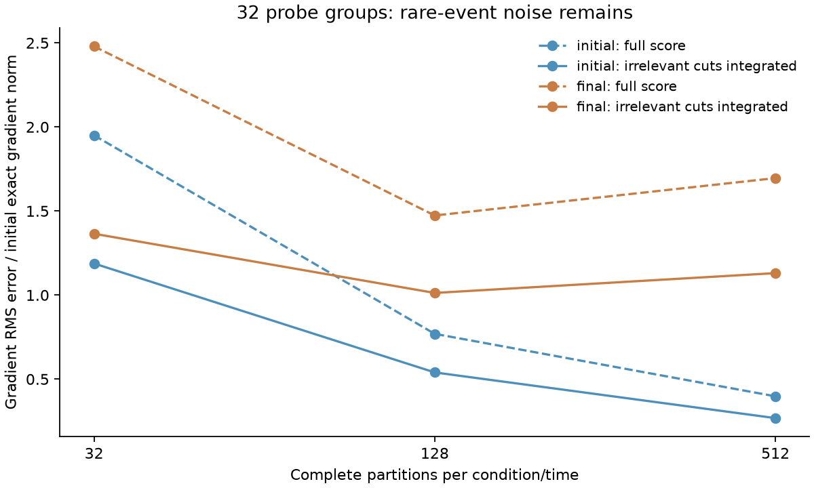

# Biological sequence-to-cut-rate qualification

**Real exact and sampled-hybrid training both completed. Predictions are nonconstant, but no model passes the frozen comparison against all controls on both validation and test.** This establishes a runnable, independently replayed sequence-to-fragment kinetic experiment. It does not qualify a model of APC peptide concentration.

Agent/model: Codex / GPT-6. Registered October 23, 2026 at 12:02 America/New_York, before implementation/fitting. Registration checkout `fc4d24a89800e3c6df2697b0f13e49ca0dd4a803` plus the recorded dirty state. [Execution plan](reproduce/plan.md), [launch/environment/source contract](reproduce/launch.json), [sampled-fit plan](reproduce/sampled-fit-plan.md). Every stage is local CPU; no Modal, GPU, environment upgrade or author outreach.

## Data and observation contract

Shared Hitlist `digestion_contiguous_timecourses_v1`, producer 2.0.9, consumes Soh2024 purified human standard-20S digestion data, MSV000092631/PXD044463. Input directory `/private/tmp/hitlist-digestion-209-review-candidate`, manifest SHA256 `5f616170b5514cb4d8f0c7b7843d232959e9514eebbca6483f976e17b0846615`. Reviewed source package `/private/tmp/hitlist-v2-digestion-208-unit-candidate`, manifest `ad62414d511b74a6aa1e4da457fdff68d9f4527874d1a2e385c65e5b98df41e8`. Source and derived archives are retained by the [preceding admission family](../2026-10-23_1123_codex_digestion-timecourse-admission/README.md). This experiment adds no private source curator or response-based selection.

The shared recipe admits canonical-20, uniquely mapped contiguous products with actual filtered/raw baseline evidence, consistent time metadata, and repeated source biological labels sharing at least three positive times. RF1 conflicts, splice alternatives, unsupported baseline cases and other exclusions retain their original provenance. Zero/missing slots are not treated as biological negatives. Original MS selection, background correction and the positive-trajectory admission remain limitations. No MHC-length or affinity eligibility rule is used.

| Split | Parents | Conditions | Curves | Positive source values | Ratio targets used here |
|---|---:|---:|---:|---:|---:|
| Train |6|7|23,054|91,226|67,576|
| Validation |3|3|3,832|15,037|10,990|
| Test |2|2|3,680|19,160|15,168|

The 30,566 curves contain 125,423 positive measurements. Each model has 93,734 response targets. Only times common to both source biological labels are used. Each peptide's earliest common positive time is its reference; reference time can differ between peptides within a condition. Other source measurements remain in the shared export. The target is `log10(signal(t) / signal(reference))`, separately for each biological label. There is no conversion of MS signal to molar concentration.

The original source-group split is unchanged. Training parents are H2B, H2A, LEDGF, IL37b, hTau and Ffh; both Ffh enzyme-ratio conditions remain in one group. Grouping was built before eligibility and did not search target outcomes. These are six/three/two same-study substrate groups, not independent-study validation. Upstream review had exposed descriptive held-out repeatability before this family; no prior kinetic model predictions existed. Subsequent work on these cohorts is exploratory development evidence and needs independent-study validation.

## Model and information flow

The reusable [independent-cut module](../../models/independent_cut.py) maps literal full substrate sequence to positive effective rates on each adjacent residue bond. The optional supplied protocol covariate is `log((substrate_um / enzyme_substrate_denominator) / 0.2 uM)`; its coefficient is learned, not fixed to linear enzyme activity.

```
full substrate sequence -> ordered adjacent-residue features -> log-linear bond rates
                                                     + optional protocol covariate
bond rates + time -> exact expected amount of each contiguous fragment
fragment amount at t / at measured reference time -> predicted log10 MS response
```

Three variants have respectively 1, 39 and 40 coefficients: a single shared rate; intercept plus 19 left-residue and 19 right-residue contrasts using alanine as reference; and those features plus the protocol covariate. Left/right effects preserve bond orientation, but this is an additive pair model without learned pair interactions, a wide motif encoder or a pretrained protein representation. All 2,299 training bond-design rows give full column rank. Every allocated coefficient receives nonzero gradients and changes in its fit.

For span `[a,b)` at positive time t, independent irreversible cuts give

```
m[a,b](t) = product over required boundary cuts (1 - exp(-k*t))
            * exp(-t * sum of internal bond rates)
```

A protein terminus requires no cut. Prefix sums give exact selected-span expectations in O(parent length + selected spans), without enumerating all binary cut states. All contiguous spans, including single residues and intact parent, are supported; listing them all is O(L²). Expected residue mass is conserved. The amounts are expected copies per initial molecule, not probabilities normalized to sum to one across peptides.

The fitted endpoint is `[log(m(t)) - log(m(reference))] / ln(10)`. An original-unit prediction multiplies this ratio by that peptide's **measured reference signal**, including on validation and test. A peptide-specific, time-constant response factor cancels under this assumption. Reference noise, changing response, background correction and selection do not automatically cancel. Thus this tests temporal response, not zero-shot absolute MS intensity or calibrated molecule counts.

No APC machinery, species classifier, TAP/transport, clearance, MHC, TCR, affinity/stability or independent MS-detectability module is trained. Purified human standard-20S context is the source scope. The coefficients describe a restrictive effective-rate hypothesis, not separately identified physical proteasome rates. No pretraining or synthetic biological labels were used; small synthetic states only verify mathematics.

## Objective, controls and training

Squared log10-response error is averaged over times within curve, curves within condition, conditions within parent, then equally over parents. Add `0.01/2 * sum(nonintercept coefficients²)`; the protocol coefficient is regularized too. Initialize intercept at `log(0.01/hour)`, all other coefficients at zero. Adam lr 0.03, betas 0.9/0.999, eps 1e-8; float64, one Torch thread, 2,000 full-batch updates per fit. Use the fixed final checkpoint, without validation selection, dropout, learning-rate rescue or test-directed refitting.

Controls are no change (zero response), a weighted least-squares shared-time curve with features `log(t/reference)` and its square and no intercept, and the one-rate kinetic variant. Each control answers a different question; the shared-time curve has no sequence-specific production mechanism.

| Variant | Train macro RMSE | Validation macro RMSE | Test macro RMSE | Test Pearson | Test Spearman |
|---|---:|---:|---:|---:|---:|
| No change |0.98579|1.16704|1.44253|undefined|undefined|
| Shared time |0.88014|1.10936|1.15749|-0.0551|0.1294|
| One rate |0.99001|1.18114|**1.01798**|0.2573|0.3537|
| Sequence, exact |0.90327|1.09796|1.02205|0.2797|0.3843|
| Sequence + protocol, exact |0.90257|1.09556|1.02057|0.2832|0.3869|
| Same 40 coefficients, sampled hybrid K512 |0.91048|**1.07721**|1.04386|0.2337|0.3396|

RMSE is in log10 signal-ratio units, weighting parents equally. Correlations and spread pool individual targets and therefore weight substrates differently. Every split's MSE, RMSE, pooled RMSE, Pearson, Spearman and spread is in [comparison.csv](results/comparison.csv); parent results are in [by-parent.csv](results/by-parent.csv). Binding thresholds/nM metrics do not apply to this assay.

Exact sequence+protocol test prediction SD is 0.7005 versus target 0.8844; sampled SD is 0.7000. These are nonconstant responses. The exact final regularized objectives are 0.98012/0.85395/0.85269 for one-rate/sequence/sequence+protocol. Gradients are approximately 1e-15 at the exact endpoints, indicating stationarity, not a global-optimum proof. The learned protocol slope is 0.03053; it does not identify a causal enzyme-dose response. Shared-time already fits training RMSE better than these kinetic variants. No sequence model beats every control on both held-out splits, and all promotion gates remain false.



## What the sampled comparison actually does

The full-score probe samples complete parent partitions using independent Bernoulli cut events. For each observed span it estimates `d log m = E[1(span present) * partition score] / m`, with exact m and exact response residuals. Leave-one-out reward centering reduces full-score variance. This is a hybrid estimator: exact expectations remain in the objective/gradient construction. It is not a pure simulation-only RL fit and has no oracle-cost-saving claim.

At initial and exact-final training states, 32 independent estimates were collected at K32/128/512. A prospectively documented training-only extension integrates the irrelevant bond scores to zero conditional on the span event. The resulting estimate uses sampled presence/exact m times the analytic conditional score. It uses the same full-partition draws and preserves the objective. Independent exhaustive checks verify both estimators against exact gradients.

| State | K | Full-score RMS error / initial exact-gradient norm | Integrated-presence RMS error / same norm |
|---|---:|---:|---:|
| Initial |32|1.9502|1.1877|
| Initial |128|0.7694|0.5399|
| Initial |512|0.3978|0.2681|
| Exact final |32|2.4792|1.3647|
| Exact final |128|1.4733|1.0126|
| Exact final |512|1.6957|1.1306|

The final-state denominator remains the **initial** exact-gradient norm because the final true gradient is nearly zero. These 32-group estimates are noisy and nonmonotonic; no general variance bound is claimed. Exact training event probabilities reach 5.74e-8. A naive plug-in log ratio based only on sampled counts is undefined for 94.3–99.8% of weighted targets across these states/budgets because the reference or target count is zero. No pseudocount silently replaces this endpoint.

After these training-only probes, a separate frozen plan ran one seed42, K512, 2,000-update sampled-hybrid fit using the same initialization, Adam, loss, regularization and final-checkpoint rule as exact sequence+protocol. Efficient prefix aggregation was checked against the frozen probe gradients before fitting. Every step draws fresh partitions. No group-standardization, clipping, sample reuse, reference-policy KL or annealing is used. The run completes, but one seed establishes feasibility rather than statistical superiority or robustness. Training remains noisy, including a late objective spike; no checkpoint was reselected.



The first probe diagnostic incorrectly grouped all peptides at a target time under one reference time. The corrected diagnostic groups by `(target time, reference time)`; the actual gradient calculation already handled per-peptide references correctly. The failed script/config/log are preserved under `attempts/probe-reference-time`; no fitting target or model was changed.

## Training-only model checks

Weighted unregularized prediction-Jacobian matrices have full rank, but condition numbers of JᵀJ are about 47,158 and 51,999 for sequence and sequence+protocol. This is numerical local support, not statistical precision or biological identifiability. [Training diagnostics](results/training-identifiability.json) also preserve intercept profiles without refitting.

A preregistered post-fit training-only diagnostic checks two analytic restrictions: with b required boundary cuts, `m(t)/m(reference) <= (t/reference)^b`; and log m is concave in physical time. At a discrepancy exceeding 0.3 log10 units, 7.47% of weighted ratio observations violate the first envelope and 9.59% of weighted triplets violate concavity. Both biological labels violate the envelope for 1,380 of 33,788 peptide-time pairs, and concavity for 892 of 22,261 triplets. Every observation and identifier is preserved; nothing is excluded or refitted. The envelope-only RMSE lower bound is 0.2776, which does not explain all the model's approximately 0.903 training error.

These findings motivate checking the observation process and effective kinetics. Background subtraction, reference noise, selection, response changes and process heterogeneity remain possible explanations; this experiment does not attribute the violations to one of them. No held-out shape analysis was used to redesign the model.

## Runtime and independent verification

macOS26.5 arm64, Python3.12.6, CPU float64/one Torch thread; `OMP_NUM_THREADS=OPENBLAS_NUM_THREADS=MKL_NUM_THREADS=1`. Original environment/commands are pinned. Exact fitting takes approximately 19.5–20.7 seconds per 2,000-update variant; the whole three-fit/control/prediction stage is 72.208 seconds, peak process RSS 1,205,846,016 bytes. Sampled training takes 323.040 seconds, 325.157 seconds including its terminal prediction work, peak RSS 1,207,222,272 bytes. Roughly 16.6 times the exact fitting time is a descriptive comparison with slightly different terminal-evaluation scopes, not a hardware benchmark.

The sampled fit uses 28,672,000 complete partitions, 9,416,704,000 bond draws and 47,214,592,000 presence tests. It still evaluates exact probabilities/residuals. There is no demonstrated computational gain from sampling on this tractable process.

Independent NumPy feature/target construction, analytic derivatives and Adam replay reproduce all 6,000 exact updates and 12 noninitial checkpoints to 2.28e-15. All 468,670 exact/control predictions agree to 5.79e-15. A separate verifier uses Torch only to reproduce the frozen uniform RNG stream, independently reconstructs cut events/conditional gradients/Adam in NumPy, and replays all 2,000 sampled updates and four noninitial checkpoints to 5.72e-15. Its 93,734 predictions agree to 5.02e-15. Source IDs, reference signals, original-unit predictions, hierarchical weights, metrics and per-parent errors are checked. Exact verifier: 41.185 seconds/992,378,880 bytes; sampled verifier: 215.821 seconds/1,244,905,472 bytes.

Raw numerical summation gives tiny differences between analytically tied predictions and therefore unstable raw Spearman ranks. Original fits, metrics and predictions are retained. The [reporting amendment](reproduce/rank-reporting-amendment.md) evaluates mathematically equivalent rate/length/boundary classes canonically; maximum prediction change is 8.26e-14. Only reported rank metrics change, not RMSE, fitting, checkpoint choice or promotion gates. Canonical rank prediction dumps remain available alongside raw dumps.

Focused repository tests pass: **18 passed in 1.06 seconds**, including exact enumeration, residue-mass conservation, ordered-feature gradients, full-score and integrated-presence estimator expectations. Core Ruff checks and experiment syntax checks pass. Repository formatting after fitting changes no Python AST; [equivalence receipt](results/repository-format-equivalence.json) preserves both hashes. Frozen executed source bytes are unchanged.

## Reproduction, artifacts and decision

Use a disposable checkout with the original absolute-path/import-alias arrangement or explicitly rebind paths in a separately recorded reproduction. Restore the original executed module/test snapshots under `reproduce/source/models/` and `reproduce/source/tests/` before running the original launch: its source-hash guard intentionally rejects the later whitespace-formatted repository module. Do not weaken that guard. The rest of the original fit source snapshots retain full relative paths under `reproduce/source/experiments/.../code/`. See [format note](reproduce/repository-format-note.md).

Run `reproduce/launch.sh` for the exact mathematical checks/fits; phase JSON files pin the original commands and hashes for probes, integrated probes, sampled fitting, diagnostics and both independent verifiers. `code/report.py` aggregates saved outputs without fitting. Outputs are immutable: use fresh destinations and preserve original files. All model coefficients, checkpoint histories, exact/sampled gradients and mathematical checks are in `results/`; the raw and canonical `*.jsonl.gz` dumps contain all train/validation/test predictions. Logs and original failed attempts are retained. No hidden external model checkpoint is required.

**Decision:** retain exact differentiation as the tractable reference and the real sampled-hybrid fit as a verified comparator. Do not promote a biological model, tune against these two test substrates, or claim calibrated APC concentrations. The next useful step is a source-linked observation diagnostic using raw/baseline/contributor information, followed by a narrowly justified process extension only if training evidence supports it. Hitlist#770 owns the broader digestion support and #762 the independent MS-response calibration limits. Species/APC machinery, transport, turnover, precursor abundance and independent response calibration remain open parts of the full goal.
