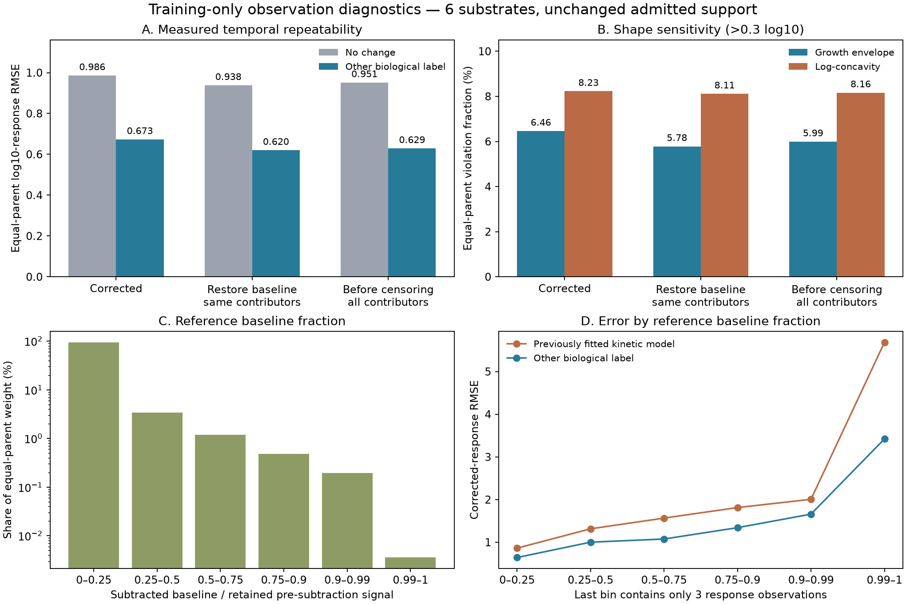

# Training-only digestion observation-effects diagnostic

**Restoring the subtracted baseline leaves most of the independent-cut model's shape violations in place.** Near-baseline measurements are noisier, but account for little training weight. This narrows the next processing-model question; it does not identify a biological cause or qualify an APC concentration model.

Agent/model: Codex / GPT-6. Registered October 23, 2026 at 12:57 America/New_York before analysis, checkout `aa4c809ef8811b55e35ee13d5e596ecd8d9c1444` plus recorded dirty state. [Plan](reproduce/plan.md), [launch/source/environment contract](reproduce/launch.json), [independent proof](results/independent-verification.json). Local CPU only, no Modal/GPU, environment upgrades or author outreach.

## Source, scope and observation layers

Same shared Hitlist2.0.9 `digestion_contiguous_timecourses_v1`, manifest `5f616170b5514cb4d8f0c7b7843d232959e9514eebbca6483f976e17b0846615`, at `/private/tmp/hitlist-digestion-209-review-candidate`. Its full `source_tables` snapshots already contain pre-subtraction quantities and baseline contributors, despite narrower internal recipe-query projections. No new source import, curation policy or private Presto curator was needed.

The source is purified human standard-20S digestion, Soh2024 MSV000092631/PXD044463. The [primary study](https://www.nature.com/articles/s41467-024-45339-3) describes baseline filtering/subtraction and technical averaging. Here the deposited arithmetic is authoritative, as independently replayed in the [all-substrate audit](../2026-10-23_1057_codex_digestion-arithmetic/README.md). This includes I/L aggregation, source3→1/4→2 technical-label remapping, per-peptide/biological/remapped-label maximum zero baseline, global median threshold, subtraction and averaging retained positive residuals. Paper-level prose does not replace the deposited implementation.

Numerical analysis is restricted to the six training parents/seven conditions: H2A, H2B, IL37b, LEDGF, hTau and two grouped Ffh ratios. All 23,054 curves,91,226 positive source values and 67,576 previously declared response targets are retained. No row is removed based on diagnostics. Complete training-condition filtered rows reproduce the original global median; products outside the admitted contiguous subset do not become new training examples. No validation/test outcome is evaluated.

For every admitted curve/time, preserve three layers:

1. **Corrected:** original positive mean after baseline subtraction and residual censoring.
2. **Restored:** pre-subtraction mean over exactly the contributors retained in corrected. Restore the applied baseline but preserve source contributor selection.
3. **Unthresholded:** pre-subtraction mean across all filtered contributors at that time, including later-censored residuals. Earlier identification/synthesis filtering still applies.

Every point retains aliases, vector/slot IDs, I/L contributors, original/remapped technical labels, baseline contributors/value, global threshold and censor status. Original corrected values remain authoritative. Actual-zero IDs agree with raw time metadata, and admitted training conditions require no mock baseline. Source technical labels are not proven physical acquisition pairs. Restored quantities are sensitivity measurements, not relabeled concentrations.

## Fixed comparisons

Use original common positive times and each peptide's earliest common positive reference. Compute log10 signal ratios, with the other biological label predicting each label in both directions; no change predicts zero. These are supplied-measurement comparisons, not learned zero-shot predictors. RMSE averages times within curve, curves within condition, conditions within parent, then equally over parents. Correlations pool individual targets.

| Layer | No-change RMSE | Other-label RMSE | Other-label Pearson | Other-label Spearman |
|---|---:|---:|---:|---:|
| Corrected |0.98579|0.67267|0.8156|0.7579|
| Restored, same contributors |0.93763|0.61972|0.8268|0.7612|
| Before residual censoring |0.95137|0.62868|0.8263|0.7621|

Changing the measurement layer changes dynamic range: lower RMSE is not a learned-model improvement or proof of more accurate biological amounts. [Complete per-parent metrics](results/comparison.csv).

The independent-cut process bounds growth by `(t/reference)^b` for b required boundary cuts and makes log amount concave in physical time. Values below use >0.3log10 discrepancy; thresholds0/0.5 also remain in [shapes.json](results/shapes.json). Applying these restrictions to restored total signal is a sensitivity check: added background can itself alter ratios/concavity and is not part of the original process model.

| Layer | Growth violations, pooled | Growth, equal-parent | Concavity, pooled | Concavity, equal-parent |
|---|---:|---:|---:|---:|
| Corrected |7.4745%|6.4629%|9.5863%|8.2256%|
| Restored |6.9344%|5.7829%|9.5301%|8.1117%|
| Unthresholded |7.1608%|5.9906%|9.5863%|8.1630%|

Restoring background leaves 4,684/5,051 original growth violations (92.73%) and 4,215/4,268 concavity violations (98.76%). It removes 367/53 and introduces 2/28 respectively. Both biological labels violate growth in 1,380 original versus 1,285 restored peptide-time pairs; concavity in 892 versus 893 triplets. [Every transition/count/weight](results/shape-transitions.json).

**Reporting correction:** the preceding kinetic README called7.47%/9.59% weighted fractions; they were pooled counts. Its prose is corrected, and this report explicitly supplies both reductions. No prior numerical count, prediction, fitted parameter, hierarchical RMSE lower bound or promotion decision changes. [Correction receipt](results/prior-report-label-correction.json).

## Baseline and source-label associations

Fixed strata use the fraction of retained pre-subtraction reference signal removed by the applied baseline. Below25% contains 65,031 responses and 94.73% of equal-parent weight. Here the preceding fixed sequence+protocol model has corrected-response RMSE0.8608 versus other-label repeatability0.6418. The predictive gap is not confined to reference signals close to the subtraction threshold.

| Reference subtracted fraction | Responses | Weight share | Saved model RMSE | Other-label RMSE |
|---|---:|---:|---:|---:|
| 0–0.25 |65,031|94.7264%|0.8608|0.6418|
| 0.25–0.5 |1,707|3.4168%|1.3147|1.0013|
| 0.5–0.75 |565|1.1767%|1.5656|1.0758|
| 0.75–0.9 |195|0.4813%|1.8125|1.3414|
| 0.9–0.99 |75|0.1952%|2.0059|1.6583|
| 0.99–1 |3|0.0036%|5.6856|3.4214|

Intervals include their lower boundary, and the last includes1. Its three observations cannot support a stable population conclusion. No model update/checkpoint selection or exclusion accompanies these descriptive training-residual associations.

The retained original/remapped technical-label set changes between reference and target for 3,827 responses,6.13% of equal-parent weight. Other-label RMSE is1.2277 versus0.6193 when that set is unchanged. This signature does not establish unchanged acquisition identity or contributor multiplicity. Censoring, weak signal and measurement variation remain possible explanations; no causal effect is established.

## Verification, training contract and runtime

No optimizer, pretraining, synthetic biological labels, loss terms or assay heads are fitted. Saved kinetic predictions retain their original corrected-log-response MSE/regularization contract. The diagnostic maps measured layer values to log ratios and other-label measurements to predictions. nM/binder-threshold metrics do not apply. Validation/test dumps are intentionally absent because this is a training-only preprocessing diagnostic; all 202,728 ratio records across three layers and 133,566 triplets are saved instead.

An independent implementation imports neither producer script and reconstructs source arithmetic with Pandas from original `fields_json`. It verifies all 91,226 positive points and 195,586 contributor occurrences, all ratios, other-label predictions, ratio weights, saved-model residuals, triplets, shape/transition reductions, baseline strata and aggregate/per-parent metrics. Maximum layer relative error5.11e-15; metric discrepancy zero. Actual baseline perturbation and removal of an actual contributor both fail verification; originals remain unchanged. First attempt failed because Pandas exposed a read-only NumPy view during in-place weight normalization. Failed script/config/log are retained under attempts/; allocated-array normalization fixes the verifier without changing outputs.

| Stage | Seconds | Peak process RSS, bytes |
|---|---:|---:|
| Layer replay |10.915|1,415,200,768|
| Response/shape analysis |10.543|1,167,556,608|
| Independent verification |10.931|1,993,670,656|

Exact shared Python/source/git paths and overrides are in reproduction receipts. CPU with OMP/OPENBLAS/MKL threads1; no GPU. Figures visually inspected; syntax checks pass. This is not a full-model benchmark or independent biological validation.

## Reproduction and decision

Run `reproduce/launch.sh` in a disposable copy with pinned input paths available and fresh output destinations. Phase JSON files freeze verification/plotting commands and source hashes. Original source/derived archives are linked from the [admission report](../2026-10-23_1123_codex_digestion-timecourse-admission/README.md). `curve-layers.jsonl.gz` preserves every source-linked point; `ratios.jsonl.gz`/`triplets.jsonl.gz` preserve every diagnostic target/prediction/weight. All summaries, figures and logs are in this family.

Decision: retain background/reference uncertainty, but do not treat baseline subtraction alone as the main explanation for model failure. Keep the completed exact and sampled-hybrid fits fixed. Next qualify a minimal substrate-entry delay as a distinct process hypothesis, including mathematical checks of which shape restrictions it relaxes, before new biological fitting. Do not assume it solves concavity violations. No model is promoted; cellular machinery, transport/clearance, precursor context and independent MS response remain necessary for the full APC availability goal.
