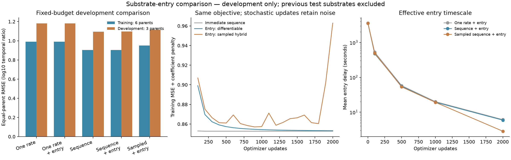

# Substrate-entry process: differentiable and sampled development comparison

**A shared entry delay did not improve the matched immediate-cut model.** The differentiable sequence model approaches immediate entry, with a fitted mean delay of5.92 seconds against hour-scale observations. The sampled hybrid completed2,000 updates but its final training loss rose, and its development error is worse. Keep the immediate sequence model as the simpler reference. No model is promoted or calibrated as APC concentration.

Registered October 23, 2026 at 13:24 America/New_York; Codex / GPT-6. All fits and independent outcome checks are complete. The earlier test substrates remain closed. This family advances the broader availability goal without completing it.

## Results

| Variant | Parameters | Training RMSE | Development RMSE | Development Pearson | Development Spearman | Development prediction SD | Fit seconds |
|---|---:|---:|---:|---:|---:|---:|---:|
| Immediate, one rate |1|0.990008|1.181136|0.31469|0.28869|0.46325|8.49|
| Entry, one rate |2|0.990313|1.181390|0.31478|0.28861|0.46345|238.85|
| Immediate, sequence/protocol |40|0.902566|1.095559|0.42877|0.36165|0.45384|8.68|
| Entry, sequence/protocol |41|0.902838|1.095745|0.42881|0.36162|0.45408|239.46|
| Entry, sampled hybrid K512/seed42 |41|0.949424|1.113748|0.40369|0.34697|0.44399|1295.28|

RMSE is equal-parent/condition/curve/time weighted error in log10 same-peptide temporal signal ratios. Correlations/SD pool observations; target development SD is1.03863. Training has6 parents/67,576 targets; development3 parents/10,990 targets. There is one sampled seed and no biological confidence interval. [Full metrics](results/all-metrics.json), [raw metrics](results/all-metrics-raw.json), [comparison CSV](results/comparison.csv), [all392,830 predictions](results/all-predictions.jsonl.gz).

Immediate controls are stationary to roughly1e-15 gradient norm. Entry fits retain small gradients(~0.00060/0.00049) toward faster entry; a finite processing lag is not identified by this fixed budget. Mean fitted delays are6.10 seconds(one rate),5.92 seconds(sequence),2.85 seconds(sampled). The sampled final exact gradient norm is0.3233, so its late loss increase is not convergence. No earlier checkpoint was substituted. Predictions vary; that alone does not establish correct biology.

## Source, admission and measurement contract

The unchanged shared Hitlist 2.0.9 canonical recipe is pinned by manifest `5f616170b5514cb4d8f0c7b7843d232959e9514eebbca6483f976e17b0846615`; recipe directory `/private/tmp/hitlist-digestion-209-review-candidate`. Original source tables and exact manifest hashes remain there and in the linked predecessor admission reports. No separate Presto curator or source-value correction was introduced.

This is purified human 20S standard-proteasome digestion, not an APC specimen. Inputs are the literal full substrate sequence, physical time and the recorded enzyme-concentration proxy. Training parents are H2A, H2B, LEDGF, IL37b, hTau and Ffh(two protocol ratios); species and enzyme preparation remain source metadata rather than learned variable effects in this homogeneous enzyme cohort. The source's retained contiguous5–40-residue positive time courses have literal construct mapping, original background/contributor provenance and shared positive references. No missing/filtered/unobserved value becomes a negative or imputed target. The repeated source biological labels are not independent studies.

The original weights and log10(signal(t)/signal(reference)) targets are unchanged. Both earlier test parents are filtered before numerical target construction. No test predictions or metrics are produced: this is development work on known source strata, and an independent source/preparation cohort is still required for promotion. No affinity, stability, TCR, MHC elution, binder-threshold or synthetic biological training labels enter this family. nM/binding metrics are inapplicable.

## Model, information flow and training

An intact parent waits an exponential time E with one shared rate lambda. Before entry it remains intact; after entry, bonds cut independently for age t-E. Bond rates are positive log-linear functions of the left/right residue contrasts and protocol proxy:40 coefficients including intercept/context, plus log(lambda). The one-rate+entry control has2 coefficients. Every contiguous fragment, including singletons and nonbinders, remains in the process. Expected amounts and sampled complete partitions conserve residue mass.

For a proper fragment, m(t)=integral_0^t lambda*exp(-lambda*u)*m_immediate(t-u)du. The intact parent additionally receives exp(-lambda*t). The predicted observation is log10(m(t)/m(reference)); measured per-peptide reference signal reconstructs later MS signal. This cancels an assumed time-invariant peptide response but does not verify that assumption, calibrate cross-peptide concentrations or identify total yield. APC machinery, transport, clearance, MHC selection and independent MS response remain outside this bounded extension.

Entry raises the early proper-fragment growth-envelope power from b to b+1, where b counts required boundary cuts. It still preserves log-concavity: the immediate-fragment function and exponential entry density are log-concave, and convolution preserves that property. Thus entry cannot explain all prior nonconcavity. This is a mathematical limitation, not evidence assigning the residuals to biological processing rather than measurement. [Convolution result, Saumard and Wellner 2014](https://pmc.ncbi.nlm.nih.gov/articles/PMC4847755/).

All variants use float64 CPU, one Torch thread, Adam lr0.03/betas0.9,0.999/epsilon1e-8,2,000 full-batch updates. Initial bond rate0.01/hour, initial entry rate1/hour, other coefficients0. Objective: the unchanged hierarchical log10-ratio MSE plus0.01/2 times squared nonintercept shared coefficients. Entry rate is unpenalized. No pretraining, dropout, validation-based checkpoint selection or rescue grid. Every allocated coefficient has recorded nonzero gradients and changes, but this does not prove identifiability of a finite entry timescale.

## Differentiable quadrature and sampled gradient

Positive physical-age Gauss-Legendre quadrature approximates the entry integral. In the qualified fast-entry regime(lambda*t>=64 and lambda>2*sum(parent bond rates)), positive Gauss-Laguerre entry-time nodes resolve the narrow density. The guard and normalized entered weights are shared over all spans at a parent/time, retaining residue mass. A NumPy Golub-Welsch rule avoids high-order polynomial overflow without adding a core SciPy dependency. This is differentiable quadrature, not exact continuous integration.

The original fixed-age attempt stopped at update500 of entry_constant when lambda reached~63/hour:32vs64-node max log-amount discrepancy0.00573 and gradient discrepancy0.00157 exceeded the frozen gates. [Original failed source/config/checkpoint/log](attempts/fixed-age-quadrature/README.md) remain intact. The numerical amendment changed no biological model, target, initializer, loss, optimizer budget or tolerance. Completed immediate controls were reused; entry fits restarted from their original initialization. Count the failed500 updates as additional work, not a resumed trajectory.

Expanded qualification uses initial, previous-fit and actual failed states, entry rates0.01 through1,000,000/hour,32/64/128/256 nodes, a separate complete-state Markov generator and branch-boundary/gradient/mass checks. Order32 passes max log-amount1e-6 and objective-gradient1e-5 limits; actual fit checkpoints100/500/1000/2000also pass32vs64. Initial probe predictions/gradients are bitwise unchanged by the amendment. [Original qualification](results/qualification.json), [amended qualification](results/qualification-v2.json), [numerical grids](results/training-numerics-v2.json).

The sampled arm draws512 fresh continuous entry times and complete cut partitions per condition/time/update. Irrelevant-bond scores are integrated out, while residuals and mass denominators remain quadrature-based. It is a hybrid continuous-process score estimator, not pure simulation-only RL or an exactly unbiased estimator of a finite quadrature grid. No clipping, group-standardization, sample reuse or reference-policy penalty. Initial16-group RMS gradient error/reference norm was0.35946 integrated versus0.47690 full score. The actual fit used28,672,000 partitions,9,416,704,000 bond draws and46,402,560,000 presence terms. There is no oracle/network-score-saving claim.

## Independent verification and runtime

[Independent verification](results/independent-verification.json) reconstructs source rows, weights, all392,830 predictions and final continuous-process gradients using separate NumPy/SciPy computations. Maximum prediction error3.11e-15; metric error1.45e-15; final gradient error6.08e-15. All2,000sampled Adam updates replay from saved gradients, with max coefficient error3.56e-15. Five sampled gradients(steps1,100,500,1000,2000) are independently reconstructed from saved RNG states using Torch only for the uniform stream; maximum discrepancy3.99e-15. Every sampled gradient and the exact-entry optimizer trajectory were **not** independently rerun. This scope is explicit, not an all-update independent-gradient claim.

Structural prediction ties are grouped by identical internal ordered-pair counts, boundary pairs, context and target/reference times; one-rate models use length/boundary count. Raw outputs and metrics are retained; grouping changes values by less than1e-10. No numerical rounding is used to manufacture ranks. Twenty-two focused tests of entry, independent-cut and availability primitives pass in1.97 seconds. Figure was visually inspected; no label clipping was found.

Expanded numerical qualification64.56s, peakRSS2,609,463,296bytes. Independent closure9.89s, peakRSS1,806,024,704bytes. Per-fit observed wall times are in the table; sampled training overlapped read-only checks and the later capacity diagnostic, so these are not isolated hardware benchmarks. The observed sampled/differentiable entry runtime ratio is about5.4, under that concurrency caveat. Total successful optimizer updates10,000plus the preserved failed500. CPU only; OMP/OPENBLAS/MKL=1, recorded import override, unchanged shared environment. No Modal or GPU.

## Reproduction and artifacts

Execution starts from Presto 311744eee9aa72c9b9ff4d44529a494982a8dd92 with dirty state recorded in [launch.json](reproduce/launch.json). Sources were frozen separately because the new module was uncommitted. Original snapshots/config live in reproduce/source/ and attempts/fixed-age-quadrature/. Amended snapshots live in reproduce/source_v2/. [Initial qualification command](reproduce/launch.sh), [numerical amendment](reproduce/numerical-v2.json), [differentiable config](reproduce/fitting.json), [sampled config](reproduce/sampled-fitting.json), [fit commands](reproduce/fit-v2.sh), [closure contract](reproduce/closure-plan.json) and per-phase verification/plot registrations preserve exact invocations.

Reproduce phases in fresh output destinations, preserving the recorded absolute import/source mappings or explicitly adapting those paths. Original failure reproduction requires the original frozen module/config; the amended fit commands reuse the two saved immediate-control checkpoints. Existing result destinations are intentionally refused. After fits, run code/close_results.py, code/verify_closure.py and code/plot.py with the frozen environment. All final states, optimizer moments, selected RNG states, per-update sampled gradients, every development prediction, summaries, figures and raw logs are under results/ and launch_logs/. Large source data remain in the pinned shared recipe.

## Decision

Keep the immediate sequence/protocol model as the lower-cost reference. This global entry-delay hypothesis earns no gain, and sampling does not improve the fixed objective in this one-seed run. This says nothing universal about RL for more expensive state-dependent trajectories.

The next [training-only capacity diagnostic](../2026-10-23_1401_codex_kinetic-capacity/README.md) separates regularization, sequence/context sharing and necessary process-shape limits before adding more kinetic states. It does not reopen validation/test or promote identity-specific rate parameters into an APC model. Independent MS-response/yield calibration, APC machinery transfer and the earlier MAPP/IC50 biological failures remain unresolved. The full concentration/availability goal stays active.
