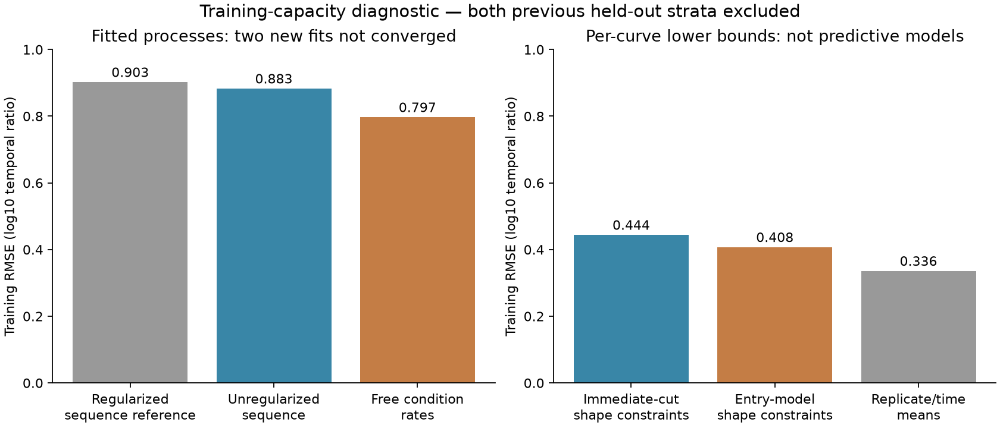

# What limits the kinetic model: training-only capacity decomposition

**Regularization and sequence/context sharing explain part of the training error, but the best fit of the independent-cut process remains unresolved.** Removing the fixed penalty reduces training RMSE from 0.90257 to 0.88315; allowing 2,121 supported condition-specific rate groups reduces it to 0.79734. Both exploratory fits exhaust their 500-evaluation polishing budget without meeting the gradient tolerance. Do not call either a proven capacity optimum or a transferable APC model.

Registered October 23, 2026 at 14:01 America/New_York, before execution. Agent/model: Codex / GPT-6. Both earlier validation and test strata are excluded before target construction. There are deliberately no held-out predictions or predictive-generalization claims in this diagnostic.

## Results and what the comparisons mean

| Condition | Kind | Parameters | Training MSE | Training RMSE |
|---|---|---:|---:|---:|
| Saved regularized sequence/protocol | Fixed reference | 40 | 0.814625 | 0.902566 |
| Same sequence features, no penalty | Capacity fit, not converged | 40 | 0.779949 | 0.883147 |
| Free condition-specific rates | Capacity fit, not converged | 2,121 | 0.635750 | 0.797339 |
| Immediate-cut necessary shape constraints | Per-curve lower bound | Not a transferable model | 0.197476 | 0.444383 |
| Entry-model necessary shape constraints | Per-curve lower bound | Not a transferable model | 0.166156 | 0.407622 |
| Unconstrained replicate/time means | Within-label disagreement floor | Not a predictive model | 0.113122 | 0.336336 |

All errors use the original equal-parent/condition/curve/time weights and log10 temporal-ratio target. Lower bounds are deliberately displayed separately from fitted models: freely selected per-curve shapes do not have to arise from any globally consistent set of bond rates. Their good fit cannot be promoted as a concentration predictor. [Comparison CSV](results/comparison.csv).

The unregularized sequence fit has pooled training Pearson/Spearman 0.44189/0.33083 and prediction SD 0.64118. Free rates give 0.60370/0.49631 and SD 0.78564. Every allocated parameter receives nonzero gradients and changes, but the final gradient maxima remain 5.19e-5 and 1.66e-5, above the requested 1e-8. Parameter coverage does not establish identification or convergence. Full per-parent metrics are in [independent fit verification](results/independent-fit-verification.json).

The necessary constraints themselves add MSE 0.08435 (immediate) or 0.05303 (entry) above the common replicate/time mean. That is a quantified restriction under a common, time-independent observation response. It does not assign the disagreement to biology rather than measurement, and the means are not a biological noise ceiling. The much larger gap to the fitted processes still mixes optimization, stronger process constraints and representational restrictions.

## Fixed source and label contract

Shared Hitlist 2.0.9 recipe manifest `5f616170b5514cb4d8f0c7b7843d232959e9514eebbca6483f976e17b0846615`, located at `/private/tmp/hitlist-digestion-209-review-candidate`. Exact source recipe and reference-fit/metrics hashes are pinned in [launch.json](reproduce/launch.json). The reference is the saved sequence_context fit from family 2026-10-23_1202, not a newly fitted checkpoint.

Use only six original training substrates, seven conditions, 11,527 condition/span groups and 67,576 same-peptide temporal ratios. Retain the original literal substrate/contiguous-peptide mappings, corrected positive quantities, source-label identities, common positive times, per-peptide references and exclusions. No values are imputed, no missing peptides become negatives, no source labels are repaired and no separate raw curator is introduced. Sources are purified standard-proteasome digestions with MS response, not measured APC concentrations. No MHC affinity, stability, elution, TCR, synthetic biological training targets or pretraining. Binding/nM metrics are inapplicable.

The common time schedules are drawn from positive hours 1, 2, 4 and 24, with some groups missing a time. All source labels in a condition/span group share the same admitted schedule; this was checked explicitly. Both previous held-out strata are removed before targets are made. This family cannot assess transfer to new proteins or studies.

## Capacity fits

The shared immediate-cut expectation remains unchanged. The observed target is log10(signal(t)/signal(reference)); the output is log10(expected fragment copies(t)/copies(reference)). Removing the regularizer retains the same 40 sequence/protocol features. Free rates relax all sequence and context sharing per condition; the Ffh conditions can differ independently. These parameters are diagnostic only and will not be inserted as identity embeddings into the APC model.

Among 2,299 bonds, 15 influence no admitted output and remain fixed, outside the optimizer. Bonds with identical internal/left/right incidence across unique admitted spans are grouped. Multi-bond groups are internal-only; their mean initial rate preserves the original summed hazard and every observed initial prediction. This leaves 2,121 fitted groups. [Complete allocation](results/rate-allocation.json). Other nonlinear equivalences remain possible; do not interpret the fitted values as individually identified biochemical rates.

Both fits start from the saved regularized rate field. Use float64, one CPU thread, Adam lr 0.01, betas 0.9/0.999, epsilon 1e-8 for 2,000 full-batch updates; no penalty. Then L-BFGS-B with gtol 1e-8, ftol 1e-15, maxls 20, maxiter/maxfun 500 and an explicit 500-function-evaluation guard. No restart search or held-out selection. Initial/perturbed objectives and analytic gradients are checked against an independent NumPy implementation before fitting.

Both polishing attempts hit the hard evaluation limit. The last evaluated state is retained, not silently replaced with a selected optimum; post-Adam states and every polishing evaluation are also saved. Post-Adam RMSE was 0.883219 and 0.798077. The final fitted RMSE values are modest improvements, but neither trajectory proves the process cannot fit better. [Fit records](results/capacity-fits.json), [every sequence prediction](results/predictions-unregularized_sequence.jsonl.gz), [every free-rate prediction](results/predictions-free_condition_rates.jsonl.gz).

A preflight attempt looked for the newer data_mse field in the older reference artifact and stopped before optimizer updates. The older artifact uses final_data_mse and a separately recorded metrics file. The corrected lookup pins/replays the metrics file; original source/config/log remain in [attempts/reference-metric-key](attempts/reference-metric-key/README.md). No model, source, target or optimizer change was made.

## Necessary-shape lower bounds

For each condition/span, use log expected amount relative to the first positive reference time, z0=0. Fit a common curve to all retained source biological labels. The unconstrained solution is the weighted per-time mean. The constrained solutions additionally require:

- Nonincreasing slopes in physical time (discrete log-concavity).
- Adjacent growth no greater than b*log10(t_next/t_previous), where b is the number of required boundary cuts; use b+1 for the entry-model envelope.

Adjacent inequalities imply the corresponding all-pair bounds. These are necessary, not sufficient, process restrictions. Tiny weighted convex quadratic programs are solved by enumerating independent active sets. Every solution has verified primal/dual feasibility, stationarity and complementarity. Fifty representative bucket/row solutions are also compared with an independently formulated SLSQP problem; the exact count is recorded in shape-qualification.json. No molecular concentrations or extra physical trajectories are inferred from these projections.

[Per-curve solutions and certificates](results/shape-curves.jsonl.gz), [every observation prediction](results/shape-predictions.jsonl.gz), [metrics](results/shape-metrics.json), [qualification](results/shape-qualification.json). Shape Spearman values are raw descriptive diagnostics; constrained ties can affect floating-point ranks, so the decisions here use verified MSE, not rank differences.

## Independent verification and runtime

The independent original-row verifier reconstructs all target/weight/reference decisions, all 23,054 convex certificates and all 67,576 predictions without importing the producer. Maximum KKT residual is 3.81e-15 and prediction discrepancy 1.78e-15. Perturbing each projected solution by an actual nonzero value invalidates its certificate. [Proof](results/independent-shape-verification.json).

The fit verifier independently checks incidence allocations, direct-sum expected ratios and all 135,152 fitted predictions. Maximum prediction discrepancy is 1.68e-13. Finite differences cover all 40 sequence coordinates and 48 selected free-rate coordinates, with maximum gradient discrepancies 1.71e-10/6.24e-12. Stable direct-sum predictions for rank reporting are retained separately from raw outputs. No complete optimizer replay or global-optimum proof is claimed. [Fit verification](results/independent-fit-verification.json), [canonical prediction differences](results/canonical-rank-predictions.jsonl.gz).

Shape projection: 3.36 s, peak RSS 1.05 GB; independent shape verification: 2.64 s/0.94 GB. Sequence/free-rate fits: 24.15/24.20 s, with 4,000 Adam updates and 1,000 polishing objective/gradient evaluations total. Independent fit verification: 9.39 s/1.05 GB. These local CPU runs overlapped the sampled-entry comparison; they are not isolated hardware benchmarks. OMP/OPENBLAS/MKL=1, unchanged shared environment, no Modal/GPU.

## Reproduce and continue

[Prospective plan](reproduce/plan.md), [registration/environment/git state](reproduce/launch.json), [shape launcher](reproduce/launch.sh), [fitting contract](reproduce/fitting.json), [fitting launcher](reproduce/fitting.sh), verification registrations and frozen source under reproduce/source/. Execution began from Presto 311744eee9aa72c9b9ff4d44529a494982a8dd92 with dirty state recorded explicitly. Use the pinned recipe/reference and fresh output destinations; scripts intentionally refuse completed output paths. Exact logs, failed preflight, all coefficients/optimizer states/histories, original rows and per-example predictions are retained under results/, launch_logs/ and attempts/.

Next: the [frozen rate-space optimization plan](../agents/codex/plans/digestion-rate-space-optimization.md) will diagnose optimization geometry and rate-boundary limits before interpreting the remaining free-rate error as evidence for more complex kinetics. A change of numerical coordinates can test this without proposing a larger biological model. Only after that should we choose richer transferable sequence features or state-dependent processing. No model is promoted; the full APC availability/concentration goal remains active.
