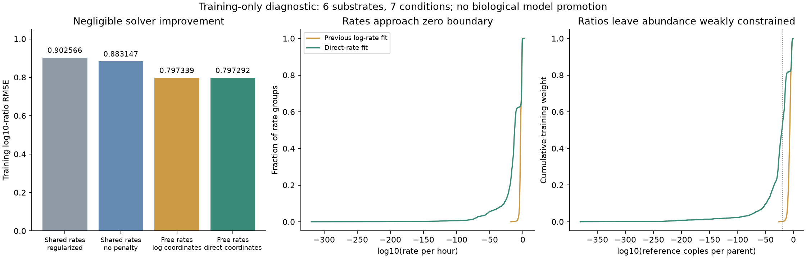

# Direct-rate optimization exposes a weak abundance constraint

**Changing solver coordinates barely improves the fit, while predicted fragment amounts collapse.** Training log10-ratio RMSE changes from **0.797339 to 0.797292**, a **0.01185% MSE reduction**. Meanwhile, 1,288/2,121 rates fall below1e-10/hour and the median reference amount shifts downward by14.28log10 units. This is evidence against a large local optimization rescue and against interpreting the fitted ratios as identified concentrations. It is not a global optimum proof or a transferable biological model.

Registered October23,2026 at14:38 America/New_York; Codex / GPT-6. All local analysis, fitting, independent replay and plotting are terminal. The full APC availability/concentration goal remains active.

## Fixed model and source

The unchanged independent-cut process assigns each original bond a nonnegative rate. A fragment exists when its required boundaries have cut and its internal bonds have not. Expected amounts retain all contiguous products, including singletons/nonbinders. This family changes optimizer coordinates only; it does not add processing states, transport, MHC selection or an MS-response network.

The canonical Hitlist digestion recipe is pinned by manifest `5f616170b5514cb4d8f0c7b7843d232959e9514eebbca6483f976e17b0846615`, directory `/private/tmp/hitlist-digestion-209-review-candidate`. The source is purified human20S standard-proteasome digestion, not an APC specimen. Six training substrates/seven conditions yield67,576 original positive corrected MS time/reference ratios. All original eligibility, source/construct/contributor identities and hierarchical equal-parent/condition/curve/time weights are unchanged. No missing or filtered value becomes a zero, negative or imputed target.

Both earlier held-out strata are filtered before target construction. **No validation/test metrics or predictions are produced**, because this is a training-capacity/identifiability diagnostic. The same2,121 supported incidence groups and15 unsupported fixed bonds from the [previous capacity family](../2026-10-23_1401_codex_kinetic-capacity/README.md) remain; free condition-specific rate identities are not promoted as sequence features. No pretraining, synthetic biological labels, binding, stability, TCR or elution training. nM and binder metrics do not apply.

## Stage A: existing-fit geometry and mathematical qualification

The stable boundary contribution is log(t/ref)+log(exprel(-r*t))-log(exprel(-r*ref)); at r=0 its limit is log(t/ref), with derivative -(t-ref)/2. Internal bonds contribute -r*(t-ref). This defines a closure of the ratio objective. A zero boundary rate still means zero physical product amount and cannot calibrate a positive measured reference.

The saved positive-rate fit replays at MSE0.635750001841792. Original rates range down to9.58e-19/hour; direct-coordinate gradient maxima are0.00394–0.0261 while log-coordinate maxima are3.06e-6–1.66e-5. Sparse local Jacobians and condition-block Gram spectra show weak directions; Gram eigenvalue precision limits and coordinate dependence are explicit, so these are not global identifiability certificates. Full per-group rates/roles/gradients and eigenvalues are retained in [audit.json](results/audit.json) and [parameter-audit.csv](results/parameter-audit.csv).

Seventy-digit Decimal calculations qualify30 rate/time cases through zero and large rates (maximum value error1.78e-15, derivative9.95e-14). All seven blocks pass positive-rate direct-sum parity and finite-difference Jacobian-vector checks, including one-sided zero-boundary derivatives. A constrained toy whose best ratio is the zero-rate limit reaches the correct boundary. [Qualification](results/qualification.json). Stage A took2.530s, peak RSS1.012GiB.

## Stage B: bounded direct-rate fit

One warm start per condition from the saved free log-rate solution; no restart search. Sparse analytical Jacobians, SciPy trust-region reflective least squares with LSMR, nonnegative bounds, Jacobian column scaling. Limits:300 function evaluations and180 callback-checked seconds per condition; ftol=xtol1e-12, gtol1e-10; LSMR atol=btol1e-10,maxiter500. Linear least-squares loss, no statistical penalty. Numerical subproblem regularization does not add a coefficient penalty to the objective. Exact invocation is frozen in [fitting.json](reproduce/fitting.json). [SciPy solver documentation](https://docs.scipy.org/doc/scipy/reference/generated/scipy.optimize.least_squares.html).

| Condition | Parameters | Previous RMSE | Direct RMSE | Evaluations | Status | Rates <1e-10 | Projected gradient max | Seconds |
|---|---:|---:|---:|---:|---:|---:|---:|---:|
| FFH_12p5 | 441 | 0.973005 | 0.972894 | 114 | 2 | 264 | 3.38e-07 | 17.69 |
| FFH_6p25 | 440 | 0.948132 | 0.948031 | 51 | 2 | 254 | 1.33e-07 | 9.53 |
| H2A | 123 | 0.723507 | 0.723493 | 74 | 2 | 73 | 3.28e-08 | 1.20 |
| H2B | 111 | 0.743409 | 0.743393 | 29 | 2 | 70 | 4.56e-07 | 0.79 |
| IL37b | 168 | 0.654252 | 0.654230 | 300 | 0 | 101 | 5.90e-06 | 4.69 |
| LEDGF | 430 | 0.824655 | 0.824597 | 59 | 2 | 265 | 1.03e-07 | 5.90 |
| hTau | 408 | 0.841090 | 0.841043 | 48 | 2 | 261 | 2.13e-06 | 7.15 |

Status2 is ftol termination, not a first-order/global-optimum certificate. Status0 means the300-evaluation budget exhausted (IL37b). No time limit was hit. Projected gradient is max|r-max(0,r-gradient_MSE)|; this continuous bound-aware mapping is reported separately from raw gradient and SciPy half-MSE scaled optimality. All raw gradients, active masks, complementarity and function-evaluation traces are preserved. There are1,102 solver-active lower bounds and1,288 rates below1e-10/hour; no rate is exactly zero at the returned strictly interior solver states.

Overall training: RMSE0.797292080, Pearson0.603785070, raw Spearman0.496366198, prediction SD0.785653645. All675 residual/Jacobian evaluations took50.159s including data and artifact work; peak RSS1.005GiB. CPU only, one BLAS thread, no Modal/GPU or shared-environment mutations. Runtime is not an isolated hardware benchmark.

## Consequence for availability modeling

Before this coordinate change,0.186% of fitted observations had reference expected amounts below1e-20copies per initial parent. Afterwards **53.732%** do (**51.799% of the hierarchical training weight**), despite essentially unchanged ratio error. Some log-reference amounts reach approximately-381. Such tiny amounts would require enormous unconstrained peptide-specific signal gains to reproduce positive reference signals. The fit does not independently measure those gains.

These are model expectations, not measured cellular concentrations or evidence of physically impossible source data. They expose the limitation of calibrating every peptide from its own reference. [Paired reference amounts](results/paired-reference-masses.jsonl.gz) preserve all67,576 comparisons and original weights. This does not establish that a shared observation model or a more complicated kinetic process will generalize.

## Independent verification and retained failure

An independent reader reconstructs original training membership, raw signals, target transforms and weights. Direct bond sums and separate analytical derivatives verify every67,576 final predictions and all2,121 rate gradients; maximum errors2.61e-14/5.79e-16. All final states match recorded evaluation traces. Original-source targets/weights match exactly. Reference amounts, projected gradients and all non-rank metrics replay. The verifier does not replay SciPy's optimizer trajectory or prove a global optimum. [Verification receipt](results/independent-verification.json), [independent predictions](results/independent-direct-sum-predictions.jsonl.gz).

The first verifier failed only its raw Spearman agreement threshold after passing prediction/gradient/source checks. [Original failed code/config/log](attempts/raw-rank-agreement/README.md) remain. Sparse arithmetic versus independent direct summation changes near-tie ranks: raw producer0.496366198263 versus independent0.496366045141, difference1.53e-7, with every point agreeing to2.61e-14. The amendment reports both ranks and their discrepancy; it does not relax a rank-agreement threshold, refit or replace original predictions. Independent verification took3.153s.

## Reproduction, artifacts and decision

Run the four frozen stages in order: [audit](reproduce/launch.sh), [fit](reproduce/fit.sh), [verification](reproduce/verify.sh), [report](reproduce/report.sh). Each has its registration/hash receipt and source snapshot under `reproduce/`. The pinned source recipe and previous committed fit/allocation files are required. Output guards prevent repeating fitting over an existing final result; use a fresh experiment destination for reproduction.

Presto commit `e1f74030de77f083c4b65fbe7aed22677ce9a13f`, registered dirty state in [launch.json](reproduce/launch.json). Python3.12.6, NumPy2.5.4, SciPy1.18.1; platformmacOS-26.5-arm64-arm-64bit. Raw outputs, every evaluated rate vector, final parameters, masks, histories and per-example predictions reside under `results/`; exact original logs under `launch_logs/`. No external raw training checkpoint directory is required for this family.

**Decision:** stop expanding this local optimizer budget. Before adding kinetic states, test whether a shared, parsimonious MS-response layer and cross-peptide signal objective constrain relative amounts better than independent per-peptide reference calibration. The [next detailed specification](../agents/codex/plans/digestion-shared-observation.md) keeps kinetics fixed, preserves exact/sampled comparisons and adds rare-event-gradient and abundance-sensitivity gates. It explicitly retains unresolved absolute scale and calibration rather than declaring concentration identified.

The current recipe already supports this rate audit. For the next observation fit, its existing upstream run metadata must be carried through canonical contributor joins: the pinned recipe omits the existing `digestion_runs.instrument_raw` relation. The publication used two instruments and substrate-dependent cysteine preparation, so a common response cannot be assumed from study identity alone. [Primary Methods](https://pmc.ncbi.nlm.nih.gov/articles/PMC10850103/). Hitlist770 owns this projection/lineage follow-up;762 owns independent known-load response calibration. No new raw import or reopening775 is implied. APC machinery, transport, clearance and cellular validation remain outside this purified-digestion result.
