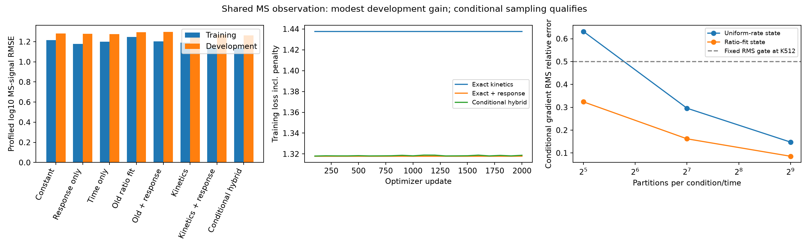

# Shared MS observation and conditional sampled kinetics

Completed local experiment and independent numerical replay. The shared observation model modestly improves development signal-shape prediction; conditional importance sampling qualifies and closely matches exact fitting. No calibrated MS-response or APC-concentration model is promoted. The original unconditional sampler qualification remains failed.

Registered2026-10-23 at15:01 America/New_York; agent/model Codex / GPT-6. Execution Presto `ce86bdb29b4ac45f08dda7147c8833333f0bd8b4` with unrelated dirty work recorded in [registration](reproduce/launch.json). Shared Hitlist `61baed9970f8661833e706c68a2adf2d0457e353` was clean and unchanged. No production model or shared environment changes.

## Question and result

The preceding rate-space audit showed that a same-peptide temporal-ratio objective permits enormous changes in predicted fragment amounts. Here the independent-cut biological model is held fixed while the observation objective preserves cross-peptide information: use original log10 signals, a small shared sequence response, and only one profiled constant per condition. This tests an observation hypothesis; it does not independently calibrate detectability.

| Variant | Train shape RMSE | Development shape RMSE | Development Pearson / Spearman | Development temporal-ratio RMSE |
|---|---:|---:|---:|---:|
| Condition scale only | 1.21471 | 1.28060 | undefined | 1.16704 |
| MS-response features only | 1.17668 | 1.27936 | 0.0961 / 0.1040 | 1.16704 |
| Shared time quadratic | 1.19993 | 1.27383 | 0.0876 / 0.0835 | 1.10889 |
| Old ratio-trained kinetics, fixed | 1.24799 | 1.29302 | 0.2151 / 0.1970 | 1.09556 |
| Old kinetics fixed + fitted response | 1.20344 | 1.29793 | 0.2187 / 0.2046 | 1.09556 |
| Refitted kinetics, constant response | 1.19004 | 1.26809 | 0.2363 / 0.2273 | 1.17697 |
| Exact kinetics + sequence response | 1.13843 | 1.26510 | 0.2561 / 0.2452 | 1.16391 |
| Conditional sampled hybrid + response | 1.13906 | 1.26279 | 0.2572 / 0.2464 | 1.15644 |

Lower RMSE is better; units are log10 original MS signal or same-peptide signal ratio, not nM. All metrics use original train/development membership. Primary MSE weights each parent equally, then condition, curve and common-positive time equally. Correlations and SD are pooled unweighted observations. Condition offsets use development labels to define a scale-invariant shape metric, so these are not calibrated absolute held-out signal predictions. Constant predictions have undefined correlation.

Exact kinetics+response reduces development MSE by2.406% versus the constant-signal control, and only0.471% versus refitted kinetics without sequence response. Its original temporal-ratio RMSE worsens from1.09556 to1.16391 compared with the old ratio-trained model. H4 remains worse than constant signal (1.41217 versus1.38867); AnnexinA1/H3 improve. Full per-condition metrics and within-condition/time peptide-rank summaries are retained. The small sampled-versus-exact difference (1.26279 versus1.26510) is one fixed seed, not evidence of a robust RL advantage. No checkpoint or hyperparameter was selected using development outcomes.

Prediction spread is nonzero: exact development centered-log10 SD0.6022 versus target1.2524; sampled0.5934. Development Spearman is about0.245, far from a high-quality biological predictor. Every allocated coefficient trains, so absent gradients do not explain this family. Exact constant-response final gradient norm is3.1e-15; exact sequence-response0.0180 and sampled0.0481. The latter two fixed-final fits are not claimed to be stationary optima.

## Canonical source, admission and metadata

Use the original purified human20S standard-proteasome digestion source, MSV000092631/PXD044463, through the canonical Hitlist recipe. Recipe manifest `5f616170b5514cb4d8f0c7b7843d232959e9514eebbca6483f976e17b0846615`; source package manifest `ad62414d511b74a6aa1e4da457fdff68d9f4527874d1a2e385c65e5b98df41e8`. Exact external paths, source/recipe checksums and overrides are in registration. The source-manifest bytes match the recipe's source receipt. [Primary study](https://pmc.ncbi.nlm.nih.gov/articles/PMC10850103/).

Retain23,054 training curves/90,630 common-positive measurements from6 parents/7 conditions, and3,832 development curves/14,822 measurements from3 parents. Include each curve's reference time as a measured value. This differs from the preceding all-positive observation audit's91,226 training points. Previous test parents are filtered before target/context collection; no new test loss or predictions are produced because those outcomes have already been exposed and must not guide development. Existing validation is explicitly development data, not independent external validation.

Original corrected MS1 arbitrary units, background provenance, source slots, positive selection, construct mapping, I/L handling and exclusions remain unchanged. No zero/filtered/unreported point becomes a biological negative. No affinity or MHC-length filter is introduced. Full precursor sequence and all possible cleavage products remain in the model, including short products and nonbinders. Source observations do not cover all such products. Nominal substrate concentration is protocol context, not a fragment concentration target. This is purified enzyme, not an APC sample; the enzyme preparation's HeLa label is not an APC phenotype.

Existing canonical queries suffice: `digestion_raw_quantities` with `joins=["acquisition"]`, selecting run ID, biological replicate, original quantity/metadata times, source value, `acquisition.instrument` and source locator. The query and365,001 joined rows are archived. All105,452 retained observations have a consistent instrument among their candidate raw runs. H2A/H2B use Orbitrap Fusion; all other retained conditions use Q Exactive HF-X. Independent native-Parquet replay verifies every selected raw/source/acquisition join and every original target/source slot.

MS1 querying scans4,044,956 rows and matches2,947,318 candidate run/IL-peptide rows.21,718 observations have multiple candidate modified forms. These are conservative candidate sets, not proven aggregate-form contributions. Exact retained technical pairing and charge/form composition remain unresolved; no arbitrary single form is assigned. Instrument-specific response slopes remain confounded with substrate coverage. The initial `acquisition_relationships=[]` receipt reflects variable reuse after the later MS1 query; [supplemental receipt note](results/context-receipt-note.json) explains it without changing original data. Joined values and independent replay are authoritative.

## Model and training contract

The biological module has40 coefficients: intercept,19 left-residue contrasts,19 right-residue contrasts, and the prior enzyme/protocol proxy. Each bond has a positive exponential rate. An observed contiguous fragment's expected amount per initial parent is the product of required boundary-cut probabilities and internal-bond survival. Every complete partition conserves residues; no binding/transport/clearance mechanism is added here.

Observation: `log10(signal)=log10(expected fragment amount)+z(peptide,instrument)·gamma+condition offset`. Profile the last term analytically across ALL peptides and times in that condition. There is no per-peptide/per-time offset or learned identity embedding. This leaves absolute between-condition gain unidentified.

Raw response columns are length/40 and19 amino-acid fractions separately for the two observed instruments. Scale and rank reduction use training within-condition contrasts only.40 raw columns yield38 supported directions; Orbitrap Fusion C/W features have no exposure and are excluded. Total learned coefficients are40 without response and78 with response. All40/78/78 coefficients respectively receive nonzero gradients and change; nuisance condition offsets are solved analytically, not gradient-trained. Their existence does not establish effect identification or instrument transfer.

Loss is hierarchical centered log10-signal MSE plus0.01/2 times squared nonintercept kinetic coefficients and response coefficients. All three iterative fits start from the same original40-coefficient ratio-trained checkpoint, with zero response coefficients. This is warm initialization, not new auxiliary pretraining. Adam lr0.03, betas0.9/0.999, eps1e-8, no decay/dropout, exactly2,000 full-batch updates, fixed final checkpoint. No biological synthetic labels. Only purified-digestion MS signals supervise this family; binding, elution, TCR, stability, machinery KO and cellular concentration heads are unused. IC50/500nM classification metrics are inapplicable.

Controls: condition-only constant;38-coefficient response-only weighted ridge; shared log10(time) quadratic weighted least squares; original kinetics unchanged; original kinetics frozen with fitted response ridge. Response ridge uses the same0.01/2 coefficient penalty. Controls, initials, all optimizer states, masks and every update are retained.

## Exact versus sampled estimator

Unconditional complete-partition sampling retained exact residuals/fragment probabilities and tested both ordinary score gradients and Rao-Blackwell conditional scores. At512 draws,16 fresh groups:

| State | Unconditional mean/RMS relative error | Unseen span/time fraction | Conditional mean/RMS relative error | Conditional unseen fraction |
|---|---:|---:|---:|---:|
| Uniform0.01/hour |0.20195 /0.54565|0.73448|0.04442 /0.14756|0.54153|
| Original ratio initializer |0.14761 /0.91282|0.72166|0.04104 /0.08562|0.53392|

The original <=20% mean-error gate failed in the first state; no unconditional biological fit ran. Counts/seeds/thresholds were not increased to rescue it. A separately prospective [conditional proposal](reproduce/conditional-plan.md) then required both <=20% mean and <=50% RMS error in both states atK512. Both pass. K32/K128, uniform proposal diagnostics, ordinary/Rao-Blackwell gradients and all16 groups remain in the raw probes; the90/10 proposal was fixed as primary before evaluation.

The proposal picks an observed span with weights90% proportional to absolute current loss coefficient times conditional-score norm, plus10% uniform; it samples a complete independent-cut partition with that span present. With mass m_j, the exact density ratio is `q(C)/p(C)=sum_j w_j I(j present)/m_j`. Apply its reciprocal to the original policy score contribution. Irrelevant bond scores are analytically integrated out. States without any rewarded observed span have zero gradient integrand; the biological process still includes every product. No constant/leave-one-out baseline is used on the restricted proposal support.

Five-bond full enumeration verifies normalized proposal and full/conditional-score expectation to1e-12;32,768 fixed-seed draws pass the prespecified six-binomial-standard-error distribution check. Actual biological fitting usesK512 per condition/time, seed42 and the same objective/budget as exact. This is explicitly a hybrid: exact masses, residuals and conditional scores remain. The current implementation computes the exact backward pass and then replaces the kinetic gradient, preserving exact response gradients. It provides no simulation-only or reduced-network-score claim, and runtime is not an optimized RL benchmark.

## Amounts, response and remaining ambiguity

Neither final fit puts any admitted observation below1e-20 expected copies per initial parent; minimum predicted log10 amount is-5.529 exact and-5.695 sampled on training. Fixed global rate changes of10^-2,10^-1,1,10,100 with response held fixed change exact training shape MSE to2.11779,1.92805,1.29603,59.73268,6639.16174. Thus the fixed-response objective constrains this particular direction. This is not proof against joint rate/response compensation, and comparison with the earlier free2,121-rate diagnostic changes capacity as well as the observation contract.

The exact fitted sequence-response spread reaches2.901log10 units within a training condition (~796-fold) and1.653 in development. These are fitted nuisance gains, not calibrated physical efficiencies. Known-load data, molecular-form reconciliation, source selection and acquisition transfer remain required. Only three development parent substrates and one sampled seed are available here. No APC concentration validation or broad species/machinery extrapolation is established.

## Verification, failures and runtime

Independent NumPy reconstruction imports neither producer model/features nor metric code. It checks all843,616 final train/development predictions across eight variants, original recipe values/weights, supported response basis, ridge solutions, final losses/gradients and all15 sensitivity points. Maximum prediction difference1.07e-14; raw Spearman differences0. All6,000 Adam arithmetic updates replay (maximum8.88e-16). Gradients at five prespecified updates per fit independently replay, including same-RNG conditional sampling (maximum7.44e-15); every sampled gradient is not independently recomputed. Separate source verification covers365,001 native raw rows,388 runs and105,452 observation memberships. Candidate MS1-form aggregation is not independently resolved.

Qualification initially failed because a dense long-vector LAPACK offset differed from its exact scalar solution by1.18e-12. The original code/config/log/diagnosis are retained under [attempts/profile-qualification](attempts/profile-qualification/README.md). A compensated scalar weighted-LS calculation fixes the verification method; no model/target/threshold or optimizer result changed, and no fit preceded the amendment. Full78-coordinate finite differences have maximum9.34e-11 error. Source amount parity is3.29e-14. No epsilon masses/counts or silent rate floors were introduced.

Local macOS26.5 arm64 CPU, Python3.12.6, Torch2.14.1, NumPy2.5.4, SciPy1.18.1, float64, one thread; no Modal/GPU request or environment change. Context preflight35.92s/2.69GiB peak; independent context replay4.56s/2.16GiB. Exact family incl.controls/output70.70s/1.17GiB; individual kinetics19.37s and kinetics+response28.96s incl.predictions. Conditional fit440.89s (whole invocation444.34s)/1.06GiB. Conditional qualification18.87s; exact/conditional independent replay18.88s/6.94s. Some verification/qualification work overlapped fitting; runtime ratios are descriptive, not isolated hardware benchmarks.

Conditional fit draws28,672,000 complete partitions,9,416,704,000 bond Bernoulli candidates and46,402,560,000 span-presence terms, while retaining exact expectation work. Strict documentation build and scoped fatal-error lint pass for all family code; full-style lint on the new conditional launcher reported import ordering/dict-style findings before freezing, so no full-style-lint pass is claimed. The unchanged production code's prior ce86bdb CI passed. No unchanged full repository test suite was rerun for experiment-only additions. Plot was rendered and inspected. Matplotlib's temporary-cache warning is retained in the log. CSV text copies use LF newlines after Git flagged the original CRLF convention; original bytes are preserved in `*.original.csv.gz`, with identical parsed rows verified in `table-packaging.json`.

## Reproduce and artifacts

Run stage scripts in order in a fresh workspace with the pinned external source/recipe generations: `reproduce/launch.sh`, `reproduce/verify-context.sh`, `reproduce/qualify.sh`, `reproduce/fit.sh`, `reproduce/conditional.sh`, `reproduce/conditional-fit.sh`, `reproduce/verify-fits.sh exact`, `reproduce/verify-fits.sh conditional`, `reproduce/report.sh`, `reproduce/package.sh`. Original rejected qualification remains archived; use the final frozen qualified source for the successful path. Scripts refuse existing fit outputs. All use the recorded shared Python and import overrides; no dependency installation is part of reproduction.

- [Execution registration](reproduce/launch.json), [exact fit](reproduce/fitting.json), [conditional fit](reproduce/conditional-fitting.json), [verification contract](reproduce/verification-plan.md), and frozen sources under `reproduce/source/`.
- [Full metrics](results/all-metrics.json), [comparison table](results/comparison.csv), [within-condition outcomes](results/within-condition.csv), [fixed-time rankings](results/within-condition-time-ranks.csv), [component ranges](results/component-ranges.json).
- `results/*-predictions.jsonl.gz` retain all original targets, condition/curve/construct/replicate IDs, weights, raw/centered predictions, profiled offsets and biological/response components. No test dump by the explicit closed-test policy.
- `results/*-fit.json` retain initial/final/checkpoint/optimizer/coverage states; `*-updates.jsonl.gz` retains every applied gradient/update. Conditional fit also retains replay/final RNG states.
- [Exact replay](results/independent-exact-verification.json), [conditional replay](results/independent-conditional-verification.json), [context replay](results/context-verification.json), [initial qualification](results/mathematical-qualification.json), original/amended logs, canonical query parquet and context JSONL.
- Shared raw source remains at the pinned external paths in registration and the previous canonical admission bundles; this family does not create another curator or reinterpret raw quantities.

## Decision and handoff

Status: numerical fitting, diagnostics and independent verification complete; publication receipt records remote closure separately. Prefer exact differentiation for this tractable expectation model; keep the conditional hybrid as the working matched stochastic reference. Do not promote a concentration or MS-detectability model from these results.

Next step: [one fragment-length state effect](../agents/codex/plans/fragment-state-length-qualification.md), first qualified through a mass-conserving expected-fragment system and discrete full-fragment trajectories. This changes the kinetic shape with one explicit parameter before increasing sequence-network capacity. Independent response calibration remains [Hitlist762](https://github.com/pirl-unc/hitlist/issues/762), contributor/form scope [Hitlist770](https://github.com/pirl-unc/hitlist/issues/770); closed recipe775 stays closed. Cellular APC machinery/transport/clearance, downstream pMHC selection and independent concentration validation remain unresolved. The full availability goal remains active.
