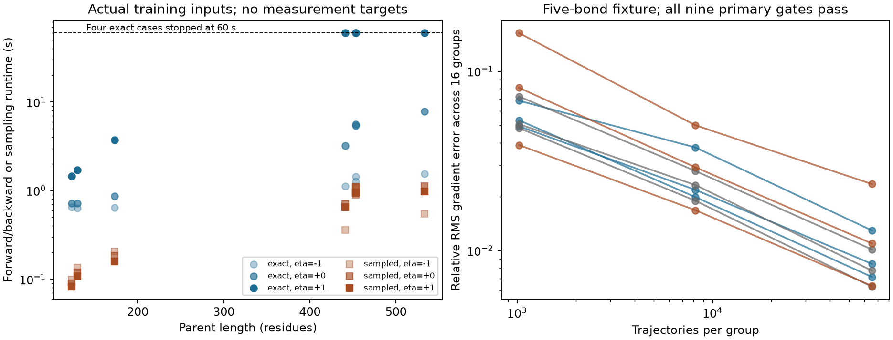

# Fragment-state length qualification

The complete-fragment expectation and trajectory formulations agree, but the
positive-uniformization implementation exceeds its 60-second runtime gate on
four long-parent cases with a positive length effect. **Do not proceed to a
biological fit with this solver contract.** The sampled arm completes all cases;
one small Monte Carlo group is not enough to establish distribution precision.

Registered October 23, 2026, 18:17 America/New_York; Codex / GPT-6. This family
qualifies one kinetic hypothesis after the shared-observation experiment. It
does not revisit the exposed MAPP test or establish APC concentrations.

## Model and question

For a live fragment `[a,b)`, bond `k` has hazard
`exp(log_rate[k]) * ((b-a)/20)^eta` per hour. The single new parameter `eta`
changes a bond's rate as its enclosing fragment becomes shorter. At `eta=0`
this is exactly the earlier independent-cut process. Each event replaces one
fragment by its two children. Every span of lengths 1 through the complete
parent length remains, including single residues, sub-ligand products and the
intact parent; there is no observed-peptide conditioning or binding filter.

The deterministic model solves the closed linear first-moment equations for
expected fragment copies per initial parent. A matrix-free action uses two
cumulative sums, taking O(L²) work. Tagged-residue mass is propagated by positive
uniformization, with a Chernoff Poisson-tail truncation budget of 1e-12, Poisson
mean at most eight per substep, and checkpointed autograd. The stated bound covers
truncation in exact arithmetic, not floating-point roundoff. No floor, output
renormalization or support pruning is applied.

The discrete model samples complete continuous-time partitions using exponential
waiting times and categorical bond events. Likelihood scores include both event
hazards and integrated waiting hazards, including final no-event survival.
Returned scores cover every bond log-rate and `eta`. REINFORCE uses a leave-one-out
baseline. No clipping, group standardization, reuse, reference KL or optimizer is
used in this qualification family.

## Numerical qualification

The artificial fixture has five bond rates per hour
`[.02,.07,.11,.03,.15]`, `eta=-1,0,+1` and times `0,.5,2,8` hours. This is a
numerical process fixture, not synthetic biological supervision. Dense fragment
and complete 32-partition generators, finite differences and the independent-cut
limit qualify the first moment and gradients. An independent verifier imports
neither production model nor producer analysis and reconstructs a row-oriented
cut-mask generator with analytical derivative matrices and SciPy Frechet
derivatives of its exponential.

- All 12 time/effect cases pass. Maximum independent expected-count discrepancy
  is 1.39e-15; maximum analytical-gradient discrepancy is 1.18e-14.
- Sixteen groups at each K=1,024/8,192/65,536 and positive time/effect pair sample
  **10,764,288 trajectories**. All nine primary K=65,536 gates pass: maximum
  marginal discrepancy is 3.30 binomial standard errors (limit six), and mean
  relative gradient error ranges 0.000390–0.00552 (limit 0.2).
- Primary RMS gradient error across groups ranges 0.00630–0.0235. The smaller
  K results remain diagnostics, rather than retrospective qualification gates.
- All 288 retained complete event histories are independently replayed, including
  their terminal survival, log density and parameter scores. All 432 groups'
  count/score sufficient statistics and leave-one-out calculations are replayed.
- Qualification took 10.565 seconds and peaked at 424 MB process RSS. Independent
  closure verification took 0.634 seconds / 199 MB.

Every numerical condition, marginal expected count, saved gradient, terminal-state
histogram and sufficient statistic is in `results/mathematical-checks.json`,
`path-probes.json` and `path-traces.json`. The producer's per-span uniformization
outputs for the small fixture were compared in memory; the saved numerical
record contains reference counts and maximum discrepancies, rather than a second
copy of every producer value. Actual-parent full arrays are retained below.

## Actual-parent runtime and precision

The input projection reads only the pinned canonical recipe manifest plus
`constructs.parquet` and `contexts.parquet`, not quantity/example tables. Source:
`/private/tmp/hitlist-digestion-209-review-candidate`, manifest SHA256
`5f616170b5514cb4d8f0c7b7843d232959e9514eebbca6483f976e17b0846615`.
The already-published 40-coefficient sequence/protocol initializer comes from
`2026-10-23_1202_codex_biological-cut-rates/results/fits.json`, SHA256
`2400f214141b6ab421cc0b5168ec08b3209507b62b7cf0a590fd719937bd267f`.
It represents an intercept, ordered adjacent amino acids and known enzyme-load
context. It was fitted previously; no coefficient is fitted or selected here.

Six distinct training parents give seven conditions: Ffh at two input ratios
(453 residues), H2A (130), H2B (123), IL37b (173), LEDGF (533), and hTau (441).
The fixed runtime matrix crosses these with `eta=-1,0,+1`, at 24 hours.
An artificial full-span readout is
`sum N[start,last]*(sin(start+1)*cos(last+.3)+1.1)/L`; it is not an assay label.
Exact forward/backward and K=512 full-path sampling run in separate fresh
processes, each with a 60-second wall limit and 4 GiB RSS limit. The frozen runtime
budget is stricter in numerical tolerance than the initial registration's 1e-10.

| Effect | Exact completed / total | Exact runtime among completed | Sampled completed / total |
|---|---:|---:|---:|
| eta=-1 | 7 / 7 | 0.636–1.553 s | 7 / 7 |
| eta=0 | 7 / 7 | 0.719–7.824 s | 7 / 7 |
| eta=+1 | 3 / 7 | 1.452–3.750 s | 7 / 7 |

Both Ffh conditions, LEDGF and hTau at `eta=+1` stop at 60 seconds. They remain
failures, without reduced support or a replacement eta range. The complete
42-worker suite took 332.458 seconds. The slow regime is consistent with stiffness:
uniformization keeps the maximum intact-fragment exit rate throughout the
interval, even after mass moves into smaller fragments. This is a numerical
limitation, not evidence against the length effect biologically.

For all seven eta-zero cases, independently reconstructed full-span amounts and
analytical bond gradients agree with the exact outputs within 1e-10. For every
successful exact case, saved counts, residue conservation and readout verify.
Every sampled partition is converted independently back into product counts,
readout and leave-one-out gradient. Full-scale event histories were not saved,
so full-scale path scores are not independently regenerated; that score-law check
uses the separate 288 recorded toy histories.

Across the 17 cases with both outputs, one K=512 group has tagged-residue mass TV
0.146–0.744, span-count RMSE 0.000824–0.00275, raw bond/eta gradient relative error
0.0796–0.653, and 40-feature/eta gradient relative error 0.0346–0.185. Small average
span RMSE can conceal diffuse missing mass. These are **one-group artificial
readout diagnostics**, not biological-loss variance guarantees or convergence.
Neither fast sampling nor a good aggregate readout qualifies distribution recovery.

## Data, losses and evaluation scope

No biological training, pretraining, assay-loss optimization, new curation,
censor-policy change, auxiliary classification or calibrated MS-response fitting
occurs here. Binding, stability, MHC elution and TCR heads are not trained.
The output is expected fragment count per initial parent at a given time, not
free intracellular concentration or measured MS intensity. Source abundance,
transport, clearance and capture/detection remain separate requirements.

**No validation/test split is used:** these are mathematical qualification and
input-only runtime studies, with source measurement targets closed. There are no
held-out predictive losses, Spearman/Pearson, IC50 RMSE or binder-threshold metrics
to report. No biological winner is selected. Frozen expected-count, gradient and
sample arrays are the numerical prediction dumps appropriate to this contract.

## Reproduction, verification and artifacts

- `reproduce/plan.md`, `implementation-spec.md`, `verification-plan.md` and
  `launch.json` were registered before their respective work.
- `reproduce/launch.sh` runs qualification; `code/runtime_inputs.py` creates the
  frozen input projection; `runtime.sh` runs its runtime matrix; `verify.sh`
  independently closes the outputs. Source hashes
  and frozen copies appear in `qualification-execution.json`, `runtime.json`,
  `verify.json` and `reproduce/source/`.
- Execution HEAD was `0361e0df6868933e86e3118fe756f7a240820d28`, with new module,
  tests, family artifacts and preserved unrelated dirty notes. The exact production
  module SHA256 is `797145eb74c408febd5a118abbac8f543ff42884f0076b754489fb59c970ada6`.
- Local macOS arm64, Python 3.12.6, Torch 2.14.1, NumPy 2.5.4, SciPy 1.18.1,
  float64 CPU, one intra-op thread and OMP/OPENBLAS/MKL threads one. Exact import
  override/interpreter are in the launchers. No cloud/GPU or environment changes.
- All 42 worker summaries/logs and 38 successful full numerical NPZ outputs are
  retained under `results/` and `launch_logs/`. Four timeouts have no successful
  output array. CSV tables are generated solely from these frozen results by
  `code/report.py`; the canonical registry remains `../experiment_log.md`.
- Focused production tests: nine pass in 1.59 seconds, including the existing
  independent-cut tests. Production format/lint, isolated fatal-rule experiment lint and strict docs
  also pass. This is not a full-suite claim. Independent artifact
  verification passes; see `results/independent-verification.json`.

## Handoff

- **Status:** numerical equivalence qualifies; actual-parent differentiable
  runtime gate fails. No new biological fit is admitted.
- **Next step:** qualify a structured triangular shifted solve and a stiff
  rational-exponential solver against the preserved uniformization reference,
  keeping complete support and independently checking gradients and tiny amounts.
- **Open questions:** biological value of fragment-length dependence, full-scale
  sampled-loss variance, calibrated response, clearance and machinery transfer.
  The full APC availability/concentration goal remains active.
