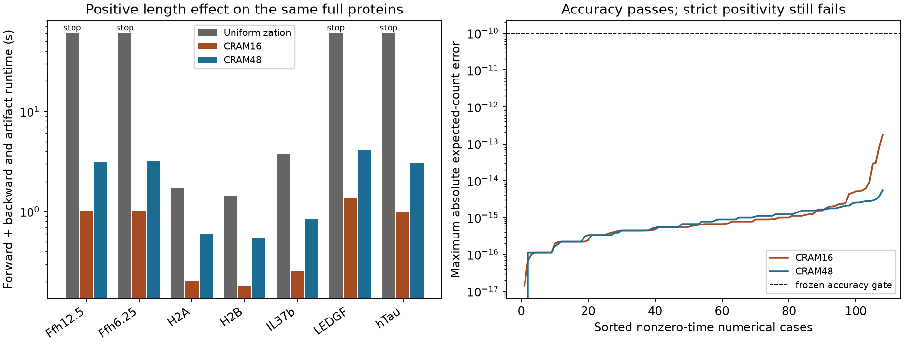

# Structured fragment-state rational solver

**The structured solver removes the measured runtime bottleneck, but both CRAM
orders fail the separately frozen strict positivity gate. No biological fit is
admitted.** CRAM48 matches available full-parent uniformization counts and
gradients to 3.78e-15 / 2.39e-15 while completing all 21 single-step cases in
0.552–4.156 seconds. It also produces tiny negative estimates in 10 of those
cases, down to -2.26e-47. Those values and the failed gate are preserved.

Registered October23,2026,18:46 America/New_York; Codex / GPT-6. This extends
the [complete-fragment qualification](../2026-10-23_1816_codex_fragment-state-qualification/README.md)
without changing biology, source inputs, support or training targets.

## Model and numerical change

The preceding model retains every contiguous span, length1 through L. Bond
hazard inside a current fragment is `exp(log_rate[k])*(fragment_length/20)^eta`.
Cuts replace a fragment by its two children and conserve residues. First moments
are expected fragment copies per initial intact parent, not APC concentration.

Its linear count operator is triangular under decreasing fragment length.
For a shifted system `(z I - dt A)x=y`, each span can be solved after its longer
ancestors, using row/column accumulators for already-solved weighted counts.
This takes O(L²) work and retains complete support without constructing an
L²-by-L² matrix. Native complex128/float64 torch autograd differentiates the
structured solution with respect to every bond log-rate, eta and RHS.

Fixed IPF CRAM16 and CRAM48 exponential approximations use eight or24 complex
shifted solves. Numerical coefficients/formulation follow the
[official OpenMC implementation](https://docs.openmc.org/en/stable/_modules/openmc/deplete/cram.html)
and its [Pusa2016 reference](https://doi.org/10.13182/NSE15-26). No package was
installed; the experimental implementation remains in this family, not the
production model. The positive uniformization implementation is unchanged.
No counts are clipped, floored, renormalized or discarded.

## Prospective numerical grid

The frozen grid has lengths2/6/12, eta=-1/0/+1, rate scales.01/1/100 and
times0/.5/2/8/24hours. Base bond rate is
`.02+.13*(1+sin(bond_index+.3))/2`. Both orders run every case.
Separate shifted-solve probes use three fixed real/complex shifts, arbitrary
RHS values and a nonconstant linear readout. The independent dense construction
explicitly enumerates parent-to-daughter transitions; exponential references use
SciPy expm and analytical Frechet derivatives. This is a numerical process
fixture, not synthetic biological labels or training.

| Criterion | CRAM16 | CRAM48 |
|---|---:|---:|
| Numerical exponential cases |135|135|
| All absolute count/gradient/mass gates |pass|pass|
| Maximum expected-count error |1.73e-13|5.47e-15|
| Maximum gradient error |2.44e-12|2.70e-13|
| Cases with negative outputs |24|19|
| Minimum output |−9.53e-15|−9.13e-45|
| Strict positivity / log admission |**fail**|**fail**|

All27 shifted-solve value/residual and autograd comparisons pass. Count,
gradient and mass tolerances are1e-10,1e-8,1e-8, respectively; shifted-solve
gradient tolerance is1e-9. The qualifier records every span's predicted/reference
count and every parameter's predicted/reference gradient, minimum and negative
count, plus relative errors above expected count1e-12. Numerical qualification
took4.244s and256MB peak process RSS.

The positivity failure cannot be hidden by excellent absolute error. An output
near zero may have poor relative accuracy, and taking its logarithm can be
undefined or misleading. The underlying continuous-time process has nonnegative
counts; this failure concerns the numerical approximation.

## Same full-parent runtime contract

Reuse the preceding family's frozen input-only canonical digestion projection,
SHA256 `74f615a77ea376439e68141ec41c17cf1d382aa96dbca456c9fad3f8d1fe601c`.
It contains six distinct training parents/seven conditions (twoFfh ratios,
H2A,H2B,IL37b,LEDGF,hTau), lengths123–533, and the already-published40-coefficient
ordered-bond/protocol initializer. Canonical recipe manifest is5f616170…;
initializer SHA256 is2400f214…. Full hashes and source paths are retained in
the preceding projection and this family's launch.json. No source quantities,
new examples, validation or test targets are loaded.

All21 preceding cases (seven conditions×three eta values) are evaluated at24h
with the same artificial all-span readout and both fixed orders. For the four
preceding eta+1 timeouts, both orders also run two equal substeps. Each of50
conditions runs in a fresh worker with the same60s wall and4GiB RSS limits.

| Variant | Completed | Runtime range | Peak RSS | Cases with negatives |
|---|---:|---:|---:|---:|
| CRAM16, one step |21/21|0.182–1.363s|554MB|13|
| CRAM48, one step |21/21|0.552–4.156s|1,180MB|10|
| CRAM16, two steps, former timeouts |4/4|1.960–2.757s|874MB|4|
| CRAM48, two steps, former timeouts |4/4|6.082–8.458s|2,100MB|4|

The complete suite took138.279s including worker startup. The earlier positive
uniformization solver completed17/21 cases and stopped bothFfh,LEDGF,hTau at60s
for eta+1. Runtime measurements are sequential local studies, not simultaneous
hardware-controlled replicates. The four formerly timed-out cases agree across
orders/substeps to9.16e-16 counts and9.51e-16 readout gradients; this is empirical
agreement, not a rigorous error certificate for arbitrary nonnormal matrices.

## Independent replay and limitations

A separate verifier imports no producer solver/runtime code. It reconstructs
source rate features and uses an independent NumPy storage/update implementation
with only the frozen numerical coefficients shared. All50 saved full-parent
forward arrays replay within4.25e-15. Lower-triangle zeros, residue mass,
readouts, minima and all negative counts verify.

- Against the17 successful preceding uniformization cases, maximum count/gradient
  errors are1.89e-11/1.25e-11 forCRAM16 and3.78e-15/2.39e-15 forCRAM48.
- For all eta0 cases, separately reconstructed analytical independent-cut counts
  and bond gradients agree within1.03e-14/1.76e-16.
- For16 order/substep cases lacking prior successful uniformization arrays,
  three fixed finite-difference directions (sin/cos bond directions and eta)
  independently check the saved readout gradient. Maximum discrepancy is1.11e-10,
  below the frozen1e-7 gate. This is not an independent full-component gradient
  certificate for those cases.
- Independent closure takes23.178s/169MB. It preserves the positivity failures;
  `all_replay_checks_pass` is separate from `biological_log_admission=false`.

No floor or after-the-fact support restriction is used to make the experiment
pass. CRAM48 is the more accurate numerical candidate; neither order is promoted
to biological log-observation training under the frozen rules.

## Training, evaluation and reproduction

There are no optimizer updates, pretraining, biological assay losses, synthetic
biological targets, binding filters or changed censor policies. No pMHC, TCR,
stability or MS-response head is trained. The artificial weighted count readout
is solely a numerical gradient probe. It supplies no concentration label.

**No validation/test split is used:** this is numerical qualification and
input-only runtime on previously fixed training parents. Predictive assay
loss, Spearman/Pearson, IC50 regression and binder-threshold metrics are
inapplicable. All270 numerical predicted/reference count/gradient arrays and
all50 full-parent NPZ outputs are retained in `results/`; no biological held-out
prediction is claimed.

`reproduce/plan.md` and `launch.json` precede implementation. `launch.sh`,
`runtime.sh`, `verify.sh` reproduce the three stages; frozen sources and their
hashes appear in stage JSON files and `reproduce/source/`. Runtime refuses to
overwrite a completed suite. Source HEAD was
`2903e113c6486f045a834fd5ca62c504f6576ae0` with new experiment and preserved
unrelated notes explicitly recorded as dirty. Local macOS arm64 CPU,
Python3.12.6/Torch2.14.1/NumPy2.5.4/SciPy1.18.1, float64/complex128, one thread;
OMP/OPENBLAS/MKL overrides and interpreter path are frozen. No Modal/cloud/GPU,
environment upgrades or source-generation mutation.

All50 worker JSON/NPZ/log sets, every qualification result, independent replay,
CSV tables and plots are local to this family. `code/report.py` only summarizes
frozen results. Isolated fatal-rule experiment lint and strict docs pass.
The production module's preceding nine focused tests and CI
are separate evidence; this experiment does not claim a new full-suite run.

## Handoff

- **Status:** accuracy and full-parent runtime qualify; strict positivity/log
  admission fails for both orders. Biological fitting remains unperformed.
- **Next step:** qualify a positive boundary-conditioned full-path importance
  estimator, with explicit proposal density and rare-product log/gradient tests;
  see `../agents/codex/plans/fragment-boundary-importance.md`.
- **Open questions:** relative accuracy of rare products, finite-sample log-loss
  bias/variance, actual biological value of the length effect, and independent
  observation/clearance/machinery calibration. The full APC availability goal
  remains active and unachieved.
