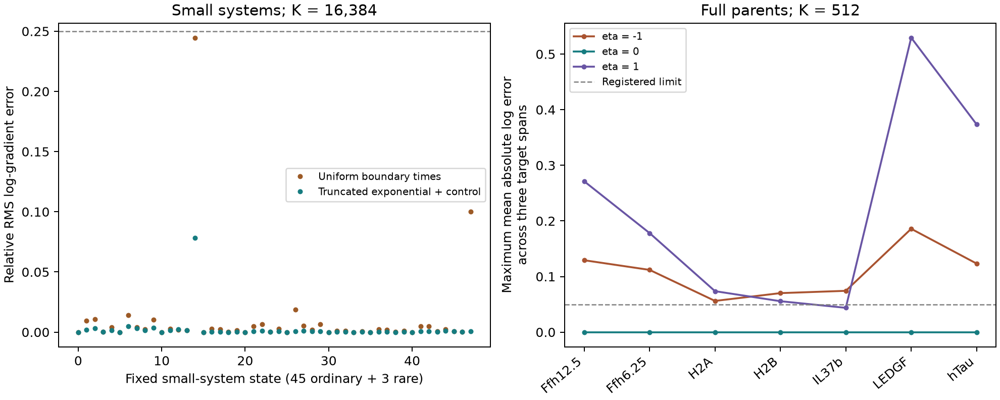

# Truncated boundary proposals and full-parent gradient qualification

**All 48 small-system primary cases pass, but only 8 of 21 full-parent cases pass
at K=512.** Seven successes are the length-independent limit. Only one of fourteen
cases with a nonzero fragment-length effect passes. This is a failed full-parent
qualification, not admission to biological fitting.

## Changed proposal and controlled gradient

The [uniform-time family](../2026-10-23_1909_codex_boundary-importance/README.md)
failed its fast-boundary stress case. Here each required boundary time is drawn
from an exponential of rate `lambda = base_rate * (parent_length/20)**eta`,
conditioned to occur before T. Its density is
`lambda*exp(-lambda*t)/(1-exp(-lambda*T))`. Boundary times are drawn once using
the initial parent length. All allowed outside cuts retain their original
state-dependent hazards and all products remain represented.

The log weight is the exact original/proposal density ratio; the proposal's
parameter dependence is explicitly included in its score. The plain estimate
`sum(w*original_score)/sum(w)` is retained. The primary estimator adds a
leave-one-out proposal-score control to the **unnormalized** gradient numerator:

`mean_i[w_i*score_p_i - mean_{j!=i}(w_j)*score_q_i]`.

The proposal score has expectation zero and the leave-one-out baseline is
independent of the current path, so the numerator remains unbiased. Dividing by
the sampled normalizer still gives a finite-sample biased log-gradient estimate.
We do not apply a constant baseline to the unnormalized original restricted-path
score, where it would generally be biased. No random draw is differentiated
through; there is no probability floor or clipping.

## Small-system experiment

Same 45 ordinary states, three rare states, K=256/2048/16384, 16 groups, seeds,
physical process and primary gates as the uniform reference. The changed density
and score control were registered before implementation/execution. All 48 primary
states pass. Ordinary worst absolute mean probability error is 0.000573,
absolute mean log bias 0.000565, mean log-gradient error 0.013121 and RMS 0.078460.
Mean ESS is not uniformly better: its ordinary minimum is 4,164.9/16,384.

| Stress case | True log probability | Mean probability relative error | Mean log bias | RMS gradient error | Mean ESS | Pass |
| --- | --- | --- | --- | --- | --- | --- |
| internal_100 | -170.270 | 0 | 0 | 0.00054956 | 16384.00 | True |
| internal_1000 | -1682.270 | -4.5475e-13 | -4.5475e-13 | 0.00030916 | 16384.00 | True |
| fast_boundaries | -1.680 | 2.2204e-16 | 2.2204e-16 | 0.00049645 | 16384.00 | True |

At eta=0 the proposal is the exact conditional independent-cut law; weights are
constant. On the fast-boundary stress case, plain versus controlled RMS gradient
error is 0.005915 versus 0.000496. The two internal-rate stresses retain finite
logs, including log probability -1682.27 where every linear weight underflows.

The matrix contains 14,352,384 paths and completes in 18.25 s, peak RSS
319,619,072 bytes. It is a small fixed mathematical fixture, not a concentration
benchmark. Three focused tests pass, including an analytical single-bond check.
Independent reference, raw-statistic and complete saved-path replay passes for
all 2,304 groups, 48 raw primary groups and 384 histories; maximum trace error
1.37e-12. Independent verification takes 0.473 s.

## Prospectively registered full-parent experiment

After the small-system gate and independent replay passed, the [actual-parent
plan](reproduce/actual-plan.md) froze seven canonical training conditions from
six complete constructs: Ffh at two enzyme/substrate ratios, H2A, H2B, IL37b,
LEDGF and hTau, lengths 123–533. These are purified human 20S digestion inputs,
not APC measurements. Exact source/context identities and unknown substrate
species remain in the pinned upstream projection.

Input SHA256 `74f615a77ea376439e68141ec41c17cf1d382aa96dbca456c9fad3f8d1fe601c`
refers to the preceding fragment-state family's `results/runtime-inputs.json`.
It pins canonical package manifest
`5f616170b5514cb4d8f0c7b7843d232959e9514eebbca6483f976e17b0846615` and the original
40-coefficient initializer artifact
`2400f214141b6ab421cc0b5168ec08b3209507b62b7cf0a590fd719937bd267f`.
No quantity tables, development/test observations or new measurements are loaded.
The initializer is previously fitted; these experiments do not refit it.

Rate features are intercept, 19 left-residue and 19 right-residue contrasts to A,
and log enzyme-concentration proxy relative to 0.2 micromolar. The latter is
computed from recorded substrate concentration / enzyme-substrate denominator.
Each condition uses eta=-1/0/+1, T=24 h, and centered target lengths 1, 9 and 40,
chosen solely from parent length. An intact-parent analytical check is also kept.
The reference readout is `[1,-.5,.25]/1.75` times the three log amounts; gradients
are projected onto all 40 coefficients plus eta. Each K=64/512 uses eight groups
with the frozen seed rule. K=512 is primary.

References use two-step CRAM48/autograd and separate four-step forward refinement.
All 63 requested target values are positive and meet the 1e-5 natural-log
agreement threshold. Independent NumPy replay matches full reference arrays;
three fixed directional finite differences per case agree within 1.70e-7.
Eta=0 logs separately match analytical probabilities. These are empirical checks
at these target/parameter states; full-output CRAM negativity in other tiny tails
remains preserved. Neither cross-step agreement nor 63 directional probes is a
universal numerical certificate for future training updates.

The original primary gate requires every target's mean probability error <=10%
and **mean absolute log error <=0.05**, plus aggregate parameter-gradient mean
relative error <=20% and RMS <=50%. Final results use that exact criterion:

| Length effect eta | Passed / 7 | Worst mean absolute log error | Worst mean gradient error | Worst RMS gradient error | Minimum ESS / 512 |
| --- | --- | --- | --- | --- | --- |
| -1.0 | 0/7 | 0.1858 | 0.3392 | 0.7490 | 17.11 |
| 0.0 | 7/7 | 0.0000 | 0.0116 | 0.0228 | 512.00 |
| 1.0 | 1/7 | 0.5294 | 0.5940 | 1.3585 | 2.76 |

The eta=+1 success is IL37b. At positive eta, some groups have effective sample
size below three out of 512; LEDGF has RMS gradient error 1.3585. At negative eta,
all seven cases fail, with worst mean gradient error 0.3392. A proposal drawn from
the initial fragment can poorly match later paths as fragment sizes change.
That is a testable explanation, not an isolated causal result: the full-parent
study also uses larger states and fewer samples than the small-system matrix.

Full per-condition results, plain/control comparisons and diagnostic K64 outputs
are in [comparison tables](results/comparison.md) and [CSV](results/actual-comparison.csv).
All 21 workers finish: 290,304 conditional paths, 467.45 s total suite time,
maximum worker RSS 2,124,644,352 bytes (1.98 GiB). The 120-second/4-GiB per-worker
cap covers both references and all target/group calls; it is not directly
comparable to earlier 60-second single-backend runtime gates.

## Independent closure and corrected gate reporting

Review found that the worker computed `abs(mean(log_error))` for its gate while
the registered plan required `mean(abs(log_error))`. The [verification plan](reproduce/actual-verification-plan.md)
records this before closure. Source, raw outputs, seed counts and original worker
gates are preserved. The independent report enforces the original, stricter
criterion: three primary decisions change from pass to fail (H2A eta=-1, H2A/H2B
eta=+1), reducing 11/21 to **8/21**. Five decisions change across both K values.
No fit or sampling run was repeated and no threshold was loosened.

[Independent actual-parent verification](results/actual-independent-verification.json)
rebuilds input features, both reference refinements, all group algebra, all 63
retained raw primary groups and all 504 saved full event histories. Path log
densities, original/proposal scores, terminal survival, projected statistics and
signed gradient readouts replay; maximum path discrepancy is 9.10e-13. The
verifier runs in 85.20 s, peak RSS 93,913,088 bytes. It checks three gradient
directions per case, not every component by finite differences, and only the
saved eight complete histories per target. Unsaved individual draws are not
claimed to have been independently replayed.

Extra frozen commands and metadata: [actual.sh](reproduce/actual.sh),
[actual-inputs.json](reproduce/actual-inputs.json), [actual-execution.json](reproduce/actual-execution.json),
[actual-verify.sh](reproduce/actual-verify.sh), [actual-verification.json](reproduce/actual-verification.json).
`results/actual-XX.json` holds every group; `actual-XX-reference.npz` holds full
reference arrays; `actual-XX-target-Y-raw.npz` holds raw projected scores/weights;
corresponding trace JSON retains full bond scores and events. No input is dropped
because its reference or sampling result is inconvenient.

## Physical model and scope

A parent begins as one intact molecule. A live fragment `[a,b)` can split at any
internal bond k with hazard `exp(log_rate[k]) * ((b-a)/20)**eta`. Both children
remain in the state and may split again. All lengths 1 through the complete parent
remain represented, including monomers and products that cannot bind MHC. No
peptide is discarded by a binding filter. Every trajectory conserves residues.
The expected count of one particular source span is its probability of surviving
as a fragment at the observation time. It is not a probability normalized among
observed MS peptides.

These studies qualify inference and gradients for this fixed stochastic law.
They have **zero optimizer updates**, no pretraining, no new biological labels,
no assay losses, no held-out predictive evaluation and no fitted checkpoints.
There is intentionally no validation/test split: the small fixtures are numerical
reference problems, and full-parent work, where present, uses frozen training
inputs only. nM regression and binder-threshold metrics are inapplicable.
Numerical probabilities, gradients, sufficient statistics and saved path arrays
are the appropriate prediction artifacts. This does not establish APC quantities,
MS-response calibration, MHC/TCR performance, transport or clearance.

## Reproduction and preserved evidence

Agent/model: Codex / GPT-6. Registered October 23, 2026; source base commit
`702d66be09a32e753272917650db4f10f8b569c0`, with recorded dirty worktree and
experiment-local source snapshots. Existing unrelated edits were preserved.
Python 3.12.6, Torch 2.14.1, NumPy 2.5.4, SciPy 1.18.1, local macOS arm64 CPU,
float64, one Torch thread; `OMP_NUM_THREADS=1 OPENBLAS_NUM_THREADS=1
MKL_NUM_THREADS=1`. No Modal/GPU, installs or shared-environment mutation.

- [Registration](reproduce/launch.json), [prospective plan](reproduce/plan.md),
  [launch command](reproduce/launch.sh), [executed source hashes](reproduce/execution.json).
- [All qualification groups (raw archive)](results/raw-numerical.tar.gz), [summary](results/summary.json),
  [comparison CSV](results/comparison.csv), [derived summary](results/report-summary.json).
- `results/primary-ordinary-*.npz` / `results/primary-rare-*.npz` contain the complete
  first primary group for each state; filenames are linked from qualification.json.
  [Recorded event histories (raw archive)](results/raw-numerical.tar.gz) contain eight paths/state.
  Other groups retain all scaled sufficient statistics, not every individual path.
- [Independent verification](results/independent-verification.json),
  [verification command](reproduce/verify.sh), [verification contract](reproduce/verify.json),
  frozen sources in `reproduce/source/`, execution/test logs in `launch_logs/`.
- The report tables for both families are generated by the exponential family's
  `code/report.py`; its `reproduce/report.sh` and `report.json` freeze the command/source.
  `results/closure-hashes.json` inventories the published bundle.

First run `/Users/iskander/code/shared-virtual-env/bin/python reproduce/unpack.py`
to restore exact raw outputs from [the three archives](results/raw-artifacts.json),
checking the [per-file receipt](results/raw-artifacts.json). This refuses to
overwrite differing files. Raw paths below are relative to that restored tree.
Then run `sh reproduce/test.sh`, `sh reproduce/launch.sh`, and `sh reproduce/verify.sh`
from the experiment directory in a fresh copy/output workspace. The qualification
launcher refuses to overwrite immutable outcomes. Preserve the linked prior
reference inputs when replaying full-parent work. Source snapshots and hashes,
not mutable current defaults, define the experiment.

## Handoff

- **Status:** All runs and independent checks complete; full-parent estimator gate
  fails. No biological fitting or model promotion is licensed by these outcomes.
- **Next step:** Test one state-adaptive boundary-time proposal, recomputing its
  hazard after each fragment cut, under the separately frozen
  [specification](../agents/codex/plans/fragment-boundary-adaptive.md). Keep the
  physical model, exact reference, cases, budgets and prior failures fixed.
- **Open questions:** Remaining survival-weight variance, practical full-data
  training cost and observation calibration. Passing these numerical fixtures
  would still require a separately registered biological fit on the canonical
  cohort, with the existing test parents closed. The APC concentration goal,
  machinery/transport/clearance and independent MS response remain unresolved.
