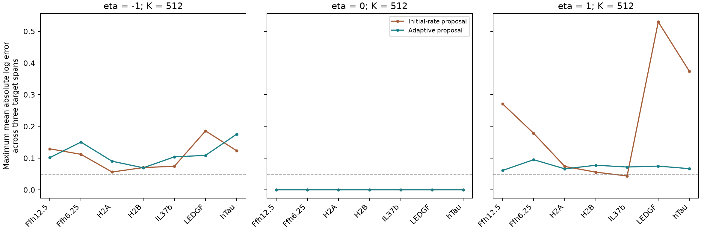

# State-adaptive fragment-boundary importance sampling

**All48 small-system primary checks pass; only7/21 full-parent cases pass.**
Recomputing boundary proposals after each cut improves the difficult positive-eta
cases substantially, but does not meet the registered probability-accuracy gate.
No length-dependent full-parent case passes all gates, so no biological sampled
fit is admitted. Stop this proposal extension as registered.

## Hypothesis and one changed component

The preceding [initial-rate proposal](../2026-10-23_1920_codex_boundary-exponential/README.md)
uses the intact parent's boundary hazards for the whole trajectory. The hypothesis
was that changing fragment sizes cause this proposal to mismatch later events.
This experiment changes only that proposal. The complete physical partition
process, rate inputs, control estimator, target matrix, counts, seeds and gates
remain fixed. Equal seeds across different sampling algorithms do not imply
identical or paired paths.

The physical hazard for an uncut bond k in live fragment[a,b) is
`exp(log_rate[k])*((b-a)/20)**eta`. Both children remain; all lengths1..L including
monomers and nonbinding products are retained, with exact residue conservation
per trajectory. The target quantity is the expected count/probability of a
particular source span at time T, not a distribution normalized over MS detections.
There is no MHC filtering, probability floor or clipping.

## Adaptive path proposal and score

For a requested target, its internal cuts are forbidden only in the importance
proposal. Each required uncut boundary uses its current original hazard h and
remaining time R to draw a truncated-exponential waiting time. Outside events
retain their original hazards. After whichever event occurs first, update the
fragment state and redraw pending clocks. This defines boundary proposal hazard
`h/(1-exp(-h*R))`; it guarantees boundary formation before T while preserving all
outside products. It does not alter the original biological process.

For a segment of duration d before the next event, each pending boundary adds
`-h*d + log(1-exp(-h*(R-d))) - log(1-exp(-h*R))` to proposal log survival.
Its log-h derivative is `-h*d + B(h*(R-d)) - B(h*R)`, with
`B(x)=x/(exp(x)-1)`. Boundary events add their normalized event hazard and score.
The implementation uses stable small/large limits and explicitly rejects
unrepresentable integrated hazards or a pending boundary rounded to terminal time.
Original and proposal event, waiting and terminal-survival densities/scores are
all retained. No random draw is differentiated through.

Weights are exact original/proposal density ratios. The unchanged primary
unnormalized gradient estimator is
`mean_i[w_i*score_p_i - mean_{j!=i}(w_j)*score_q_i]`.
Its leave-one-out proposal-score control has zero expected contribution. Dividing
by the estimated normalizer still introduces finite-K bias in log gradients;
log probabilities are also biased estimates. Plain gradients and all underlying
statistics are preserved rather than calling the normalized estimate unbiased.

## Fixed small-system qualification

Six residues, five rates[.02,.07,.11,.03,.15]/hour, eta[-1,0,1], times[.5,2,8]h,
five endpoint/interior/intact targets and three prescribed rare stresses.
K256/2048/16384,16groups with the unchanged seed rules. PrimaryK16384 gates:
absolute mean probability relative error<=.05, absolute signed mean log bias<=.02,
mean log-gradient relative error<=.05 and RMS<=.25. This small-system bias metric
is explicitly distinct from the full-parent mean-absolute-error metric.

All45 ordinary and3 rare primary states pass. Ordinary worst mean probability
error0.002786, absolute mean log bias0.002677, mean gradient error0.003769 and
RMS0.012494. The rare cases include true log probabilities-170.27 and-1682.27;
the latter remains estimable in log space although linear weights underflow.
For fast boundaries, controlled RMS gradient error0.0000509 versus plain0.004156;
all rare eta0 weights are constant to numerical precision.

Six preflight tests pass, including intact/zero-time behavior, complete partitions,
eta0 constant-weight limits, stable segment derivatives, and independent finite
differences in all six parameters on16fixed paths (96 directions). The qualification
has144conditions,2,304groups and14,352,384paths, completing in23.21s with317,227,008B
peak RSS. Independent21-fragment/Frechet and closed rare-eta references replay all
groups,48complete primary raw groups and384saved full event histories. Max path
error1.14e-12; independent replay0.461s. Unsaved individual paths are not claimed
to have been independently replayed.

## Full-parent outcome

After that gate and independent replay, the same21cases were admitted: seven
canonical training conditions/six full constructs123–533residues, eta=-1/0/+1,
T24h and centered lengths1/9/40 selected solely from sequence length. Sources are
purified human20S digestion inputs, not APC measurements. The40-coefficient
initializer has intercept,19left/19right residue contrasts and the recorded enzyme
concentration proxy. The signed log readout uses weights[1,-.5,.25]/1.75, and its
full41-coordinate gradient includes eta. K64/512×8groups; primaryK512 requires
each target mean probability error<=10%, mean absolute log error<=.05, aggregate
mean gradient relative error<=.20 and RMS<=.50.

| eta | Initial-rate proposal passes | Adaptive passes | Worst mean absolute log error | Worst mean gradient error | Worst RMS gradient error | Minimum ESS / 512 |
| --- | --- | --- | --- | --- | --- | --- |
| -1.0 | 0/7 | 0/7 | 0.17552 | 0.35993 | 0.81516 | 7.96 |
| 0.0 | 7/7 | 7/7 | 0.00000 | 0.00805 | 0.02120 | 512.00 |
| 1.0 | 1/7 | 0/7 | 0.09505 | 0.08491 | 0.22895 | 61.37 |

The adaptive proposal reduces positive-eta worst mean absolute log error from
0.5294 to0.0950, RMS gradient error1.3585 to0.2290, and raises minimum ESS2.76 to61.37.
However, every positive-eta case still misses the0.05 log-error criterion. The
previous IL37b pass is not retained, so total passes fall8/21→7/21 even while the
worst positive-eta behavior improves. Negative-eta results remain poor and are
not uniformly improved. All seven eta0 cases pass. Passing reference/density
replay does not establish adequate finite-sample estimates.

See [all primary cases](results/comparison.md), [CSV](results/actual-comparison.csv)
and [numerical comparison](results/numerical-comparison.csv). Every worker completes;
290,304conditional paths take333.98s suite time,308.55s inside conditional sampler
calls, maximum worker RSS322,912,256B. Exact references were reused by hash;
old worker time included their construction. These totals are not a matched
end-to-end speedup comparison. Full runtime caps remain120s/4GiB per worker.

## Independent full-parent verification

Exact CRAM48 two/four-step arrays and readout gradients are the previously
independently checked references, now reused only after exact source/config/case
hashes and rebuilt rate features match. This experiment does not recompute their
63directional finite differences. Eta0 logs are separately checked analytically.
Full-output tiny-tail negativity in CRAM remains unresolved; these references
qualify only the fixed positive target values at these parameter states.

Independent NumPy/scalar replay checks all group algebra,63saved raw primary
groups and504saved complete event histories. It reconstructs original/adaptive
proposal densities, all fixed-path scores, terminal survival and parameter
projections. Max path error8.67e-13;3.238s/78,938,112B. Signed log bias and mean
absolute error are separately verified. A new cancellation test catches the
previous metric error; producer and independent gate decisions agree in every
case. Reference reuse and unsaved-path limits are explicit in the receipt.

## Source, training and evaluation scope

Input projection SHA25674f615a77ea376439e68141ec41c17cf1d382aa96dbca456c9fad3f8d1fe601c,
canonical package manifest5f616170b5514cb4d8f0c7b7843d232959e9514eebbca6483f976e17b0846615,
original fitted initializer2400f214141b6ab421cc0b5168ec08b3209507b62b7cf0a590fd719937bd267f.
Exact paths/source hashes are in reproduce/actual-inputs.json. No measured quantity,
development/test tables, new curation or biological labels are loaded in this
family. The original initializer is previously fitted and is not refitted here.

Zero optimizer steps or pretraining, no assay losses, no synthetic biological
training labels and no fitted checkpoints. There is intentionally no predictive
validation/test split: this is a fixed-state estimator study using numerical
fixtures and frozen training-parent inputs. Probability/gradient/raw-path dumps
are the relevant numerical predictions. nM regression/binder-threshold metrics
are inapplicable. Neither full APC quantities nor MS response, transport,
clearance, pMHC/TCR behavior or species/cell transfer is validated by these results.

## Reproduction and artifacts

Agent/model Codex / GPT-6; registeredOctober23,2026at20:00America/New_York. Source
base2c6cb9748b5804450a02b60bc7c4b5a96ad31d48 with dirty task notes preserved; exact
model/test/verifier/report snapshots and hashes are frozen in reproduce/.
Python3.12.6,Torch2.14.1,NumPy2.5.4,SciPy1.18.1; CPUfloat64 one thread on macOSarm64,
OMP/OpenBLAS/MKL thread counts1. No Modal/GPU or shared-environment changes.

- [Registration](reproduce/launch.json), [prospective specification](reproduce/plan.md),
  [executed source](reproduce/execution.json), [small launch](reproduce/launch.sh).
- [Full-parent specification](reproduce/actual-plan.md), [fixed inputs/reference hashes](reproduce/actual-inputs.json),
  [executed source](reproduce/actual-execution.json), [actual launch](reproduce/actual.sh).
- [Small independent replay](results/independent-verification.json),
  [full-parent replay](results/actual-independent-verification.json),
  commands/plans in reproduce/verify* and reproduce/actual-verif*.
- [Raw archive inventory](results/raw-artifacts.json) preserves every original
  qualification/group/path/raw-array byte. Run `python reproduce/unpack.py` with
  the recorded environment to restore those exact paths. It refuses to overwrite
  differing files. Also restore the preceding exponential family's archives
  before full-parent replay because exact references are deliberately reused.
- Small raw outputs: results/qualification.json, path-traces.json and primary-*.npz.
  Full-parent outputs: actual-XX.json and actual-XX-target-Y-raw.npz / -traces.json.
  All groups retain sufficient statistics; first primary groups retain full raw
  arrays and eight full histories per target. Other individual paths are unsaved.
- [Report reproduction](reproduce/report.sh), [report source metadata](reproduce/report.json),
  logs under launch_logs/, and results/closure-hashes.json for publication integrity.

The launchers refuse existing immutable qualification/summary outputs. Use a fresh
output workspace with pinned dependencies/inputs when resampling. The independent
verification and report commands read saved artifacts. Seven focused tests pass;
explicit F/E9 code checks pass. This is not a claim of a new full repository test
suite run; current-head CI remains authoritative.

## Handoff

- **Status:** All runs, independent verification and reports complete. The full-
  parent sampled gate fails; this proposal extension stops without sample tuning.
- **Next step:** The separately frozen [full-observation numerical admission plan](../agents/codex/plans/fragment-observation-domain.md)
  tests all actual required training spans/times before a bounded differentiable
  biological fit. It explicitly changes the numerical admission scope without
  retroactively passing earlier blanket positivity gates. The previous sampled
  failures remain references. A coherent condition/time minibatch objective is
  specified before any new biological optimization.
- **Open questions:** Whether the length effect improves biological predictions,
  required-output numerical precision/runtime, observation calibration and the
  remaining APC mechanisms. No new Hitlist data gap arose. The full goal stays active.
