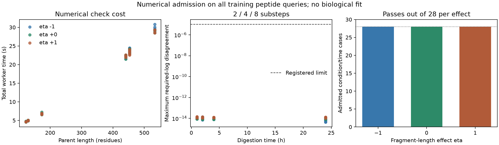

# Full-observation fragment solver admission

**ADMITTED for a separately frozen bounded fit.** This checks the numerical solver over actual training support, not
biological predictive accuracy. The separate sampled estimator still fails all
length-dependent full-parent cases under its frozen K512 contract.

Codex / GPT-6, October 23, 2026. Source commit `6347987636c2de32a4f20001c356fb1d24febbc7` with recorded
dirty status and exact copied sources in `reproduce/`. The preceding adaptive
sampling family is unchanged. This family implements the [registered plan](reproduce/plan.md).

## Model and source

Full branching fragments of every length 1..L, including monomers and nonbinders.
A bond in a current fragment cuts at
`exp(x_bond @ theta) * (current_fragment_length / 20)^eta`.
The 40 theta inputs are an intercept, 19 left-residue contrasts, 19 right-residue
contrasts, and log enzyme concentration context. The original fitted initializer
is reused without fitting. Eta is fixed at -1, 0, +1. The output is the expected
number of copies of each position-specific fragment per initial parent. No MHC
selection, transport, clearance, MS response, conditioning on observed products,
probability floors, or new biological labels are introduced.

Canonical Hitlist recipe manifest `5f616170b5514cb4d8f0c7b7843d232959e9514eebbca6483f976e17b0846615`,
from the shared-observation family. Complete unchanged training support: **90,630
measurements**, 45,315 unique span/time queries, seven conditions, six parent
constructs, lengths 123–533, times 1/2/4/24 h. Source support, row identities and
weights are independently reconstructed. Every required span is covered; no easy
subset, length filtering, negative-label imputation or quantity-based selection.
All source/recipe/initializer/feature hashes are in `reproduce/launch.json`.

The entire source JSON is parsed, including excluded split records. Projection
accesses identity, support and context fields, and counts development support;
**measured quantity values are deserialized with the file but never consulted by
the projection or numerical gates**. The frozen initializer comes from
prior training. No development/test quantity, loss or prediction is computed.
Original test parents remain excluded. Existing 14,822 development observations
are not a new blind test. Canonical single-source-span mapping is asserted; no
new repeated-origin disambiguation is made.

## Numerical contract and outcomes

Fixed CRAM48 two/four/eight substeps, CPU float64/complex128, one thread. All
required values must be positive and finite, with maximum pairwise natural-log
disagreement <=1e-5; eta0 also matches independently summed analytical log counts.
Every full array is preserved, including negative or zero unobserved tails.
This is a prospective required-output criterion; it **does not pass the earlier
blanket positivity gate** or qualify arbitrary unobserved peptide queries.

| eta | Admitted condition/time cases | Unresolved required span/time queries |
|---|---:|---:|
| -1.0 | 28/28 | 0 |
| 0.0 | 28/28 | 0 |
| 1.0 | 28/28 | 0 |

Signed readout covers every sorted unique required span: alternating weights of
magnitude `1+0.25*sin(i+1)`, normalized by total absolute weight. Two-step autograd
produces all 41 parameter gradients. Independent NumPy eight-step central
finite differences (h=1e-5) test normalized sine/cosine theta directions and eta;
tolerance is `1e-5 + 1e-6*abs(FD)`. Undefined/unresolved forward values prevent a
derivative/admission, without clipping or dropping rows.

**252 directional checks** across 84
gradient-evaluated cases; maximum absolute discrepancy
2.00716e-10. This finite set of directions/initial parameter
states is an empirical numerical check, not a universal error bound or a guarantee
throughout training. Every future training update must pass its registered
required-output check, and the final checkpoint must cover all rows.

Maximum full-array negative count per call: 41,297.
Maximum absolute residue-mass discrepancy: 5.11591e-12.
Full arrays and per-call minima/mass remain in raw case archives; negative tails
are numerical artifacts, not negative molecular concentrations.

## Runtime and verification

All 84 registered fresh-worker cases are accounted for;
84 are admitted. Suite elapsed 1464.95 s;
maximum worker peak RSS 2.055 GiB. Each worker has
120 s / 4 GiB caps. Runtime includes forward refinements, autograd, six independent
perturbed solves and artifact writes, not a training update. No GPU/Modal was
requested or used; shared environment unchanged. Hardware sysctl identification
was sandbox-denied and that return code is preserved; platform/software recorded.

Two focused oracle tests plus one closure-gate counterexample test pass: nine variable-time/eta cases versus an independent
dense generator and three finite-difference directions for a full-support signed
readout. Initial pytest collection failed without the family PYTHONPATH; the
original log and corrected explicit invocation are retained. This is not a full
repository-test or stylistic-lint claim.

Closure reconstructs all source support/weights, checks 252
full primary arrays, recomputes every span log/gate and eta0 analytical reference,
and replays saved FD reductions. All 84 unperturbed full arrays are independently
recomputed with the NumPy eight-step solver: maximum full-array absolute discrepancy
9.4369e-16, maximum required-log discrepancy
1.24345e-14, elapsed 83.26 s.
The worker stores eta0 analytical discrepancy
for eight substeps; closure independently enforces that comparison for all three
refinements. Changed admission decisions: 0.
It does **not** rerun every perturbed matrix solve;
the producer uses a separate NumPy implementation qualified against the dense
oracle. Exact artifacts and verification scope are in `results/summary.json`.

## Reproduction and artifacts

Run `sh reproduce/launch.sh` in a fresh copy with no existing case outcomes. It
refuses to overwrite results. `reproduce/frozen-code.json` pins launcher, solver,
reference, support, cases and configuration; `reproduce/source/` contains snapshots.
Source paths are recorded; canonical recipe must be present and match its hash.
Environment: `OMP_NUM_THREADS=OPENBLAS_NUM_THREADS=MKL_NUM_THREADS=1`;
Python `/Users/iskander/code/shared-virtual-env/bin/python`. Tests additionally use the absolute family `code/` as
PYTHONPATH. Run `reproduce/reference-verify.sh`, then `reproduce/verify.sh`;
`reproduce/test.sh` and `reproduce/report.sh` reproduce tests and reporting.

- `results/case-summary.csv`: all case decisions, cost and negativity.
- `results/required-span-predictions.csv`: all 135,945
  required span/eta queries and three solver predictions.
- `results/unresolved-spans.csv` when nonempty: every unresolved query.
- `results/case-*.json/.npz`: full arrays, parameters, logs, gradients and FD logs.
- `results/independent-reference.json` and `independent-case-*.npz`: freshly
  recomputed independent full-output references.
- `results/raw-arrays-*.tar.gz`, `raw-artifacts.json`, `reproduce/unpack.py`:
  byte-verified archives/restoration of all 168 raw numerical array files.
- `results/worker-receipts.json`, `launch_logs/`: all worker returns and failures.

No fitting/pretraining or optimizer updates, assay-label losses, binding thresholds
or synthetic biological targets. No held-out predictive validation/test split is
used: this is a numerical admission experiment. Numerical prediction dumps are
retained; Spearman/Pearson/RMSE for biological observations and binder metrics do
not apply.

## Decision and handoff

Status: numerical family closed after independent artifact verification; publication
receipt is recorded separately. ADMITTED for a separately frozen bounded fit.

Next step: freeze the matched analytical-vs-fragment biological execution contract, qualifying the offset/minibatch objective first.
A numerical pass does not justify more sampler tuning by itself: biological value
of the length effect remains the next scientific test. No new Hitlist metadata gap
arose in this numerical work. Full APC availability/concentration, machinery,
clearance, independent MS calibration and cellular validation remain open.
