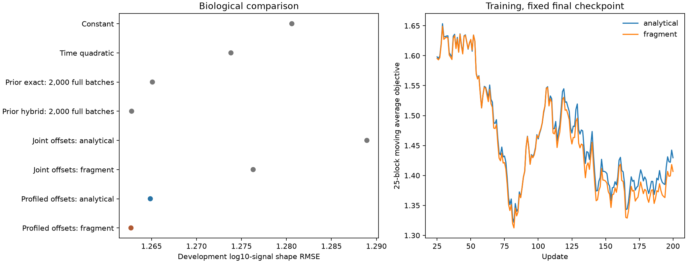

# Biological fragment fits with exactly solved condition offsets

Exact condition-offset solving gives development shape RMSE **1.26487 analytical / 1.26272 fragment**, versus **1.28894 / 1.27630** with learned offsets. The added length effect improves the matched analytical result.

The full APC peptide-availability/concentration goal is not achieved. These are
relative MS signal-shape predictions on purified human standard 20S digestion,
not cell concentrations, a complete Presto fit, or a new RL comparison.

## Biological outcomes

| Condition | Train shape RMSE | Development shape RMSE | Development Pearson / Spearman | Development temporal-ratio RMSE | Development prediction / target SD |
|---|---:|---:|---:|---:|---:|
| Prior joint-offset analytical | 1.18192 | 1.28894 | 0.2320 / 0.2283 | 1.23295 | 0.6417 / 1.2524 |
| New profiled-offset analytical | 1.16435 | 1.26487 | 0.2547 / 0.2451 | 1.14417 | 0.6045 / 1.2524 |
| Prior joint-offset fragment | 1.16259 | 1.27630 | 0.2401 / 0.2354 | 1.20013 | 0.6111 / 1.2524 |
| New profiled-offset fragment | 1.15648 | 1.26272 | 0.2531 / 0.2427 | 1.13098 | 0.5784 / 1.2524 |

Constant-condition scale gives development shape RMSE 1.28060 and temporal-ratio
RMSE 1.16704. Earlier time quadratic gives 1.27383 / 1.10889. Earlier 2,000-full-batch
exact and sampled-hybrid fits give shape RMSE 1.26510 / 1.26279, Spearman .2452 /
.2464 and ratio RMSE 1.16391 / 1.15644. Those are contextual controls, with different
optimization budgets; the preceding 200-draw joint-offset arms are matched controls.
No one-seed, three-development-parent difference establishes robust superiority.
Prediction SD need not equal target SD; matching spread by construction would
not establish predictive quality. Judge it together with error and correlation.

The already recorded per-condition metrics show the three development parents
separately; every reported per-condition metric is independently recomputed from
the original prediction dumps before report generation. These are descriptive,
not additional checkpoint-selection criteria.

| Development condition | Observations | Analytical shape RMSE | Fragment shape RMSE | Analytical temporal-ratio RMSE | Fragment temporal-ratio RMSE |
|---|---:|---:|---:|---:|---:|
| aSPIRE_AnnexinA1 | 6174 | 1.04395 | 1.03409 | 0.74424 | 0.70825 |
| aSPIRE_H3 | 2492 | 1.31224 | 1.32061 | 1.26197 | 1.26374 |
| aSPIRE_H4 | 6156 | 1.40992 | 1.40357 | 1.33451 | 1.31860 |

## Dataset and meaning of predictions

Unchanged canonical Hitlist recipe manifest
`5f616170b5514cb4d8f0c7b7843d232959e9514eebbca6483f976e17b0846615`,
MSV000092631/PXD044463: 90,630 training observations from six constructs/seven
conditions and 14,822 development observations from three other parents.
Original positive background-corrected MS signals, eligibility, instruments,
modified-form/technical contributor ambiguity and source mapping are unchanged.
Weights give equal parent, then condition, curve and common positive time.
No new negatives, censor inequalities, synthetic biological targets or curator.

Inputs are full parent sequence, digestion time, enzyme concentration context and
instrument identity. Forty coefficients encode log cut hazards using an intercept,
19 left/19 right residue contrasts and log enzyme context. Thirty-eight supported
instrument/length/composition coordinates estimate relative MS response. The
fragment arm adds one scalar eta=tanh(rho), physically bounded to (-1,1), with
hazard `exp(x@theta)*(current_fragment_length/20)^eta`. All fragment lengths 1..L
remain, including monomers/nonbinders. Outputs are expected fragment copies per
initial precursor and log10 signal = log10 expected copies + response + scale.
No normalization over observed candidates. Eta-zero uses the exact independent-cut
formula. No MHC, TCR, APC machinery KO, transport, cellular clearance or species
transfer module receives supervision here. MS response is not independently calibrated.

Development scales are solved using development labels for the existing
scale-invariant shape diagnostic. Thus this is not absolute out-of-sample signal
prediction. MSE uses hierarchical weights; correlations/spread are pooled unweighted.
Development is already inspected. Original test parents are deliberately excluded
from this optimization diagnostic, with no new blind-test claim. All train and
development predictions are retained; nM/binder metrics do not apply.

## The one change: eliminate seven nuisance optimizer variables

At each selected condition/time block, evaluate every admitted time/span in that
condition at the current parameters, and compute
`beta = sum(w*(target-base_prediction))/sum(w)`. Detach beta for the selected
probability-weighted block loss. The weighted expectation over all 28 blocks equals
the full profiled-objective gradient by the envelope identity. A single-block
finite difference must hold beta fixed; differentiating a new block-specific
optimum tests a different objective. Neither stale nor separate timewise offsets
are used. Only 78 common parameters (79 with raw eta) are allocated to Adam.
Selected differentiable values are reused detached only at the exact same state.

Identical original 40-coordinate ratio-trained initializer, zero response,
200 fixed seed-42 block draws, Adam lr .03, betas .9/.999, eps 1e-8, no clipping,
weight decay or dropout. Penalty is .005 squared nonintercept rate/response
coefficients, plus .005 eta squared for the fragment arm. No new pretraining.
Final checkpoint only; no outcome-driven extension/retry/reset or test rescue.

| Arm | Final training objective | Profiled training data MSE | Residual offset optimization gap |
|---|---:|---:|---:|
| analytical | 1.378363 | 1.355700 | 1.95e-29 |
| fragment | 1.360604 | 1.337441 | 2.5e-29 |

Initial objective was 1.595535.
The former joint-offset gaps were .196090 analytical and .129245 fragment MSE.
Removing that gap tests optimization, not a causal claim about fragmentation or
proof that other representation/generalization limits have disappeared.

## Verification, runtime and artifacts

Before fitting, toy and all-28-block actual analytical identities passed at the
original initializer and a predetermined sinusoidal perturbation. A toy
counterexample rejects separate timewise offsets. Actual eta-zero fragment
common-gradient parity and positive finite 2/4-step readouts passed. Every queried
condition/time is checked during fitting, the selected block is checked after
each update, and all final train/development queries are checked. Required-log
disagreement must be <=1e-5, with no clipping, floors, dropped rows or eta reset.
Tiny negative unobserved tails remain unqualified and are recorded.

Independent verification replays all 200 Adam steps per arm and every analytical
gradient. Fragment probes at fixed steps 1/100/200 independently solve whole-condition
offsets with NumPy eight-step physics and test nine fixed-offset rate/eta directions
plus all 38 response components per state. Other fragment gradients are not
independently recomputed. Every final physical amount, source-linked target/weight,
scale, training objective and global metric is independently checked. Exact scope
and numerical errors are in each `independent-verification.json`.

| Arm | End-to-end seconds | Peak RSS GiB | Materially trained / allocated parameters | Eta |
|---|---:|---:|---:|---:|
| analytical | 7.76 | 1.224 | 78 / 78 | 0 |
| fragment | 3051.87 | 2.364 | 79 / 79 | 0.3170007217829173 |

Local CPU float64/complex128, one thread, no GPU/Modal/environment change. Before
training, the longest-parent target-free update cost was 26.09 s.
The frozen cap is 8400 s / 4 GiB per arm, derived
from 200 worst-parent costs with 50% margin plus 300 s evaluation and rounding.
This is a prospective cap, not an outcome-driven extension of the previous run.
Descriptive runtimes include numerical guards and artifact/evaluation work;
independent analytical verification briefly overlaps fragment fitting.

Agent/model: Codex / GPT-6; source commit a6c6559 with recorded dirty state. Exact
source/data hashes, commands and source snapshots are under `reproduce/`.
`launch.json`/`launch.sh` preserve zero-update qualification; separately frozen
`fitting.json`/`fit.sh` record the subsequent fits. To rerun, restore the recorded
source/data paths or explicitly document equivalent relocation, then run in a
fresh family copy without attempted-arm outputs. Verification commands are
`sh reproduce/verify.sh analytical` and `sh reproduce/verify.sh fragment`;
`sh reproduce/report.sh` regenerates the summary. Raw checkpoint/state/reference
arrays are archived byte-for-byte as `results/raw-training-*.tar.gz`; restore them
with `python reproduce/unpack.py`. All 105,452 predictions per completed arm remain
directly available as `results/<arm>/predictions.jsonl.gz`.

Status: terminal outcomes and independent verification recorded. The next decision
must follow these biological results; numerical precision or parameter updates
alone do not justify model promotion. Existing cellular MAPP failure, precursor
mapping and independent MS calibration remain unresolved. No new length-dependent
sampler is admitted and no APC concentration model is validated.
