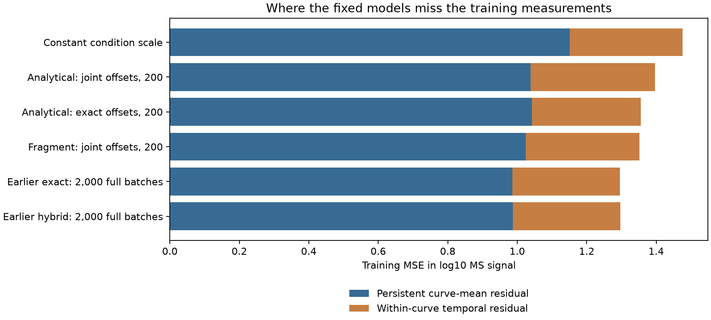

# Training residuals: persistent curve means dominate remaining error

Persistent curve-mean residuals account for **76.89%** of the profiled analytical model's training MSE. Solving condition offsets changes persistent MSE by **+0.003925** and temporal MSE by **-0.045156** relative to the matched joint-offset fit.

This is a posthoc arithmetic diagnostic of completed, independently verified
fits. It is not another model, predictive evaluation, biological noise ceiling,
MS calibration, or evidence of APC concentrations. The live profiled-fragment
fit is deliberately excluded; no running checkpoint or development target is
used to select this analysis.

| Frozen model | Total MSE | Persistent curve-mean MSE | Within-curve temporal MSE | Persistent share |
|---|---:|---:|---:|---:|
| Constant condition scale | 1.475509 | 1.150526 | 0.324983 | 77.97% |
| Analytical: joint offsets, 200 | 1.396931 | 1.038436 | 0.358496 | 74.34% |
| Analytical: exact offsets, 200 | 1.355700 | 1.042360 | 0.313340 | 76.89% |
| Fragment: joint offsets, 200 | 1.351619 | 1.023909 | 0.327710 | 75.75% |
| Earlier exact: 2,000 full batches | 1.296025 | 0.986178 | 0.309847 | 76.09% |
| Earlier hybrid: 2,000 full batches | 1.297461 | 0.986934 | 0.310527 | 76.07% |

The new analytical fit's total training improvement comes from temporal error
reduction; persistent curve-mean error slightly worsens. The longer exact/hybrid
fits still have about 76% persistent error. This is not concentrated in one
construct: the new analytical model's persistent share ranges from
71.77% to 81.06% across all six
training constructs. Original condition/construct summaries are retained.

## Exact meaning of the two components

For each original curve, let residual r_i be the condition-centered predicted
minus measured log10 MS signal; retain original weight w_i. Let W_c be the sum of
weights and m_c the weighted mean residual in that curve. Then

`total MSE = sum_c W_c*m_c^2 + sum_i w_i*(r_i-m_c)^2`.

The cross term is zero. The first component is a mismatch persistent across the
curve's observed times; the second changes within that curve. No added curve
intercept is fitted into the predictive model. Curves include source biological
labels, and source molecular-form/technical ambiguity persists. They are not
necessarily independent unique molecular peptides.

**These are not processing-versus-detectability components.** Wrong kinetic
amplitude, source preparation, MS response and contributor effects can all cause
persistent errors; time-varying measurement effects can cause temporal errors.
The decomposition does not identify a causal mechanism or a noise ceiling.

## Data, comparisons and boundaries

All six model comparisons use the same 90,630 original training measurements across
23,054 curves, seven conditions and six constructs. Canonical Hitlist manifest
`5f616170b5514cb4d8f0c7b7843d232959e9514eebbca6483f976e17b0846615`,
MSV000092631/PXD044463 purified human standard 20S digestion. Original positive
corrected MS values, target units, row identities, instrument labels, source
contributors and equal parent/condition/curve/time weights are unchanged. No
negative labels, censor reinterpretation, new biological synthesis or curator.

Four prior fixed fits and the completed profiled analytical fit are compared
with the constant condition-scale control. The 200-update fits share draw
schedule/initializer/Adam settings; the earlier exact/hybrid used 2,000 full
batches and are contextual references. This diagnostic performs **zero optimizer
or pretraining updates** and adds no assay loss. Original signal maps to each
existing model's saved condition-centered log10-signal prediction. No affinity,
nM, binding-threshold, MHC/TCR or APC machinery outcomes are evaluated here.

Complete input JSONL files include development records. They are parsed and
skipped by their original split before quantities are consulted; all reported
arithmetic uses training only. Original test is excluded. There are no new
validation/test predictions or metrics because this is a training residual
diagnostic, not generalization evidence. Existing full prediction dumps, pinned
by path/hash, remain the per-example evidence; no model outputs are overwritten.

## Verification, resources and reproduction

Stable Python sums produce the original curve records. A separate NumPy
bincount implementation reads every original prediction, independently verifies
all measurement identities/targets/weights across files and reconstructs all
138,324 curve records, condition/construct summaries and fractions. Maximum
absolute component disagreement is 8.88e-16.
A nonuniform-weight toy checks both components and rejects the unweighted-mean
substitution. Producer 8.56 s, peak RSS 0.968
GiB; independent verifier 6.40 s. Local CPU, no GPU/Modal or environment
change; the producer stayed within the registered 120 s / 4 GiB cap. These are
arithmetic runtimes, not model-training speed comparisons.

Agent/model Codex / GPT-6; source a6c6559 with recorded dirty state. Frozen plan,
exact source hashes, command/environment and source snapshots are in `reproduce/`.
Run `sh reproduce/launch.sh` only in a fresh result directory; then run
`python code/verify.py` and `python code/report.py` using the recorded shared
Python environment and one-thread settings. Source paths include the completed
analytical arm of the still-live 2201 family; original hashes must match. The
source-frozen producer refuses an existing summary. `results/curve-residuals.csv.gz`
contains every curve's original identifiers, weights and component sums;
`results/summary.json` and `comparison.csv` hold the complete reductions.

## Decision

Finish the live paired fragment fit unchanged. Then require the next hypothesis
to address persistent cross-curve signal error as well as temporal behavior.
Do not assume a more elaborate trajectory sampler will solve the dominant error,
or silently add per-peptide nuisance offsets that erase abundance information.
A more expressive response or cleavage context can be a predictive hypothesis,
but independent known-load/form/transfer data are still required to interpret it
as detectability or availability. The existing Hitlist calibration and precursor
requests remain relevant; this diagnostic finds no new missing source column.
No causal attribution, new biological winner or APC concentration claim follows.
Full availability goal remains active.

## Existing bulk-MS data limit checked

The inspected Hitlist bundled Bekker-Jensen peptide CSV at commit61baed9 contains
sequence, parent, digest/fractionation/enrichment and detection-count fields, but
no peptide intensity column. This is already [Hitlist #95](https://github.com/pirl-unc/hitlist/issues/95),
which is open; its existing Presto comment already requests distinct raw/normalized
measurements, experiment-level lineage and explicit missingness. Closed #751
materializes existing native numeric measurements and does not recover these
omitted peptide intensities. No duplicate issue or source import was created.
See `results/upstream-data-review.json` for the exact inspected file/header/hash.
This is a code/header review, not fresh validation of every current Hitlist export.
