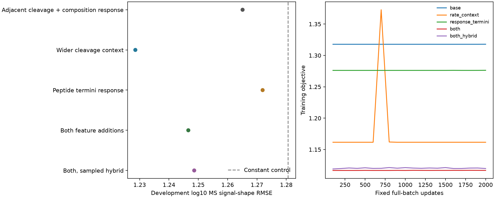

# Sequence context and peptide-terminal response on biological digestion

Wider cleavage context changes development shape RMSE from 1.26510 to 1.22853, and Spearman from 0.2452 to 0.3487. Combining both additions gives 1.24659; the matched conditional sampled hybrid gives 1.24860.

This is development evidence on three already inspected proteins, not a new blind
biological test or a calibrated intracellular-concentration model. All five
predeclared fits are retained. No architecture, checkpoint, penalty or seed was
selected from development outcomes. The full availability goal remains active.

## Actual biological outcomes

| Model | Parameters | Train shape RMSE | Development shape RMSE | Development Pearson / Spearman | Development temporal-ratio RMSE |
|---|---:|---:|---:|---:|---:|
| Adjacent cleavage + composition response | 78 | 1.13843 | 1.26510 | 0.2561 / 0.2452 | 1.16391 |
| Wider cleavage context | 158 | 1.06433 | 1.22853 | 0.3555 / 0.3487 | 1.09848 |
| Peptide termini response | 150 | 1.12157 | 1.27193 | 0.2538 / 0.2442 | 1.16216 |
| Both feature additions | 230 | 1.04616 | 1.24659 | 0.3467 / 0.3426 | 1.09710 |
| Both, sampled hybrid | 230 | 1.04802 | 1.24860 | 0.3456 / 0.3401 | 1.10118 |

Constant-condition scale: development shape RMSE1.28060, temporal-ratio RMSE1.16704.
Prior adjacent-context exact/hybrid shape RMSE1.26510/1.26279. The new base arm
reproduces the old exact result. The previous fragment-length model gave1.26272
with a different200-minibatch budget. These comparisons do not make the current
one-seed result robust across biological studies. Every per-example prediction
is retained; MSE is hierarchical weighted, correlations and SD are pooled/unweighted.

| Development parent | Base | Wider rates | Terminal response | Both exact | Both hybrid |
|---|---:|---:|---:|---:|---:|
| aSPIRE_H3 | 1.31724 | 1.31661 | 1.32643 | 1.33914 | 1.34236 |
| aSPIRE_H4 | 1.41217 | 1.32105 | 1.42096 | 1.32636 | 1.32685 |
| aSPIRE_AnnexinA1 | 1.03541 | 1.02431 | 1.03677 | 1.05330 | 1.05573 |

The error decomposition keeps original source-curve identities. Persistent means
are not pure MS effects, and temporal residuals are not pure processing effects.
No per-peptide fitted offset is added to erase between-peptide information.

| Model | Training persistent MSE | Training temporal MSE | Development persistent MSE | Development temporal MSE |
|---|---:|---:|---:|---:|
| base | 0.98618 | 0.30985 | 1.14079 | 0.45969 |
| rate_context | 0.84795 | 0.28485 | 1.09887 | 0.41041 |
| response_termini | 0.95189 | 0.30602 | 1.16025 | 0.45756 |
| both | 0.81183 | 0.28262 | 1.14082 | 0.41317 |
| both_hybrid | 0.81463 | 0.28371 | 1.14305 | 0.41597 |

## Interpretation of this factorial

The wider-rate-context arm is the preferred next representation hypothesis: it
improves both development shape and temporal error. Terminal response additions
improve training fit but worsen development shape error, both with and without
wider rates. Do not add those response features to the preferred model merely
because the full-feature model is more flexible. Wider rates improve all three
development parents, but most absolute improvement comes from H4; the other
changes are small. No confidence interval or independent-study replication is
claimed. Current results motivate a prospectively specified transfer test from
purified-digestion rate features to cellular MAPP, retaining the latter's capture/
observation and total-yield limitations, rather than another sampler extension.

## Dataset and prediction meaning

Unchanged canonical Hitlist manifest
`5f616170b5514cb4d8f0c7b7843d232959e9514eebbca6483f976e17b0846615`,
MSV000092631/PXD044463 purified human standard20S digestion. Same90,630training
observations from six constructs/seven conditions and14,822development observations
from three other parents. Original positive background-corrected log10MS signals,
source identities, contributor/form ambiguity, instruments, sequence mapping and
parent/condition/curve/time weights remain. No new filters, negatives, censor
conversion, synthetic biological labels or parallel source curator.

Original test parents stay excluded: this is a representation diagnostic using
already inspected development parents, with no untouched-test claim. Development
condition scales are solved from development labels to evaluate relative signal
shape. Absolute signal, total yield and peptide concentration are not identified.
All train/development observations are preserved; binding thresholds/nM do not apply.

Inputs are full parent sequence, candidate span, time, enzyme context and
instrument. Analytical independent-cut expectations represent copies per initial
precursor for all lengths1..L, including monomers/nonbinders. Log10copies plus
relative response plus one profiled condition scale predicts the original MS
signal. No normalization over observed candidates. No new APC species/cell/KO,
transport, clearance, pMHC or TCR labels train; these modules are not allocated.
Independent MS response calibration and cellular validation remain unresolved.

## Nested representations and fixed training

Keep the original40rate coefficients and38instrument-specific length/composition
response coordinates. Add residue indicators at bond positionsi-2,i-1,i+2,i+3,
wherei/i+1 are already modeled, including explicit parent-boundary indicators.
There are80raw extra rate columns. Add first/last peptide residue contrasts per
instrument to response; external parent flanks never enter that response layer.
These are small linear sequence models, not a learned neural encoder.

Residualize new features against old features using training sequences/metadata
only; center response contrasts within condition. Normalize by training RMS and
retain eigenvalues>max(largest,1)*1e-10. New allocated dimensions: rates
80, response72.
Unsupported/dependent raw directions are removed before training. All transforms,
names/eigenvalues and omitted/out-of-training-span directions are preserved in
`results/features.json`. Held-out directions outside the supported span are
projected away, an explicit prediction limitation rather than serving qualification.
Zero additions reproduce the old model for every training/development query.

Each arm uses the same original ratio-trained40rate initializer, zero response and
zero added rates, 2,000full-batch Adam updates, lr.03, betas.9/.999, eps1e-8. Loss is
weighted condition-centered MSE plus .005squared coefficients excluding the kinetic
intercept. No dropout, clipping, weight decay, schedule, new pretraining or
outcome-driven retry/extension. Final checkpoint only. All allocated-coordinate
material gradients/updates are reported, without claiming causal identification.

The fifth arm uses the full both representation, selected before results, and
replaces only kinetic data gradients with the established K512conditional complete-
partition importance estimator (seed42,90%gradient-norm proposal/10%uniform).
Exact probabilities, residuals, conditional scores and response gradients remain.
This is a sampled hybrid; it is not a pure simulator-only RL model and has no
score-saving claim. No new GRPO/clipping/reuse/reference-KL change is made.

## Qualification, verification and runtime

Independent raw feature indexing, exact nesting, old-objective equality and NumPy
value/Jacobian checks pass at initialization and predetermined .02sin perturbations.
Enumerated conditional-mixture toy identity passes. Sixteen K512groups at each
fixed full-model state pass mean-relative-error<=.2 and RMS<=.5, without sampler
tuning. Pre-fit measured costs admit600s per exact arm and1800s hybrid,4GiB each.
Qualification took16.56s. The initial source-freeze invocation used the
wrong relative directory and failed before qualification/fitting; its log and the
invocation-only correction are preserved. No executed biological fit was replaced.

Independent closure rebuilds new raw sequence features and final NumPy physical
expectations, source IDs/targets/weights, all global/per-parent metrics and both
residual components. It replays all2,000Adam arithmetic updates per arm and four
fixed gradient states (1/100/1000/2000). Hybrid replay uses independent NumPy
conditional score/importance arithmetic with PyTorch RNG draws. Other gradients
are not independently replayed; the pinned source loader is reused.

| Arm | End-to-end seconds | Peak RSS GiB | All allocated coefficients materially trained |
|---|---:|---:|---:|
| base | 31.82 | 1.463 | True |
| rate_context | 35.23 | 1.454 | True |
| response_termini | 52.27 | 1.346 | True |
| both | 51.46 | 1.351 | True |
| both_hybrid | 1104.58 | 1.466 | True |

Local CPU float64, one thread, no Modal/GPU/shared-environment changes. Descriptive
runtimes include artifact/evaluation work and limited overlap with independent
verification, not isolated benchmark comparisons. Scientific interpretation must
follow biological metrics, not numerical gates or parameter coverage.

## Reproduction and decision scope

Agent/model: Codex / GPT-6; source commit010be23818400d47a55d6ce0f386b95c222ce8ec with recorded dirty
state. `reproduce/plan.md`, `launch.json`, `execution-code.json`, source snapshots,
`fitting.json` and `verification.json` preserve exact contracts and hashes.
Run `sh reproduce/launch.sh` for qualification; fitting command/environment is
frozen in`reproduce/fitting.json` and invoked through`code/run_fits.py` in a fresh
family copy. Fitters refuse existing arm destinations. Run`sh reproduce/verify.sh
ARM` and`sh reproduce/report.sh` for closure. Absolute input paths require the
pinned preceding families/Hitlist recipe, or an explicitly documented relocation.
Raw checkpoints/updates are archived with a byte-verifying restore helper; direct
`results/ARM/predictions.jsonl.gz` files retain105,452source-linked rows per arm.

Do not promote a general APC concentration model from these scores. This family
tests whether ordered sequence representation warrants further study; independent
protein/study transfer, calibrated observation response and cellular production/
clearance remain required. Separate literature discovery filed [Hitlist788](https://github.com/pirl-unc/hitlist/issues/788)
for native intracellular peptidome perturbation panels. No new source workbook was
admitted or used in these fits; its censored ratios and cross-paper reuse require
canonical qualification. Existing calibration/precursor/intensity issues retain ownership.
