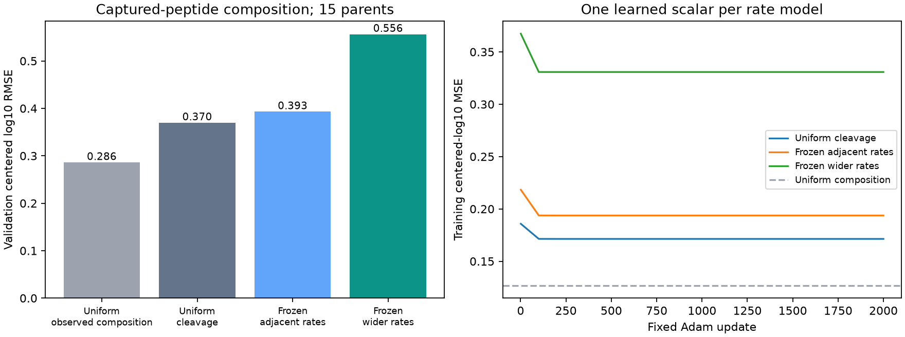

# Frozen digestion-to-cellular transfer: biological outcomes

Neither frozen sequence prior improves both no-sequence controls on this development endpoint. These are already inspected validation parents, not a newly blind result. No APC concentration model is promoted. All physical fits have varying outputs; wider-context validation prediction SD exceeds the target SD. The failure is not constant-output collapse.

All three exact fits completed the fixed 2,000 updates. The sampled estimator passed
its numerical gates, but its predeclared cost gate rejected training; this family
therefore does **not** provide a fitted exact-versus-RL biological comparison.

## Observed biological prediction

| Model | Train RMSE | Validation RMSE | Validation Pearson / Spearman | Prediction SD | Delta | Seconds |
|---|---:|---:|---:|---:|---:|---:|
| Uniform observed composition | 0.35609 | 0.28603 | undefined / undefined | 0.00000 | undefined | 0.00 |
| Uniform cleavage | 0.41394 | 0.36972 | 0.4416 / 0.3723 | 0.43871 | 0.105202 | 138.46 |
| Frozen adjacent rates | 0.44012 | 0.39307 | 0.4067 / 0.3456 | 0.43028 | 0.167398 | 135.09 |
| Frozen wider rates | 0.57514 | 0.55627 | 0.1685 / 0.1258 | 0.57088 | 0.175558 | 131.31 |

RMSE/MSE weight parents, conditions and candidate peptides equally within each
level. Pearson/Spearman and prediction/targetSD are pooled, unweighted. Validation
target SD is 0.35130. Exact constant controls have
undefined correlations. Secondary `kl` in JSON/CSV is **KL(target || prediction)**,
not the reverse KL used as primary loss in older MAPP families. Historical test
scores are not recomputed or compared as matched outcomes here.

| Validation parent | Uniform composition | Uniform cleavage | Adjacent | Wider |
|---|---:|---:|---:|---:|
| 1bc99aeca298 | 0.38189 | 0.38504 | 0.35123 | 0.43972 |
| 2cb9e79a6489 | 0.27243 | 0.24283 | 0.21121 | 0.40203 |
| 4957964dcbfc | 0.14104 | 0.18840 | 0.01096 | 0.23588 |
| 4f3bfe865e11 | 0.16330 | 0.16330 | 0.48978 | 0.65697 |
| 50867e0c89d5 | 0.02533 | 0.01917 | 0.05878 | 0.02692 |
| 5f7f1efc939f | 0.16905 | 0.91260 | 0.85863 | 0.78388 |
| 636b2837a9e6 | 0.40658 | 0.23513 | 0.21839 | 0.28697 |
| 72641d53d4b0 | 0.09625 | 0.13750 | 0.17593 | 0.97473 |
| 7f2445dfc796 | 0.53057 | 0.51211 | 0.67781 | 0.67315 |
| 7ff9e02ec441 | 0.16713 | 0.14050 | 0.05244 | 0.52168 |
| 9984e70ded61 | 0.16897 | 0.23079 | 0.49707 | 0.73511 |
| b4dde8faf69c | 0.18221 | 0.16255 | 0.03981 | 0.04009 |
| e4d2079e5cc6 | 0.22577 | 0.21747 | 0.21900 | 0.36372 |
| f4e53b3d2572 | 0.37505 | 0.45254 | 0.28325 | 0.20555 |
| f6e6d3486fcf | 0.44041 | 0.50972 | 0.50115 | 0.84248 |

No new sequence weights, treatment effects or peptide-specific offsets can adapt
to MAPP. These outcomes test the frozen cleavage prior plus the specified removal
and observation assumptions; failure cannot uniquely identify which is wrong.
The model predicts identical composition across UT/TNF+IFN for the same parent,
so it does not learn treatment response. See per-parent and exposure strata JSON.

## Source and endpoint contract

Agent/model: Codex / GPT-6. Source commit5b888cccf97796d205e519f6371c7556076cf4f2 with registered dirty
state. Canonical Hitlist MAPPmin2 manifestdf78d02f8200809c659e43adfae29866c48b712122b740379106994622f4ac80, PXD009092,
human HEK293 proteasome-associated captured fragments.72 training parents / 144 examples /
918 candidate measurements; 15 validation parents / 30 examples / 112 measurements. The
14 historical test parents are excluded from target construction, fitting and eval;
there are no test prediction dumps because those partitions were already exposed
and this prospective diagnostic explicitly excludes them. Validation also has
historical exposure, so this is no new blind biological test.

Preserve original nonimputed published quantities, MS/MS/PEP eligibility, source
run filters, coordinate/parent alternatives and contributor/material limitations.
No new curation, negatives, zero imputation, clipping or censor reinterpretation.
All targets are original log10MS intensities centered per parent/condition. No
nM/binder threshold is applicable. No pMHC/TCR/KO/species/transport labels train.
No native-peptidome workbook from Hitlist788 enters this family. This captured
pool is not free cytosol or a professional APC measurement.

The sequence-only exposure audit precedes target arithmetic and finds no exact
parent/construct containment or shared measured peptides against digestion
**training** in either split. The prior digestion development sequences are
separately flagged in `results/exposure.json`; no shared-component flag is proof
of homology or specimen independence. All transferred bond features lie in the
supported algebraic span; that does not establish biological transfer support.

## Physical model and information flow

Full parent sequence -> fixed per-bond cleavage rates -> expected amount for each
contiguous fragment under steady precursor input and common removal -> occurrence
sum -> centered log10amount -> centered observed log10MS target.

For independent-cut expectation C_s(t), F_s(delta)=integral C_s(t)exp(-delta*t)dt.
F is residence amount per unit precursor influx. All lengths 1..L are in physical
support, including short/nonbinding products; compute needed spans analytically
without enumerating the complete long-parent O(L^2) table. The residue identity
is sum length(s)F_s=L/delta. Observation normalization/centering is downstream of
physical F. Unknown peptide-specific capture/MS response is assumed equal within
the observed set; purified-study MS-response coefficients are not transferred.

Three rate models: uniform .01; frozen 40adjacent-residue/enzyme-context coefficients;
frozen 120wider-context coefficients from2358. Enzyme context fixed reference 0.
The frozen features and rates were fit on purified standard20S timecourses; prior
development evidence motivated wider context. These source models may be wrong
for cellular proteasome composition/substrate handling. Only log(delta) trains;
its units inherit an uncalibrated rate/time transfer and must not be interpreted
as a measured cellular half-life. Absolute amount additionally needs calibrated
precursor influx, removal and volume, which current data do not identify.

## Training and sampling contract

Each fit initializes delta=.01, runs 2,000 full-batch Adam updates at lr .03,
betas .9/.999, eps 1e-8, and uses equal-parent/condition/candidate centered-log10MSE.
No penalty, bound, schedule, clipping, restart, outcome-based checkpoint selection,
new pretraining or additional fitted context. All scalar optimizer states are
retained; no unallocated holistic module is claimed trained. Uniform observed
composition is an unfitted zero prediction control.

The prospective wider hybrid retains exact forward probabilities/residuals and
conditional log-derivatives. It samples complete partitions conditional on chosen
spans, including sampled ages under Exp(delta), with 90%gradient-norm/10%uniform
proposal and explicit q/p correction. Shared derivative baseline subtraction has
an exact correction. K512 per example, seed42. This is a sampled hybrid, not pure
simulator-only RL/GRPO. It passes three fixed-state gradient checks but is NOT fit:
its original cost projection 8598 seconds exceeds the 7200 second ceiling. Do not
infer an RL accuracy result or relax that recorded decision after seeing scores.

## Qualification, independent verification and resource contract

All spans for lengths 2/4/6 at delta 1e-4/.01/1/100 match independent branching-state
resolvents, numerical integration, finite differences and Torch derivatives.
Residue conservation passes. A 65,536-draw enumerated conditional-age/partition toy
passes its probability/count/mean checks and exact importance-gradient identity.
Actual initial logdelta and +/-1:16 K512 groups, relative mean errors about.00113/
.00117/.00045 and RMS.00483/.00466/.00638; all pass unchanged. None triggered the
registered absolute near-zero gate.

The first qualification fails while writing a NumPy bool after the first actual
gradient probe. Preserve original code/log/results under attempts/serialization.
Only serialization/scalar diagnostic handling and resume from ORIGINAL cost
receipts change. All original caps/decisions/seeds/settings remain; no biological
fit failed or restarted. Corrected qualification 61.58 seconds, about1.08 GiB RSS.
Exact runtime caps 690/517/525 seconds, all 4 GiB. Local CPU float64, one thread, no
Modal/GPU/package/shared-environment changes. Limited verifier overlap means
reported end-to-end durations are not isolated hardware benchmarks.

Independent verifier rebuilds source targets from original intensities, raw
sequence features and the training-derived transform, physical span amounts,
all 4120 final rows, global/per-parent/exposure
metrics, all 6000 Adam arithmetic updates and
four fixed exact gradient states per fit. Other gradients are not independently
recomputed. Source recipe is already canonically qualified; this consumer does
not repeat upstream workbook ingestion.

## Reproduction and decision scope

`reproduce/launch.json`, registration/plan, execution/fitting/verification receipts,
and source snapshots freeze settings, inputs, code and actual commands.
Run `sh reproduce/launch.sh` in a fresh family copy, then `sh reproduce/fit.sh`;
fitters refuse existing output directories. Verify each completed arm with
`python code/verify.py ARM`, then run`python code/report.py`. Use the pinned Python
and one-thread environment in the shell launchers; external input paths need an
explicit relocation. Raw optimizer/checkpoint JSON and compressed source-linked
prediction dumps are retained directly; no separate large-output archive.

Status: biological fits and independent verification complete.
Next step: use the result to test or improve the cellular observation/processing
bridge with independent support; do not change this family's seeds/caps/features.
Open questions: capture/MS response, cellular production/removal, precursor
abundance, machinery contrasts, independent cellular data. Full APC availability
and concentration goal remains active.
