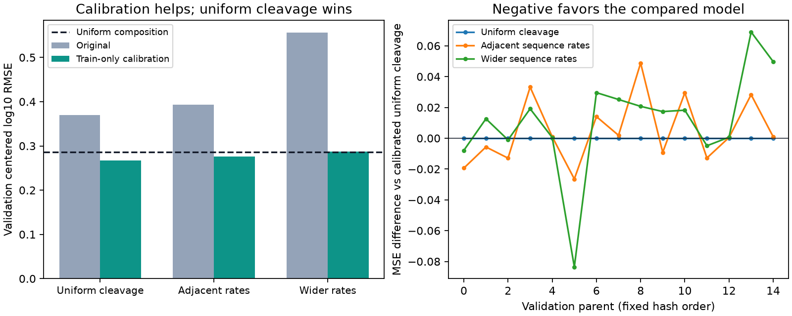

# Train-only amplitude calibration of frozen cellular predictions

The calibrated uniform-cleavage control wins. Neither imported sequence prior beats both controls, so the prospective stop rule is triggered: stop extending this bridge on the same MAPP development set.

Uniform-cleavage calibration reduces validation RMSE from 0.36972 to **0.26711**,
versus 0.28603 for uniform observed composition (about 6.6% lower RMSE).
This is modest, nonconstant prediction on previously inspected cellular data.
It is not evidence that digestion-trained sequence preferences transfer, nor that
physical peptide amounts or APC concentrations have been validated.

## Complete outcomes

| Model | Beta | Train RMSE | Validation RMSE | Validation Pearson / Spearman | Validation prediction SD |
|---|---:|---:|---:|---:|---:|
| Uniform composition | 1.000000 | 0.35609 | 0.28603 | undefined | 0.00000 |
| Uniform cleavage | 1.000000 | 0.41394 | 0.36972 | 0.4416 / 0.3723 | 0.43871 |
| Uniform cleavage + calibration | 0.302123 | 0.34137 | 0.26711 | 0.4416 / 0.3723 | 0.13255 |
| Adjacent sequence rates | 1.000000 | 0.44012 | 0.39307 | 0.4067 / 0.3456 | 0.43028 |
| Adjacent sequence rates + calibration | 0.265903 | 0.34161 | 0.27590 | 0.4067 / 0.3456 | 0.11441 |
| Wider sequence rates | 1.000000 | 0.57514 | 0.55627 | 0.1685 / 0.1258 | 0.57088 |
| Wider sequence rates + calibration | 0.113527 | 0.35129 | 0.28697 | 0.1685 / 0.1258 | 0.06481 |

The calibrated uniform-cleavage control improves 10 of 15 validation parents over
uniform composition, worsens 4 and ties 1. Its weighted R2 relative to uniform is
0.12793; prediction SD is 0.13255 versus target SD 0.35130. The adjacent model loses
to that control on 9 parents, and the wider model loses on 11. Wider calibration
still slightly loses to uniform composition overall. All beta values are positive;
no boundary/zero-denominator case occurs. A positive scalar preserves each model's
rank ordering: this diagnostic fixes amplitude, not peptide ordering.

MSE/RMSE and R2 use equal parent, condition and candidate weighting. Correlations
and SD are pooled and unweighted. Constant-control correlations are undefined.
Secondary forward KL is KL(target || prediction), not the reverse KL objective
in older MAPP fits. Per-parent and exposure-stratified metrics and full predictions
are retained for all seven conditions. Original test scores are not revisited.

## Inputs, targets and data scope

Agent/model: Codex / GPT-6. Source commit `ebb70e3f4a86fd6ba33f9e2422dd0df63d56479b` with recorded dirty
state. This family consumes the verified prediction dumps from
`2026-10-24_0043_codex_digestion-cellular-transfer`, unchanged canonical Hitlist
MAPPmin2 manifest `df78d02f8200809c659e43adfae29866c48b712122b740379106994622f4ac80`.
Source: PXD009092, human HEK293 proteasome-associated captured fragments.
Training: 72 parents, 144 parent/condition examples, 918 candidate measurements.
Validation: 15 parents, 30 examples, 112 measurements. Both original conditions
UT and TNF+IFN are retained, with unresolved specimen/run independence.

Targets remain original source log10 MS intensities centered within each example.
All source quantities, eligibility, mapping alternatives and measurement IDs are
unchanged. No new source curation, negatives, synthetic biological labels, censor
conversion, imputation or clipping. This is a captured pool, not free cytosol or
a professional APC validation. No nM/binder-threshold metrics apply.

The 14 historical test parents are excluded from fitting and evaluation by the
prospective plan; hence no test prediction dumps or new test metrics. Validation
also has historical exposure. Calibration was proposed after examining the earlier
transfer failure, so the result is developmental evidence, not a fresh blind test.
Prior source-overlap and feature-support flags are preserved without claiming
homology or specimen independence.

## Model, fitting and meaning

The physical models are entirely frozen: full parent sequence -> uniform or
purified-digestion-trained cleavage rates -> continuous precursor input/common
removal -> occurrence-summed centered log10 residence amount p. The earlier fitted
removal parameter and all 40/120 imported sequence coefficients remain unchanged.
No purified-study MS-response coefficients transfer. Uniform cleavage still uses
span length, parent boundaries and occurrence multiplicity; it has no learned
amino-acid preference.

For each physical arm, fit exactly one nonnegative scalar using training only:

    beta = max(0, sum(w*p*y) / sum(w*p*p))
    empirical prediction = beta*p

No intercept, penalty, optimizer, hyperparameter search, new pretraining or
validation-derived calibration. The original unscaled predictions and unfitted
uniform composition remain controls. Signed unconstrained coefficients and all
training cross moments are saved. New parameters learned: three scalar beta
values. No physical rates, APC machinery, species, treatment effect, transport,
MHC or TCR component trains. This diagnostic performs no RL/sampled fitting.

The multiplier is an empirical observation-link correction, not an independently
identified detector efficiency or biological rate. It changes predicted captured
MS differences without validating the underlying physical amount distribution.
All models retain zero predicted UT/TNF+IFN change for an identical parent.
Absolute concentration, precursor influx/abundance and cellular clearance remain
unidentified. The unchanged broader goal still requires those biological tests.

## Independent verification and resources

The independent verifier rebuilds **4120 input
predictions** from canonical source targets/weights and the pinned independent
physical reference, including sequence features and their training transforms.
It obtains beta through weighted least squares and checks the nonnegative KKT
condition; maximum coefficient difference is 1.12e-16. All **7210
output predictions**, global/per-parent/exposure metrics and the stop decision
verify; maximum prediction discrepancy is 1.78e-15.
The prior independent physical implementation is reused, not a newly written
third physical solver. Original workbook curation is not repeated downstream.

Local CPU, one-thread NumPy/SciPy, unchanged shared environment; no Modal or GPU.
Producer 0.935 seconds, peak 104.14 MiB, below
the prospectively declared 60-second/2-GiB budget. Independent verification
9.196 seconds. No failed scientific run, retry or outcome-based change.

## Reproduction and next action

`reproduce/launch.json`, `plan.md`, execution/verification receipts and source
snapshots freeze inputs, settings, source hashes and exact invocation. Run
`sh reproduce/launch.sh` in a fresh family copy, then the pinned Python with
`code/verify.py` and `code/report.py`. Use the recorded one-thread environment.
The producer refuses an existing summary; explicit source-path relocation is
needed outside this workspace. Raw coefficient/moment JSON and compressed
per-example train/validation dumps are directly retained.

Status: completed and independently verified; the same-MAPP transfer stop rule is
in force. Keep calibrated uniform cleavage as a provisional development control,
not a promoted APC model or replacement for the historical test-set baseline.
Next: canonical native cellular peptidomics admission under Hitlist788 and broader
independent MS-response/precursor/machinery support. Do not launch another sampler
extension or tune these sequence priors against the same development parents.
Open questions: processing, capture/detection, production/clearance, precursor
abundance, perturbation response and independent cellular validation.
