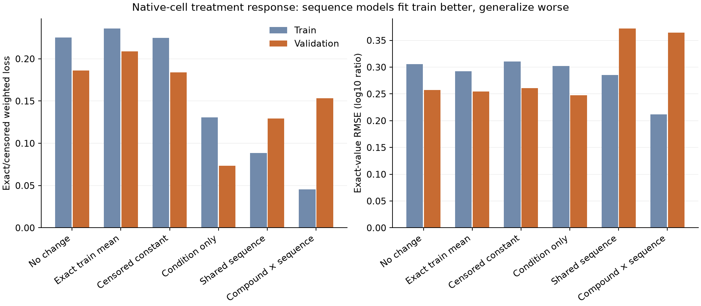

# Native-cell response baselines

**Condition-only prediction wins.** On held-out parent components, sequence
features improve training fit but worsen native peptide treatment-response
prediction. These are completed fits to real biological measurements, not a
synthetic recovery experiment or an APC concentration model.

Agent/model: Codex / GPT-6, October 24, 2026. Presto source
`593e3b5c2bc08ff9242b363145096f2ba6234e95`, recorded dirty task state; the full
experiment launcher/config and prospective plan were frozen before fitting.

## Data and evaluation

Use the independently verified canonical Hitlist native response recipe from
[0259 admission](../2026-10-24_0259_codex_native-response-admission/README.md),
manifest `c72980c070cb1296609bbe7d296e27b6a2a22d3ff354ef846c1c99ad7959ccfc`.
Source: Dasgupta2014/Gelman2013 human HEK293T/SH-SY5Y native cell extracts and
chemical perturbations. The target is the original positive treated/control
isotope-channel ratio in log10 space, including source-declared inequalities.
Controls, derived means, unsupported identities and conflicting possible reuse
are deferred by the shared recipe. No synthetic labels, negatives, imputation,
target averaging, affinity filter or peptide-length cutoff.

Training: 1,861 peptide-form/condition groups, 86 parent/dependence components,
28 conditions, 6,735 effective observations (4,301 exact / 2,434 bounded).
Validation: 245 groups, 19 components, 27 conditions, 932 observations
(504 exact / 428 bounded). Weights average condition, component, form and
observation within each split. Original copies and unresolved charge/replicate
dependence stay visible. These counts do not represent independent specimens.

The frozen 631-group test split is **not evaluated**: it is reserved for the
predeclared final comparison with the full-parent processing models. No test
predictions are produced by this family, and no setting is selected using
validation. The same studies occur in all splits; shared-control proxies can
cross splits. No external-study, specimen or homology independence is claimed.

## Models and optimization

Six fixed variants, with no pretraining or parameter search:

- No change predicts log10 ratio zero; exact train mean uses weighted exact
  training observations; censored constant solves the full training loss as a scalar.
- Condition-only uses the training condition indicators and one global intercept.
- Shared sequence adds log length, amino-acid fractions, first/last residues,
  N-terminal acetylation and oxidation count.
- Compound-dependent sequence additionally interacts those features with the
  literal compound name. No mechanism, genetic knockout or enzyme activity is inferred.

Features are centered/scaled using training weights. Constant columns and unsupported
linear directions are removed by a training-only SVD, threshold 1e-10 relative to
the largest singular value. The three fitted models allocate 28, 83 and 582
parameters; all receive nonzero updates. Raw column counts are 28, 91 and 910.
Validation contains no unseen condition or compound category. This is a test of
held-out parent components under seen treatment categories, not a new-drug test.

Loss is weighted squared error for exact log ratios, squared positive violation
for upper bounds and squared negative violation for lower bounds. Linear fits
add 0.01 times the squared projected standardized-feature coefficients, excluding
the global intercept. Zero initialization, deterministic float64 L-BFGS-B,
maxiter 1,000, gtol 1e-9, ftol 1e-12. All three optimizers report convergence;
iterations 10 / 37 / 215 and final gradient infinity norms 1.15e-9 / 3.80e-7 /
7.03e-7. The latter two stop by the objective-change tolerance, not gtol. Final
parameters only; no early stopping, restarts or validation tuning. No affinity,
stability, MHC elution, TCR or APC machinery label trains in this experiment.

## Results

Primary loss combines exact and bounded targets with the canonical hierarchy.
Exact-only RMSE renormalizes the same weights over exact observations. Correlations
are pooled over exact effective observations and are not specimen-level statistics.

| Model | Parameters | Train loss | Validation loss | Validation exact RMSE | Validation Pearson / Spearman | Bound satisfaction, weighted |
|---|---:|---:|---:|---:|---:|---:|
| No change |0|0.225013|0.186297|0.257019|undefined|0%|
| Exact train mean |1|0.235781|0.208923|0.254223|undefined|0%|
| Censored constant |1|0.224752|0.183884|0.260793|undefined|0%|
| Condition only |28|0.130494|**0.073495**|**0.247726**|0.4518 / 0.4279|0%|
| Shared sequence |83|0.088709|0.129189|0.372097|0.2833 / 0.2297|22.45%|
| Compound-dependent sequence |582|**0.045652**|0.153178|0.364586|0.2980 / 0.2881|45.88%|

Condition-only reduces primary validation loss by **60.5%** versus no change and
exact-value RMSE by **3.6%**. The large primary improvement includes reduced bound
violations; it does not imply large exact-value accuracy. The predictor still
satisfies none of the explicit bounds, so even this control is limited.

Shared and compound-dependent sequence increase primary validation loss **75.8%**
and **108.4%** relative to condition-only. Their lower training error and worse
validation error are consistent with overfitting/poor parent transfer. More
satisfied bounds do not compensate for larger errors elsewhere. Neither sequence
model passes the predeclared biological screen. This does not prove that peptide
sequence is irrelevant or diagnose a unique cause; representation, regularization,
limited parent coverage and measurement effects remain possible contributors.

## Verification, numerical correction and runtime

All six fits finish in **4.639 seconds**, peak process RSS **418,185,216 bytes**.
Local CPU, one OMP/OpenBLAS/MKL thread; no GPU, Modal or shared-environment changes.
Each fit stays under 300 s; family under 900 s / 4 GiB. Individual fit/artifact
times: 0.432 / 0.431 / 0.429 / 0.560 / 0.622 / 2.056 seconds. These are descriptive
whole-arm times, not isolated solver benchmarks.

Independent closure verifies all **46,002 source-linked predictions**, all feature
definitions/centering/scaling/support, model coefficients, final objective/gradient,
12 global and 960 stratified metric records. The producer's upper/lower-bound toy
and three finite-difference directions per fitted model pass. No optimization
updates are replayed independently; final-model arithmetic and convergence are checked.

Some repeated identical model inputs differed by approximately 1e-16 in batched
matrix multiplication, creating spurious within-stratum correlations. The original
predictions/metrics remain untouched. Qualified prediction dumps evaluate each
distinct raw feature vector once, giving exact input ties the same prediction.
No target-based grouping or numerical tie tolerance is used. This corrects 149
correlation records; maximum change from original predictions is 3.28e-15, with
no material loss/RMSE or decision change. Constant spread is zero and constant
correlations are undefined. See `results/qualified-v2/correlation-corrections.json`.

The initial scalar-dot-product verifier completed its mathematical checks but
failed its 180-second runtime gate. All its outputs and failure log are preserved
in `results/qualified` and `launch_logs/`. Vectorizing only the coordinate product
finishes in **6.956 seconds / 458,981,376 bytes**, agrees with every completed
scalar-reference prediction within 1.17e-15, and passes the unchanged resource
gate. This is a verifier implementation correction, not a model retry.

## Reproduction and artifacts

- `reproduce/launch.sh`, `launch.json`, `execution.json`, `plan.md`, admission
  receipt and frozen launcher; exact environment/library/source metadata retained.
- `results/*-model.npz`, `*-fit.json`: final transforms/coefficients, support,
  convergence, gradient probes and runtime. Constants are in their fit JSON.
- `results/*-predictions.jsonl.gz`, `summary.json`, `stratified-metrics.json`:
  original outputs; do not overwrite them.
- **Canonical reported outputs:** `results/qualified-v2/` contains complete
  train/validation observation predictions, summary, CSV, stratified metrics and
  exact-tie corrections. `results/independent-verification.json` qualifies them.
- `analysis/verify.py`, both frozen verifier versions and execution receipts,
  closure/runtime-correction plans and logs preserve the full verification history.
- Source recipe/raw data remain at the hash-pinned paths in the launch config;
  all targets/qualifiers/contributor IDs/weights needed to reproduce metrics are
  also retained in the prediction dumps. nM/500-nM binding metrics do not apply.

Status: biological baseline family closed; condition-only is the provisional
reference for this exact validation contract. Next: a small full-parent generative
processing model, with matched exact/sampled optimization and the same biological
controls. Open questions: sequence transfer, causal machinery behavior, precursor
changes, MS response and APC concentration calibration. Native extract ratios and
chemical treatments do not establish free APC peptide concentrations or KO effects.
The full goal remains active; the MAPP transfer stop rule remains enforced.
