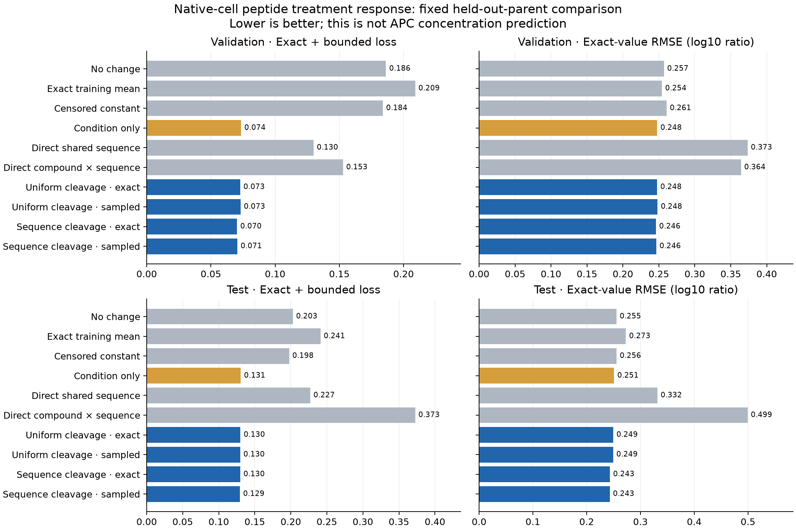

# Native-cell full-parent processing: small held-out gains

Sequence-dependent processing improves held-out native peptide response modestly.
The exact model reduces test exact-value RMSE from 0.250953 for condition alone to
0.243207 (3.09%), but combined exact/bounded loss improves only 0.59%. Its sampled
counterpart is close and about 25 times slower. This is a limited positive result
on treated/control extract ratios, not a validated APC peptide-concentration model.

Agent/model: Codex / GPT-6, October 24, 2026. Source commit
`2cb7db0fff076180e3235ea11ef9d30b6cb2872e`, with new physical module/experiment code
and documented dirty task state. All executed code, dependencies, configuration,
prospective specification and runtime environment were frozen before fitting.

## Source, split and measurement contract

Unchanged canonical Hitlist native-response recipe, manifest
`c72980c070cb1296609bbe7d296e27b6a2a22d3ff354ef846c1c99ad7959ccfc`, independently
admitted in [0259](../2026-10-24_0259_codex_native-response-admission/README.md).
Dasgupta2014/Gelman2013 human HEK293T/SH-SY5Y native-cell extracts under chemical
perturbations. Target: original positive treated/control isotope-channel ratio,
in log10 space, retaining source-declared upper/lower bounds. No synthetic targets,
generated negatives, target averaging, imputation, clipping or MHC length filter.

Use the recipe's full-parent-supported subset. Training: 1,855 groups / 85 dependence
components / 28 conditions / 6,707 effective observations (4,289 exact, 2,418 bounded).
Validation: 245 groups / 19 components / 27 conditions / 932 observations (504 exact,
428 bounded). Test: 631 groups / 16 components / 28 conditions / 2,447 observations
(1,278 exact, 1,169 bounded). Six unsupported training groups / 28 observations are
omitted; their IDs remain in `results/data-coverage.json`. Original hierarchical
condition→component→form→observation weights are renormalized once per selected
split. All six 0314 controls are refitted on precisely this subset/weight contract.

Parent/dependence components are held out. The same studies and treatment categories
occur across splits; unresolved specimen, shared-denominator and homology dependence
remain. These are not thousands of independent biological specimens or an external
study test. All model settings and all four completed fits were frozen before the
separate evaluation command opened test outcomes once. No model was retrained or
selected using test results. Test is now inspected and must not become a tuning set.

## Inputs, representation and output

Inputs: complete candidate parent sequences, peptide occurrence spans and supplied
condition identity (cell line and literal chemical exposure). All origin alternatives
are retained; identical parent sequences are collapsed, all occurrences summed, and
distinct candidate parents assigned equal input. That origin prior is not measured
precursor abundance. No MHC, TCR, measured enzyme activity or genetic KO label is used.

Continuous unit precursor input, independent irreversible bond cuts and common
fragment removal define expected amounts for every contiguous span 1..L, including
short fragments and nonbinders. Observed queries are evaluated analytically without
materializing all spans or normalizing over observed peptides. The full parent fixes
origin/boundary geometry; under independent cuts, distant outside bonds integrate out.

Control bond rate is exp(rho + w·phi). Treatment scales all bond rates by exp(a_condition).
Removal is fixed to 1 to set an uncalibrated time unit. Uniform arms omit w; sequence
arms use left/right residue indicators projected into 38 training-supported directions.
Feature centering/scaling/SVD use 5,008 reachable training bonds from 236 distinct
parents only. No held-out feature direction falls outside training support. All 28
condition coordinates are supported in training; no unseen condition is allocated.

For a queried span, A=1+sum(internal bond rates). Steady-state amount F is 1/A for a
whole parent, l/[A(A+l)] for one boundary, or
lr(2A+l+r)/[A(A+l)(A+r)(A+l+r)] for two boundaries. Output is
b_condition + log10(F_treated/F_control), using occurrence-summed parent mixtures.
The b offset is shared across peptides in a condition; there is no peptide-specific
free offset. Modified forms retain separate observations but share processing rates.
No PTM mechanism, independent MS-response module, transport or pMHC selection is fitted.
Same-form detector cancellation and the shared precursor/observation shift are assumptions.

## Training and exact/sampled comparison

Four fixed arms: uniform/sequence rates × exact/conditional-score gradients.
Zero initialization, float64, 200 full-batch Adam steps, lr 0.02, betas (0.9,0.999),
epsilon 1e-8. No pretraining, restarts, clipping, schedule, validation selection or
parameter search. Loss is source-weighted squared exact error plus one-sided squared
bound violations; penalty 0.01 on all coordinates except b's global intercept.
Uniform arms have 57 parameters; sequence arms 95. All allocated coordinates change.
Direct controls use the frozen 0314 training-only SVD/ridge/L-BFGS-B settings.
No affinity, stability, MHC elution, TCR, APC machinery or species auxiliary task trains.

The sampled arms retain exact amounts, residuals, origin probabilities and b gradients.
They use 512 conditional origin/age samples per response group, seed 42, with paired
uniform draws for treatment/control. Differentiate the unnormalized event/survival
score with sampled choices/ages detached; outside bonds integrate out. This is a
conditional-score hybrid, not simulator-only RL or GRPO. No clipping, group scaling,
sample reuse or reference KL is added to this biological comparison.

## Held-out outcomes

Primary loss includes exact and bounded targets; exact RMSE renormalizes weights over
exact observations. Correlations are pooled over exact effective observations.

| Model | Train loss | Validation loss | Test loss | Validation / test exact RMSE | Test Pearson / Spearman |
|---|---:|---:|---:|---:|---:|
| No change | 0.225345 | 0.186297 | 0.202817 | 0.257019 / 0.255458 | undefined |
| Exact training mean | 0.236163 | 0.209045 | 0.241141 | 0.254274 / 0.272868 | undefined |
| Censored constant | 0.225089 | 0.183902 | 0.197630 | 0.260757 / 0.255525 | undefined |
| Condition only | 0.130686 | 0.073514 | 0.130557 | 0.247717 / 0.250953 | 0.5538 / 0.5324 |
| Direct shared sequence | 0.088821 | 0.129940 | 0.226896 | 0.373407 / 0.331508 | 0.4517 / 0.4473 |
| Direct compound × sequence | 0.045643 | 0.152802 | 0.372538 | 0.364197 / 0.499235 | 0.2200 / 0.2226 |
| Uniform cleavage, exact | 0.129261 | 0.072834 | 0.130125 | 0.247607 / 0.249390 | 0.5561 / 0.5280 |
| Uniform cleavage, sampled | 0.129287 | 0.073126 | 0.129744 | 0.248242 / 0.249202 | 0.5565 / 0.5345 |
| Sequence cleavage, exact | 0.124510 | 0.070384 | 0.129789 | 0.245952 / 0.243207 | 0.5578 / 0.5373 |
| Sequence cleavage, sampled | 0.124566 | 0.070619 | 0.129336 | 0.246426 / 0.242887 | 0.5587 / 0.5383 |

Sequence-exact beats condition-only primary loss by 4.26% on validation and 0.59%
on test; exact RMSE improves 0.71% and 3.09%. Test Spearman changes only 0.5324→0.5373,
and validation Spearman declines 0.4279→0.4221. Test weighted exact R2 is 0.0929
versus 0.0342. Most variation remains unexplained. It improves primary loss on
13/19 validation components and 10/16 test components, but only 14/27 validation
and 15/28 test conditions. No seed replication or uncertainty interval establishes
robust superiority.

Exact-sequence test bound satisfaction is 14.92% versus 0% for condition-only;
validation satisfaction is only 1.30%. The small processing gain is not adequate
prediction of the extreme source-declared responses. Direct sequence regressions
again fit training better and generalize worse. Enforcing the processing structure
avoids that large deterioration, but does not prove a causal cleavage explanation.

The sequence hybrid gives test RMSE 0.242887 / loss 0.129336 versus exact 0.243207 /
0.129789; validation slightly favors exact. These small single-seed differences
supply no convincing sampled-method advantage. The exact arm is the practical
provisional processing reference because accuracy is close at far lower cost.
This family passes the nominal primary-loss screen, not biological concentration
qualification. Preserve all fixed models rather than selecting a test winner.

## Numerical verification and runtime

Nine physical/substrate tests pass: full small-parent partition generator/resolvent,
residue-mass accounting, conditional-age transforms and score/finite-difference
gradients. The first test invocation had a float32 identity-matrix reference mistake;
its failure log is preserved, and correcting only that test dtype gives 9 passed
in 3.39 seconds. No production formula or gate was changed.

Four predetermined real-data gradient probes pass: mean relative error 0.00279–0.00321,
RMS 0.00912–0.01142, versus frozen 0.10/0.25 limits. Shared-rate gradients cancel at
identical treatment/control initialization. Qualification takes 43.70 seconds /
0.629 GiB. Each sampled fit evaluates 379,904,000 conditional event scores. All runs
finish their prescribed 200 updates within 300-second exact / 1,800-second sampled
and 4-GiB limits. These are bounded fits, not proof of global convergence.

| Arm | Parameters changed / allocated | Seconds | Peak GiB | Final exact gradient infinity norm |
|---|---:|---:|---:|---:|
| uniform_exact | 57 / 57 | 5.40 | 0.415 | 8.36e-06 |
| uniform_hybrid | 57 / 57 | 146.61 | 0.659 | 0.00809 |
| sequence_exact | 95 / 95 | 5.55 | 0.412 | 3.46e-05 |
| sequence_hybrid | 95 / 95 | 138.74 | 0.658 | 0.00734 |

Six matched controls complete in 2.02 seconds for the slowest arm;
all report optimizer convergence. Local CPU, one requested Torch/OMP/OpenBLAS/MKL
thread; no Modal/GPU or shared environment changes. Hardware/software and exact
invocations are in `reproduce/execution.json`. Timing is descriptive, not a repeated
isolated hardware benchmark.

Independent closure verifies **100,860 source-linked predictions** and
**2,180 global/stratified metric records**. It reconstructs
physical predictions from raw parent sequences/occurrences, recorded transforms and
final coefficients with a separate scalar rational formula, without importing the
producer model or physical primitives. Original values/qualifiers/contributors,
split weights and final source/checkpoint hashes agree. Maximum prediction/log-amount
error is 3.55e-15. Runtime 86.08 seconds /
0.277 GiB. This is arithmetic verification, not independent biological
validation; optimizer trajectories are retained but not independently replayed.

## Reproduction, artifacts and next decision

- `reproduce/launch.sh` supports `qualify`, `baselines`, `train <arm>`, and `evaluate`;
  exact ordered invocations are recorded in `execution.json`. Existing-output guards
  prevent overwriting this completed family. Reproduction requires the pinned source
  recipe and source files, local import symlink and shared Python path in the receipt.
- `reproduce/launch.json`, `plan.md`, source snapshots and closure receipts preserve
  the full data/model/optimization/test contract. Final constants/checkpoints and
  transforms were sealed in `pre-evaluation-receipt.json` before evaluation.
- `results/arms/*`: checkpoints every 20 updates, final coefficients, full trajectories,
  gradients/losses, selected conditional trace probes and per-arm runtime/support.
- `results/baselines/*`: all six refitted controls and convergence metadata.
- `results/evaluation/*-predictions.jsonl.gz`: all train/validation/test source observations,
  targets/qualifiers/weights, predictions and physical log amounts per unit input.
- `results/evaluation/summary.json`, `stratified-metrics.json`, `comparison.csv`, plots
  and `independent-verification.json` contain complete outcomes. Binding/nM/500-nM
  metrics are inapplicable to native response ratios. Raw source paths remain in the
  pinned 0259 recipe; no duplicate source curation is introduced.

Status: this fixed biological comparison is complete. The exact sequence-processing
model is a provisional reference for this specific same-study response contract.
Next work must target independent biological transfer and precursor/machinery/
measurement identifiability, not tune against this now-open test split or extend a
sampler merely because it works numerically. Actual APC validation, calibrated
precursor-relative concentrations, causal machinery loss and independent MS response
remain unachieved. The full availability goal stays active.
