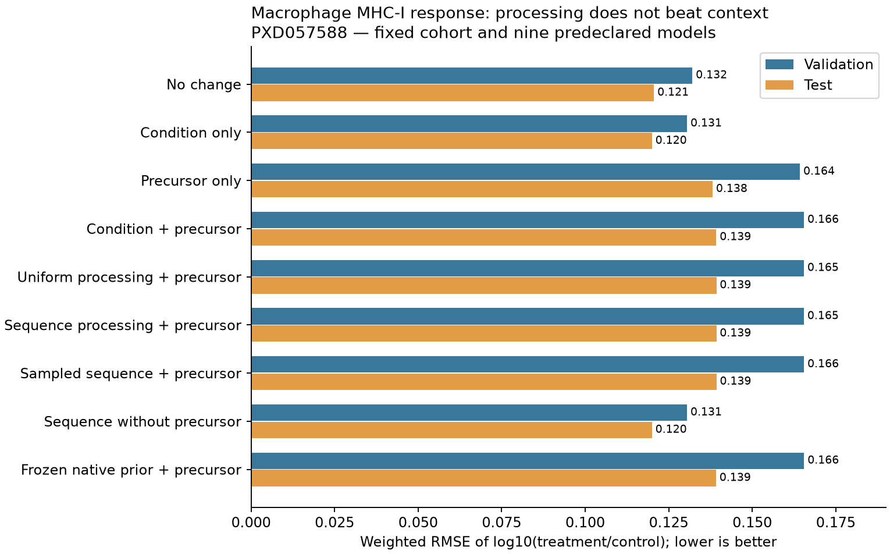

# Macrophage response: processing and precursor inputs fail to beat context

The fixed nine-model comparison is negative. Test RMSE is 0.120011 for condition
alone and 0.139278 for sequence processing with the measured precursor surrogate.
Removing precursor input gives 0.120008, an immaterial improvement. The sampled
model is no better and takes 35 times longer than exact gradients. No model of
free-peptide or APC concentrations has been validated.

Codex / GPT-6, October 24, 2026. Source commit
`f7b76a30fbbffce6f2d36752ee16d85b6b3fa1a6`; new experiment code and tracked task dirt
are explicitly frozen in `reproduce/`. The prospective specification was registered
before cohort arithmetic. All nine fits finished and their checkpoints, transforms,
constants and settings were sealed before the separate once-only held-out evaluation.
There were no test-driven changes, retries, restarts or model selection.

## Data, provenance and biological scope

PXD057588 Table 9 macrophage MHC-I ligand response to GL261 or CT2A coculture,
relative to naive macrophages. Table 11 global digest peptides provide independent
condition-level parent-proteome fold-change surrogates. These are MHC-bound peptide
measurements, not the intracellular free-peptide pool. Table 10's MHC loss belongs
to the tumor partner, not the macrophage. Tables 7/8/10/12 remain source context
and do not supply training labels in this family.

Canonical Hitlist EvidenceStore query/materialization, with current consumer
2.0.17 at `b3f1079b16ba7f1ec8cd48276696b8492a7f8d74`, consumes the existing verified
schema-7 / Hitlist-2.0.0 reference package at `/private/tmp/hitlist-v2-reference-200-final`.
This is explicitly an older source generation with a current consumer, not a newly
downloaded export. Source manifest SHA256:
`d99f67e625c6c33a2054a56dea4f98fb8248ca5f717cc98af3662f228655fa6a`.
Response-recipe manifest:
`93ef0b2368c077330d5621d0017b91f7709d17e543fb6d7d17fc1a92ab2250f6`.
Public query requests, relation hashes, source locators, derivation contributors,
context assertions, mapping alternatives and dispositions are retained. No workbook
parser or parallel source curator was added to Presto.

Canonical export accepts 200,718 of 200,724 source log2-fold-change measurements;
six unresolved source/reference cases retain dispositions. The explicit target
conversion is log2 ratio × log10(2). Model supervision uses only admitted Table 9
rows. It does not average, clip, impute or turn missing values into negatives.
All admitted responses are exact values; no censor/binder/nM/500-nM metric applies.
No synthetic biological labels, IC50, stability, TCR or species/class auxiliary
supervision is used.

Every candidate parent must have at least two distinct Table 11 digest sequences.
For each parent/condition, average the reported fold-change representation over
source treatment channels for each digest sequence, then take the median across
digest sequences. Shared digest peptides retain all candidate parent memberships;
they are not independent protein measurements. All reference origins are retained,
identical full parent sequences collapsed, and repeated occurrences summed.

Source treatment labels map G1+/G2+/G3+ to GL261 and C1+/C2+/C3+ to CT2A. Eight of
nine channel mappings differ between Tables 9 and 11, so matching channel positions
would be wrong. Exact specimen/aliquot matching is unresolved. Table 11 is post-IP
lysate proteomics with channel-total normalization; Table 9 MHC ratios are unscaled.
An offset can absorb a shared shift but does not calibrate absolute precursor input.
The source reference is modern mouse UniProt 2026_03, not the original search database.

The fixed split hashes `pxd057588_apc_response_v1:` plus the complete canonical
dependency-component ID modulo 20: 0–13 train, 14–16 validation, 17–19 test. It uses
the all-source component graph before filtering. Weights average condition,
component, peptide row and source treatment channel within each split.

| Split | Peptide rows | Response groups | Components | Observations |
|---|---:|---:|---:|---:|
| Train |492|984|361|2,952|
| Validation |96|192|69|576|
| Test |129|258|82|774|

All 717 admitted peptides have both conditions. There are 920 distinct candidate
parent sequences and 1,840 parent/condition precursor estimates. The same study and
condition categories occur across splits. Channels and shared controls are not
independent biological specimens; no homology-independent or external-study claim
is made. Frozen human-native prior training has zero exact peptide overlap in all
three splits; exact full-parent overlap is four training parents and zero held-out
parents. This does not establish homology independence.

## Model, training and what remains untrained

Inputs: full candidate parent sequences, observed peptide spans, supplied coculture
identity, and optional fixed parent precursor log10 fold change. The physical
model has continuous parent input, independent irreversible cuts and common removal
rate 1, with every contiguous span of length 1..L in its latent support. Expected
queried amounts are evaluated analytically without enumerating or normalizing over
observed ligands. This retains short/nonbinding products mathematically but does
not measure their concentrations.

Control rates are uniform or exp(rho + w·adjacent-residue features). Treatment
multiplies every bond rate by one condition-specific scale. For each origin, sum
internal rates and retain left/right boundary rates to calculate the steady-state
fragment amount F. Output is a condition offset plus log10 of the ratio of
occurrence-summed treated/control amounts. Treated amounts optionally multiply each
parent input by 10^its precursor log-ratio. Candidate parents have equal baseline
input; no per-peptide fitted offset exists.

Forty left/right residue indicators are centered/scaled and projected onto 38
training-supported coordinates, using equal-parent weights over 8,149 reachable
training bonds from 651 parents. All held-out directions are supported. Conditions
have two coordinates (global intercept and one contrast). Uniform, sequence and
frozen-prior arms allocate 5, 43 and 4 free parameters, respectively; every allocated
coordinate changes. The frozen prior imports only human-native 0410 sequence rates,
not its chemical-condition parameters, and is not selected using APC labels.

Four controls: zero change; condition offset; precursor-only equal-parent mean
linear fold change; condition offset plus that precursor signal. Two fitted controls
use L-BFGS-B (maxiter 1,000, gtol 1e-9, ftol 1e-12), zero initialization. All five
physical arms use 200 full-batch float64 Adam steps, lr .02, betas .9/.999, eps 1e-8,
seed 42. Loss is weighted squared log10-ratio error plus .01 squared-coefficient
penalty excluding the global observation offset. No schedule, restart, clipping,
selection or tuning. Local CPU, one requested numerical thread, no Modal/GPU or
shared-environment changes.

The sampled arm uses 512 conditional origin/age draws per response group, paired
treatment/control uniforms, exact forward amounts/residuals and precursor-weighted
origin probabilities. Only kinetic gradients use event scores. This is a conditional
score hybrid, not pure simulator RL or GRPO; no clipping, standardization, sample
reuse or reference KL is applied. Four fixed real-data probes pass mean-relative
error .000716–.001628 and RMS .004194–.007620 against .10/.25 gates. Finite-difference
directions and no-input shared-rate cancellation pass. Qualification takes 16.73 s.

The model does not train allele-specific affinity/stability, TAP, machinery KO,
species/class inference, TCR specificity or an independent MS-detectability module.
The non-MHC MS data supply precursor surrogates here. Same-peptide MHC selection and
detector cancellation remain assumptions; changing allele mixture, competition or
sample handling can violate them. A fit to this endpoint cannot identify cleavage
causally or separate processing, presentation and observation.

## Fixed held-out results

RMSE is in log10 treatment/control ratio. Correlations are pooled over effective
source observations; losses and RMSE use the registered hierarchical weights.

| Model | Validation MSE | Test MSE | Validation RMSE | Test RMSE | Test Spearman |
|---|---:|---:|---:|---:|---:|
| No change |.017453|.014547|.132111|.120611|undefined|
| Condition only |.017035|.014403|.130517|.120011|.2512|
| Precursor only |.026993|.019088|.164295|.138158|.2241|
| Condition + precursor |.027396|.019394|.165518|.139264|.2642|
| Uniform processing + precursor |.027390|.019398|.165498|.139278|.2639|
| Sequence processing + precursor |.027389|.019398|.165496|.139278|.2641|
| Sampled sequence + precursor |.027398|.019404|.165524|.139298|.2643|
| Sequence without precursor |.017032|.014402|.130508|.120008|.2323|
| Frozen native prior + precursor |.027407|.019375|.165551|.139193|.2646|

No processing variant meaningfully beats condition alone. Removing precursor input
reduces test MSE relative to condition alone by only .0052%; test weighted R2 is
.00136 versus .00131. Condition itself barely beats no change. Adding the precursor
surrogate with a fixed proportional effect worsens error substantially; sequence
processing does not rescue it. The frozen human-native prior has no useful transfer
under this fixed contract. Its tiny advantage over condition+precursor does not
pass the requirement to beat condition alone.

Without precursor inputs, predictions are almost constant within each condition:
test prediction SD .000278/.0000759 versus target SD .1372/.0972 for CT2A/GL261.
Precursor-equipped predictions vary, but that variation is not accurate. All free
coordinates updating is therefore not evidence of useful learned biological variation.
Small final exact objective gradients (about 1.4–1.9e-6) argue against merely stopping
too early at this regularized fit, not against underfitting or a restrictive model.
This result does not isolate whether the main limitation is precursor normalization,
measurement noise, the fixed proportional input assumption, regularization, restricted
kinetics, or changing MHC selection/observation.

| Physical arm | Changed / allocated | Seconds | Peak GiB |
|---|---:|---:|---:|
| Uniform exact |5/5|2.58|.417|
| Sequence exact |43/43|1.92|.419|
| Sequence sampled |43/43|67.48|.540|
| Sequence without precursor |43/43|1.90|.417|
| Frozen prior exact |4/4|1.34|.416|

All prescribed steps and resource caps pass. The sampled arm uses 201,523,200 event
scores and has final exact-gradient infinity norm .000591. Its approximately 35×
cost buys no predictive gain. Timings are descriptive single runs, not replicated
hardware benchmarks. Four controls each complete within .002 s after input setup.

## Verification, reproduction and decision

Independent source verification checks 1,256,555 canonical relation rows,
200,718 response rows, 1,840 precursor estimates, all contributors/origins and all
4,302 admitted observations (13.23 s). Independent final closure imports neither
the producer model nor physical primitives: separate scalar amount arithmetic and
NumPy/SciPy metrics verify all **38,718 prediction rows and 4,743 metric records**,
maximum prediction/log-amount discrepancy 3.55e-15 (7.21 s, .319 GiB). This is
arithmetic verification, not external biological validation or optimizer replay.
The physical primitives were already tested in 0410; this family adds actual
precursor-mixture gradient and independent final-mixture checks.

Original failed source-export and cohort attempts remain preserved: materialize
returns a Path, and unmatched reference inventory rows may legitimately omit
sequences. Separate corrected consumers resume without changing source data,
cohort rules or gates. No observed occurrence lacks a matched full parent. A
pre-execution Ruff closure-binding warning was corrected before any fit; its
original source/receipt is retained. No failed biological fits were discarded.

- `reproduce/plan.md`, `launch.json`, source/query recipes and execution receipts
  freeze canonical admission. `reproduce/model-config.json`, `model-launch.sh`,
  `model-execution.json` and `model-source/` freeze ordered qualification, four
  controls, five physical fits and once-only evaluation, including dependencies
  and the exact imported prior. Use the recorded Python/import paths/environment.
- `data/apc_response_recipes/2026-10-24_0449_codex_apc-precursor-response/` holds the
  canonical response recipe, queried relations and hashed model inputs. Raw sources
  remain in the pinned shared package; no source duplication in the experiment.
- `results/arms/*` contains final coefficients, full update/loss/gradient trajectories
  and optimizer/generator checkpoints every 20 steps. `results/baselines/*` contains
  all controls. `reproduce/pre-evaluation-receipt.json` seals their hashes.
- `results/evaluation/*-predictions.jsonl.gz` preserves every train/validation/test
  source observation, target, weight, precursor contributor/origin information and
  prediction. Summary, strata, CSV, within-condition spread, overlap counts and
  PNG/PDF figures are under `results/`; independent verifier and its receipt retained.

This family is complete and negative. Keep condition-only as its practical reference;
do not promote the negligible no-precursor gain or tune against the now-inspected
test. Next work must distinguish training-only precursor calibration/kinetic
identifiability from independent biological generalization, with a fresh prospective
population for new predictive claims. Do not extend sampling machinery to address
this failure: exact and sampled optimization agree. The full APC availability and
concentration objective remains active and unachieved.
