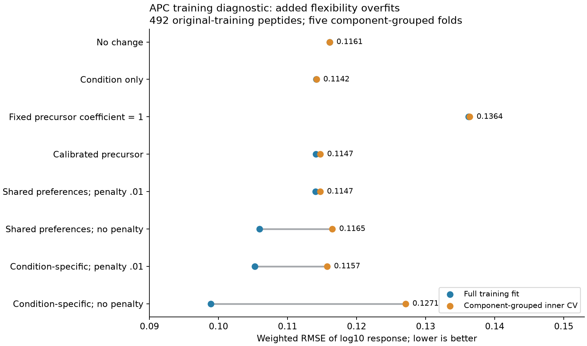

# APC training diagnostic: calibration helps the failed input, flexibility overfits

The diagnostic explains part of the nearly constant APC predictions without fixing
biological generalization. A fixed precursor coefficient of 1 is poorly supported:
the full-training estimate is 0.0516. Removing the kinetic penalty or allowing
condition-specific residue preferences improves training fit, but neither beats
condition alone in component-grouped inner cross-validation. The predesignated
flexible/unpenalized arm worsens inner-CV RMSE by 10.77% versus calibrated precursor,
so the registered gate rejects another sampled fit. No original validation/test
prediction was produced and no concentration model is promoted.

Codex / GPT-6, October 24, 2026. Source commit
`34568ca4bdd7086044333da09a4c4b4e9e660edd`, with recorded tracked task dirt and frozen
new code. The prospective diagnostic specification is `reproduce/plan.md`.
This is posthoc development work motivated by the prior negative biological result,
not a new untouched test or proof of an optimal architecture.

## Data and split contract

Use only the original training subset of [0449](../2026-10-24_0449_codex_apc-precursor-response/README.md):
PXD057588 Table 9 macrophage MHC-I treated/control responses and Table 11 condition-level
digest-derived precursor surrogates. Original canonical response recipe manifest
`93ef0b2368c077330d5621d0017b91f7709d17e543fb6d7d17fc1a92ab2250f6`;
all source/model-input hashes and original source verification are pinned by
`reproduce/execution.json`. The shared source JSON is filtered by original split
before feature construction; excluded rows do not enter fitting, calibration,
prediction or scoring. No workbook parser or new source curation is introduced.

The diagnostic includes 492 peptides, 984 peptide/condition groups, 361 dependency
components and 2,952 source-channel observations. Preserve original exact log10
responses, qualifiers, contributor/origin alternatives and hierarchical weights.
Every candidate parent has at least two distinct digest sequences in the inherited
contract. CT2A and GL261 coculture conditions remain distinct. The source's sample
pairing and normalization limitations are unchanged; these are condition-level
protein surrogates, not exact aliquot-matched precursor concentrations.

Five inner folds hash `pxd057588_train_diagnostic_v1:` plus canonical component ID,
using the full SHA256 integer modulo 5. No reseeding/rebalancing. Validation fold
peptide counts are 86, 100, 125, 92 and 89. All model inputs/targets for a component
stay together. Each fitting subset refits feature scaling/projection and precursor
calibration. Original weights are renormalized for each fitting subset; pooled
inner-CV metrics retain the complete original-training weight contract.

Each arm also fits all original training data for optimization diagnosis. These
full-data fits are not compared to any new outer test. Original 0449 validation/test
outcomes remain excluded from this analysis. The inner folds are same-study and
seen-condition development evidence with shared control/sample/homology limitations.
No synthetic labels, imputation, target clipping/averaging, negative generation or
MHC affinity filtering is added. Only this MHC-bound response assay trains; IC50,
stability, TCR, species/class, KO and independent MS-response tasks do not. Binder
and nM metrics do not apply.

## Fixed model and optimization contrast

Four controls: no change; condition means; condition means plus the unscaled
precursor log-ratio; condition means plus one calibrated nonnegative precursor
coefficient. Fit the coefficient from within-condition weighted covariance divided
by precursor variance, truncated only at zero. Fit two offsets analytically with
no penalty. This is an empirical observation/input calibration, not measured
biological elasticity. All calibration is fitted separately inside each fold.

Every physical arm freezes that fold's coefficient gamma and applies parent input
`10^(gamma * parent_log10_ratio)`. The calibration control uses the existing
equal-parent mean linear fold ratio in log10 space; this is not identical to the
full physical origin mixture when candidate parents differ. Both remain explicit.

The existing continuous-input/independent-cut/common-removal model supports every
contiguous 1..L span. Removal is fixed at 1 and candidate parents have equal baseline
input. All query occurrences are summed. Control log-rate is `rho + phi·w`, where
phi contains 38 supported directions from 40 adjacent-residue indicators. Centering,
scaling and SVD use equal-parent reachable fitting bonds only; no unsupported
inner-validation feature directions are allocated.

The shared-preference treatment uses `log_rate_control + x_condition·a`. The flexible
treatment additionally uses `phi·(x_condition·V)`, allowing condition-dependent
residue preferences. The condition design has global/contrast coordinates.
Shared/flexible models have 41/117 kinetic parameters. Two observation offsets are
profiled analytically at every objective call, with gradients through the profiled
objective. Inner-validation predictions use training-fitted offsets only. No
peptide-specific fitted offset exists. One fitted-and-frozen gamma is additional.

Factorial: shared/flexible preferences × kinetic penalty .01/0. Every arm uses
400 full-batch float64 Adam steps, lr .02, betas .9/.999, eps 1e-8, seed 42, zero
kinetic initialization, final checkpoint only. No pretraining/warmstart, restart,
schedule, clipping or selected epoch. Loss is source-weighted MSE in log10 ratio
plus the fixed penalty on all kinetic coefficients; offsets are unpenalized.
This differs from 0449's joint-offset fit and must not be described as its controlled
rerun. It is a small experimental physical model, not the full modular assay trainer.

## Outcomes

All 24 exact physical fits and 24 control evaluations complete. Lower RMSE is better;
correlations are pooled over effective source observations, while losses/RMSE use
the registered weights.

| Model | Full-training MSE | Full-training RMSE | Inner-CV MSE | Inner-CV RMSE | Inner-CV Spearman |
|---|---:|---:|---:|---:|---:|
| No change |.013477|.116091|.013477|.116091|undefined|
| Condition only |.013031|.114155|.013038|.114185|.1890|
| Fixed precursor coefficient 1 |.018552|.136207|.018600|.136383|.1568|
| Calibrated precursor |.013015|.114083|.013165|.114738|.2210|
| Shared preferences, penalty .01 |.013009|.114057|.013159|.114715|.2222|
| Shared preferences, no penalty |.011225|.105947|.013568|.116482|.2039|
| Condition-specific, penalty .01 |.011076|.105242|.013394|.115730|.2577|
| Condition-specific, no penalty |.009784|.098916|.016153|.127096|.2194|

Precursor calibration removes much of the damage from forcing coefficient 1, but
still does not improve inner-CV RMSE over condition alone. Full-data gamma is
.0516255; fitting-fold estimates range .00165–.14445, showing instability across
components. This does not mean protein abundance is biologically irrelevant: the
source pairing, normalization, measurement error and downstream presentation all
remain possible contributors.

The condition-centered weighted prediction Jacobian at zero initialization has
rank 5/41 for shared preferences and 81/117 for flexible preferences, at relative
singular-value threshold 1e-8. Thus many shared-model parameter directions have no
first-order observable effect at this initialization. All allocated coordinates
change during fitting and final full-data Jacobians have full column rank under
the same threshold, which does not imply good conditioning or causal identification.
The saved singular values and column norms are more informative than rank alone.

Both removing regularization and expanding condition preferences increase training
variation and reduce training error. Those gains do not transfer across components:
the flexible/unpenalized arm has training R2 .2728 but inner-CV R2 -.2006. Regularized
flexible R2 is .1768 in training and .0045 in inner CV. The original near-constant fit
is therefore not explained solely by insufficient updates; added flexibility can
fit the source yet overfit. This does not identify a unique biological limitation.

Within-group differences among source treatment channels contribute MSE .002354,
about 18% of condition-only training MSE; about 82% is error between response-group
means. This is an exact arithmetic decomposition, not a biological-versus-measurement
noise decomposition. Group means themselves remain noisy. The group-mean oracle is
only a label-derived lower bound for models sharing inputs across those channels.

The predesignated flexible/unpenalized candidate had to improve inner-CV RMSE by
at least 2% over calibrated precursor and retain within-condition prediction SD
above .001. Its SDs .0920/.0630 pass, but RMSE worsens by 10.77%, so the biological
gate fails. **No new sampled fit or sampled-gradient qualification ran.** The
conditional-score hybrid remains implemented/frozen for reproducibility, but its
unexecuted path supplies no numerical or biological result in this family. No
GRPO clipping/standardization/reuse/KL experiment is claimed here.

## Runtime and verification

Local CPU, one requested Torch/OMP/OpenBLAS/MKL thread; no Modal/GPU or shared
environment changes. All 24 physical fits complete 400 steps within the 300-second
exact-fit and 4-GiB limits. Fit loops/final output time sums to 100.02 s; individual
fits take 3.50–5.25 s, peak process RSS .467 GiB. These timings exclude input setup,
Jacobian diagnostics and independent closure. Every 41/117 allocated kinetic
coordinate changes. Shared-penalty final gradient infinity norms are below 8e-13;
unpenalized flexible gradients remain .0042–.0254. The latter are bounded final
iterates, not convergence/global-optimum proofs; no extra tuning was performed.

Four fixed shared/flexible zero/random-state finite-difference probes pass
three directions each at absolute tolerance 1e-7. Initial and full-fit Jacobians
are computed by directional automatic differentiation and retained. Qualification
takes 3.58 s; it is not a new biological validation.

Independent closure imports no producer model or physical primitives. It verifies
all original source fields and component folds, reconstructs fitting-bond feature
scaling, estimates gamma by a separate weighted least-squares calculation, profiles
condition offsets from fitting rows only, and reconstructs physical predictions
with scalar fragment amounts. Separate NumPy/SciPy reductions verify **47,232
prediction rows and 5,824 metric records**, max prediction/log-amount error
2.84e-14, 28.70 s, .861 GiB. It verifies final coefficients/checkpoint endpoints and
loss decomposition, not every optimizer update or Jacobian singular value by an
independent implementation. No failed numerical/biological attempt was discarded.

## Artifacts and next decision

- `reproduce/launch.json`, `plan.md`, `execution.json`, `launch.sh` and source
  snapshots freeze all five actions: qualify, exact, collect_exact, sampled gate,
  collect_final. Original canonical data remain at the pinned shared paths; no
  duplicate source dataset is introduced.
- `results/full/` and `results/fold-{0..4}/` contain per-fold calibration, feature
  transforms/coverage, controls, final coefficients and complete update/loss/gradient
  trajectories, plus optimizer/RNG checkpoints every 100 updates. Each fit stores
  predictions for all original-training groups for reconstruction.
- Compressed source-linked per-observation prediction dumps cover full training and
  every inner-validation observation once per variant. `final-summary.json` contains
  pooled and condition/component metrics; CSV/PNG/PDF, runtime summary, numerical
  probes/Jacobians, gate disposition and independent closure are retained.
- No original outer validation/test dumps exist for this family by design. Do not
  promote its full-training or inner-CV results into a new external benchmark.

Stop expanding this source's sequence features and do not extend the sampler on
this failure. Condition-only remains the simplest diagnostic comparator; no
production baseline changes. Next evaluation needs an independent APC population
with independently supported processing/selection/measurement information.

[Hitlist #798](https://github.com/pirl-unc/hitlist/issues/798) requests canonical
admission of the de Verteuil2010 dendritic-cell immunoproteasome-loss study, with
quantitative source/replicate lineage, concurrent machinery assertions, negative
control roles and separate RNA/protein evidence. The request is verified open;
source assets and quantitative schema are not admitted yet. It extends the broad
mouse-data request #13 and creates no Presto-only curator. This is a candidate
independent APC study, not evidence of free intracellular concentrations. The full
availability/concentration goal remains active and unachieved.
