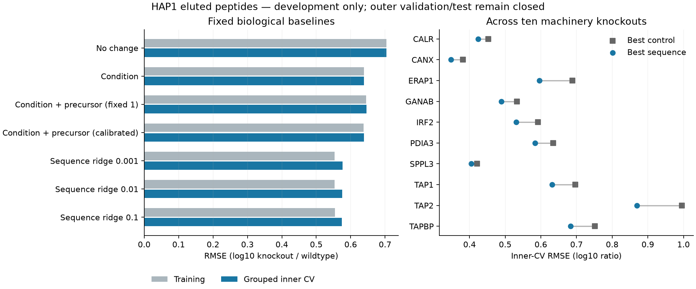

# HAP1 machinery response: sequence features predict knockout responses

A small sequence regression improves grouped inner-CV RMSE by **10.0%** over the
best condition/protein-abundance control: **0.574832 versus 0.638745 log10 ratio**.
It improves error in all ten knockout conditions and gives clearly nonconstant
predictions. This is useful development evidence for relative elution response
among observed peptides. It does not validate intracellular concentrations,
causal processing rates, unseen knockouts or external APC transfer.

Codex / GPT-6, October 24, 2026. Registered before materialization or fitting against
Presto `6045dd27511b96782c9c2422ca2f1a8b81df5b7d` and Hitlist `2f4bbe0` plus frozen new
recipe code. The shared recipe is published in [Hitlist PR807](https://github.com/pirl-unc/hitlist/pull/807)
at `abbc376`, stacked on source PR806. Merge and PyPI release remain pending.
Local CPU, float64 NumPy/SciPy, one numerical thread; no Modal, GPU, installations
or shared-environment changes.

## Source and target

Shapiro 2025, PMID40113210 / PMC12090245 / PXD056426: human HAP1 wildtype plus eleven
antigen-processing machinery KO conditions, with three declared biological
replicates each. MHC-I elution and global proteomics are distinct modalities.
Supplied HLA-A*02:01/B*40:01/C*03:04 is a cell-line genotype, not individual peptide
restriction. HAP1 is not a professional APC. KO labels assert interventions,
not measured residual machinery activity.

The independently checked canonical source manifest is
`88cad10d7bc2a638305cb0d37ad96ac2826c3badaf7b3e0aad7928820df5c4b8`.
Hitlist's registered `hap1_machinery_response_v1` recipe produces manifest
`a1eec392c06485966e131663f85e7599dcd9e5ff621841eb0d44eeaafe779309`.
There is no Presto raw-source curator. See the [source audit](../2026-10-24_0612_codex_hap1-quantitative-admission/README.md).

One target is log10 of one positive canonical KO peptide replicate intensity minus
the mean log10 intensity of at least two positive WT replicates for that peptide.
Technical runs are already averaged by the source. No control cross-products,
target averaging, imputation, clipping or synthetic negatives are introduced.
WT is reference only. B2M is background only: all 520 sequences positive in any B2M
replicate, including source standards, are excluded under an explicit policy
following the paper's background-removal rationale. Missing, zero, nonfinite and
unparsed quantities remain separate evidence, never inferred bounds. Noncanonical
labels remain deferred pending their separate raw-source replay.

Every candidate full-parent sequence group must have human-target support. All
origin alternatives remain in the package. Precursor inputs use only supplemental
MaxLFQ: every candidate parent needs exactly one source protein inference group
and at least two positive WT and KO measurements. Ambiguous groups stay unresolved;
supplement NA is never filled from positive deposited values. The direct model
averages group log10 responses equally across distinct candidate parent sequences.
These are condition-level protein-group surrogates, not paired aliquots or molarity.

All 2,391,692 supplementary cells retain dispositions. The recipe admits 220,271
responses across 16,063 peptides and 5,541 components. Of these, 129,728 have complete
precursor support: 87,260 train, 19,744 validation and 22,724 test. These are
measurement cells, not independent biological specimens.

## Splits and evaluation

Before eligibility filtering, components join all canonical/noncanonical peptide
identities, reported parent claims, exact full-parent sequences and deposited
protein groups, including indistinguishable proteins. SHA256(recipe_id+component_id)
modulo 20 assigns 14/3/3 train/validation/test buckets, without reshuffling.
This protects exact molecular dependencies. Clone, specimen, study and homology
independence remain unresolved; shared study processing and controls remain limits.

All seven models use the same complete-precursor training population:
**87,260 observations, 6,317 peptides, 1,798 components and ten KO conditions**.
Five inner folds use SHA256(`hap1_baseline_inner_v1:`+component_id) modulo 5.
Fold sizes are 17,495 / 17,065 / 17,778 / 15,481 / 19,441 observations.
Every fold refits transforms and calibration. Weights average condition, component,
peptide and replicate; pooled CV retains the full training-population weights.

**Outer validation and test were intentionally not predicted or scored.** They are
reserved for a separately frozen physical-model comparison. Independent source
arithmetic checks include those rows without fitting or scoring a model. Selecting
among three fixed penalties makes inner CV development evidence, not a blind test.
Previous MAPP/native/macrophage held-outs remain closed.

## Model and training contract

Inputs are peptide length, 20 amino-acid fractions, 20 N-terminal and 20 C-terminal
indicators, supplied KO condition, and measured precursor log-ratio. Output is one
scalar log10 KO/WT elution response. Parent identities establish origins, precursor
inputs and grouping; they are not fitted identity features. Species and MHC genotype
are constant context here and have no fitted embeddings or auxiliary heads.

The four analytic controls are zero response, condition means, condition plus
precursor coefficient 1, and condition plus one nonnegative calibrated coefficient.
The latter uses weighted within-condition covariance/variance with analytically
profiled offsets. Full-training gamma is 0.189554; fold values range 0.121589–0.262808.
This is empirical calibration, not a biological elasticity. Forcing coefficient 1
worsens error. Calibrated protein input alone barely improves on condition means.

Sequence arms add condition-specific linear effects with training-only feature
centering/scaling. Within-condition centering leaves intercepts unpenalized.
Closed-form fitting minimizes condition-normalized weighted MSE plus lambda times
squared coefficients, with fixed lambdas 0.001, 0.01 and 0.1. There is no optimizer,
restart, epoch selection, pretraining or outcome-driven feature search.

The full fit has 61 globally varying features and 610 condition-specific sequence
slots: 580 have within-condition variation and nonzero fitted coefficients; 30 are
structurally zero. Ten offsets and one gamma are additional. Collinear indicators
are regularized, not causally identified. Fold-specific support and normal-equation
residuals are saved. This direct regressor does not train the modular encoder,
physical processing, transport, affinity/stability, TCR, species/class or independent
MS-detectability branches. Protein measurements are covariates, not prediction
labels. No other assay family or synthetic biological data trains. Binding/nM
metrics do not apply.

## Outcomes

Losses use hierarchical weights. Correlations are pooled, unweighted over source
observations. All full-training and inner-validation predictions are saved.

| Model | Training RMSE | Inner-CV RMSE | Inner-CV R² | Inner-CV Spearman |
|---|---:|---:|---:|---:|
| zero | 0.703614 | 0.703614 | -0.1417 | undefined |
| condition | 0.638312 | 0.638870 | 0.0588 | 0.2137 |
| fixed_precursor | 0.645376 | 0.645887 | 0.0380 | 0.2022 |
| calibrated_precursor | 0.637901 | 0.638745 | 0.0591 | 0.2215 |
| sequence_0.001 | 0.553116 | 0.576014 | 0.2349 | 0.4601 |
| sequence_0.01 | 0.553141 | 0.575716 | 0.2357 | 0.4601 |
| sequence_0.1 | 0.554784 | 0.574832 | 0.2380 | 0.4587 |

All three sequence penalties improve CV RMSE by approximately 10%. Penalty 0.1 has
the lowest RMSE: CV R² improves from 0.0591 to 0.2380, and Spearman from 0.2215 to
0.4587. All ten conditions improve; gains range from 4.0% for SPPL3 to 13.4% for
ERAP1. Within-condition prediction SD ranges 0.1266–0.5307. The prespecified gate
requires at least 2% RMSE improvement and SD above 0.001 in every condition; it passes.
About 76% of weighted target variance remains unexplained. No uncertainty interval
or external validation establishes broader superiority.

No sampled or RL model ran in this family. The prerequisite was to establish a
biological feature baseline before another physical exact-versus-sampled comparison.
Sampler agreement alone would not match the biological gain demonstrated here.

## Verification and resources

- Source replay, recipe build and derived replay: 424.19 seconds, 1.802 GiB peak.
- Independent checker imports no Hitlist recipe code. It checks all source-cell
  dispositions, 220,271 responses and 45,981 parent inputs, and reconstructs the full
  dependency graph with an independent traversal. Maximum response discrepancy
  is 1.78e-15; 114.83 seconds, 1.109 GiB peak. Original-source fidelity is separately
  established by the linked source audit; specimen independence is not established.
- All 42 full/fold fits finish in a total 214.21 seconds, 1.027 GiB peak, within the
  registered 300-second/2-GiB cap. Per-variant fit/CV times exclude some serialization
  and stratified reporting, so their sum is not total elapsed time.
- Independent augmented least-squares solves reconstruct 1,221,640 predictions,
  coefficients, transforms, weights, folds, global metrics and the gate. Maximum
  prediction/coefficient discrepancies are 2.94e-12 / 1.90e-12; 52.37 seconds,
  0.992 GiB peak. Detailed per-group strata are producer summaries backed by verified
  predictions, rather than separately recomputed metrics.
- Hitlist format/lint pass, 43 focused tests pass, and guarded `./test.sh` passes
  3,439 unit tests with 394 warnings in 642.44 seconds. The initial sandbox memory
  probe failed; the host probe found 7.95 GiB free and allowed three workers without
  bypass. An initial focused command used a nonexistent filename and collected no
  tests; the corrected invocation passed.
- Artificial software checks recover coefficient 2 exactly and establish that
  evaluation targets cannot change predictions. These are not biological examples.
  No biological attempt was discarded or rerun. A plot legend was repositioned
  after visual inspection, without changing data.

## Reproduction and handoff

The [frozen plan](reproduce/plan.md), [commands](reproduce/launch.sh), registration
and per-action receipts preserve commits, dirty state, Python/NumPy versions,
environment and input paths. Executed code is frozen under `reproduce/source/`
and `results/admission/source/`. Overrides are `OMP_NUM_THREADS=1`,
`OPENBLAS_NUM_THREADS=1`, `MKL_NUM_THREADS=1`, and
`PYTHONPATH=/private/tmp/hitlist-hap1-recipe`. Launchers refuse existing outputs;
use fresh destinations for reproduction.

Shared source: `data/hap1_quantitative_source_admission/2026-10-24_0612_codex_hap1-quantitative-admission/canonical-package-v2`.
Shared recipe: `data/hap1_response_recipes/2026-10-24_0730_v1`; its manifest is copied
here. The fitted cohort, every source-linked prediction, 42 coefficient/transform
sets and stratum records are in `results/fits/`. CSV/PNG/PDF summaries, independent
receipts and deterministically compressed logs are portable artifacts. Large source snapshots remain outside Git
and can be regenerated from the pinned source.

**Status:** development baseline and numerical closure complete; upstream merge and
release pending. The full APC availability/concentration goal remains active.
**Next:** keep sequence ridge and analytical controls fixed; specify a model joining
availability, transport and selection with independent data anchoring each component,
then compare exact and sampled updates on the same objective. Preserve nonbinding
and short fragments; do not encode every KO as cleavage. Freeze that design before
opening reserved validation/test outcomes.
**Open questions:** complete-case selection, precursor calibration, APC transfer,
independent detection/selection constraints and intracellular concentration validation.
