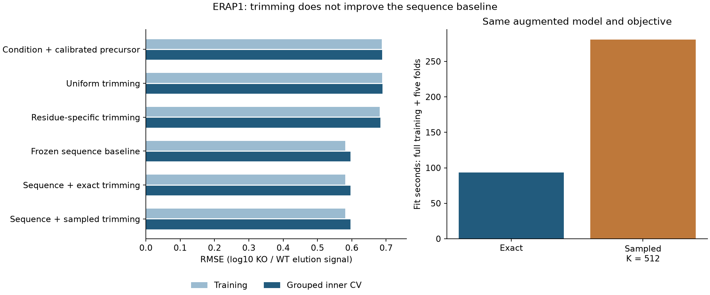

# ERAP1 trimming adds no biological gain beyond the sequence baseline

The frozen sequence baseline remains preferred: grouped inner-CV RMSE **0.596370**
versus **0.596436** with exact trimming and **0.596417** with sampled trimming.
The predeclared 2% improvement gate fails. Residue-specific physical trimming alone
has RMSE **0.683779**, only 0.4% better than condition-only and far worse than the
sequence baseline. A correct sampler does not repair this biological model failure.

Codex / GPT-6, October 24, 2026. Presto `5699b9f4e73a31c65eddc414f5d6a41f2fae24d2`
plus frozen new files and recorded task-file dirt. Registered before implementation
or fitting; the earlier metadata-only path inventory is disclosed in the
[frozen plan](reproduce/plan.md). Local CPU, float64, one numerical thread; no
Modal, GPU, installations or shared-environment changes.

## Data, endpoint and isolation

Shapiro 2025, PMID40113210 / PMC12090245 / PXD056426: human HAP1 MHC-I elution and
supplemental protein MaxLFQ. HAP1 is not a professional APC. Supplied HLA genotype
A*02:01/B*40:01/C*03:04 is sample context, not individual ligand restriction.
This experiment isolates ERAP1 KO because the admitted article identifies direct
N-terminal trimming as its function. No other KO is reinterpreted as cleavage.

Canonical Hitlist source manifest:
`88cad10d7bc2a638305cb0d37ad96ac2826c3badaf7b3e0aad7928820df5c4b8`.
Registered response recipe manifest:
`a1eec392c06485966e131663f85e7599dcd9e5ff621841eb0d44eeaafe779309`.
See the [source audit](../2026-10-24_0612_codex_hap1-quantitative-admission/README.md)
and [preceding baseline](../2026-10-24_0730_codex_hap1-response-baselines/README.md).
No Presto source curator was added.

Only the preceding complete-precursor **outer-training ERAP1 subset** enters:
8,281 observations, 3,304 peptides, 1,296 molecular components, 1,514 candidate
parent sequences and 3,409 exact occurrences. A response is one positive KO
replicate log10 elution intensity minus the mean log10 of at least two positive WT
replicates. B2M-background exclusions, source missingness and all origin alternatives
remain unchanged. No imputation, censor conversion, synthetic biological labels,
target averaging or treatment/control cross-product. Other assay families are
excluded; nM/binder classification metrics do not apply.

Protein inputs require complete unambiguous parent-group support from supplemental
MaxLFQ. These are condition-level abundance surrogates, not paired aliquots or molar
measurements. Each parent's log10 response uses the preceding baseline's frozen
calibration coefficient gamma, separately for the full fit and each inner fold.
Those calibration fits used all ten KO categories, excluding the matching held-out
molecular components. Gamma is not refitted from ERAP1 outcomes here.

The original all-source component graph and five inner folds are retained. Weights
average component, peptide and replicate within ERAP1. **Outer validation and test
are intentionally unscored**: this is development work before a separately frozen
broader model comparison. Older MAPP/native/macrophage tests remain closed.
Exact molecular grouping does not prove specimen, clone, homology or study independence.

## Physical model and information flow

Full proteins enter a reference source compartment at unit flux. Independent bond
cuts and fragment exit both have fixed rate one. The exact steady fragment amount
is the input flux into a second, trimming compartment. This is an uncalibrated
uniform reference, with no learned proteasome or TAP specificity. All contiguous
1..L spans are supported, including short and nonbinding products.

In the second compartment, clearance is one. A span of length at least two can
lose its N-terminal residue and become the next shorter span with the same C end.
Monomers clear without further trimming; a free-residue mass ledger is checked in
toy software tests. WT rates are either one uniform rate or 20 rates indexed by the
removed residue. KO multiplies all rates by a fitted sigmoid kappa. Kappa is an
effective response parameter, not measured ERAP1 residual activity.

For each queried origin, enumerate every possible N-extended birth span and sum
its birth flux times the probability of surviving all required trimming steps,
divided by the queried span's exit-plus-trimming hazard. There are **1,741,916**
birth paths. Counts of removed residues are sufficient for this particular
residue-only model; the full quadratic span table is not materialized. The independent
checker instead uses the forward scalar recurrence over starts. All occurrences and
candidate parents are retained; equal baseline parent flux is an assumption.

KO parent flux is multiplied by `10^(gamma * parent_protein_log10_response)`.
Sum all origin amounts before taking the KO/WT ratio. The physical-only output is
an offset plus that log10 ratio. The augmented output is the frozen sequence
prediction plus an offset and the physical ratio, subtracting the baseline's
original precursor term to avoid double-counting it. The offset is the fitting-only
weighted mean residual at each step; no peptide-specific free offsets are fitted.

The frozen direct baseline uses peptide length, residue fractions and N/C-terminal
indicators. It is not a learned mechanistic selection or MS-detection module.
The physical-only elution interpretation assumes unchanged same-peptide
selection/measurement factors. These data alone cannot identify causal trimming
rates, processing versus selection, or intracellular concentrations.

## Training and sampled estimator

Four fixed arms each have one full-training fit plus five held-component fits:
uniform physical-only exact (2 rate/reduction parameters), residue physical-only
exact (21), baseline-augmented exact (21), and the same augmented model with sampled
gradients (21). Every allocated parameter has support and changes in all fits;
profiled offsets also fit. The direct baseline coefficients and gamma remain frozen.
No broader encoder, species/class, transport, affinity/stability, TCR or independent
MS-detection branch is trained in this experiment.

All rates/reduction coordinates initialize at zero. Fit 150 full-batch Adam steps,
lr 0.03, betas (0.9,0.999), epsilon 1e-8, seed 42; retain the final checkpoint.
Loss is source-weighted MSE plus `0.01*mean(log_rates^2) + 0.01*reduction_logit^2`.
No restarts, learning-rate selection, extra epochs or outcome-dependent retries.

The sampled arm retains exact forward amounts and loss residuals, then estimates
kinetic gradients from conditional birth paths, sharing uniform quantiles between
WT and KO. It is a **hybrid score-function estimator**, not simulator-only RL or
GRPO. No clipping, group standardization, reuse or reference-KL penalty is applied.

Before fitting, three fixed parameter probes and eight gradient draws per probe
compare the unpenalized data gradient. K128 fails the predeclared RMS gate (0.317–0.334
versus limit 0.25). The predeclared K512 fallback passes: mean relative errors
0.0470–0.0524 (limit 0.10), RMS 0.1275–0.1928. Both attempts are preserved. Finite
differences, exact score expectation, recurrence/linear-system equality, ragged
sampling boundaries and toy residue-mass conservation pass. Qualification is a
numerical prerequisite, not evidence of biological accuracy.

## Biological outcomes

All metrics below use the same ERAP1 subset. RMSE and R² use hierarchical weights;
Pearson/Spearman are pooled unweighted over observation rows. Saved predictions
preserve exact floating-point ties. The original seven controls are all retained.

| Model | Train RMSE | Inner-CV RMSE | CV R² | CV Spearman |
|---|---:|---:|---:|---:|
| Zero response | 0.715884 | 0.715884 | -0.0877 | undefined |
| Condition only | 0.686424 | 0.686516 | -0.0003 | -0.0036 |
| Fixed precursor coefficient 1 | 0.707281 | 0.707391 | -0.0620 | -0.0071 |
| Calibrated precursor | 0.687914 | 0.688302 | -0.0055 | -0.0100 |
| Sequence, penalty 0.001 | 0.579610 | 0.596718 | 0.2443 | 0.5256 |
| Sequence, penalty 0.01 | 0.579636 | 0.596493 | 0.2449 | 0.5257 |
| Frozen sequence, penalty 0.1 | 0.581462 | **0.596370** | **0.2452** | 0.5243 |
| Uniform trimming, exact | 0.688704 | 0.689090 | -0.0078 | -0.0451 |
| Residue-specific trimming, exact | 0.681335 | 0.683779 | 0.0077 | 0.1389 |
| Sequence + trimming, exact | 0.581296 | 0.596436 | 0.2450 | 0.5248 |
| Sequence + trimming, sampled | 0.581292 | 0.596417 | 0.2451 | 0.5249 |

The augmented exact model is 0.0112% worse in CV RMSE than the fixed baseline;
it improves 654/1,296 components and worsens 642. Its physical correction SD is
0.01023 log10 ratio. The sampled correction SD is 0.01011, with nearly identical
accuracy. The gate fails on accuracy, not zero variation. Physical-only residue
trimming improves 720 components over condition-only and worsens 576, but accounts
for less than 1% of weighted target variance. No uncertainty interval or external
validation supports a broader gain.

The augmented exact fits have final penalized gradient infinity norms at most
1.99e-7, versus 6.58e-5 for sampled. Physical-only residue fits are at most 3.07e-6.
These support local numerical stability under this fixed model, not proof of a
global optimum or identification of the biological cause of failure. Learned kappa
ranges 0.438–0.465 for physical-only residue fits and 0.497–0.499 for augmented exact;
neither range should be interpreted as measured enzyme activity.

## Resources, verification and artifacts

All 24 fits complete in **888.29 seconds**, peak **2.280 GiB**. The sum of per-fit
elapsed times is 377.46s uniform, 132.20s residue, 93.46s augmented exact, 280.82s
augmented sampled. The matched augmented sampled arm takes approximately **3.00×**
the observed exact fitting time. Early arms ran more slowly per step; brief upstream
integration checks overlapped early fitting. These are recorded local run times,
not an isolated hardware benchmark. No cap was relaxed.

Each fit evaluates 526,058,632 exact WT/KO path scores over 151 forward evaluations.
Each sampled fit additionally scores 507,494,400 conditional path draws over 150
updates; sampling therefore does not eliminate exact enumeration in this hybrid.
Qualification took 57.60s and peaked at 2.352 GiB.

Eight relevant software tests passed. The independent checker imports no model or
producer code: it verifies source/recipe/baseline hashes, all origins, cohort IDs,
weights/folds, every enumerated birth path and residue count, all 24 scalar-recurrence
fits, offsets, penalties, final losses and every global metric. It reconstructs
**198,744 fit predictions**, max discrepancy **9.05e-15**, and emits **28,512**
component/population metric rows. Verification took **8.34s / 1.227 GiB**. Optimizer
histories and gradients are preserved, but optimizer updates and final gradient
vectors are not independently replayed. Original raw-source fidelity is established
by the preceding source audit, not re-established by model closure.

`results/fits/` holds every step-0/50/100/150 optimizer/RNG checkpoint, objective
trace, fit receipt, full/fold predictions, train/inner-CV Parquet and summary JSON.
`results/` also holds the cohort, parent/origin inventories, all path inputs,
qualification attempts, independent verification, component metrics, CSV/PNG/PDF.
`reproduce/qualification/` and `reproduce/training/` preserve the actually executed
sources and environment; a style-only consolidation between phases is retained in
both snapshots. Commands and the prospective configuration are in `reproduce/`.
Large shared input packages remain at the paths pinned in `reproduce/launch.json`.

**Status:** biological comparison and independent numerical closure complete;
publication and upstream merge/release are tracked separately. The full APC
availability/concentration goal remains unachieved.
**Next step:** keep the direct baseline fixed. Seek independent constraints on
substrate-dependent processing and MHC selection/detection before adding more
sampler complexity or opening reserved outcomes. Any new biological model requires
a new prospective experiment; do not retune this completed comparison.
**Open questions:** length/internal-sequence effects, transport, selection/detection
confounding, precursor calibration, absolute/relative amount identifiability and
transfer beyond this cell line and observed positive peptide population.

Post-run source discovery filed [Hitlist809](https://github.com/pirl-unc/hitlist/issues/809)
for independently measured ERAP1 substrate/product evidence. Primary
[Chang2005](https://pmc.ncbi.nlm.nih.gov/articles/PMC1287962/) and
[Evnouchidou2008](https://journals.plos.org/plosone/article?id=10.1371/journal.pone.0003658)
report substrate-context effects absent from this minimal model. This motivates
source qualification, not a claim that those omissions caused the observed failure.
No new biochemical numeric dataset was admitted or used in these fits.

Publication check: CSV writers now emit LF line endings. The original verification
receipt/code remain in `reproduce/verification-v1/`; a second verification matches
all original metrics and fit checks exactly. Parsed CSV cells are unchanged.
