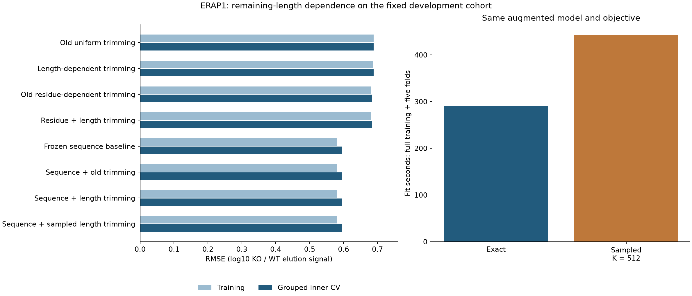

# ERAP1 remaining-length response comparison

**Result: length-dependent trimming does not improve the frozen sequence baseline.**
Codex / GPT-6, October24,2026. Local CPU, float64, one numerical thread; no Modal,
GPU, installation or shared-environment changes. Started from Presto
0248f11913ac6b75e8df870228a74316471da204 with recorded task dirt and frozen new code.
[Prospective specification and numerical recovery](../agents/codex/plans/erap1-length-response.md).

## Question and interpretation

The preceding residue-only trimming model did not improve the successful direct
sequence baseline. This comparison adds only remaining-substrate length to the
physical transition rate. Primary [Chang2005](https://pmc.ncbi.nlm.nih.gov/articles/PMC1287962/)
motivates length dependence qualitatively. It supplies no numeric priors or labels
for these fits. The chosen bands1–8,9–16,>=17 are a coarse hypothesis; neither
learned modifier is constrained to match the paper's qualitative trend.

The previous independent-source plan required numeric anchors before adding rate
dependence. This experiment explicitly relaxes that rule for a bounded structural
diagnostic on existing development data. No new biochemical cohort was admitted.
Fitted rates remain empirical effective parameters, not independently calibrated
ERAP1 activity or identified intracellular amounts. Independent measurements and
APC validation remain necessary for the larger availability objective.

## Data and split contract

Unchanged canonical Shapiro2025 PXD056426 human HAP1 source88cad10d… and registered
recipea1eec392…, with full hashes/paths in `reproduce/launch.json`. Only the previous
complete-precursor ERAP1 **outer-training** population is modeled:
8,281 observation cells,3,304 peptides,1,296 molecular components,1,514 candidate
parents,3,409 distinct origins and1,741,916 birth-to-query paths. Parent/source and
baseline artifacts are hash-checked before fitting. No Presto source curator.

Targets are one positive KO peptide replicate minus the mean log10 intensity of
at least two positive WT replicates. Keep original B2M exclusions, source filter
states, missingness, all parent/origin alternatives and biological/technical lineage.
No imputation, synthetic labels, inferred bounds, generated negatives or target
averaging. Precursor measurements are condition-level protein-group surrogates,
not aliquot-paired quantities or molarity. HAP1 is not a professional APC.

The same five molecular-component folds and hierarchical weights are reused.
Fold-specific direct sequence coefficients, transformations and precursor gamma are
frozen from0730. **Outer validation/test are intentionally unscored**, reserved for
a separately frozen comparison; therefore this family has no outer-test dump.
Inner CV has already informed model development and is not a blind test. Shared
study/control and unresolved clone/specimen/homology independence remain limits.
Other assay families and nM/500nM binding metrics are inapplicable.

## Model, enumeration and training

Keep the preceding two-compartment unit-influx/unit-clearance model. For each
queried peptide, enumerate every N-terminal precursor start with the same C end,
from every retained parent origin. The upstream full-parent cleavage formula
integrates other paths out; quadratic enumeration of every protein span is not
needed for these queries. The model still supports short/nonbinding1..L products.
The observed training peptides are8–14 residues long. Products shorter than8 and
long precursors are latent states, not independently measured targets here; their
supported representation does not establish accurate abundance predictions.

A state log-trimming rate is theta[removed residue] + eta[remaining-length band].
The9–16 band is reference0; short and long modifiers are learned. Monomers do not
trim further. KO multiplies trimming by sigmoid(z), retaining the earlier effective
response convention; this is not measured residual ERAP1 activity. Parent-specific
KO influx is scaled by10**(gamma*observed parent log10 response). Sum origin amounts
before log10(KO/WT). No learned MHC selection, transport or independent MS detector
enters this model, and those influences may confound the elution endpoint.

Four arms each have one full-training and five fold fits:

| Arm | Trainable numerical coordinates | Prediction |
|---|---:|---|
| Length-only exact |4|Physical ratio plus a profiled offset|
| Residue + length exact |23|Physical ratio plus a profiled offset|
| Augmented exact |23|Frozen direct baseline plus physical correction and profiled offset|
| Augmented sampled |23|Same model/objective, conditional-score kinetic gradient|

The augmented correction subtracts gamma times the direct precursor surrogate to
avoid adding that direct input twice. All offsets are profiled using fitting rows
only. The seven old direct/control models and four0810physical models remain frozen
references. This does not train the rest of Presto's encoder, affinity/stability,
TCR, identity, machinery or detection branches.

Every fit uses150 full-batch Adam steps, lr.03, betas(.9,.999), eps1e-8, zero
initialization and seed42; final checkpoint only. Loss is weighted MSE plus
.01*mean(theta²)+.01*mean(eta²)+.01*z². There is no pretraining, scientific restart,
post-outcome extension or feature search. The primary gate is >=2% inner-CV RMSE
improvement over frozen sequence_0.1 and correction SD>.001. Passing would establish
only development signal for this elution-response contract.

The sampled arm retains exact forward amounts and exact conditional path
probabilities; paired WT/KO uniforms sample512 paths per query. It still enumerates
all paths/states. This is a hybrid score-function estimator, not simulator-only RL
or GRPO; no clipping, group standardization, sample reuse or reference KL. Three
fixed unpenalized data-gradient probes, eight draws each, pass the original mean
relative <=.10 and RMS <=.25 gates atK512; the predeclaredK2048 fallback is unused.

## Numerical failure and recovery

The first global-prefix implementation passed response/objective equality and
finite differences. A full-path check that should have preceded fitting was added
late and found errors up to2.375e-7, exceeding the registered2e-9 tolerance.
Independent diagnosis confirmed the same error in the executed Torch producer and
NumPy global summation. The smaller response discrepancy did not override that gate.
Training was terminated (session14762, exit143), preserving11 completed fits and one
incomplete fit under `results/attempt-global-prefix/`. They are not qualified
biological results. Their code, configuration and original logs are preserved in
`reproduce/attempt-global-prefix/` and `launch_logs/attempt-global-prefix/`.

The prospectively documented recovery sums independently within each origin.
Power-of-two buckets use2,516,006 padded states for1,741,916 actual states, then
scatter back to the original order. Model/data/optimizer/seed/gates are unchanged.
All six full-cohort WT/KO path probes pass, maximum error6.22e-10; zero-length
response/objective equality is within9e-14. Eleven software tests pass, including
scalar balance/mass conservation, multiple origins, monomers, score expectations,
finite differences and a million-state rounding regression. A preliminary new test
used a float32 reference accidentally; its original failure and corrected float64
reference are retained. No tolerance was relaxed.

The inherited gradient checker used a1e-12 denominator floor rather than the
registered1e-8. Both were inactive at every original probe; independent recomputation
confirmed identical gate outcomes. Corrected code uses1e-8 and qualification was
rerun before the new fits. The admitted recovery has mean relative errors.0397–.0521
and RMS.1374–.1652. Qualification took23.47s and peaked at2.001GiB.

## Outcomes and closure

The accuracy gate **fails**. Keep the frozen direct sequence baseline. Remaining-length
modifiers produce a small physical-only change, but add no useful held-out-fold
prediction beyond that baseline. All metrics below use the same8,281 ERAP1 rows;
MSE/RMSE/R²/spread use hierarchical weights, Pearson/Spearman pooled observations.
All seven original controls and all old/new arms are retained in the CSV/JSON.

| Model | Train RMSE | Inner-CV RMSE | CV R² | CV Spearman |
|---|---:|---:|---:|---:|
| Old uniform trimming | 0.688704 | 0.689090 | -0.0078 | -0.0451 |
| Length-only trimming | 0.688273 | 0.688680 | -0.0066 | -0.0248 |
| Old residue trimming | 0.681335 | 0.683779 | 0.0077 | 0.1389 |
| Residue + length trimming | 0.680819 | 0.683296 | 0.0091 | 0.1466 |
| Frozen sequence baseline | 0.581462 | 0.596370 | 0.2452 | 0.5243 |
| Baseline + old exact trimming | 0.581296 | 0.596436 | 0.2450 | 0.5248 |
| Baseline + length trimming, exact | 0.581294 | 0.596442 | 0.2450 | 0.5248 |
| Baseline + old sampled trimming | 0.581292 | 0.596417 | 0.2451 | 0.5249 |
| Baseline + length trimming, sampled | 0.581291 | 0.596422 | 0.2450 | 0.5249 |

New augmented exact RMSE is **0.0121% worse** than the baseline; sampled is also
slightly worse. Exact/sampled correction SDs are0.010261/0.010146 log10 ratio, so
failure is not the absence of numerical variation. Physical-only residue+length
explains under1% of weighted target variance. A coarse length dependence is not
sufficient to resolve this model's predictive failure; this does not rule out
biological length effects, richer substrate context, transport, selection or detector
confounding. No uncertainty interval or external replication supports superiority.

All4/23 allocated numerical coordinates update in every fit. Maximum final exact
penalized gradient norms are9.13e-7 for length-only,3.61e-6 for residue+length,
2.18e-6 for augmented exact and7.85e-5 for sampled. These are bounded local-fitting
diagnostics, not global convergence or causal identification. Full/fold coefficient
and length-stratified metrics are included; none is used to tune a follow-up arm.

The qualified24fits take **1319.54s**, peak **1.979GiB**.
Augmented exact takes290.51s across six fits versus442.43s sampled
(**1.52×**). These are observed sequential local fitting times, not a
replicated hardware benchmark. Each fit computes526,058,632 exact path scores and
759,833,812 padded prefix cells; a sampled fit additionally gathers507,494,400 path
score terms. Sampling does not eliminate enumeration. All registered resource caps
pass. The stopped numerical attempt is separate: its11 completed fits sum to
361.58s, with additional interrupted-fit work retained in the original log.

Independent source, parent/origin, full path, weighting, fold, offset, penalty and
metric reconstruction verifies **198,744 fit predictions**, maximum error
**1.52e-13**, and emits38,880 component-metric rows plus210
length-stratum rows. It takes9.94s/1.288GiB. Every saved
gradient-probe reduction and gate is independently recomputed. The first closure
checker reconstructed all24fits but then hit a variable-name collision while
loading old reference files; its source/log are retained. A name-only checker fix
completes closure with no fit or tolerance changes. Optimizer/RNG histories are
retained but optimizer updates and final gradient vectors are not independently
replayed.

Eleven relevant software tests, tracked-source Ruff lint/format and strict docs
build pass. The all-tree lint invocation finds two pre-existing long lines in an
untracked frozen source-audit snapshot under data/; that source is preserved rather
than reformatted. A separate check of all1,545 tracked Python/notebook paths passes
(with repository experiment exclusions), and new experiment code passes isolated
lint. The comparison PNG/PDF was generated from verified metrics and visually checked.

The fixed length extension is closed. No new feature, penalty, seed or iteration
budget will be selected against these inner folds. Outer validation/test remain
unscored, and the larger APC availability/concentration objective remains unachieved.

Reproduction: `reproduce/launch.sh`, `launch.json`, prospective plan, phase-specific
executed code/environment receipts and `reproduce/source/`. Runners refuse to
overwrite existing attempts; replay in a fresh experiment copy with empty output
and phase-receipt directories, preserving the pinned configuration and dependencies.
All source data stay at the explicitly pinned shared paths. Large per-step traces,
checkpoints and per-example full/fold predictions are retained under `results/`.

**Next step:** execute the separately frozen
[HAP1 outer evaluation](../agents/codex/plans/hap1-frozen-outer-evaluation.md) without
further fitting or choosing settings from its outcomes. Actual APC amounts,
selection/detection calibration and independent processing evidence remain open.
