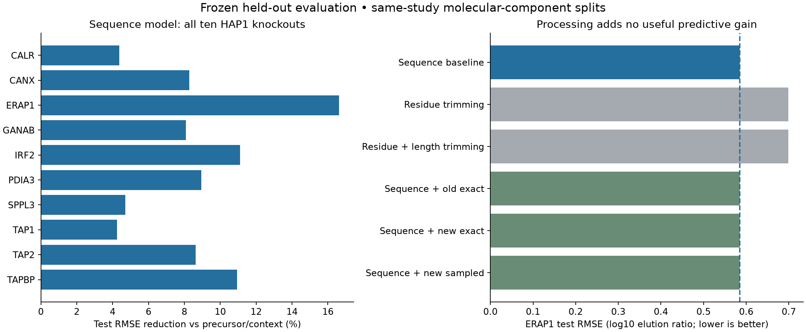

# Frozen HAP1 outer evaluation: sequence signal survives, processing adds no gain

Codex / GPT-6, October 24, 2026. Registered before held-out outcome access at
Presto `9a8742db807d805f276f67658ccae9486faab5d7`, with the recorded unrelated task
dirt and new frozen experiment code. [Prospective plan](../agents/codex/plans/hap1-frozen-outer-evaluation.md).
No new training, calibration, model selection or source curation occurred.

The preselected sequence_0.1 model reduces test RMSE **9.167%** against the
preselected calibrated-precursor comparator (validation **10.897%**). Test R² is
**0.24986** and Spearman **0.46623**. Predictions vary within all ten knockouts;
all ten have lower test RMSE. Both prespecified direct-model gates pass.

The preselected ERAP1 processing augmentation does not help: test RMSE
**0.585337** versus **0.585327** without it, a **0.001744% worsening**. Validation
improves only0.1471%, below the2% requirement. Both physical-model gates fail.
Sampled-trained parameters perform essentially identically. This is evidence for
same-study MHC-elution response prediction, not APC peptide-concentration prediction.

## Biological and source contract

Shapiro2025 PXD056426 human HAP1 MHC-I elution and separate global MaxLFQ,
unchanged canonical Hitlist source `88cad10d7bc2a638305cb0d37ad96ac2826c3badaf7b3e0aad7928820df5c4b8`
and registered recipe `a1eec392c06485966e131663f85e7599dcd9e5ff621841eb0d44eeaafe779309`.
HLA-A*02:01/B*40:01/C*03:04 is fixed genotype context, not peptide-specific restriction.
The assay label and sole predicted output are **log10 positive KO replicate intensity
minus mean log10 positive WT intensity**. WT requires at least two positive cells;
the original520B2M-positive sequence exclusions remain. All candidate parent
origins and source-cell/sample/control lineage are retained. Complete precursor
support requires the original protein-group/positive replicate policy. MaxLFQ
provides a condition-level parent-response surrogate, not paired molar concentration.
Missing, zero and filter-NA source states stay distinct; no imputation, negative
generation, synthetic biological labels or inferred censoring bounds. Other assay
families, affinity/nM and500nM binder metrics are not applicable.

The models were fitted previously on87,260outer-training cells,6,317peptides and
1,798molecular components. Frozen validation contains19,744cells,
1,438peptides and405components;
test contains22,724cells,1,606peptides and
423components. Components do not overlap across splits.
These counts do not establish independent biological specimens or studies.
ERAP1 contributes1,970validation cells/774peptides/795origins/425,963paths and
2,297test cells/888peptides/929origins/554,402paths. All relevant parent alternatives
enter deterministic exact inference.

## Frozen models and information flow

- Seven direct models from0730: zero; condition offset; unit precursor coefficient;
  nonnegative calibrated precursor coefficient; three condition-specific sequence
  ridge penalties.001/.01/.1. Features are peptide length,20amino-acid fractions,
 20N-terminal and20C-terminal indicators, supplied KO identity and precursor ratio.
  Archived training-only feature means, scales, masks, condition centers, coefficients,
  offsets and gamma0.1895535345 are reused unchanged. Original fits use weighted
  closed-form regression and ridge penalty; no pretrained sequence encoder.
- Four0810physical models: shared trimming rate or residue-specific rates,
  physical-only or added to the frozen sequence baseline; exact- and sampled-trained
  augmentation. Two or21numeric coordinates plus the original profiled offset.
- Four1007physical models add two remaining-length modifiers (1–8,9–16reference,
  >=17): four or23numeric coordinates. The original full-training150Adam steps,
  lr.03,seed42 and.01rate/reduction penalties (plus.01length penalty for1007) are
  historical training contracts, not new training in this experiment.
- Physical inference starts with unit parent supply/uniform cleavage source,
  then N-terminal trimming and clearance. Sum all query origins and birth paths;
  apply frozen precursor gamma and effective KO rate scale. Physical-only output
  is log10 KO/WT amount ratio plus archived offset. Augmentation adds that ratio
  minus the direct model's precursor term to the direct prediction, plus archived
  offset. No offset is estimated from validation or test.
- Sampled-trained models use exact forward inference here. Their prior training
  used exact-forward/conditional-score hybrid gradients, not simulator-onlyRL/GRPO.
  No new sampler, clipping, standardization, sample reuse or KL penalty is tested.
  No affinity, stability, TAP, detector, TCR, species or MHC-class branch is trained.

## Held-out outcomes

Within each split, weights give equal mass to conditions, components within
condition, peptides within component and replicate cells within peptide. ERAP1
weights are renormalized. MSE, RMSE, MAE, R² and SD are weighted; Pearson/Spearman
are unweighted. All metrics and condition/component/length strata are preserved.
No confidence intervals or independent-cohort replication were performed.

| Model | Validation RMSE | Test RMSE | Test R² | Test Pearson | Test Spearman |
|---|---:|---:|---:|---:|---:|
| zero | 0.705093 | 0.714064 | -0.163400 | undefined | undefined |
| condition | 0.649139 | 0.632674 | 0.086697 | 0.235589 | 0.224667 |
| fixed_precursor | 0.653052 | 0.635841 | 0.077532 | 0.225431 | 0.221995 |
| calibrated_precursor | 0.648257 | 0.631249 | 0.090808 | 0.245130 | 0.236386 |
| sequence_0.001 | 0.578725 | 0.576157 | 0.242582 | 0.479905 | 0.467839 |
| sequence_0.01 | 0.578410 | 0.575523 | 0.244247 | 0.480342 | 0.467796 |
| sequence_0.1 | 0.577617 | 0.573380 | 0.249865 | 0.479802 | 0.466227 |

All ten conditions improve against the prespecified precursor comparator:

| Knockout | Test control RMSE | Test sequence RMSE | Reduction | Test Spearman |
|---|---:|---:|---:|---:|
| hap1_calr_ko | 0.435523 | 0.416470 | 4.37% | 0.333047 |
| hap1_canx_ko | 0.388215 | 0.356134 | 8.26% | 0.412662 |
| hap1_erap1_ko | 0.701953 | 0.585327 | 16.61% | 0.575377 |
| hap1_ganab_ko | 0.541681 | 0.497874 | 8.09% | 0.402962 |
| hap1_irf2_ko | 0.552052 | 0.490753 | 11.10% | 0.449985 |
| hap1_pdia3_ko | 0.650284 | 0.592165 | 8.94% | 0.407123 |
| hap1_sppl3_ko | 0.401621 | 0.382719 | 4.71% | 0.306854 |
| hap1_tap1_ko | 0.670863 | 0.642329 | 4.25% | 0.394454 |
| hap1_tap2_ko | 0.994876 | 0.909046 | 8.63% | 0.450905 |
| hap1_tapbp_ko | 0.727624 | 0.648039 | 10.94% | 0.479319 |

The ERAP1-only comparison uses the same frozen sequence model and all eight
physical parameter sets. Other sequence penalties are shown descriptively;
their ERAP1 test outcomes do not select a replacement for sequence_0.1.

| Model | Validation RMSE | Test RMSE | Test R² | Test Pearson | Test Spearman |
|---|---:|---:|---:|---:|---:|
| zero | 0.714410 | 0.719001 | -0.055293 | undefined | undefined |
| condition | 0.700680 | 0.700979 | -0.003053 | undefined | undefined |
| fixed_precursor | 0.718811 | 0.722052 | -0.064269 | 0.023706 | 0.033068 |
| calibrated_precursor | 0.701972 | 0.701953 | -0.005842 | 0.023706 | 0.033068 |
| sequence_0.001 | 0.601573 | 0.581358 | 0.310076 | 0.570171 | 0.579299 |
| sequence_0.01 | 0.601589 | 0.581611 | 0.309474 | 0.569862 | 0.579079 |
| sequence_0.1 | 0.603220 | 0.585327 | 0.300624 | 0.566425 | 0.575377 |
| 0810_uniform_exact | 0.702788 | 0.703039 | -0.008957 | -0.007071 | -0.010716 |
| 0810_residue_exact | 0.692737 | 0.699122 | 0.002254 | 0.138832 | 0.144208 |
| 1007_length_exact | 0.702390 | 0.702825 | -0.008342 | 0.001828 | 0.002136 |
| 1007_residue_length_exact | 0.692245 | 0.698824 | 0.003104 | 0.143277 | 0.148232 |
| 0810_augmented_exact | 0.602327 | 0.585348 | 0.300572 | 0.568033 | 0.577929 |
| 0810_augmented_sampled | 0.602388 | 0.585345 | 0.300579 | 0.567981 | 0.577955 |
| 1007_augmented_exact | 0.602332 | 0.585337 | 0.300599 | 0.568073 | 0.577941 |
| 1007_augmented_sampled | 0.602393 | 0.585335 | 0.300605 | 0.568018 | 0.577954 |

## Verification, numerical qualification and runtime

Before outcome access, all source/recipe and upstream closure hashes were checked;
all15models reproduced677,068archived training prediction values. Independent
affine and scalar-recurrence inference agreed within1.14e-13. Target mutation
did not change predictions. Preparation took15.84s,
peak1.826GiB. Both sets of covariate-only predictions were
saved and hashed before either outcome set was read. Outcome access is timestamped;
both outer sets are now inspected and closed to further tuning.

Evaluation including all metrics took7.56s,peak1.490GiB.
Independent post-evaluation reconstruction verified361,281prediction
values (maxerror1.16e-13), every source origin/input,
source rows, hierarchical weights, split disjointness, gates and
50,995stratum records;14.62s,
peak1.267GiB. Original-source cell-level curation audits are
reused by hash; this is not new experimental biological validation. Local float64
CPU, one numerical thread; no Modal/GPU/installations. All resource caps pass.
Inference time does not compare exact versus sampled *training* costs.

Five validation component strata for uniform/length-only physical controls emitted
near-constant correlation warnings: prediction ranges3.3e-14to5.9e-14. Their Pearson
and Spearman values are uninterpretable. Original scores/predictions are preserved;
`strata-qualified.parquet` marks those ten correlation cells undefined under
SciPy's numerical warning criterion. Primary metrics/gates and every prediction
are unchanged; the qualification receipt verifies that these are the only edits.
This post-evaluation numerical qualification must not be interpreted as another
biological fit. An equivalent endswith lint amendment was frozen before preparation;
its original source/receipt is retained under`reproduce/pre-qualification-lint`.

## Reproduction, artifacts and limits

- `reproduce/launch.sh`, `launch.json`, `checkpoints.json`, copied plan and
  `reproduce/source/` pin the actual invocation, dependencies, code and full-model
  parameters. The launcher intentionally refuses to overwrite an existing
  evaluation. Use a new output copy to reproduce, retaining its frozen paths.
- `results/preparation.json`, `results/independent-verification.json` and
  `launch_logs/` contain qualification and closure. Frozen input directories are
  listed inlaunch.json; original recipe/source versions are not relabeled by later releases.
- `results/evaluation/{validation,test}/` contains every covariate, source-linked
  outcome, per-example prediction, parent/origin record and physical correction.
  Prediction-onlyNPZs and the pre-outcome receipt preserve separation from scoring.
- `summary.json`, `comparison.csv`, `conditions.csv`, `strata-qualified.parquet`,
  correlation qualification and PNG/PDF provide all reported results. Original
  `strata.parquet` remains the raw reduction. Posthoc analysis invocation is recorded
  separately; no inference code/checkpoints changed after opening outcomes.

**Decision:** retain sequence_0.1 as the HAP1 observed-positive response reference.
Do not promote the processing augmentation or retune either inspected outer split.
The strongest demonstrated signal is a parsimonious condition-specific sequence
regression. Elution conflates processing, MHC selection and detection; these data
do not separately identify those factors. HAP1 is not a professional APC; seen
conditions, shared WT controls/study and unresolved clone/specimen/homology
independence limit generalization. No unseen-KO, independent-cohort, free-peptide,
short-product or precursor-relative concentration validation is established.

**Status:** biological evaluation and independent closure complete. **Next step:**
independent processing/selection/detection constraints and prospective APC data,
with the simple sequence model as a mandatory comparator. **Open question:** how
to learn actual availability rather than only this observed MHC-elution response.
The broader availability goal remains active and unachieved.
