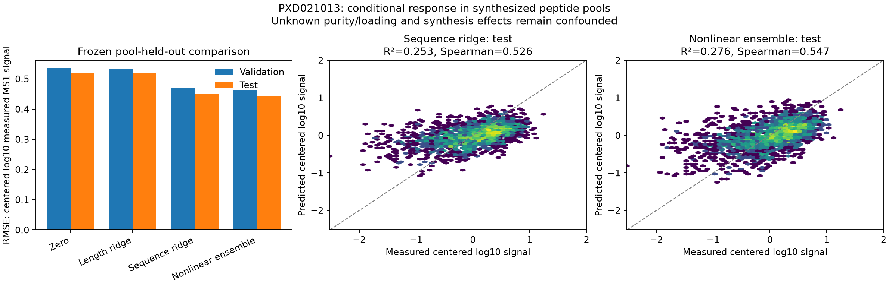

# Grouped MS1 response: sequence predicts signal beyond length

Codex / GPT-6, October 24, 2026. Completed locally from Presto
`1606976b3b684d2f4c4dfe5f1b91b7d83a25530a`, with recorded task-file dirt and new
experiment-local code. The [prospective plan](reproduce/plan.md) predates selection
and new quantities; [numerical details](reproduce/numerical-contract.md) predate fitting.

The preselected sequence ridge reduces test RMSE **13.57%** against the preselected
length ridge, and validation RMSE **11.98%**. Test Spearman is **0.52564**, weighted
R² **0.25329**, with positive Pearson and Spearman in all four test pools. Every
primary gate passes. The fixed three-seed neural ensemble gives a secondary
**14.88%** test RMSE reduction; it does not replace the declared primary model.

This is prediction of **actual measured MS1 signal in synthesized peptide pools**.
It is not an experiment with numerically generated biological labels. Unknown
purity, synthesis yield, handling, loading and measurement response remain
confounded. No intracellular abundance, pure detector efficiency, unconditional
detection probability, or transfer to biological elution is established.

## Dataset and exact endpoint

Original ProteomeTools PXD021013 nontryptic synthesis libraries, intended-product
workbook, deposited README and SDRF, plus 24 original MaxQuant SEARCH ZIPs. The two
previously inspected pilot pools and pools sharing intended sequences with them
were excluded before selection. SHA256 order with fixed salt selected 12 pools per
library, greedily excluding any intended-sequence overlap. Within each library,
ranks 0–1 are test, 2–3 validation and 4–11 training. No replacements or seed changes.

Canonical Hitlist implementation: PR814 `b9b10470058e32e679652c6fd405cc834b649bf3`,
merged as `68dea0be320906e311763db553cee54dccb6fa07`; runtime used the pinned feature
checkout via PYTHONPATH, without replacing the shared editable installation.
Source manifest **e373789b499fff90bdb34e305642812d8ffc5ceea3d91527d5b467d08031f7f9**;
registered recipe `pxd021013_intended_unmodified_ms1_v1`, manifest
**0183d91b5e97bcfdecf229900033066e6b524f31ba3ef6c1a1f7de4b5da82c6c**.

All runs pass the original fixed Carbamidomethyl(C), MaxQuant1.5.3.30, unspecific
search and indexed DDA context gates. Both sequence and molecular-form records
must have positive finite intensity, PEP in [0,0.01), no reverse/contaminant flag,
and an intended canonical sequence. Require exactly one variable-Unmodified form;
fixed CAM still applies. No raw-signal clipping, imputation, averaging of labels,
inferred bounds, generated negatives, affinity filter or MHC binding supervision.
Library names do not supply experimentally established MHC restriction.

Of 17,517 intended products: **12,877 admitted**, **1,852 observed but excluded**,
and **2,788 unobserved with unknown cause**. The latter are not detection negatives.
The source contains 56,040 molecular-form records; all dispositions remain recorded.

| Split | Pools | Admitted peptides/measurements |
|---|---:|---:|
| Training | 16 | 8,712 |
| Validation | 4 | 2,104 |
| Test | 4 | 2,061 |

All 24 pools exceed the prospective minimum of 50 examples (range 168–845).
Intended sequences and dependence components are disjoint across pools and splits.
This establishes same-study pool holdout, not independent instrument/laboratory,
specimen, sequence-homology or biological-cohort transfer. Only four test pools
support the generalization claim; no confidence intervals were estimated.

The sole target is log10 positive form intensity minus its admitted run mean.
Predict a scalar from sequence and subtract the run mean **of predicted scores**.
Target means, raw intensities, pool IDs and library labels are never model inputs.
Predictions are conditional on the admitted positive candidate set; this does not
score the probability that an arbitrary planned or intracellular peptide is seen.

## Models, training and parameter coverage

Raw features are length, squared length, 20 amino-acid fractions and 20 indicators
for each terminus. Equal-pool-weighted training means/scales are frozen. Ridge masks
features constant within every training run: length has 2 coordinates and sequence
has **42**, all nonzero after fitting. Ridge minimizes equal-pool MSE plus
alpha times mean squared coefficient, with alpha in [0.001,0.01,0.1,1]. Validation
selects length alpha0.001 and sequence alpha0.1; no intercept or pretrained encoder.

The nonlinear control retains 53 nonconstant raw features, then Linear(53,32), tanh,
and a scalar linear output without bias. Its **1,760 parameters** all receive finite
nonzero gradients and change at the selected checkpoint, for each seed42/43/44.
Training is float64 CPU, full batch, 400 Adam updates per seed, lr0.003,
betas(0.9,0.999), eps1e-8, with 0.001 times mean squared parameter added to MSE.
No schedule, dropout, clipping, pretraining, restart or test-driven selection.
Validation checks every25steps select steps50/75/75. Report each seed and the
predeclared mean-prediction ensemble. All 51 checkpoints and optimizer/RNG states
are retained. This is a continuous observation model; no RL estimator is needed
or compared here. Processing, affinity, stability, species/class, APC and TCR
branches are not trained by these measurements.

**Identifiability limitation:** each selected pool has a fixed C-terminal residue.
All 20 direct C-terminal effects disappear under within-pool centering; the ridge
therefore omits them. Nine C-terminal categories never vary in training and are
also masked from the neural input. Neural conditional interactions do not identify
an additive between-pool response scale. Gradient activity is not proof that every
biological effect is identified. Raw feature ranges are exceeded by 897 validation
and 8 test examples; flags/counts and masks are retained without excluding them.

## Held-out results

Errors, R² and SD use equal pool weights, then equal example weights within pool.
Pearson/Spearman are unweighted pooled correlations, with per-pool/library strata
also saved. Units are centered log10 measured signal, not log10(nM). Binding
threshold metrics are inapplicable. All 13 model variants are in
[metrics.csv](results/evaluation/metrics.csv); no test-selected winner.

| Model | Validation RMSE | Test RMSE | Test R² | Test Spearman |
|---|---:|---:|---:|---:|
| Zero | 0.534813 | 0.520561 | 0.000000 | undefined |
| Selected length ridge | 0.534663 | 0.520456 | 0.000405 | 0.078182 |
| **Selected sequence ridge** | **0.470624** | **0.449828** | **0.253294** | **0.525644** |
| Fixed neural ensemble | 0.463737 | 0.443033 | 0.275683 | 0.547499 |

Primary sequence test Pearson is0.49807. Test prediction SD0.23812 versus target
SD0.52056 is nonconstant but still compressed. Neural ensemble SD is0.30922.
Primary within-pool test Spearman ranges0.48950–0.61090; test RMSE is0.48354 in the
HLA-I-origin library and0.41337 in the HLA-II-origin library. These library strata
are synthesis provenance, not class-specific biological binding performance.

All four primary gates pass: >=5% improvement on both validation and test,
positive Pearson and Spearman in >=3/4 test pools, and prediction SD >=0.1 target
SD on both splits. All three neural seeds and their fixed ensemble also pass
the same descriptive secondary screen. Inspecting these results closes these
held-outs to further tuning.

## Verification, resources and retained failures

The pipeline independently compares **4,767,232 literal source cells** and all
**12,877 targets** against original ZIP tables. Gradient finite differences,
independent centered forward values, ridge normal equations and group-offset
invariance pass two numerical tests (1.21seconds). These fixtures are not biological
labels. The fit seals all checkpoints, transforms, selection and covariate-only
predictions before the evaluation process opens reserved outcomes.

Independent NumPy features/centering, augmented weighted least-squares ridge refits,
neural checkpoint inference, source-linked dump and metric reconstruction verify
**167,401 prediction values and 182 metric records**, maximum difference
**1.0814e-13**. Validation selection and all gates reproduce. Neural optimizer
trajectories are stored but were not independently replayed.

| Phase | Seconds | Peak process GiB |
|---|---:|---:|
| Canonical admission | 39.180 | 1.716 |
| Original-source verification | 9.182 | 0.778 |
| All ridge and three neural fits | 5.418 wall / 5.484 CPU | 0.393 |
| Held-out evaluation | 0.996 | 0.267 |
| Independent prediction verification | 0.659 | 0.163 |

Local CPU only, Torch2.14.1, NumPy2.5.4, Python3.12.6; Torch/BLAS thread count1.
No Modal or shared-environment changes. These are observed bounded execution
times, not a replicated hardware comparison. New transfer including partial
attempts was660,751,734bytes; raw plus canonical logical artifacts1,582,596,202bytes.
All transfer/storage/disk/RSS/time gates pass.

HLA_63 and HLA_112 encountered HTTPS403 and official S3-service500 errors.
Anonymous FTP recovered the exact deposited files; HLA_63's initial timed-out
partial prefix also matches its recovered archive. Server metadata, CRCs, hashes,
all attempts and the unchanged cohort are retained. The first remaining-download
script omitted the documented FTP fallback and stopped; its source is preserved.
Prelaunch lint issues were corrected before execution. Full repository lint hits
two preexisting long lines in an untracked frozen ERAP1 audit script; that historical
source was not rewritten. Tracked-source lint/format is checked separately. The
Matplotlib unwritable-default-cache warning is retained; a temporary cache was used.

## Reproduction and decision

- [Selection launch](reproduce/launch.sh), [prediction pipeline](reproduce/predict.sh),
  [exact prediction source/env receipt](reproduce/prediction-launch.json), and
  [source snapshots](reproduce/source) freeze executed code and settings.
- [Archive receipts](reproduce/archive-receipts.json), per-attempt receipts,
  [source manifest](results/source-manifest.json), [recipe manifest](results/recipe-manifest.json)
  and split-file hashes bind source identity. Replays require a fresh output
  generation; scripts refuse overwriting these results.
- Raw data: `/private/tmp/presto-modular-model/data/measured_ms1_grouped_observer/2026-10-24_1702_v1`.
  Canonical data: sibling `2026-10-24_1702_canonical`, including source ZIPs/typed
  tables, complete recipe dispositions, and explicit train/validation/test files.
- [Fit artifacts](results/fit), [pre-test seal](results/pre-test-seal.json),
  [evaluation/strata](results/evaluation), compressed per-example validation/test
  dumps, plot/PDF, and [independent verification](results/prediction-verification.json)
  are preserved. Compressed logs decode byte-identically to original logs.

Keep the preselected sequence ridge as the scoped conditional-response reference;
the small secondary neural improvement does not establish a need for a large
architecture. Compared with the1635pilot source audit, this is the first larger
pool-held-out predictive result. It supplies a measured observation constraint for
future processing experiments, but does not establish that MS response caused
the MAPP or macrophage failures. A new prospective biological comparison must
test transfer, share this same frozen observer between exact and sampled methods,
and preserve the omitted terminal/between-pool effects and unknown purity/load.
The full APC peptide-availability/concentration goal remains active and unachieved.
