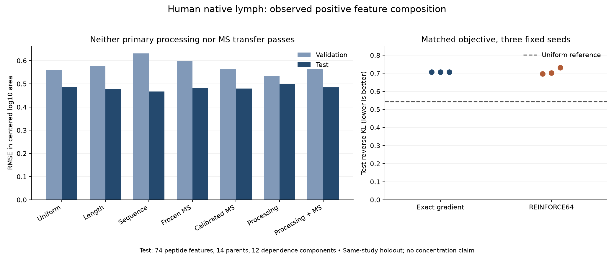

# Independent lymph composition: MS transfer and processing fail held-out gates

Codex / GPT-6, October24,2026. Presto `992cc9349a729cfb1ef78f1c13f2f6e1112c9264`
with recorded unrelated task dirt and frozen new experiment code. [Prospective
specification](reproduce/plan.md), [exact source/environment](reproduce/launch.json)
and [fitting fingerprints](reproduce/fitting.json) precede new outcomes.

**The primary processing+MS model fails.** Test RMSE0.48463 versus0.46704 for the
validation-selected sequence ridge and0.47913 for the train-calibrated MS scalar.
Its predictions vary (SD0.27949 versus target0.48566); all39allocated coordinates
receive gradients and change. This failure is not constant output or frozen weights.
The fixed measured-MS model also fails transfer beyond length on both held-outs.

The matched discrete REINFORCE comparison works numerically but supplies no useful
biological gain. Exact reverse-KL test0.70626 and REINFORCE0.71020±0.01514 both lose
to uniform0.54365. The difference between training methods is much smaller than
the failure to generalize. No model is promoted as an APC availability predictor.

## Source, endpoint and admission

Nanaware2024 PMID38848214 / PMC11233987.319, human native extracellular IBD lymph
S6(a), plus separately preserved mouse DC I-Ab S4(e) database/library searches.
Original19assets were canonically admitted and independently verified in1903.
Source manifest `6e82a782b0511ba56425855f0764c4c40127e715fdb10b10e6c12118ab539c4c`.
Shared registered recipe `nanaware2024_observed_composition_v1` is implemented in
[Hitlist819](https://github.com/pirl-unc/hitlist/pull/819), version2.0.28.
The experiment imported the isolated tested source; the user's shared editable
installation remains unchanged. Runtime base8657c9a plus frozen patch/new files;
published recipe commitc61ad506 is rebased onto source merge9133736d with identical
implementation files. Source PR818 is merged; PyPI release and recipe CI are separate.

- Use original positive finite **area**, never mix it with the parallel intensity
  fields. Missing/zero/invalid values retain dispositions and are not negatives.
- Canonical peptides with no modification except explicitly +57.02±0.02 on every
  C match the frozen observer's chemistry. No extra confidence/FDR threshold is
  inferred. The published identification confidence remains an uncertainty.
- Original accession/isoform matches and same-study deposited nondecoy peptide
  evidence supply all candidate parent sequences. Require one distinct canonical
  full sequence; sum its exact occurrences. Missing/ambiguous candidates remain
  excluded with their original evidence. Derive positions from sequence; do not
  shorten DC peptides to match erroneous reported lengths/start coordinates.
- Choose one source feature per block/peptide/parent by greatest finite -10lgP,
  numeric charge and observation ID, **before looking at area**. The selected
  feature is fixed across channels; do not fall back when it is missing. This is
  representative-feature signal, not summed charge states or total peptide molarity.
- Group by block/sample/full parent; require three distinct selected positive
  peptides. Target is original log10area minus the group mean, or the corresponding
  within-group area fraction. Prediction centering/softmax uses model scores only.
  It is conditional on the observed positive set, not the complete intracellular pool.
- All original parsed peptides, supplied accessions and candidate parents enter the
  dependency graph before eligibility. Both DC algorithms and excluded bridges
  participate. SHA256 of the fixed salt and component ID gives60/20/20splits.
  Peptides, parent sequences and components are disjoint across these partitions.

Independent original-cell, reference-backed origin, feature choice, NetworkX graph,
split and target replay verifies32,995quantity cells,4,384observations and2,472admitted
feature measurements across the three cohorts. Raw references reuse the unchanged
1903original-XML verification by exact source/table hash.

| Cohort | Train components | Validation components | Test components | Decision |
|---|---:|---:|---:|---|
| Human native lymph |34|14|12|Fit under prespecified pilot20/5/5minima|
| DC database search |36|1|6|No fit: validation support fails|
| DC library search |32|3|11|No fit: validation support fails|

The human fit contains459/135/74features in36/14/14parent/sample groups. There is
one exported human sample channel with unresolved donor/pooling identity. These
are **not**34/14/12independent donors. DC algorithms share acquisitions, expanded
DCs are not untreated baseline APCs, and specimen/precursor/KO links remain
unresolved. No DC test scores or prediction dumps are produced because no DC model
was fitted. No resplit, support relaxation or changed source filter followed.

## Information flow and training

Full parent sequence + queried peptide spans -> per-bond rates -> analytic expected
steady-state fragment amounts -> occurrence sum -> optional frozen MS log-score ->
within-group centered log10score or observed-candidate probability distribution.

Unit precursor influx, independent irreversible cuts and common removal1 define
latent amounts for every contiguous1..Lspan, including short/nonbinding products.
The exact formula evaluates requested spans without allocating an O(L²)enumeration.
For A=1+sum(internal rates), an interior span has amount
lr(2A+l+r)/[A(A+l)(A+r)(A+l+r)]; terminal spans use the corresponding one/no-boundary
form. No quantity measures the unobserved spans. Removal fixes an arbitrary time
unit; centering removes a parent's shared input factor but does not calibrate
absolute concentration or physical removal/production kinetics.

Uniform models train one log-rate. Sequence models train39coordinates: one log-rate
plus19contrasts for each adjacent residue, with the twentieth effect the negative
sum. No peptide-specific offset. Initialrho=log(.01), effects0. Four MSE arms are
uniform/sequence × noobserver/fixedobserver.500full-batch float64 Adamsteps,
lr.02,betas(.9,.999),eps1e-8, penalty.01mean(residue-effect²); no rho penalty,
pretraining of processing, schedule, clipping, early stopping or restart.

Controls: zero; length/length² ridge; sequence ridge with length/length²,
20fractions,20first/20last indicators; frozen MS response; and its train-fitted scalar.
Training-only standardization, within-group centering and SVD remove unsupported
regression directions. Length has rank2, sequence56. Ridge alpha.001/.01/.1/1,
penalty alpha*mean(coefficient²); validation selects1for both families. The frozen
1702observer uses its archived42-coefficient alpha.1ridge/transforms; no previous
held-out targets enter these fits. New train-only calibration shrinks its score
to0.233527times the original. This is empirical transfer calibration, not isolated
MS detectability or a measured detector-efficiency parameter.

Matched distribution arms use the same39-parameter sequence+fixedMS model and
**reverse KL(q||observed area fractions)**, exact differentiation or fresh discrete
REINFORCE64 per group with a leave-one-out reward baseline. Seeds42/43/44, same
500updates/Adam/penalty/initialization. The seed changes only REINFORCE samples;
exact runs are intentionally identical, not three independent biological replicates.
Each sampled peptide's reward is logp-logq. The exact expected score gradient agrees
with differentiation. No clipping, group standardization, sample reuse or reference
KL is added; earlier synthetic tests do not establish benefit here.

This is genuine discrete peptide-identity REINFORCE over the **observed candidate
set**. It does not simulate complete cleavage histories and differs from the earlier
conditional-age hybrid. Both methods compute all candidate scores, so no score-saving
claim applies. No genotype-specific affinity/stability, TAP, APC machinery-loss,
species/class inference, TCR or other assay branch trains. Species/context remain
source metadata, with no inferred wildtype state. No synthetic biological targets,
non-detection negatives, censoring, IC50 or500nM binding metrics apply.

## Held-out outcomes

Weights give equal components, then equal parent/sample groups within component,
then equal peptide features for MSE. ReverseKL uses the corresponding component/group
weights. Correlations are unweighted; loss/RMSE/MAE/R²/spread are weighted. All21models
and all three splits are in [summary.csv](results/summary.csv), full metrics JSON,
component strata and source-linked per-example dumps. The following includes all
physical arms and the validation-selected direct controls.

| Model | Train RMSE | Validation RMSE | Test RMSE | Test reverse KL | Test R² | Test Spearman |
|---|---:|---:|---:|---:|---:|---:|
| zero | 0.47211 | 0.56074 | 0.48566 | 0.54365 | 0.00000 | undefined |
| length_1 | 0.46588 | 0.57622 | 0.47813 | 0.52164 | 0.03077 | 0.36789 |
| sequence_1 | 0.38931 | 0.63085 | 0.46704 | 0.51001 | 0.07520 | 0.28195 |
| observer_fixed | 0.49918 | 0.59776 | 0.48296 | 0.53494 | 0.01107 | 0.25317 |
| observer_calibrated | 0.46925 | 0.56271 | 0.47913 | 0.52722 | 0.02670 | 0.25317 |
| uniform_alone_mse | 0.47247 | 0.56058 | 0.50860 | 0.63368 | -0.09672 | -0.30095 |
| uniform_observer_mse | 0.50045 | 0.59756 | 0.49858 | 0.59283 | -0.05391 | 0.14544 |
| sequence_alone_mse | 0.40374 | 0.53267 | 0.49952 | 0.60151 | -0.05790 | 0.23842 |
| sequence_observer_mse | 0.43324 | 0.56201 | 0.48463 | 0.54260 | 0.00424 | 0.25793 |
| sequence_observer_exact_42 | 0.46197 | 0.58684 | 0.54705 | 0.70626 | -0.26880 | 0.27147 |
| sequence_observer_exact_43 | 0.46197 | 0.58684 | 0.54705 | 0.70626 | -0.26880 | 0.27147 |
| sequence_observer_exact_44 | 0.46197 | 0.58684 | 0.54705 | 0.70626 | -0.26880 | 0.27147 |
| sequence_observer_reinforce_42 | 0.46189 | 0.58888 | 0.54189 | 0.69681 | -0.24497 | 0.27541 |
| sequence_observer_reinforce_43 | 0.46081 | 0.58688 | 0.54117 | 0.70242 | -0.24164 | 0.27331 |
| sequence_observer_reinforce_44 | 0.46314 | 0.58044 | 0.55172 | 0.73137 | -0.29056 | 0.25882 |

Primary sequence+MS gains versus sequence ridge are+10.91%validation but−3.77%test;
versus calibratedMS,+0.13%validation and−1.15%test. Both required5%gates fail.
The paired12-component bootstrap95%interval for test gain versus sequence is
[−18.39%,+10.56%], versus calibratedMS[−16.37%,+12.21%]. This descriptive component
resampling does not quantify independent donor/study uncertainty.

The frozenMS model is worse than length by3.74%validation/1.01%test. Sequence
processing withoutMS improves validation but fails test; addingMS does not produce
consistent improvement. Do not select the numerically best test model as a new
winner. Sequence ridge's modest test improvement coexists with worse validation.

REINFORCE test RMSE0.54493±0.00481 versus exact0.54705; reverseKL0.71020±0.01514
versus0.70626. These are population SDs across three sampling seeds, not biological
confidence intervals. Both lose to uniform. Primary MSE physical predictionSD0.27949
versus target0.48566; reverse-KL exactSD0.40882. All1/39allocated physical parameters
receive gradients and change. Last-step exact gradient norms are about1e-5or below
for the sequence models, arguing against simply stopping before optimization made
progress, without proving a globally optimal or biologically adequate model.

Post-evaluation **covariate-only** exposure audit: one current test peptide occurred
in the observer's training and one in its validation; none in its test. Human current
train overlaps7/1/1observer train/validation/test sequences. No cohort was changed.
Observer training lengths8–25versus new lengths7–29;22train/12validation/5test rows
fall outside at least one active observer training-feature range. This flags transfer
limits but does not establish why predictions fail or authorize a posthoc exclusion.

## Verification, runtime and preserved failures

Five existing steady-state partition/mass/gradient tests pass. Independent scalar
formula and real-data finite differences agree within2.90e-10. Exact score-function
expectation error1.59e-15.256groups of64sample draws give relative mean gradient
error0.01342 and absolute0.00209, passing the frozen criterion. Per-estimate relative
RMS0.27666 records noise rather than hiding it.

All checkpoints, transforms and test-covariate predictions were sealed before the
separate evaluation loaded test labels. Independent NumPy residue features, observer,
training-weight ridge refits, per-parent direct rate sums/rational amount formulas,
normalization, prediction dumps and63split/model metric records reproduce14,028
predictions within9.58e-13. Ridge coefficients agree within2.22e-16. Adam trajectories
are retained but not independently replayed. Plot was visually checked.

| Stage | Wall seconds | Peak RSS GiB |
|---|---:|---:|
| Canonical recipe admission/replay |7.02|0.813|
| Independent original-area/graph/target check |1.95|0.505|
| Gradient/formula qualification |0.95|0.302|
| All21controls/models |12.77|0.395|
| Held-out evaluation |0.56|0.296|
| Independent prediction replay |0.77|0.116|

Exact reverse-KL fits1.47s each versus REINFORCE1.71s, about16%slower sampled.
Each physical fit computes334,668candidate scores; each REINFORCE fit additionally
draws1,152,000peptides. Local CPU, one Torch/BLAS thread, no Modal/GPU/installations.
Ordered fits share a process and first-fit overhead; this is not a replicated
hardware benchmark. All declared memory/runtime/disk caps pass.

Preserved verification failure: the first independent verifier rebinds its training
weight variable during per-split metrics and subsequently checks ridge coefficients
against test weights. The production fitter does not do this. Frozen correction
renames the verifier binding; all original coefficients, predictions, metrics and
tolerances remain unchanged. Failed code/log and exact correction rationale are
retained. Source fixture import/lint issues were fixed before admission; required
Hitlist test runner initially lacked a sandbox memory probe, then passed3,477tests
with actual host probe access. No memory guard bypass. Recipe/source focused19tests
pass. Matplotlib used a temporary writable font cache; its warning is preserved.

## Reproduction and decision

`reproduce/all.sh` lists all stages; each stage refuses existing outputs. Use a fresh
experiment copy and explicitly relocate recipe/prepared output destinations while
retaining original launch files. Exact source hashes, new Hitlist code/patch,
model/observer fingerprints, source and recipe manifests, command/env and all raw
logs are retained. Data live in repo-level `data/lymph_composition_recipes/` and
`data/lymph_source_qualification/`, not an unpublished second curator. Parent/source
and excluded-cell evidence remains in the canonical recipe; its full manifest is
copied into this experiment. Prediction/checkpoint/trajectory artifacts are directly
under results; the artifact manifest binds the publication inventory.

Keep exact differentiation as the practical reference. The new evidence does not
support treating independently learned MS response as a unit-strength transferable
correction, or choosing a more elaborate policy-gradient optimizer to solve this
failure. Before more biological transfer, test processing/selection/observation
assumptions on training-only comparisons or new independent measurements; preserve
these inspected held-outs. HAP1's earlier direct sequence-response result remains
the stronger biological evidence. The target remains a model of APC availability,
including short/nonbinding products modulo precursor abundance; that is still
**active and unachieved**. This extracellular conditional-signal experiment does not
substitute for it. Unresolved original-reference, quantity-grain and specimen/
precursor requirements are recorded on [Hitlist817](https://github.com/pirl-unc/hitlist/issues/817#issuecomment-6388815228).

Publication-only follow-up: CSV CRLF line endings triggered Git whitespace checks.
The summary is normalized to LF with every parsed cell unchanged; the original is
retained as `results/summary-original.csv.gz` with a byte-hash receipt. The first
publication shell continued after the check because it lacked fail-fast mode;
the corrective publication requires the check to pass before committing. No fitted
model, numerical outcome or frozen executed report script changes.
