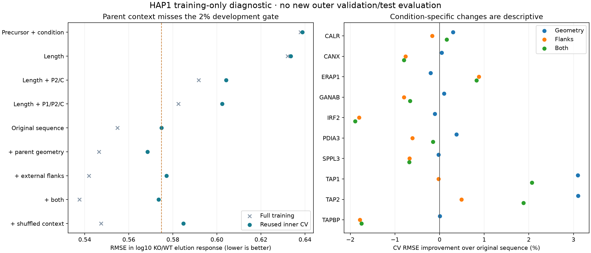

# HAP1 parent-context ablation: insufficient incremental prediction

Codex / GPT-6, October 24, 2026. Registered at Presto
`d96f958c4ed8990cd0b529c278f211bef92ceb41`, with existing unrelated task dirt and
frozen experiment-local additions. [Prospective specification](reproduce/plan.md)
was written before implementation and fitting. Local float64 CPU, one numerical
thread; no Modal, GPU, package installation or shared-environment change.

**The primary development gate fails.** Adding parent geometry and external flanks
to the established sequence regression improves pooled inner-CV RMSE only **0.232%**,
from **0.574832 to 0.573501**. Improvement over shuffled context is **1.925%**, but
only **three of five folds** improve against the original sequence model. The frozen
gate required at least 2% versus sequence, 1% versus shuffle, and four improved folds.
No model is promoted; the existing held-out sequence reference remains unchanged.

This experiment selects hypotheses for the larger availability goal. It is not a
new RL comparison, independent test result or successful APC concentration model.
Prior exact and sampled processing failures motivate testing representation before
adding optimizer complexity. The next useful separation is explicit MHC-selection
covariates versus processing context, with provenance and independent evaluation.

## Data and endpoint

Reuse Shapiro 2025 / PXD056426 human HAP1, canonical Hitlist source manifest
`88cad10d7bc2a638305cb0d37ad96ac2826c3badaf7b3e0aad7928820df5c4b8` and
`hap1_machinery_response_v1` recipe manifest
`a1eec392c06485966e131663f85e7599dcd9e5ff621841eb0d44eeaafe779309` at
`data/hap1_response_recipes/2026-10-24_0730_v1`.
Parquet filtering admits only original outer-training, complete-precursor rows:
**87,260 observations, 6,317 peptides, 1,798 components, ten KO conditions**.
Exact cohort equality with the archived 0730 cohort is checked before fitting.

Target = log10 positive KO replicate elution intensity minus mean log10 positive
WT intensity for the same peptide. Original minimum positive-WT support,
B2M-background exclusions, protein-group precursor policy and all candidate origins
remain unchanged. Precursor response is a condition-level MaxLFQ surrogate, not
paired absolute concentration. Missing source values are not zero/negative labels;
no imputation, extra confidence filter, generated biology or inferred censoring.
Other assay families and IC50/500 nM binding metrics do not apply.

Use the exact original five SHA256 component folds and equal condition/component/
peptide/replicate weights. Fitting weights are recomputed within each fold; pooled
CV uses original full-training weights. These are **reused development folds**.
No new outer validation/test predictions or metrics are produced: the prior 1503
outer sets were inspected and are closed to tuning. Shared study, controls, known
conditions and unresolved specimen/homology independence remain limitations.

## Inputs, training and outputs

All arms take supplied KO identity and precursor response. Fitting-only
within-condition covariance estimates the common nonnegative precursor coefficient;
condition offsets and this coefficient match the established reference. Each arm
adds condition-specific ridge effects of the listed features. Global weighted
standardization and condition centering use fitting rows only. Penalty is fixed at
**0.1 × sum of squared coefficients**, with condition-normalized weighted residual
MSE. Fifty-four closed-form fits (nine arms × full/five folds); no tuning, pretraining,
initialization, stochastic optimizer or training of other Presto modules.

- Original sequence: length, 20 amino-acid fractions, 20 first- and 20 last-residue
  indicators (61 raw columns).
- Position controls: length plus P2/C (41) or P1/P2/C (61) one-hot columns.
- Parent geometry: log1p distance to either protein end and two physical-terminus
  indicators (four columns).
- External flanks: one residue immediately outside each peptide boundary, with
  twenty residue categories plus a physical-terminus category per side (42 columns).
- Geometry/flanks/both add 4/42/46 columns. All 6,499 exact occurrences in 2,077
  distinct parents are preserved. Average occurrences equally within parent, then
  parents equally; independently reconcile canonical source occurrence sets.

The shuffled control uses outcome-independent, length-matched cyclic donor maps
within each fitting/evaluation partition separately. Repeated input keys share a
donor; mappings are saved and independently checked. One inner-evaluation singleton
stays unchanged. Same-component donor assignments remain (up to 145/1,402 keys in
one evaluation fold); this single permutation is a diagnostic, not a calibrated
randomization test. No cross-partition context is borrowed.

Every model predicts one continuous log10 elution-response value. Unsupported
constant columns are masked or recorded; regularized dependent coordinates are not
independently identifiable biological parameters. Full/fold transforms, offsets,
coefficient support/nonzero counts and normal-equation residuals are retained.
No MHC affinity/stability, TCR, species, class, kinetic rate or MS-response head trains.

## Outcomes

| Model | Training RMSE | Inner-CV RMSE | CV R² | CV Spearman |
|---|---:|---:|---:|---:|
| Precursor + condition | 0.637901 | 0.638745 | 0.0591 | 0.2215 |
| Length | 0.632084 | 0.633505 | 0.0745 | 0.2645 |
| Length + P2/C | 0.591769 | 0.604202 | 0.1582 | 0.3318 |
| Length + P1/P2/C | 0.582525 | 0.602395 | 0.1632 | 0.3496 |
| Original sequence | 0.554784 | 0.574832 | 0.2380 | 0.4587 |
| Sequence + geometry | 0.546492 | 0.568473 | 0.2548 | 0.4647 |
| Sequence + external flanks | 0.541846 | 0.577124 | 0.2319 | 0.4505 |
| Sequence + both | 0.537528 | 0.573501 | 0.2415 | 0.4537 |
| Sequence + shuffled context | 0.547377 | 0.584759 | 0.2115 | 0.4381 |

Parent geometry alone yields a descriptive **1.106%** pooled gain. Its largest
condition gains are about 3.1% in each TAP-loss condition; these are development
strata in an already studied population, not new causal evidence or independently
validated transport prediction. External flanks worsen pooled CV despite improving
training error. Combined context helps four of ten condition-level strata.
Position-only features also underperform the original composition-containing model;
this does **not** exclude MHC selection as the origin of the original signal.

## Verification and resources

Before new arms, independent context reconstruction agrees within 1.78e-15,
canonical origin sets match, and the terminal/repeated/ambiguous-parent fixture
verifies two-stage weights. Recomputed precursor and sequence references reproduce
all archived full/inner-CV predictions within 0 and 4.00e-14 respectively.

Fitting all 54 models takes **60.62 s**, total qualification/fitting **62.72 s**,
peak **2.627 GiB**; within the frozen 300 s/3 GiB fitting caps. Independent SVD
reconstruction of all **540 condition systems** verifies **1,570,680 prediction
values**, maximum error **1.57e-13**, coefficient error **2.34e-14**. All archived
summary metrics reproduce within 2.78e-15 and 225 condition/fold strata within
1.23e-15. Qualified verification takes **77.04 s**, peak **2.136 GiB**. These are
single local-process timings, not replicated hardware comparisons.

Initial cross-implementation raw Spearman equality failed by 2.50e-8 in the geometry
training model (and 1.25e-8 in CV). The failed verifier and diagnostic are preserved.
Exactly identical inputs had 3.3–4.4e-16 prediction differences that change tie ranks.
Using one representative value per identical-input group gives exactly matching
Spearman in both implementations. The revised verification separately checks SVD
predictions at the unchanged 1e-10 tolerance, metrics on exact archived values at
that tolerance, continuous replay metrics, and explicit identical-input ties.
This replaces the original overstrong raw-rank equality check; no model, reported
metric, biological gate or tolerance is changed. Raw and tie-qualified values,
input hashes and predictions are retained under `results/rank-ties-*` and
[verification investigation](reproduce/verification-investigation.md).

Experiment code lint/format pass. Plot reviewed visually; a legend-only placement
correction leaves all numerical results unchanged. Original matplotlib fallback
cache warning and first report log are retained. An import-sort preflight correction
occurred before fitting. No failed biological run or hidden refit occurred.

## Artifacts and reproduction

- [Frozen launch and source/environment hashes](reproduce/launch.json),
  [fit command](reproduce/launch.sh), and executed snapshots in `reproduce/source/`.
- `results/fits/predictions.parquet`: every source-linked training/inner-CV prediction;
  `checkpoints.json`, `context-features.npz`, `feature-lineage.parquet`,
  `donor-mappings.json`, `strata.json` and `summary.json` retain the full calculation.
- `results/summary.csv`, PNG/PDF, independent receipts and raw logs are published
  with the experiment. Source bytes remain at the hash-pinned shared data paths.
- Run fitting once into a fresh experiment output directory (existing fit output is
  deliberately refused), then `analysis/verify.py` and `analysis/report.py` with the
  same one-thread environment. [Closure commands](reproduce/closure.sh) record the
  successful verification/report invocations. The final artifact manifest hashes
  all published retained files except itself. Original local logs are published as
  byte-equivalent `.log.gz` archives; `results/log-publication-review.json` records
  the full-content inspection, exact original hashes and decompression checks.

A supplementary source audit verifies the primary paper names **MixMHCpred 2.2**.
Nine inspected first-line CSV/TSV/TXT headers in the original supplements and Search
archives contain no rank/HLA/affinity/binding field. This narrow inspection does not
establish absence from embedded values, other assets or author-held outputs.
`results/binding-covariate-source-audit.json` preserves every header and source hash.
Request original per-allele scores and assignment provenance through Hitlist #726;
any newly computed scores must remain separate derived predictions, not measurements.

## Handoff

- **Status:** closed negative development experiment; full availability goal active.
- **Next step:** qualify explicit selection covariates and the biological population
  needed to distinguish selection from processing; preserve the current sequence
  reference. No additional feature/penalty sweep on these folds.
- **Open questions:** independent APC/free-peptide quantities, calibrated precursor
  supply, causal machinery rates, observation bias and biological transfer remain
  unresolved. This comparison does not identify which of them dominates the failures.
