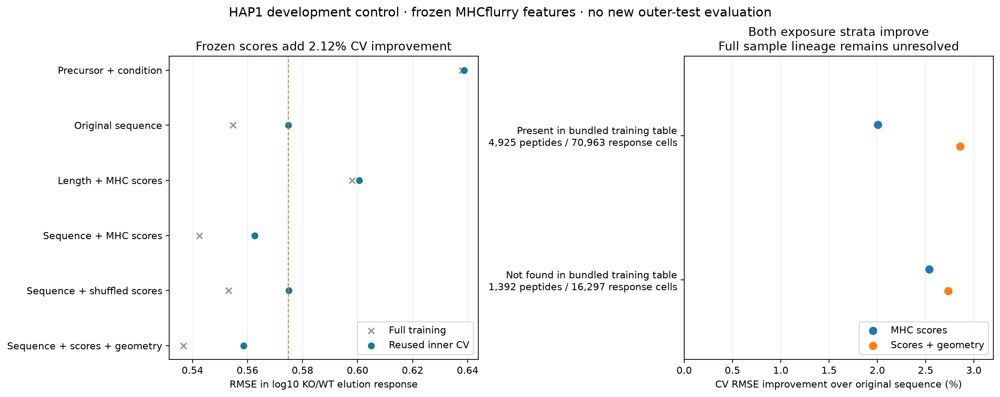

# Frozen MHC scores add modest HAP1 development signal

Codex / GPT-6, October 24, 2026. Registered at Presto
`e85deef4f97d5a7dbc1e5b6dda42784e3fa3b3c1`, with recorded unrelated task dirt and
frozen experiment additions. [Prospective specification](reproduce/plan.md) predates
prediction generation and fits. All work ran locally on CPU; no cloud training,
GPU, installation or shared-environment modification.

**The predeclared development gate passes.** Adding three frozen allele-specific
MHCflurry scores to the original sequence regression reduces pooled inner-CV RMSE
from **0.574832 to 0.562644**, a **2.120% improvement**, versus the 2% requirement.
Improvement versus shuffled scores is **2.156%**, and all five folds improve.
This is a reused-development-fold result, not a new held-out biological validation.
The earlier frozen test reference remains unchanged.

The score features complement the sequence features: length plus scores alone has
RMSE0.600516 and does not replace the original sequence representation. Adding four
parent-geometry features gives0.558574 descriptively, a further0.723% improvement;
this secondary arm is not selected using outer outcomes. No new RL comparison or
successful intracellular concentration model is claimed.

## Data, endpoint and evaluation scope

Unchanged Shapiro2025 / PXD056426 HAP1 source manifest
`88cad10d7bc2a638305cb0d37ad96ac2826c3badaf7b3e0aad7928820df5c4b8`, and Hitlist
`hap1_machinery_response_v1` recipe
`a1eec392c06485966e131663f85e7599dcd9e5ff621841eb0d44eeaafe779309` at
`data/hap1_response_recipes/2026-10-24_0730_v1`.
Only original outer-training/complete-precursor rows are loaded: **87,260 response
cells, 6,317 peptides, 1,798 molecular components, ten known KO conditions**.
Exact equality with the original archived cohort is verified before fitting.

The target is positive KO-replicate log10 elution intensity minus mean log10 WT
intensity for the same peptide. Original positive-WT support, B2M exclusion,
protein-group precursor and all-parent ambiguity policies remain unchanged. No
imputation, missing-negative conversion, new eligibility filter, synthetic HAP1
label or inferred censoring bound. Precursor input is a condition-level MaxLFQ
response surrogate, not aliquot-matched concentration. Other assay families,
IC50 regression targets and500nM binder metrics do not apply to this response fit.

Original five SHA256 dependency-component folds are reused. Weights assign equal
condition/component/peptide/replicate mass; refit them inside training folds and
retain full-training weights for pooled CV. Condition/exposure strata renormalize
those weights rather than reconstructing a different population. Outer validation/
test were inspected in1503 and remain closed: **no new outer predictions or scores**.
Same-study controls, reused folds, known conditions and unresolved specimen/homology
independence prevent external or unseen-KO generalization claims.

## Frozen predictor and overlap

Read-only MHCflurry2.3.14 from clean source
`cd141c8c3c4eb393ab7a53fd4aa40a981cf5d10f`; pin the installed2.3.0 presentation bundle's
explicit `models/affinity_predictor` component, all eleven selected networks.
The [documented training recipe](https://openvax.github.io/mhcflurry/release_training_recipe.html)
includes measured affinities, reassigned MS ligands, synthetic negatives and teacher
pretraining. Consequently an affinity-named score is **not isolated experimental
binding evidence**. Use it as a frozen predictive covariate, not measured Kd,
occupancy, energy or an independently calibrated concentration.

Only peptide and each supplied HAP1 allele (A*02:01, B*40:01, C*03:04) enter this
predictor. Generate all three positive finite API nM outputs, then log10-transform.
No best-allele assignment, score-based filtering, percentile, processing predictor
or presentation combiner is used. All 18,951 peptide/allele scores and eleven-member
outputs are retained. The original paper used MixMHCpred2.2; these are a separately
identified derivation, not recovered original paper predictions.

The bundled affinity training table has **811,134 rows**:239,021 affinity and572,113
mass-spec rows. **4,925/6,317 peptides** occur in it, all also appearing among MS rows.
Literal allele/peptide overlaps are2,090(A),1,818(B),593(C). The marker search found
no HAP1/Shapiro/40113210/PXD056426 string, but the table lacks full study/specimen
lineage and source_provenance. Teacher-pretraining and ensemble-selection sample
lineage remain incomplete. Neither a missing marker nor peptide nonoverlap proves
sample disjointness. The fixed cohort was not changed after these counts or outcomes.

Source, model, training-table and output hashes are frozen. The installed affinity
manifest matches its bundled inference-export receipt; the download metadata names
[the2.3.0 archive](https://github.com/openvax/mhcflurry/releases/download/2.3.0/models_class1_presentation.20260928.tar.bz2).
This run did not independently redownload the full public archive. Exact local bytes
are pinned, and all model/source hashes are unchanged after scoring.

## Trainable model and information flow

Peptide -> original61length/composition/P1/C features, optionally concatenate the
three frozen log10 scores and four qualified source-parent geometry features ->
fitting-only weighted standardization / condition centering -> separate ridge
coefficients per supplied KO -> one log10 KO/WT elution-response prediction.
A common nonnegative precursor slope and ten condition offsets are fitted with the
original policy. Geometry preserves all parent/occurrence alternatives and averaging
from the qualified2018experiment. Source/score values have no access to HAP1 targets.

All six arms use fixed condition-normalized weighted MSE + **0.1 sum(beta²)**,
closed-form solutions, no tuning or stochastic optimization. Thirty-six full/fold
fits. The primary64-column arm has610supported/nonzero condition-feature coefficients
plus ten offsets and the common precursor slope; dependent or unsupported columns
are recorded, not interpreted as independent biological parameters. The eleven
MHC networks stay frozen. No Presto kinetic, species/class, MS, TCR or other assay
branch trains, and no new synthetic training target is generated.

Static affinity would cancel in a same-peptide KO/WT ratio. These regressions instead
learn condition-dependent associations with the fixed score triplet. Their coefficients
do not mean that a knockout changed peptide affinity or identify causal loading rates.
The shuffled arm moves complete triplets among same-length input keys using the
frozen2018cyclic donor rule, separately inside fitting/evaluation partitions. One
singleton remains unchanged; same-component donors are recorded. It is one diagnostic
permutation, not a calibrated randomization test.

## Outcomes and interpretation

| Model | Training RMSE | Inner-CV RMSE | CV R² | CV Spearman |
|---|---:|---:|---:|---:|
| Precursor + condition | 0.637901 | 0.638745 | 0.0591 | 0.2215 |
| Original sequence | 0.554784 | 0.574832 | 0.2380 | 0.4587 |
| Length + three MHC scores | 0.598078 | 0.600516 | 0.1684 | 0.3408 |
| Sequence + MHC scores | 0.542454 | 0.562644 | 0.2700 | 0.4793 |
| Sequence + shuffled scores | 0.553179 | 0.575043 | 0.2374 | 0.4600 |
| Sequence + scores + geometry | 0.536652 | 0.558574 | 0.2805 | 0.4825 |

Nine of ten condition strata improve; the largest descriptive gains are3.61% and
5.89% in the two TAP-loss strata. This is consistent with the usefulness of
selection-related sequence information, but the mixed predictor supervision and
observational endpoint do not isolate its mechanism.

| Presence in bundled predictor training table | Peptides | Response cells | Sequence CV RMSE | With scores | Improvement |
|---|---:|---:|---:|---:|---:|
| Present |4,925|70,963|0.565804|0.554473|2.003%|
| Not found |1,392|16,297|0.610611|0.595117|2.537%|

The latter stratum is not certified unseen by all teacher/pretraining/selection data.
No independent-study uncertainty interval or new test evaluation was performed.
Keep this checkpoint as a **development control** for the next mechanistic comparison;
do not replace the earlier held-out baseline or claim validated availability.

## Verification, resources and artifacts

- Frozen inference: geometric-mean reconstruction of all eleven member outputs
  agrees within2.22e-15log10; reversed/rebatched64-peptide probes within1.28e-7,
  below the1e-5float32 gate. CPU backend, one Torch/BLAS thread, batch1024, compilation
  disabled, optimization_level0. Scores3.80s; full qualification13.59s/1.182GiB.
- Original control/sequence full/CV predictions replay within0/4.00e-14. Fit pipeline
 49.42s/1.448GiB, within300s/3GiB. Allsource/hash checks pass.
- Independent CSV training-exposure replay and SVD reconstruction verify360condition
  systems and1,047,120predictions, max1.48e-13; coefficients1.75e-14. Archived aggregate
  metrics within4.00e-15 and174strata within1.78e-15. Verification39.29s/1.764GiB.
- Prespecified exact-input-tie qualification handles tiny cross-implementation
  Spearman differences (maximum4.18e-8); raw values and ties retained. No verification
  failure, tolerance change or biological refit. Import sorting was fixed before use.
- Default isolated Ruff check and the repository's 100-column format check pass.
  An additional expanded E/F/I check flags seven style findings in the frozen
  scripts; these and the initially wrong 88-column check are recorded in
  `results/code-review.json`. Executed source is preserved unchanged.
  Visual plot review passes. First plot's long title
  was wrapped and axis margin adjusted; all scientific metrics remain unchanged.
  Timings are single local runs, not replicated hardware benchmarks.

[Fit invocation](reproduce/launch.sh), [predictor invocation](reproduce/qualify.sh),
[launch metadata](reproduce/launch.json), [predictor source/model/environment hashes](reproduce/predictor-launch.json)
and [closure commands](reproduce/closure.sh) freeze the execution. Existing output
directories are deliberately refused: rerun in a fresh experiment directory.
`reproduce/source/` contains executed scripts and the reused regression core.

`results/predictor/` contains every score/member output, exposure table, source-marker
matches, provenance and qualification. `results/fits/` contains source-linked
training/inner-CV predictions, full/fold coefficients/transforms, donor maps and
strata. Summary CSV/JSON, plots and independent receipts accompany them. Raw input
and large pretrained weights remain at explicit hash-pinned paths; no shared files
were altered. Original logs remain locally. All six were completely inspected before publishing
byte-equivalent `.log.gz` copies; `results/log-publication-review.json` records the
review and round-trip hashes. An artifact manifest records the published bytes.

## Handoff

- **Status:** closed positive development comparison; full availability goal active.
- **Next step:** use the frozen sequence-plus-score control when specifying the next
  processing/selection comparison, and qualify an independent biological population.
  Do not tune the inspected outer sets or call this independent binding validation.
- **Open questions:** original study prediction outputs, complete external-model
  training lineage, direct APC free-peptide quantities, kinetics, precursor calibration
  and detector response remain unresolved. Hitlist726owns selection-data provenance.
