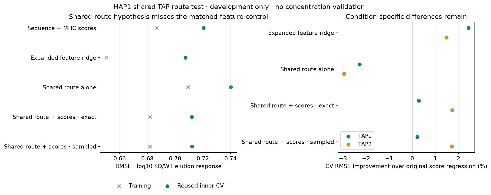

# Shared TAP-route response does not beat matched sequence features

Codex / GPT-6, October 24, 2026. Registered at Presto
`59a8db61014eede3715b11295096a83bb9aeb34d`, with unrelated task dirt and frozen
experiment additions. [Prospective specification](reproduce/plan.md).
All training ran locally on CPU, one Torch/BLAS thread; no cloud, installation or
shared-environment changes.

**The biological development gate fails.** A small shared two-route model with
MHC-score observation covariates improves inner-CV RMSE 1.207% over the original
sequence-plus-score regression, but is 0.629% worse than a regression given the
same expanded features. Only two of five folds beat that matched control.
Exact and conditional-sampled training are almost tied: sampled RMSE is 0.032%
worse, at 1.37 times the measured runtime. This is a single-seed development
comparison, not independent biological validation or a demonstrated RL benefit.

## Source, endpoint and cohort

Unchanged Shapiro2025 / PMID40113210 / PXD056426 source manifest
`88cad10d7bc2a638305cb0d37ad96ac2826c3badaf7b3e0aad7928820df5c4b8`;
canonical Hitlist `hap1_machinery_response_v1` recipe manifest
`a1eec392c06485966e131663f85e7599dcd9e5ff621841eb0d44eeaafe779309` at
`data/hap1_response_recipes/2026-10-24_0730_v1`.
Select original outer-training/complete-precursor rows with supplied TAP1 or TAP2
KO identity. This subgroup was specified before new fits, motivated by the primary
biology and the disclosed 2041 condition findings. It is not a new study.

| Supplied condition | Response cells | Peptides | Components | Components per inner fold |
|---|---:|---:|---:|---|
| TAP1 KO | 7,006 | 3,071 | 1,239 | 250, 257, 260, 258, 214 |
| TAP2 KO | 2,162 | 949 | 569 | 131, 122, 123, 102, 91 |

Union: **9,168 response cells / 3,110 peptides / 1,248 components**. Components
preserve the original source dependencies; these counts are not specimen counts.
All prospective support gates pass. Preserve positive-WT support, B2M background
exclusion, all parent/occurrence alternatives and ambiguous-precursor policies.
No additional score threshold, imputation, missing-as-negative conversion or
synthetic biological label. Only observed-positive KO response cells are modeled.

Target: log10 positive KO-replicate elution intensity minus the mean log10 positive
WT intensity for the same peptide. Precursor input remains a condition-level
MaxLFQ surrogate, not aliquot-matched molarity. Other assay families, IC50 targets
and 500 nM binding metrics are inapplicable.

Original SHA256 component folds are reused. Weights give equal mass to condition,
component, peptide and replicate; recompute within fitting partitions and retain
full-subgroup weights for pooled CV. Outer validation/test were inspected in1503
and remain closed: **no new outer predictions or outcomes are used**. All reported
CV is development evidence, with shared study, known conditions, WT denominators
and unresolved specimen/clone/homology independence.

## Model and information flow

The [primary study](https://pmc.ncbi.nlm.nih.gov/articles/PMC12090245/) motivates
separating transport from selection, but TAP loss also affects the loading complex.
N-terminal source location is not a measured signal-peptide or bypass annotation.
Therefore the following are effective response parameters, not causal transport
rates or experimentally measured residual machinery activity.

1. Peptide length, composition, P1/C-terminal residues, P2/P3 residues and four
   source-position features form 105 raw route inputs. The four geometry values
   retain all source parents/occurrences and the qualified2018 averaging policy.
   Standardize on fitting rows only; remove zero-variance coordinates.
2. A shared linear logit predicts `rho`, the modeled fraction of baseline-delivered
   peptide relying on the affected route. Each supplied KO has a fitted
   `epsilon = sigmoid(eta)`. Two path weights are `1-rho` and `rho*epsilon`.
3. Sum these weights to obtain relative delivery `R = 1-rho+rho*epsilon`.
   Predict `gamma*precursor + offset[KO] + log10(R)`; optionally add three
   standardized MHC-score covariates with separate coefficients per KO.

MHC scores enter only this observation term, not the route function. Existing
MHCflurry2.3.14 / 2.3.0 frozen-score bytes from2041 are reused, including all three
supplied HAP1 alleles. No best-allele assignment, new neural inference or fine-tuning.
Their mixed affinity/MS/teacher supervision prevents a pure-binding interpretation.
**2,474/3,110 peptides** occur in the bundled predictor training table; 636 are not
found there. Complete teacher/selection/study lineage is still unavailable, so
neither subgroup establishes sample independence.

`R` is conditional on baseline delivery, not a distribution normalized over the
observed ligand list. Its complement denotes delivery not retained, not proven
intracellular degradation. This family neither learns baseline production nor
generates full cleavage trajectories. It has no supervision for short unobserved
products. No other Presto species/class, TCR, stability or detector branch trains.

## Fixed training and sampled estimator

Five models each receive one full-data and five fold fits, **30 fits total**.
The two regressions use the original condition-normalized ridge penalty0.1.
The expanded regression receives exactly the route's105 features plus the three
score features; the original regression receives61 sequence plus3 score features.
Both are refitted on this identical subgroup, so their metrics differ from2041's
all-ten-condition numbers.

Route models use weighted MSE plus
`0.01*(sum(theta²)+mean((eta-logit(.05))²)) + 0.1*mean_KO(sum(beta²))`.
Theta includes the intercept. Initialize theta/beta to zero and epsilon to0.05.
The common nonnegative precursor coefficient is fit once per fitting partition by
the same calibrated-precursor policy for all arms. Profile two unpenalized offsets.
Float64 Adam,250 full-batch steps,lr0.03,seed42; no schedule, clipping, group
standardization, reuse, reference KL, post-failure tuning or checkpoint selection.

The sampled model has the **same exact forward response and objective**. For each
row/update it samples64 conditional route identities from the normalized path
weights and uses the average gradient of their log weights to estimate `grad log R`.
Counts are drawn directly as binomial variates:11.46 million count draws represent
733.44 million Bernoulli path draws; those paths are not individually materialized.
Observation and regularizer gradients are analytic. This is an exact-forward
conditional-score hybrid, **not simulator-only REINFORCE or GRPO**. It does not
test expensive score reuse or full antigen-processing simulation.

## Results

| Model | Training RMSE | Inner-CV RMSE | CV R² | CV Spearman | Full + five folds, seconds |
|---|---:|---:|---:|---:|---:|
| Sequence + MHC scores | 0.686770 | 0.720640 | 0.3030 | 0.5424 | 0.145 |
| Expanded feature ridge | 0.650475 | **0.707492** | **0.3282** | **0.5637** | 0.166 |
| Shared route alone, exact | 0.709329 | 0.740153 | 0.2648 | 0.4893 | 3.527 |
| Shared route + scores, exact | 0.681972 | 0.711942 | 0.3198 | 0.5462 | 2.927 |
| Shared route + scores, sampled | 0.681925 | 0.712170 | 0.3193 | 0.5457 | 4.011 |

Primary gate required >=2% gain over the original score regression, >=1% over the
expanded regression, and improvement in >=4/5 folds. Actual1.207%/-0.629%/2folds:
**FAIL**. Expanded ridge improves1.824% over the original subgroup control, but no
new held-out baseline is promoted. The simple matched-feature control remains the
comparator for this exact development contract.

TAP1 CV RMSE: original0.611686, expanded0.596784, route+scores0.609945.
TAP2: original0.815159, expanded0.803081, route+scores0.801055. The shared-route
model is slightly better only in the second descriptive condition comparison.
Among636 peptides absent from the bundled training table, expanded/route scores
are0.839751/0.825073 versus original0.818958; all these changes worsen that stratum.
Neither exposure stratum was selected or removed after inspecting results.

The full score-augmented route has109 allocated trainable coordinates, all receiving
loss gradients, plus two profiled offsets and the common calibrated precursor
coefficient. The profiled prediction Jacobian has rank104/109; feature redundancy
and response-only supervision require caution about parameter interpretation.
Exact final gradient norm5.71e-7; final50-step objective improvement1.86e-10 relative.
Sampled norm0.00472, relative change1.69e-5. Every route fit meets the predeclared
late-improvement diagnostic. This does not prove a global optimum. CV prediction
SD0.464 versus target0.863 shows nonconstant but contracted predictions.

## Verification, correction and artifacts

Before fitting, source support, finite-grid exact/analytic gradients, finite
differences, conditional-score means and independent ridge/offset fixtures pass.
Gradient errors3.32e-14; sampled means within2.60 analytic standard errors, against
the five-SE gate. Qualification1.85s/0.599GiB. All fits12.81s/0.796GiB; single local
timings, not replicated hardware benchmarks.

Independent source/feature reconstruction, SVD fits and analytic response replay
verify all30 fits /91,680 final prediction values, maxerror6.23e-14. It also checks
825,120 training-history prediction values through continuous metrics, all final
latent outputs, profiled offsets, objectives and analytic gradients (8.05e-16),
archived rank metrics and65 strata. Feature error1.78e-15; verification2.52s/0.543GiB.
Raw cross-implementation Spearman is not used as a numerical equality gate.

**Post-fit coverage correction:** closure found that the original epsilon=1 and
monotonicity checks evaluated reference algebra rather than the production function
at that boundary. Finite-grid production checks had run before fitting. A frozen
[amendment](reproduce/boundary-qualification-amendment.md) adds actual production
boundary/monotonicity and sampled-forward checks afterward; all pass. Original
qualifier/logs and model bytes remain unchanged. This is not represented as a
fully executed prospective boundary gate; no outcome or decision changed.

The [launch bundle](reproduce/launch.json), [launch command](reproduce/launch.sh),
[qualification command](reproduce/qualify.sh) and closure commands preserve exact
environment, versions, source/data hashes and executed scripts. `results/fits/`
contains the source-linked cohort, all inputs, per-example train/CV predictions,
latent outputs, full/fold checkpoints and histories. Summary tables, plots,
independent receipts, reviewed logs and artifact manifest accompany them.
Default isolated Ruff and100-column formatting pass; prelaunch unused-variable/
literal style findings were fixed before the relevant scripts executed.

## Decision and full-goal implications

Keep the expanded regression as this subgroup's development control; reject
promotion of the shared-route model and stop this bounded family. Sampling is
not the source of the biological gap. These results constrain an effective model
of observed response; they do not establish likely APC peptide concentrations.

An arbitrary positive peptide-specific baseline amount `A(p)` cancels from
`log10(A(p)*R/A(p))`. The explicit boundary checker illustrates that invariance.
No amount of fitting this response-only endpoint identifies the baseline pool.
Next work must constrain baseline quantities and observation/selection separately,
using qualified absolute/relative native-peptide evidence and prospective biological
evaluation, while preserving the full processing support. Existing inspected outer
sets remain closed. **The full APC availability goal remains active and unachieved.**
