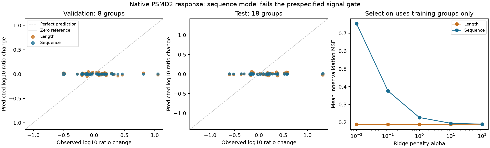

# Native PSMD2 response: prospective sequence screen

Completed and independently verified: the sequence model fails the prespecified
signal gate and produces nearly zero changes. Registration and the execution-order
amendment preceded numerical fitting and held-out effect inspection.
Agent/model: Codex / GPT-6; local CPU only. Presto base 84b1e593, dirty with
unrelated todo work preserved. Exact state, source hashes and invocation are in
`reproduce/launch.json`. Shared Python is not modified.

Hypothesis: the relative response of two peptides from the same complete parent
to PSMD2 knockdown has sequence information that transfers between the original
source dependency components. This conditional endpoint is one necessary signal
test toward a processing model; it is not calibrated APC concentration.

Data: the fixed `pxd018722_native_contrast_v1` package admitted in family0612,
228 contrasts from 82 parent sequences and 81 source dependency components.
Train/validation/test: 158/38/32 contrasts and 55/8/18 components. Each target is
mean KD minus mean control of within-run log10 peptide/reference raw intensity
ratios. Original six-run quantities, twelve contributors, all exclusions and
modified/matching annotations remain in that package. All six signals must be
positive; missing values and zeros are not negative or censor labels. Eligibility,
reference and split rules are frozen in `reproduce/plan.md`; no source is added.

Exactly three conditions are evaluated: zero change; a log-length contrast; and
a linear sequence contrast with log length, 20 residue fractions and 20 one-hot
coordinates at each terminus (61 raw features). Both learned models predict
`g(peptide) - g(reference)`, without an intercept. Fit weighted squared error plus
alpha times coefficient squared norm; weights balance components, then parents,
then contrasts. Training-only weighted RMS scales feature differences without
centering. Zero-RMS coordinates are excluded from the solved system and recorded.

Choose alpha from [0.01, 0.1, 1, 10, 100] using three hash-defined inner training
component folds; average their weighted MSEs and break exact ties toward larger
alpha. Refit once on the full training split. Validation and test evaluate all
three frozen conditions once. Do not tune features, admission, alpha bounds or
thresholds after either result. No pretraining, synthetic biological training,
MHC, TCR, affinity, stability, species or detection head applies to this screen.
Synthetic qualification fixtures are software checks only.

Report weighted MSE/RMSE/MAE, weighted and ordinary Pearson/Spearman, prediction
and target spread, signed-change accuracy and all validation/test predictions.
Constant correlations are undefined with an explicit reason. A 500 nM binding
threshold is inapplicable. Use 2,000 component-bootstrap draws per partition,
PCG64 seed 20261025, retaining paired gains against both references. Validation
advances a physical exact-versus-discrete comparison only if sequence RMSE beats
both references by >=5% and predicted SD is >=25% of target SD. Test transfer
requires those gains and paired 95% intervals above zero. Preserve failures and
uncertain outcomes; do not retune the inspected partitions.

Stages: `qualify` (data-free invariants), `prepare` (released-recipe binding and
covariate partition checks), `fit` (training only), `evaluate` (frozen held-outs),
`replay` (independent SVD least-squares/statistical reconstruction), then closure.
Prepare and all later stages require verified tested PyPI source 2.0.37 and recipe
2.0.38 receipts. Qualification and implementation can proceed while those jobs
run. All stages refuse overwrites; preserve exact code snapshots, input hashes,
parameters, predictions, selection records, timing and failed attempts.

Resources: local CPU, one BLAS thread; 20 minutes/stage, 3 GiB process-tree RSS,
1 GiB free-disk reserve plus 32 MiB startup margin. No Modal or GPU requested.
Large source data stays once under `data/`; this family records paths/hashes and
small predictions. There is no physical elapsed-time or absolute-concentration
claim, and only eight validation components limit precision. The same acquisition
environments span all partitions; this is within-study parent-group transfer.

## Prospective execution-order amendment

The [local execution amendment](reproduce/local-execution-amendment.md) permits
this local screen to use the exact merged/full-CI code while serialized PyPI
builds finish. It replaces only the earlier release-before-fit sequence; the
original files remain intact. All scientific rules and numerical modules remain
unchanged. Publication is still required before the Hitlist work is called done.
Use `reproduce/launch-local.sh` for prepare/fit/evaluate/replay. The completed
qualification exercised 24 software-only rows and 120 inner predictions, with maximum
ridge stationarity residual 1.94e-16, without biological target access. Its short
run prevents a meaningful one-second-polled peak-RSS estimate; the amended
launcher retains the same memory limit with 50 ms polling and OS peak accounting.

## Outcome: no demonstrated transferable signal from this representation

The fixed screen failed. Validation sequence RMSE is 0.317328 versus 0.317216 for
zero change (0.036% worse). Test sequence RMSE is 0.423308 versus 0.424407 for zero,
only 0.259% better. The paired test gain interval is [-0.247%, 0.449%], spanning no
improvement. Predicted variation is only 0.95% / 0.89% of target SD on validation/test.
Both the 5% gain and 25% spread requirements fail. Do not advance a physical exact
versus RL comparison on the strength of this result, and do not tune this test set.

| Split | Model | RMSE | Weighted Pearson | Weighted Spearman | Predicted/target SD |
|---|---|---:|---:|---:|---:|
| val | zero | 0.31722 | undefined | undefined | 0.00000 |
| val | length | 0.32080 | -0.15830 | -0.07819 | 0.06024 |
| val | sequence | 0.31733 | -0.03282 | -0.02504 | 0.00949 |
| test | zero | 0.42441 | undefined | undefined | 0.00000 |
| test | length | 0.42744 | -0.09886 | 0.07456 | 0.06025 |
| test | sequence | 0.42331 | 0.27454 | 0.09036 | 0.00888 |

All metrics are in dimensionless log10 signal-ratio-change space. Pearson on test
is 0.2745 despite the nearly zero output scale; this is not calibrated predictive
quality. Weighted Spearman is 0.0904. The CSV includes MSE/loss, MAE, ordinary
correlations, signed-change accuracy and denominators, target/prediction means
and spread. Every validation/test prediction is retained in Parquet; 500 nM binding
metrics are inapplicable. Bootstrap intervals against length also include zero.

### What the near-constant output means here

Training-only selection chooses alpha 1 for length and alpha 100 for sequence.
Sequence inner validation MSE improves monotonically across the registered grid:
0.75394,0.37587,0.22623,0.19381,0.18891 as alpha increases from 0.01 to 100. Weakening
the penalty is already harmful in the training-group comparisons. Do not extend
the grid after viewing outer results.

The sequence model has 61 raw features, 59 solved coordinates and rank 56; N-terminal
cysteine and C-terminal histidine have zero feature-difference RMS in training
and are explicitly omitted from the solve. All 59 active coefficients are nonzero;
the maximum ridge stationarity residual is 6.94e-17. The separate SVD solution
reproduces all 32 coefficient sets and 1,580 inner predictions. Across 684 training,
validation and test predictions, the maximum discrepancy is 3.30e-17. All metrics,
4,000 component-bootstrap draws and the frozen gate decision reproduce.

Thus this screen's near-constant output follows cross-validated shrinkage of this
limited representation; it is not explained by a missing gradient path or an
unfinished optimizer. It does not resolve the older IC50 model's underfitting,
prove that native processing has no sequence signal, or identify the biological
cause. The observations remain conditional on six positive source signals, with
shared acquisitions and only 8 validation components.

### Runtime and reproducibility

| Stage | Wall seconds including monitor | OS peak child-process RSS, MiB |
|---|---:|---:|
| qualify | 1.013 | Not reliably sampled |
| prepare | 1.175 | 227.2 |
| fit | 1.022 | 170.2 |
| evaluate | 0.936 | 169.5 |
| replay | 1.114 | 175.3 |

Training-core work, including inner selection and final solve, took
0.0260s for length and0.0428s
for sequence. Local CPU, one BLAS thread; no GPU/Modal or shared-environment changes.
All fitting stages passed the unchanged 20 min / 3 GiB / 1 GiB disk + 32 MiB startup limits.
The original subsecond qualification's one-second-polled RSS cannot estimate a
peak; the prospective local-launch amendment adds 50 ms polling and OS peak
accounting before biological fitting. Environment versions are recorded after
execution, explicitly labeled as a post-run snapshot rather than a historical
startup capture; this agent performed no package modifications.

The execution-order amendment was recorded before fitting: exact merged/full-CI
code and byte-identical source bindings enabled local fitting while serialized
PyPI releases proceed. The original release-first launcher/config/prepare source
and all amendment evidence remain. Upstream publication is outstanding work;
it is not silently redefined as complete. The monitor-template registration
failure occurred before any stage and is documented separately. All five actual
model stages succeeded without retry or criterion changes.

### Next scientific decision

The next experiment should use training data only to distinguish poor sequence
representation from unstable acquisition-level response. Quantify within-arm
ratio variability and leave-one-acquisition sensitivity without calling the
numbered runs independent biological specimens. Then test a preregistered
source-context representation only within training components if justified.
The inspected outer partitions cannot become a fresh confirmation test. A new
independent biological cohort is needed for a revised model's transfer claim.
This result does not complete precursor-relative APC availability, latent-pool
recovery, concentration/observation calibration or the exact-versus-RL objective.

Source release 2.0.37 is now published and independently byte-verified against
successful build 40168710669 at d2e0cb6; the receipt is in results/source-release.json.
Recipe PR841 is merged as d02ca1a. Its tested release 40169827556 remains in progress;
publication remains required. The next training-only diagnostic is specified in
[the reliability plan](../agents/codex/plans/native-contrast-training-reliability.md)
and has not been launched as part of this screen.
