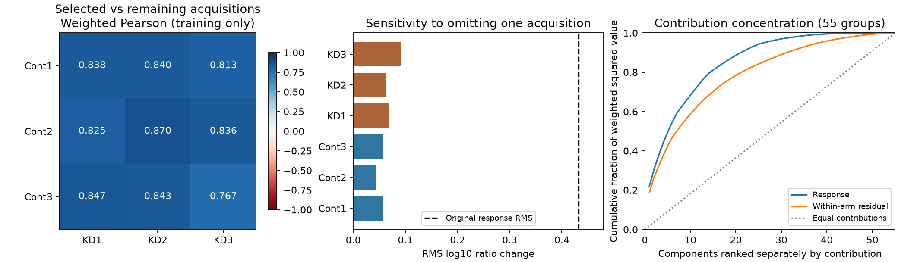

# Native acquisition sensitivity: concordant training responses, weak sequence predictor

**Result:** complementary acquisition responses are concordant on the frozen training
cohort (median weighted Pearson **0.8382**, range
0.7669–0.8700).
This weakens acquisition instability as the dominant explanation for screen0630's
nearly constant predictions. It does not establish a biological noise ceiling,
causal processing effects, transfer performance or absolute concentration.

The prespecified decision selects a **new training-only parent-boundary-context
comparison**, with no retuning of the inspected outer splits. This diagnostic
fits no model and demonstrates no improvement over uniform availability.



## Reproducibility and contract

- Date: 2026-10-25 UTC. Agent: Codex; model identity: GPT-6 as supplied by system.
- Base commit: `c728d6179075569a82cac70649460cbf34b1bd2d`; dirty worktree with pre-existing tasks/todo.md
  changes and untracked historical evidence. All five executed numerical/launcher
  sources were frozen before qualification in `reproduce/source/`, with hashes,
  stage commands, configuration and preregistered plan in `reproduce/`.
- Shared input package: `/Users/iskander/code/presto/.worktrees/presto-modular-model/data/native_contrast_recipes/2026-10-25_0612_codex_native-contrast-admission`.
  Manifest SHA256: `5f1f388876e2b5b3f65d254ff4939d2559077c2e6af1dffe603b05a1283b836a`.
  Input file hashes checked against that manifest; no duplicate raw dataset created.
- Exactly 158 original training contrasts, 56 complete human parent sequences,
  55 dependency components. Original source-wide dependency graph, hash references,
  complete-case selection and weights unchanged. Equal component, then parent,
  then contrast weight; weights normalize to one.
- PXD018722 native HEK293T control versus PSMD2 knockdown; three acquisitions per
  arm, all six intensities positive per endpoint. Original admission: peptide PEP
  <=0.01, reverse/contaminant exclusion, 8–25 residues, literal nonengineered unique
  complete-parent sequence with every declared parent resolved and agreeing.
- Assay: non-MHC native peptidomics raw sequence intensity only. LFQ, MHC-elution,
  IC50, stability and TCR labels excluded. No censor substitution, missing-intensity
  imputation, acquisition relabeling or extra eligibility filtering.
- Target: mean KD log10(peptide/reference intensity) minus mean control, using an
  unchanged same-parent reference. This is a conditional relative response, not
  a molar concentration or the full intracellular peptide distribution. These
  HEK293T measurements are not an APC calibration dataset.
- Acquisitions are `Cont1`, `Cont2`, `Cont3`, `KD1`, `KD2`, `KD3`. Physical specimen,
  aliquot, biological replication and pairing are unresolved. No paired-sample or
  independent-biological-replicate assertion is made.
- Training/pretraining, losses, optimization and model parameters: **none**.
  Synthetic data appear only in software qualification, never biological fitting.
- No validation/test predictions or held-out loss: this is explicitly a training-only
  diagnostic after outer inspection in screen0630. No held-out examples are materialized
  by the diagnostic or replay. Parquet predicates select training IDs; whole-file
  integrity hashing reads storage bytes without evaluating other splits. See
  `results/read-scope.json`. IC50 regression and 500 nM metrics are inapplicable.
- Local CPU only; no Modal GPU. One BLAS thread; exact environment overrides in
  `reproduce/launch.json`. Versions captured at each stage start. Shared Python
  environment unchanged. Tested Hitlist2.0.38 release independently published and
  byte-verified; receipt in `results/recipe-release.json`.

Run the frozen commands from a fresh copy of this experiment directory, retaining
source/config but with a new empty results/ and launch_logs/ directory. Existing
results are evidence and must not be overwritten:

```sh
reproduce/launch.sh qualify
reproduce/launch.sh diagnose
reproduce/launch.sh replay
```

The launcher uses an absolute original path; when relocating a fresh replay,
update the copied launcher path explicitly and retain the original invocation.
Report-only regeneration: `reproduce/report.sh` (no biological fits or outer access).

## Within-arm dispersion and omission sensitivity

Weighted response RMS is **0.43160** log10 units; centered SD
0.42978. Within-arm RMS is **0.12978**
(control 0.10615, KD 0.14972), or
30.1% of response RMS. This is a descriptive ratio,
not an error variance or reliability coefficient. No division by sqrt(3) is used.
Per-acquisition residual means/RMS/SD are preserved in `results/summary.json`.

| Omitted acquisition | Response change RMS | Mean absolute change | Sign flips |
|---|---:|---:|---:|
| Cont1 | 0.05681 | 0.03752 | 8.59% |
| Cont2 | 0.04474 | 0.03193 | 2.03% |
| Cont3 | 0.05677 | 0.03598 | 11.63% |
| KD1 | 0.06857 | 0.04711 | 9.22% |
| KD2 | 0.06156 | 0.04413 | 7.60% |
| KD3 | 0.09121 | 0.05832 | 7.24% |

**73.2%** of the original weighted mass keeps the
same nonzero response sign under all six omissions. Original zero-response exclusions:
0; all comparisons report their eligible weight and
zero exclusions. Each omission uses two runs in one arm and three in the other;
these are sensitivity views, not independent observations or new training labels.

## Complementary acquisition comparisons

One control + one KD acquisition define one response. The other two acquisitions
per arm define its complementary response. Pearson uses weighted covariance;
Spearman applies weighted Pearson to ordinary average-tie ranks. Constant arrays
have undefined correlation. These nine views are dependent and are not pooled or
bootstrapped as nine independent replicates.

| Selected acquisitions | Weighted Pearson | Weighted Spearman | Same nonzero sign |
|---|---:|---:|---:|
| Cont1 + KD1 | 0.8382 | 0.8250 | 72.4% |
| Cont1 + KD2 | 0.8398 | 0.7899 | 77.0% |
| Cont1 + KD3 | 0.8134 | 0.8091 | 71.3% |
| Cont2 + KD1 | 0.8248 | 0.7954 | 78.8% |
| Cont2 + KD2 | 0.8700 | 0.8318 | 73.7% |
| Cont2 + KD3 | 0.8365 | 0.8143 | 71.8% |
| Cont3 + KD1 | 0.8468 | 0.7780 | 72.1% |
| Cont3 + KD2 | 0.8427 | 0.7524 | 72.9% |
| Cont3 + KD3 | 0.7669 | 0.7184 | 69.3% |

All nine correlations are defined and positive, selecting the prespecified
representation investigation. Concordance can also reflect shared-reference,
acquisition or observation effects; it cannot establish biological replication.

## Component contributions and relation to screen0630

The largest component supplies 22.0%
of weighted squared response; the largest five supply
49.5%. For within-arm
squared residual the corresponding fractions are
18.7% and
42.4%. Full 55-component
contributions are preserved in `results/components.json`; no component is discarded,
no acquisition subset is selected, and no new exclusion rule is introduced.

Screen0630's fixed 61-feature sequence model selected ridge alpha100 in training CV
and failed both outer gates, with prediction spread below 1% of target SD. The exact
solution was independently reproduced, so unfinished optimization was not the
explanation for that small model. The present result suggests investigating missing
sequence context before increasing optimizer complexity or adding RL on this cohort.
It does **not** resolve the older full-model IC50 underfit or erase the failed screen.

## Verification and runtime

Data-free qualification checks identical acquisitions, omission-residual and
complementary-response identities, duplicate-weight and sign-reversal invariance,
constant/zero conventions and both decision branches. The diagnostic code was
unchanged after qualification.

Independent scalar replay imports no production core, uses `math.fsum`, manual
average ranks and log10 of original intensity ratios, and checks all 1,896
contributors against 1,284 distinct admitted source quantity cells. Every response,
residual, omission, partition, component contribution and summary/decision replays:
**8,520 scalar checks**, maximum absolute difference
**3.33e-15**, within frozen atol2e-12/rtol2e-13.
Training diagnostics are retained per contrast in Parquet; CSV tables and JSON
summaries permit recomputation.

| Stage | Wall seconds | OS child peak MiB |
|---|---:|---:|
| qualify | 0.631 | 97.6 |
| diagnose | 0.981 | 175.1 |
| replay | 0.582 | 422.0 |

All stages respect 20min, 3GiB RSS, 1GiB disk reserve plus32MiB startup margin.
Process-tree RSS is polled at50ms; OS child-process peak is also recorded. The first
sandboxed preflight was denied process enumeration before a numerical child was
launched. Its environment and failure are preserved under
`reproduce/attempts/sandbox-preflight/`; the unchanged command then passed with
process-monitoring permission. No numerical stage failed or was retried.

## Handoff

Status: closed; positive training acquisition concordance, no new predictor.
Next step: preregister nested training-component CV for parent-boundary context
against the frozen 61-feature sequence reference. Keep outer validation/test closed;
a changed representation needs new independent biological confirmation.
Open questions: missing physical-replicate metadata (Hitlist#837), selection of only
complete detected peptides, source processing versus clearance, APC transfer,
MS observation calibration and precursor-relative absolute abundance remain unresolved.
