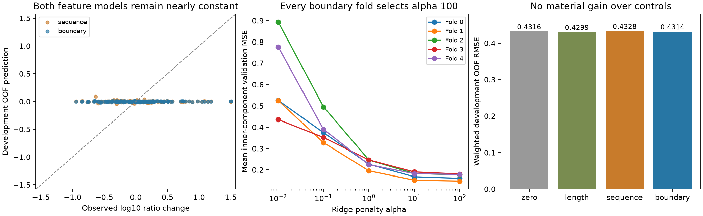

# Native boundary context: fixed development comparison fails

Adding two external parent residues on each side of the peptide does **not**
produce a useful predictor of the native control/PSMD2 response. Boundary RMSE
is **0.431426**, versus peptide-only
**0.432811** and length-only
**0.429931**. Prediction SD is only
**1.386%** of observed SD. All four fixed
materiality gates fail. No model is promoted and no independent confirmation
priority is earned.



## Contract and reproduction

- Date:2026-10-25 UTC; agent Codex, model GPT-6 (system identity).
- Base commit `0de1ef166c93eb3e9f92cd2e7e2eb82e17c49f4b`; dirty with preserved unrelated
  tasks/todo.md changes and historical untracked evidence. Ten executed sources,
  original peptide-feature checksum, launch commands, environment overrides and
  the detailed plan were frozen before qualification in `reproduce/`.
- Shared input: `/Users/iskander/code/presto/.worktrees/presto-modular-model/data/native_contrast_recipes/2026-10-25_0612_codex_native-contrast-admission`.
  Manifest SHA256 `5f1f388876e2b5b3f65d254ff4939d2559077c2e6af1dffe603b05a1283b836a`. Input files checked against that
  manifest. No large raw dataset copied into this experiment.
- Same158original training contrasts,56complete human parent sequences and55
  dependency components. No eligibility change, new reference, acquisition
  selection, target weighting from reliability, or outlier removal. Source-wide
  dependencies precede eligibility; groups remain intact in every fold.
- PXD018722 native HEK293T control/PSMD2 knockdown, six positive raw sequence
  intensities per endpoint, PEP<=.01, no reverse/contaminants,8–25residues, literal
  nonengineered unique complete parent with all declared alternatives resolved.
  Physical biological replication and control/KD pairing remain unknown.
- Only native non-MHC raw sequence intensities are labels. LFQ, affinity, stability,
  TCR and MHC-elution families are excluded. Source zeros/missing quantities are
  not imputed; this fixed cohort consists of complete detected endpoints.
- Target is the KD-minus-control difference of three-acquisition mean log10
  peptide/reference intensity ratios within one parent. It is not absolute
  abundance, a full peptide distribution or APC calibration. Shared precursor/run
  scale and fixed MS response cancel only under the stated contrast assumptions.
- All weights retain equal component, then parent, then contrast weighting and
  normalize within each fit/evaluation subset. No intercept, identity features,
  measured intensity, acquisition label or reliability feature enters a predictor.
- No pretraining. Software qualification uses60synthetic known-context rows only;
  these do not enter biological fitting. Loss is weighted MSE plus alpha times
  coefficient squared norm; no division by rank/feature count.
- Local CPU, oneBLASthread, noModalGPU or installs. Exact overrides and stage-start
  library versions are preserved. Shared Python environment unchanged.
- Original validation/test groups remain closed. This is **training-only nested
  development CV**, not a fresh blind test. Thus no original held-out loss/test
  dump or IC50/500nMclassification applies. Every development OOF and inner
  selection prediction is retained with target/ID/weight/fold. Parquet filters
  precede row materialization; whole-file hash reads check storage integrity,
  without materializing or evaluating other splits.

Frozen invocation (execute only in a fresh registered copy; existing evidence
must not be overwritten):

```sh
reproduce/launch.sh qualify
reproduce/launch.sh prepare
reproduce/launch.sh fit
reproduce/launch.sh evaluate
reproduce/launch.sh replay
```

The original launcher contains the original absolute path; a relocated replay
must explicitly adjust its copied path and retain the original invocation.
`reproduce/report.sh` regenerates this report/plots without fitting or outer access.

## Inputs, representation and information flow

The baseline uses ln(peptide length),20amino-acid fractions,20first-residue and
20last-residue indicators. Its pure61feature function is byte-identical to
screen0630. The new model adds88features: four external positions (two preceding
start, two following end) ×20canonical amino acids plus OTHER and BOUNDARY.
OTHER is a literal noncanonical residue; BOUNDARY is outside the complete parent.

Every peptide and reference endpoint is mapped by literal sequence to all exact,
overlapping parent occurrences. Features average over occurrences; none is
selected using labels. All214endpoints in this actual cohort have one occurrence,
so averaging is not activated here. The general overlapping/unknown/terminal
behavior is exercised in software qualification. All source-origin spans and
parent hashes reconcile before fitting and independently in replay.

Each model predicts `g(peptide,parent context) - g(reference,parent context)`.
The endpoint features are subtracted, then each surviving coordinate is divided
by its training-only weighted RMS. Exactly zero-RMS coordinates are dropped;
there is no feature centering or intercept. Weighted ridge solves all remaining
coefficients. The model has no neural encoder or auxiliary branch that can remain
untrained. All original endpoint contexts,149feature names and contrast vectors
are retained in results.

## Fixed nested selection and outcomes

Five development folds hash complete dependency IDs using
`pxd018722-boundary-dev-v1`; three inner selection folds use
`pxd018722-boundary-inner-v1`. Minimum five components in every development and
inner selection fold passes. Inner support ranges7–21components. All scaling is
refit inside each inner fit. Alpha[.01,.1,1,10,100] minimizes the unweighted mean of
three weighted validation MSEs, with larger alpha winning exact ties. The selected
model is refit on that development-training partition and predicts omitted
training components once. No final all-training deployment fit is made.

| Condition | Weighted OOF RMSE | Pearson | Spearman | Prediction SD / target SD |
|---|---:|---:|---:|---:|
| zero | 0.431604 | undefined | undefined | 0.000% |
| length | 0.429931 | 0.09 | 0.166 | 9.497% |
| sequence | 0.432811 | -0.0961 | -0.0747 | 2.607% |
| boundary | 0.431426 | 0.0475 | 0.0326 | 1.386% |

Pearson uses weighted covariance. Spearman uses ordinary average-tie ranks
followed by weighted Pearson. Mathematical constants have undefined correlations.
Full weighted/unweighted metrics, MAE, signed-change metrics and per-component
errors are in JSON/CSV/Parquet. The boundary Spearman0.0326 is near zero; the small
pooled improvement over61features is not meaningful success.

| Development fold | Components | Zero RMSE | Length RMSE | Sequence RMSE | Boundary RMSE |
|---|---:|---:|---:|---:|---:|
| 0 | 12 | 0.433480 | 0.433032 | 0.434041 | 0.435359 |
| 1 | 8 | 0.600210 | 0.601042 | 0.600792 | 0.598061 |
| 2 | 12 | 0.395696 | 0.392721 | 0.395834 | 0.395864 |
| 3 | 14 | 0.399918 | 0.399253 | 0.399184 | 0.398248 |
| 4 | 9 | 0.331767 | 0.323803 | 0.340507 | 0.333376 |

Boundary improves versus61features in only3of5folds. Paired component bootstrap:
2,000PCG64draws, seed202610250711, sorted55component IDs, resampling whole groups
with replacement while retaining within-group weights; linear2.5/97.5percentiles.
These intervals describe development uncertainty with overlapping training sets,
not prospective transfer confidence.

| Boundary gain versus | RMSE gain | Paired95%interval |
|---|---:|---:|
| zero | 0.0412% | [-0.2103%, 0.2849%] |
| length | -0.3476% | [-1.8646%, 1.0555%] |
| sequence | 0.3201% | [-0.0373%, 0.7336%] |

Fixed promotion rule required >=5%gain over all three controls, predictionSD>=25%
of targetSD, improvement in at least4of5folds, and positive bootstrap lower bound
versus61features. **Every requirement fails.** Neither alpha grid nor folds were
changed after observing the result.

## Which parameters trained

| Fold | Representation | Selected alpha | Solved coordinates | Design rank | Nonzero coefficients |
|---|---|---:|---:|---:|---:|
| 0 | length | 0.1 | 1 | 1 | 1 |
| 0 | sequence | 100 | 58 | 55 | 58 |
| 0 | boundary | 100 | 135 | 124 | 135 |
| 1 | length | 0.1 | 1 | 1 | 1 |
| 1 | sequence | 100 | 59 | 56 | 59 |
| 1 | boundary | 100 | 137 | 129 | 137 |
| 2 | length | 1 | 1 | 1 | 1 |
| 2 | sequence | 100 | 57 | 54 | 57 |
| 2 | boundary | 100 | 133 | 123 | 133 |
| 3 | length | 10 | 1 | 1 | 1 |
| 3 | sequence | 100 | 56 | 53 | 56 |
| 3 | boundary | 100 | 130 | 108 | 130 |
| 4 | length | 0.1 | 1 | 1 | 1 |
| 4 | sequence | 10 | 59 | 56 | 59 |
| 4 | boundary | 100 | 137 | 129 | 137 |

All boundary folds choose alpha100. Across inner folds, maximal stationarity
residual is2.78e-16. SVD reconstruction agrees, so this small model's shrinkage is
not unfinished numerical optimization. The model learns a strong, known boundary
signal in the data-free synthetic qualification (RMSE0.009901), but that does not
establish learnable signal on this biological cohort. It also does not diagnose
the older full neural model's IC50 underfit.

## Verification, runtime and decision

Independent replay imports no production core. It reconstructs contexts via a
separate literal scan, checks all source spans, fits augmented ridge systems with
SVD instead of normal equations, reconstructs inner selection and OOF predictions,
uses manual average ranks, and regenerates all2,000bootstrap draws individually.
All240nonzero fits,9,480inner predictions,632OOF predictions and all decisions pass:
**149,250numerical checks**, maximum difference
**8.32e-14**, within frozen rtol2e-9/atol2e-10.

| Stage | Wall seconds | OS child peak MiB |
|---|---:|---:|
| qualify | 0.678 | 101.0 |
| prepare | 1.032 | 207.6 |
| fit | 1.187 | 179.6 |
| evaluate | 1.003 | 171.3 |
| replay | 0.810 | 170.6 |

All five stages passed on the first numerical attempt within unchanged20minute,
3GiB RSS and1GiB diskreserve+32MiBstartup limits. Process-tree polling50ms and OS
child peak are both recorded. Process monitoring required the existing authorized
sandbox escalation; no guard was disabled. This is experiment runtime evidence,
not a general CPU/GPU benchmark.

Acquisition diagnostic0711 found high complementary-response concordance, but
this does not make those responses predictable from sequence. Immediate boundary
features fail the current component-generalization screen. A useful next question
is whether the arbitrary reference peptide and sparse per-parent support distort
this training objective. That requires a separate fixed reference-invariant
comparison, not feature expansion, alpha retuning or relabeling the original test.

## Handoff

Status: closed, negative development result; no promoted predictor or RL advantage.
Next: audit endpoint/parent support and compare the same fixed features under a
reference-invariant all-pairs loss, keeping dependent pairs inside their original
components. Preserve this failed result and the original outer closures.
Open: full precursor-relative APC availability, undetected/sub-ligand products,
source-observation calibration, machinery/clearance transfer and independent
biological confirmation remain required for the overall goal.
