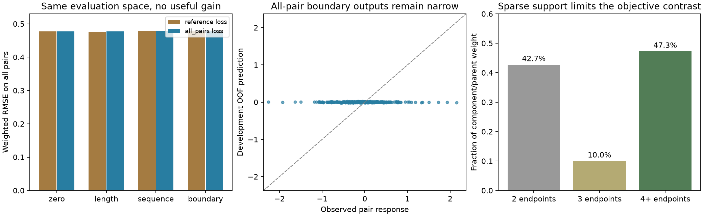

# Native reference-invariant objective: negative result, stopping rule triggered

The all-pairs loss does not rescue sequence-based response prediction. On the
**same all-pair evaluation space**, the new boundary model scores RMSE
**0.477868**, versus
**0.477484** for the frozen
reference-trained boundary model and **0.477414**
for zero change. Prediction SD is only **1.367%**
of observed SD. All four preregistered gates fail.

**Stop further feature/optimizer expansion on this native response-only cohort.**
The next scientific step is native baseline product amounts and the MS/precursor
observation contract. This stops one unsuccessful development path; it does not
complete or pause the broader APC availability goal. The cohort can remain a
constraint on a later joint model. No predictor or RL advantage is promoted.



## Reproducibility and original data

- Date: 2026-10-25 UTC. Agent: Codex; model GPT-6 (system identity).
- Base commit: `68218543c1dd54082b66f8097ab52882354e560e`; dirty with unrelated tasks/todo.md edits
  and untracked historical evidence preserved. Thirteen executed sources,
  configuration, exact stage commands and prospective plan were frozen before
  qualification in `reproduce/`. Original fitting/selection/metric functions are
  AST-identical to0726; original feature/context modules are byte-identical.
- Shared package: `/Users/iskander/code/presto/.worktrees/presto-modular-model/data/native_contrast_recipes/2026-10-25_0612_codex_native-contrast-admission`; manifestSHA256
  `5f1f388876e2b5b3f65d254ff4939d2559077c2e6af1dffe603b05a1283b836a`. Raw inputs remain once underdata/.
- Frozen controls and endpoint features are reused from `/Users/iskander/code/presto/.worktrees/presto-modular-model/experiments/2026-10-25_0726_codex_native-boundary-context`.
  Exact per-file hashes are in `reproduce/launch.json` and checked before every
  stage. The20original final controls are not refit; their632original development
  predictions reproduce with **maximum difference0.0**.
- Fixed nativePXD018722 HEK293T control/PSMD2 panel: same158training reference
  contrasts,214endpoints,56complete human parents and55dependency components.
  PEP<=.01, no reverse/contaminants,8–25residues, literal nonengineered unique
  complete parent with all declared alternatives resolved; all six endpoint
  intensities positive. No added source peptides, changed reference, acquisition
  choice, imputation, censor substitution or outlier/reliability filtering.
- Labels use raw native non-MHC sequence intensities only. LFQ, affinity/stability,
  MHC-elution andTCRlabels are excluded. Target is the KD-minus-control mean
  log10 intensity ratio between two peptides in one parent. It is a relative
  response, not molar abundance, complete-pool availability or APC calibration.
- Control/KD biological specimen, clone, aliquot and pairing metadata remain
  unresolved. Numbered acquisitions are not asserted independent biological
  replicates. Matching-only identifications and modified-form aggregation retain
  their original admission limitations.
- All original validation/test groups remain closed. These are training-component
  development results, with overlapping nested fit sets. No original held-out
  validation/test dump, IC50regression or500nMclassification applies. All inner
  and development predictions are retained. Predicate filters precede row
  materialization; whole-file hashes check bytes without evaluating other splits.
- No pretraining or synthetic biological augmentation. Synthetic arrays and
  known-context examples exercise actual pair algebra/fitting/statistics only.
  LocalCPU/oneBLASthread, noModalGPU or environment installations. Environment
  versions were recorded at the start of every stage.

Frozen stages (run in a newly registered copy, never overwrite existing evidence):

```sh
reproduce/launch.sh qualify
reproduce/launch.sh support
reproduce/launch.sh prepare
reproduce/launch.sh fit
reproduce/launch.sh evaluate
reproduce/launch.sh replay
```

The launch script records the original absolute path. A relocated copy must
explicitly update that path and preserve the original command. Report-only
regeneration: `reproduce/report.sh`.

## Support and the exact objective change

The target-free support stage precedes effect construction. It finds449unordered
within-parent pairs from the same214endpoints; these are dependent records, not
449independent biological measurements. There remain158within-parent response
degrees before cross-parent dependencies. Lexicographic endpoint IDs choose one
orientation; each feature and target difference uses that same orientation.

| Parent support | Parents | Endpoints | Pairs | Component/parent weight |
|---|---:|---:|---:|---:|
| n2 | 24 | 48 | 24 | 42.73% |
| n3 | 6 | 18 | 18 | 10.00% |
| n4plus | 26 | 148 | 407 | 47.27% |

Hierarchically weighted endpoint fractions equal the parent-weight fractions
because endpoints split their parent's mass. Ordinary endpoint fractions are
also retained in `results/support.json`. For the42.73%weighted mass with only two
endpoints, reference loss and all-pair loss are identical. No such group is dropped.

The original objective gives equal weight to each of n-1contrasts against one
hash-selected reference. The new objective gives equal weight to all n(n-1)/2
unordered pairs. Both retain equal component and then equal parent weights.
Weights normalize within every fit/evaluation subset.

For within-parent endpoint residuals e, the checked identities are:

`mean_{i<j}(e_i-e_j)^2 = 2n/(n-1) * mean_i(e_i-mean(e))^2`

`mean_{i!=a}(e_i-e_a)^2 = n/(n-1) * [Var(e)+(mean(e)-e_a)^2]`

The n-dependent factor is retained. All-pair loss is independent of arbitrary
anchor choice and common parent shifts. Production qualification checks these
quadratic matrices and gradients on synthetic cases, with common shifts and
permutations; preparation checks every actual parent before any biological fit.
Independent replay separately reconstructs the pair/centered quadratic equality.

All449targets are built from original log10 intensity ratios and reconciled to
differences of original reference targets. All1,896contributors map to1,284distinct
source quantity cells, with acquisition labels independently verified. Complete
endpoint quantities, measurement IDs and pair lineage are preserved in results.

## Models, fitting and information flow

The four fixed conditions are zero response, ln(length),61peptide features and
149features including two external residues on each side of a peptide. The61map
contains length,20AAfractions,20first-residue and20last-residue indicators. Four
external positions each use20AA+OTHER+BOUNDARY. Exact parent contexts and their
uncertainty policy remain unchanged from0726; all214actual endpoints have one
literal occurrence. No biological identity, measured intensity or acquisition
metadata is a predictor input.

Endpoint features are subtracted. Each fitting objective computes its own
training-only weighted RMS scales, drops exactly zero coordinates and solves
weightedMSE+alpha||beta||², with no intercept, centering or rank normalization.
Thus regularization retains the registered scaling convention; this is not a
claim that models using different losses must have identical coefficient priors.
All surviving coefficients are solved. There are no untrained neural branches.

Five development and three inner component folds reuse the exact0726hashes.
Alpha[.01,.1,1,10,100] minimizes mean three-fold weightedMSE, with larger alpha on
exact ties. Only all-pair models are fitted. Both objective families predict both
spaces in their omitted training components; all models remain sealed before
aggregate outcome evaluation. The comparison makes no new blind-test claim.

## Primary: both objectives evaluated on all pairs

| Training loss | Features | Weighted RMSE | Pearson | Spearman | PredSD/targetSD |
|---|---|---:|---:|---:|---:|
| reference | zero | 0.477414 | undefined | undefined | 0.000% |
| reference | length | 0.475752 | 0.0819 | 0.1609 | 7.802% |
| reference | sequence | 0.478641 | -0.0850 | -0.0489 | 2.531% |
| reference | boundary | 0.477484 | -0.0063 | -0.0037 | 1.281% |
| all_pairs | zero | 0.477414 | undefined | undefined | 0.000% |
| all_pairs | length | 0.477146 | 0.0338 | 0.1547 | 4.734% |
| all_pairs | sequence | 0.477845 | -0.1035 | -0.0342 | 0.820% |
| all_pairs | boundary | 0.477868 | -0.0616 | -0.0503 | 1.367% |

The new boundary model is worse than every preregistered matched control. It
improves over the original-objective boundary model in only1of5development folds.
The best displayed control is the reused length model, but its small gain over
zero is not qualification of an availability model.

| New boundary gain versus | Gain | Paired95%interval |
|---|---:|---:|
| all_pairs:zero | -0.0952% | [-0.2926%, 0.1845%] |
| all_pairs:length | -0.1513% | [-1.0423%, 0.8241%] |
| all_pairs:sequence | -0.0048% | [-0.1893%, 0.2007%] |
| reference:boundary | -0.0804% | [-0.1980%, 0.0561%] |

The decision required >=5%gain over its three new-objective controls and the
original boundary control, predictionSD>=25%targetSD, improvements in4of5folds,
and a positive paired95%lower bound versus the original boundary model. All fail.
Bootstrap resamples the55whole components2,000times usingPCG64seed202610250726,
retains within-component weights and uses linear percentile intervals. Pairs are
never resampled as independent observations. Intervals describe development
uncertainty with overlapping fitted models, not prospective biological transfer.

## Secondary: both objectives evaluated on original reference contrasts

| Training loss | Features | Weighted RMSE | Pearson | Spearman | PredSD/targetSD |
|---|---|---:|---:|---:|---:|
| reference | zero | 0.431604 | undefined | undefined | 0.000% |
| reference | length | 0.429931 | 0.0900 | 0.1660 | 9.497% |
| reference | sequence | 0.432811 | -0.0961 | -0.0747 | 2.607% |
| reference | boundary | 0.431426 | 0.0475 | 0.0326 | 1.386% |
| all_pairs | zero | 0.431604 | undefined | undefined | 0.000% |
| all_pairs | length | 0.430376 | 0.0748 | 0.1674 | 5.618% |
| all_pairs | sequence | 0.431941 | -0.0856 | -0.0632 | 0.900% |
| all_pairs | boundary | 0.431887 | -0.0267 | -0.0354 | 1.528% |

These scores use a different target/weight space and must not be compared to
all-pair scores as if their scale were identical. Pearson is weighted covariance;
Spearman is weighted Pearson of ordinary average-tie ranks. Constant predictions
have undefined correlations. Full weighted/unweighted metrics and per-fold and
per-component errors are preserved in JSON/CSV, along with every prediction.

## Parameter support and verification

| Development fold | New model | Selected alpha | Solved coordinates | Design rank |
|---|---|---:|---:|---:|
| 0 | length | 1 | 1 | 1 |
| 0 | sequence | 100 | 58 | 55 |
| 0 | boundary | 100 | 135 | 124 |
| 1 | length | 0.1 | 1 | 1 |
| 1 | sequence | 100 | 59 | 56 |
| 1 | boundary | 100 | 137 | 129 |
| 2 | length | 100 | 1 | 1 |
| 2 | sequence | 100 | 57 | 54 |
| 2 | boundary | 100 | 133 | 123 |
| 3 | length | 1 | 1 | 1 |
| 3 | sequence | 100 | 56 | 53 |
| 3 | boundary | 100 | 130 | 108 |
| 4 | length | 10 | 1 | 1 |
| 4 | sequence | 100 | 59 | 56 |
| 4 | boundary | 100 | 137 | 129 |

Both sequence and boundary models choose alpha100 in all five folds. The small
spread persists after changing reference weighting; it is not fixed by this
objective. The result does not prove that the source biology lacks signal, and
it does not diagnose the older neural IC50underfit.

Independent replay imports no production core. It reconstructs raw-source targets
and pair membership, checks features with a separate literal scan, solves all240
new fits with augmentedSVD, verifies selection and both prediction spaces, uses
manual ranks and regenerates every bootstrap draw. It checks26,940inner and4,856
development predictions plus the632reused-control predictions. All
**354,449numerical checks** pass; maximum difference
**7.79e-14**, within frozen2e-9relative/2e-10absolute
tolerances. Pair-target arithmetic also passes the tighter2e-12absolute/2e-13relative
pre-fit checks. Every numerical stage passes on its first attempt.

| Stage | Wall seconds | OS child peak MiB |
|---|---:|---:|
| qualify | 0.682 | 103.2 |
| support | 0.953 | 166.0 |
| prepare | 1.311 | 492.7 |
| fit | 1.495 | 203.0 |
| evaluate | 1.056 | 181.1 |
| replay | 1.575 | 483.8 |

Unchanged resource limits:20min/stage,3GiB RSS,1GiB free reserve+32MiBstartup margin;
50ms process-tree monitoring plusOSchild peak. All pass. This is recorded local
experiment runtime, not a general hardware benchmark.

## Handoff

Status: closed negative result; stopping rule triggered. Do not extend this
response-only cohort's feature or optimizer search.
Next: qualify native baseline amounts and the observation/calibration information
needed to distinguish availability from MS response, using shared data and a
registered direct baseline before any new exact/discrete generative comparison.
Open: precursor-relative APC quantities, undetected/sub-ligand products,
machinery/clearance conditioning, observation calibration and independently
confirmed biological transfer. The full goal remains active and unachieved.
