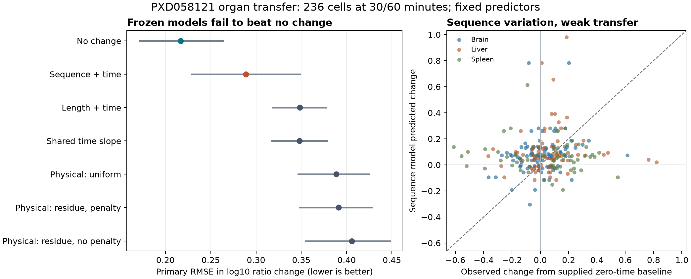

# Frozen organ transfer fails the no-change baseline

The preselected sequence model transfers poorly to the original F3 organ time
courses. Its primary RMSE is **0.288802**, versus **0.216691 for no change** and
**0.348240 for length + time**. It beats length by17.07% but is33.28% worse than
no change, failing the prespecified quality screen. This is not an output-collapse
result: weighted predictionSD0.208033 is close to targetSD0.208481, while Pearson
is only0.071599 and Spearman0.119131. No model was refitted or selected on F3.



Intervals in the left panel are peptide-bootstrap95% intervals, not animal-level
uncertainty. The right panel shows the preselected sequence model, not a selected
best result. Original exact/score checkpoint results are in the complete table below.

## Data and admission

PXD058121 original F3 Brain/Liver/Spleen purified mouse20S digestions of one human
alpha-synuclein substrate, from one source animal. Source metadata and raw cells
were previously audited; this is not untouched independent biology, a new-protein
test, or an APC experiment. Forty-four acquisitions cover nominal0/30/60/90/120min;
Spleen30R3 is absent. No recorded F2 acquisition/raw-file reuse is admitted.

Family1655 remains closed at its original explicit-unmodified gate. Independent
source family1735 verified the [original study Methods](https://pmc.ncbi.nlm.nih.gov/articles/PMC11874349/)
declaration of no additional search modifications. This new family was registered
before changed-cohort numeric admission. It uses the separately named shared
`pxd058121_organ_method_baseline_change_v1` recipe at Hitlist
**5a5a416230ca1d0c19ed2936d2215cda79b0f295** (2.0.41, release pending at execution).
The original source-generation manifest remains
fd91bb6ff3178a2246b760f6b0f99bc3824d83815a65719c34587816f3459974.

All4,198F3 assignments retain null Unlocalized Mod values. The Methods assertion
supports a search interpretation only when localized and terminal values are
reported zero. Typed policy provenance includes the article/paragraph hashes,
reported-method status and scope; it does not prove biochemical purity or the
exact software/export roundtrip. Original source tables and both strict recipes
are unchanged. Original ambiguous-mass, span,10ppm, input-ID/intensity, duplicate,
positive-finite and unique same-acquisition intact-normalizer gates remain fixed.
No missing/zero/negative quantity is imputed or assigned an inferred censor label.

For each organ/parent/span, the supplied baseline is the mean eligible nominal-zero
log10(product/intact) ratio. Future target=log10(product/intact) minus that baseline.
Every baseline and normalizer ID is retained; future values cannot create baseline
eligibility. Same-acquisition ratios cancel a shared run multiplier; same-peptide
changes cancel a fixed MS-response factor. These assumptions do not remove
peptide-specific time-varying response, quantify initial molecules, or establish
intracellular concentrations. Conditional observation and missing peptides remain.

| Organ | Primary sequences | Primary cells,30/60min | Later sequences | Later cells,90/120min |
|---|---:|---:|---:|---:|
| Brain |20|92|19|74|
| Liver |23|79|17|60|
| Spleen |21|65|16|55|

All three organs pass the original minimum20sequences/40primary cells. Overall:
425future cells,155baseline cells,517candidate trajectories and8,138source
dispositions. Independent replay verifies every disposition, raw-table hash,
Methods assertion, baseline/normalizer join, target and weight. Some baseline-only
curves have no future observations;155 is the complete admitted baseline count.
Exclusion counts overlap:2,060ambiguous assignments,38input-link conflicts,
26duplicate eligible masses,79missing unique normalizers and1,383missing eligible
zero baselines;3,940decisions concern out-of-scope source views.

## Inputs, models and comparison

Inputs are peptide/parent sequence, peptide span, elapsed time and the supplied
baseline. Organs are evaluation strata, not learned inputs. Primary endpoint is
30/60min, with90/120min descriptive extrapolation. Weighting is equal organs,
then peptide curves, observed times and replicate cells. Metrics include weighted
MSE/RMSE/MAE/R² and populationSD, plus unweighted Pearson/Spearman and SD.
There is no new validation split because all21conditions were fixed; no test-time
model selection, tuning, organ correction or old F2 held-out outcome access occurs.
IC50/500nM binding metrics do not apply to this endpoint.

- Zero predicts no change.
- Shared-slope, length and sequence are equal ensembles of the five stored outer
  models from0143, keeping original fold-local transforms and inner-selected ridge
  penalties. Time enters as minutes/80; length is log(length); sequence additionally
  uses20amino-acid fractions and20-way N/C-terminal one-hot indicators. Saved
  constant coordinates and rank projections stay fixed. Seen-sequence and novel
  constant-coordinate flags accompany every prediction; no support-based rescoring.
- Three physical ensembles retain the saved training-objective-selected start in
  each of five0143outer folds: uniform, residue with penalty.01, residue with no
  penalty. Independent-bond cleavage probabilities define all peptide spans;
  prediction is component(t)-component(0), cancelling historical offsets.
- Fourteen0046final checkpoints comprise two exact-gradient references and twelve
  conditional-score fits (uniform/residue ×16/64draws ×seeds42/43/44). These use an
  exact forward value with a REINFORCE gradient, not simulator-only RL or GRPO.
  Original0046training was800Adam updates,lr.03, weighted log-ratio MSE with
  profiled peptide offsets and a.01log-rate variance penalty for residue models.
  Those offsets cancel here. Prior training costs were not rerun.

All31checkpoint/selection files were frozen by SHA256 before numeric admission.
No pretraining or new updates, synthetic training labels, learned observation
head, MHC/TCR head, species classifier or machinery conditioning were added. The
assay-output mapping is only observed log10(product/intact) change→predicted change.

## Results and fixed decision

| Fixed arm | Primary RMSE | Primary Pearson | Primary Spearman | Later-time RMSE |
|---|---:|---:|---:|---:|
| zero | 0.216691 | undefined | undefined | 0.356673 |
| shared_slope | 0.347949 | -0.027582 | 0.041167 | 0.804682 |
| length | 0.348240 | -0.012281 | 0.081901 | 0.799320 |
| sequence | 0.288802 | 0.071599 | 0.119131 | 0.418738 |
| physical_uniform | 0.388405 | 0.009522 | 0.102252 | 0.809529 |
| physical_residue_penalized | 0.391007 | 0.009155 | 0.098203 | 0.814234 |
| physical_residue_unpenalized | 0.405819 | -0.027621 | 0.070708 | 0.849698 |
| original_residue-exact-0-42 | 0.417174 | 0.000626 | 0.103792 | 0.863262 |
| original_residue-score-16-42 | 0.416756 | 0.000426 | 0.103792 | 0.862354 |
| original_residue-score-16-43 | 0.417135 | 0.000528 | 0.103450 | 0.863313 |
| original_residue-score-16-44 | 0.417540 | 0.000829 | 0.103792 | 0.864130 |
| original_residue-score-64-42 | 0.417334 | 0.000750 | 0.103792 | 0.863645 |
| original_residue-score-64-43 | 0.417472 | 0.000831 | 0.103792 | 0.863948 |
| original_residue-score-64-44 | 0.417334 | 0.000679 | 0.103792 | 0.863580 |
| original_uniform-exact-0-42 | 0.416998 | 0.000707 | 0.103450 | 0.863025 |
| original_uniform-score-16-42 | 0.416352 | 0.000401 | 0.103450 | 0.861628 |
| original_uniform-score-16-43 | 0.416880 | 0.000628 | 0.103792 | 0.862760 |
| original_uniform-score-16-44 | 0.417609 | 0.001325 | 0.103450 | 0.864497 |
| original_uniform-score-64-42 | 0.416581 | 0.000401 | 0.103621 | 0.862074 |
| original_uniform-score-64-43 | 0.417157 | 0.000774 | 0.103621 | 0.863366 |
| original_uniform-score-64-44 | 0.417326 | 0.000969 | 0.103792 | 0.863784 |


All metrics, including organ/time strata, are in `results/metrics.csv` and JSON.
All8,925per-example predictions with targets/IDs/support flags are in
`results/predictions.csv` and Parquet. The outcome-free prediction artifact was
written and independently checked before scoring. All44individual direct/physical
predictor checks pass; independent algebra reproduces physical ratio changes and
verifies zero-time cancellation. No production fit or past held-out data reader
was called. CSV and Parquet numerical values match exactly.

The sequence gate passes improvement overlength, positive pooled correlations,
nonconstant predictions and the organ-versus-length check; **it fails improvement
overzero**. Sequence/length RMSE ratios are0.6718Brain,0.9760Liver,0.8430Spleen.
Compared with no change, sequence is worse in every organ. Later times also fail:
sequenceRMSE0.418738 versus no-change0.356673; secondary results cannot rescue the
primary screen. No learned arm beats no change on the primary comparison.

One thousand paired peptide-identity bootstrap draws (seed31415), shared across
organs with equal-organ renormalization, give95% gain intervals of
**−70.50% to−5.62% versus no change** and **−1.35% to33.25% versus length**.
Zero draws are invalid. This measures peptide resampling in this source, not
animal, protein or study generalization. The original whole-cohort length gain
therefore does not establish a robust transferable sequence model.

Exact and score-gradient original checkpoints all have primaryRMSE0.41635–0.41761.
The largest absolute paired RMSE difference is
0.000646; seeds show changes in both
directions. There is no demonstrated RL advantage. The sequence model has enough
output variation, but weak correspondence to the observed changes. The physical
and shared-slope predictions systematically overstate growth. This narrows the
failure to representation/transfer/measurement assumptions; it does not identify
which biological or observation mechanism is responsible.

## Reproduction, runtime and limits

Codex/GPT-6,2026-10-25; Presto b8150780ede2272908cde3fac828e35bab240973 with
unrelated task dirt preserved. Registration at17:47UTC preceded admission; the
exact shared commit is in `reproduce/requests/verify-1.json` (the registration
configuration intentionally contains a later-commit placeholder). Copied metadata
support from1655is explicitly labeled reuse, not a new source query.

From this experiment directory, in order:

```sh
reproduce/launch.sh verify --attempt 1 --requests reproduce/requests/verify-1.json
reproduce/launch.sh fetch --attempt 1 --requests reproduce/requests/fetch-1.json
reproduce/launch.sh fetch --attempt 2 --requests reproduce/requests/fetch-2.json
reproduce/launch.sh fetch --attempt 3 --requests reproduce/requests/fetch-3.json
reproduce/launch.sh fetch --attempt 4 --requests reproduce/requests/fetch-4.json
reproduce/launch.sh fetch --attempt 5 --requests reproduce/requests/fetch-5.json
reproduce/launch.sh fetch --attempt 6 --requests reproduce/requests/fetch-6.json
```

Existing attempts are immutable; reproduce in a new equivalent family/worktree,
keeping the source/request/model hashes and updating machine paths explicitly.
Raw source/recipe data remain under `data/intact_degradomics_canonical` and
`data/intact_organ_recipes/2026-10-25_1747_codex_intact-method-transfer`; requests record exact paths.
The feature checkout is selected explicitly at admission; no shared editable
install changes. Python3.12.6/localCPU/float64/one numerical thread; no Modal/GPU.
Exact env overrides, wall time, RSS, guard receipts and stdout are frozen under
`reproduce/`, `results/` and `launch_logs/`. Guard limits remain20min/stage,
3GiB startup free+speculative and RSS,1GiB disk reserve+32MiB margin. The first
figure title clipped; both renders and sources are retained, with v2 used here.
No model/metric rerun was used to correct layout.

Seven guarded stages passed in 17.844s combined, with
maximum process-tree/OS peak 738.36MiB. This includes both figure renders;
no model training runtime is added. Inference/check time is separately preserved
by arm in prediction-verification.json.

Independent metric replay checks all252stratum records, all1,000bootstrap draws,
rank ties, all12exact/score pairs, joins and the fixed gate. Shared-code validation:
format/lint,30focused tests including strict-F2/F3 parity, and3,594default tests
passed; new hosted CI/release tracked in HitlistPR848. A scientific failure does
not invalidate the source recipe; release remains a separate software obligation.

**Decision:** close this evaluation; no F3 refitting, feature search, threshold
change or optimizer expansion. Do not promote the0143development model to a
transferable availability model. Full precursor-relative APC concentrations,
machinery conditioning, short/unobserved products and independently calibrated
observation remain unproven. The next biological experiment needs qualified
amount/processing context and broader substrate support before another matched
exact/discrete comparison; another optimizer comparison on this endpoint is not
justified by these results.
