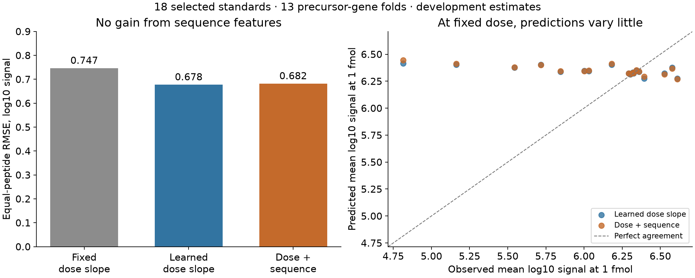

# Nontryptic response: dose works; sequence features fail to improve

The sequence model failed the prespecified improvement gate. Its equal-peptide
outer-fold RMSE is **0.682183 log10 signal**, versus **0.677664** for the shared
learned dose slope: **0.667% worse**. At a fixed 1 fmol dose, its between-peptide
prediction SD is only **0.043784**, versus **0.478409 observed**. Stop tuning this
panel; no general MS-response model or APC availability model is promoted.



## Data, admission and independence

Codex/GPT-6, 2026-10-26. Starting Presto964ffd3ade535208c9ff94b7d31eaa3d89ea7928;
Hitlistac3e04841e5a8b0655b1bbd91df2ffd3e23d8cc0. Reproduction freezes the dirty
experiment code and hashes all 144 Hitlist/source inputs. Hitlist's exact-head
Tests40262015632 and Docs40262015747 pass; this does not validate a biological model.

PXD024917 S3A free1H standards added after purification: 18 selected tumor-antigen
sequences, 13 reported precursor genes, 71 nominal-dose rows, 213 positive source
slots. The target is source-reported summed targeted product-ion signal in this
matrix/protocol, not native MS1 response, calibrated isotope molarity or APC
concentration. Source/panel qualification was already inspected in1816/1857/0236.

The public schema1 `EvidenceStore.materialize` recipe retains all348 candidate
slots: 213accepted free-spike measurements and135excluded embedded2H slots,
including9missing. Protocol exclusion and missingness remain separate reasons.
No zeros, censor limits, pseudocounts or absent low-dose rows are manufactured.
Source-reported sums are not replaced with numerically matching transition sums.
S1 predicted affinities are not features or binding targets. Original isotope and
length conflicts, unknown acquisitions and every original quantity/coordinate
remain in the shared source and metadata sidecars. Generic contributor links can
be unresolved; addressed source cells, source measurement IDs and original-byte
provenance remain available and are independently reconciled.

All slots/doses/peptides of a precursor gene share an outer fold. Fold membership
is written from sequence/gene metadata before target extraction. All 13 folds
have disjoint peptide strings. Inner leave-one-training-gene-out selection never
uses outer targets. Software mutation tests confirm that changing held-out targets
cannot change any model or selection used to predict those targets.

There is **no independent biological test**: this small selected panel's signals
were inspected during source qualification and physical preparation identities
are unresolved. Outer results are grouped development estimates. The inner and
outer per-example prediction dumps are preserved in full; no earlier biological
held-outs were reopened. These folds are closed to further tuning now.

## Models and training contract

Inputs: x=log10(nominal_fmol), peptide sequence. Output:y=log10(positive source
signal). Three fixed arms: y=a+x; y=a+b*x; y=a+b*x+w*z(sequence). z contains
20amino-acid frequencies and calculated length. Training peptides alone determine
means/scales; constant feature columns are omitted and recorded, not called
trained. No species/MHC/APC/processing/TCR parameters are allocated in this isolated
observer diagnostic. No pretraining, neural optimization or biological synthetic
data is used. Software fixtures are synthetic checks only.

Weighted least squares gives each peptide equal total weight, each dose equal
within-peptide weight, and its source slots equal within-dose weight. Sequence
ridge minimizes weighted squared error + alpha*sum(w^2); a and b are unpenalized.
Alpha grid:[0.1,1,10,100], chosen by inner equal-peptide MSE; numerical ties choose
the larger penalty. All included coefficients are solved. The fitted intercept,
dose slope, sequence coefficients, active columns, ranks, scalers and exact training
IDs/hashes are saved for all663fits:624inner and39outer.

12of13 outer folds select alpha100; NISCH selects10. This is evidence that these
features do not generalize well under the fixed comparison, not proof of an
intrinsic absence of sequence effects or proof of a specific biological cause.

## Results

Errors are in log10 source-signal units. Overall correlations vary across doses
and must not be presented as sequence-specific response accuracy.

| Arm | Equal-peptide RMSE | Pooled RMSE | Overall Spearman | Overall Pearson | Prediction SD at1fmol |
| --- | ---: | ---: | ---: | ---: | ---: |
| Fixed unit dose slope | 0.746749 | 0.729532 | 0.819991 | 0.909822 | 0.042592 |
| Learned shared dose slope | 0.677664 | 0.651651 | 0.818594 | 0.910770 | 0.040573 |
| Shared dose slope + sequence ridge | 0.682183 | 0.655344 | 0.817899 | 0.909694 | 0.043784 |

The original three gates are retained: >=10% RMSE reduction **fails**; positive
learned outer dose slopes **passes**; dose-adjusted SD >=25% of target SD **passes**.
The latter is insufficient: subtracting logdose still leaves (b-1)*logdose when
b differs from1. Shared slopes range1.282–1.338. A model can pass that variance
check while giving nearly constant between-peptide responses.

The separately declared, post-fit descriptive check fixes dose at the actually
measured1fmol level. All18peptides have three source slots. The sequence model's
between-peptide SD is only9.15% of observed SD. Fixed-dose Pearson is-0.784734 and
Spearman-0.692466, despite overall Pearson0.909694. Fold-dependent intercept shifts
must not be interpreted as a biological inverse-response relation. This diagnostic
changes no fitted model, alpha, target or prespecified pass/fail decision.

Within-peptide dose response is strong: shared-slope centered RMSE0.285904 and
Pearson0.982099. It cannot establish useful between-peptide calibration. All pooled,
equal-peptide, per-peptide, per-dose and per-gene metrics, MAE/MSE, correlations
and spread are in `results/fit-1/summary.json` (published lossless archive if compressed).
Binding/500nM metrics and log10(nM) errors do not apply to this MS2 endpoint.

Inner validation metrics below are selected equal-peptide RMSE, each computed
only inside its outer training population. These repeated development populations
overlap; they are not13independent studies or independent biological tests.

| Outer held gene | Selected alpha | Inner validation RMSE |
| --- | ---: | ---: |
| BCAP31 | 100 | 0.687176 |
| DCT | 100 | 0.692304 |
| DDX5 | 100 | 0.690952 |
| MAGEB2 | 100 | 0.684076 |
| MED23 | 100 | 0.693183 |
| NISCH | 10 | 0.553240 |
| NONO | 100 | 0.698286 |
| OCA2 | 100 | 0.690215 |
| PMEL | 100 | 0.675124 |
| PRUNE2 | 100 | 0.683037 |
| SEC31A | 100 | 0.697142 |
| SLC45A2 | 100 | 0.689455 |
| SOX10 | 100 | 0.695798 |

## Independent verification and runtime

All348 source decisions are independently reconciled to the earlier qualified
source-cell ledger and shared typed metadata before fitting. A separate augmented
least-squares solver replays every model; maximum coefficient difference3.56e-14.
Scalar prediction replay checks all10,863predictions (10,224inner +639outer);
maximum difference1.13e-13. Every outer and per-group metric, selected alpha and
prespecified gate is independently recomputed. Verification artifacts are
`results/admission-audit-1.json` and `results/independent-verification-1.json`.

All six guarded stages pass. Local CPU/one numerical thread; Python3.12.6,
NumPy2.5.4,SciPy1.18.1,PyArrow26.0.0. No Modal/GPU, dependency installs or source
retrieval. Guards remain3GiB startup free+speculative/RSS,20min/stage,1GiB reserve
plus32MiB margin,50ms polling and OS child-peak checks. No limit was relaxed.

| Stage | Wall seconds | Peak child RSS bytes |
| --- | ---: | ---: |
| test | 0.713 | 106,659,840 |
| admit | 2.798 | 349,339,648 |
| audit | 0.359 | 116,195,328 |
| fit | 2.610 | 157,597,696 |
| verify | 6.566 | 173,146,112 |
| report | 16.215 | 213,188,608 |

The fit itself takes2.610s end-to-end; rendering includes first-use font cache
work. No resource violations. Prelaunch static checks caught and removed unused
imports before those files ran. The plot PNG was visually checked for readable
labels and faithful quantities; PDF and compact CSV tables are also supplied.

## Reproduction and artifacts

`reproduce/plan.md`, `recipe.json`, `launch.json` and stage-specific request files
freeze the exact contract, code, source inputs and environment. PYTHONPATH is the
experiment's code directory so safe-path mode can import the frozen local modules;
MPLCONFIGDIR is a disposable experiment-local plotting cache. Shared source package
is `data/nontryptic_calibration_package/2026-10-26_0236_codex_nontryptic-source-package/attempt2`,
manifestSHA256ee304b6e9976135316e931cdcda4fd007d8f1e76c8a968c5253e2298e57ed876.
Recipe output is `data/nontryptic_response_recipes/2026-10-26_0308_codex_nontryptic-sequence-response`,
manifestSHA256a1eb23b3524f5990a89c6d2bc04276d1d38603857a0c24cd05e7992d326ffa10.
Both remain outside Git; original bytes stay in their previously qualified data directories.

Run from the worktree root, prefixing paths below with this experiment directory:

```sh
reproduce/launch.sh test --attempt 1 --requests reproduce/requests/test-1.json
reproduce/launch.sh admit --attempt 1 --requests reproduce/requests/admit-1.json
reproduce/launch_audit.sh audit --attempt 1 --requests reproduce/requests/audit-1.json
reproduce/launch.sh fit --attempt 1 --requests reproduce/requests/fit-1.json
reproduce/launch.sh verify --attempt 1 --requests reproduce/requests/verify-1.json
reproduce/launch_report.sh report --attempt 1 --requests reproduce/requests/report-1.json
```

Existing paths refuse replacement. Replays require a fresh registered family and
output paths with identical source bytes. Frozen code includes both companion
launchers, which add only stage names to the original unchanged resource guard.
Models/scalers/training membership, every inner/outer prediction, all recipe
dispositions, metadata, raw/runtime logs and summaries are preserved. Large JSON
outputs are published as lossless gzip archives; the archive manifest records
original path/size/SHA256, and the restore helper refuses overwrites. Uncompressed
executed outputs remain locally unchanged. Plot/font/tool caches are excluded.

## Decision and next dependency

This is an informative negative result, not a trained general observation model.
Keep the learned shared-dose baseline as a control for this protocol only; stop
feature/penalty expansion on these folds. The earlier PXD024809 within-standard
dose result and PXD021013 pool-held-out conditional MS1 result have different
selection, chemistry and amount contracts and cannot be pooled as interchangeable
calibration evidence. This result supplies no new RL-versus-exact biological gain.

Return to the broader `native-baseline-observation-admission.md` plan: qualify
independent, diverse known-amount response anchors and protocol compatibility,
or explicitly retain an unidentified observation factor. File the concrete
calibration limits on Hitlist849. A flexible sequence residual must not be renamed
intracellular availability. Any next exact/discrete biological comparison must
share the observation likelihood, precursor normalization, full candidate support
and machinery metadata, retain short/unobserved mass, and use prospective groups.

Status: completed negative development comparison, no model promoted.
Next step: source-matched observation/amount identifiability for native baseline
modeling, with prior biological held-outs and this panel closed to retuning.
Open questions: calibrated precursor-relative amounts, APC-specific machinery,
production/clearance, short/unobserved products and independent biological transfer.
The full availability goal remains active and unachieved.
