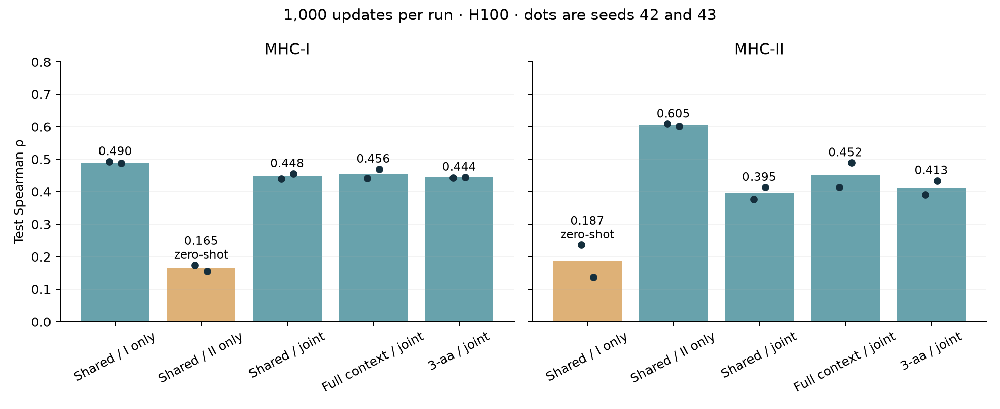
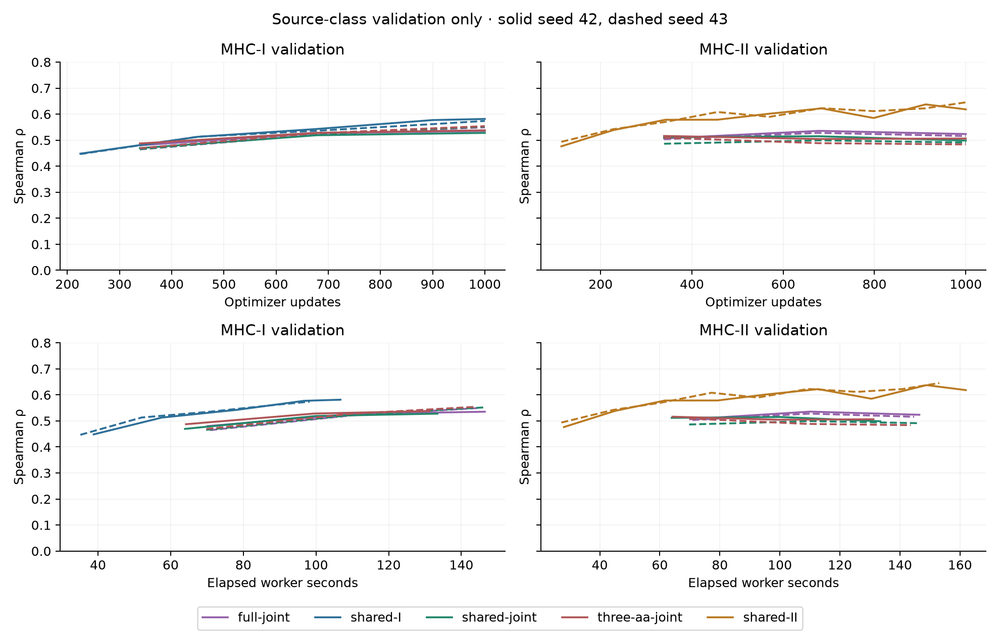

# Cross-class affinity transfer and flank comparison

Completed: all ten1000-update H100 fits, all selected validation/test prediction
dumps, independent metrics and exact same-H100 checkpoint replay. Codex / GPT-6,
October27,2026. No predictive fit failed in the final app. The initial container-
import failure remains preserved separately and executed zero updates.

## Findings

Two-seed means below; Spearman is higher-better and RMSE is lower-better in
log10(nM). † marks evaluation on a class with zero training affinity labels.

| Condition | I val ρ / RMSE | I test ρ / RMSE | II val ρ / RMSE | II test ρ / RMSE |
|---|---:|---:|---:|---:|
| shared-I | 0.5756 / 1.1441 | 0.4905 / 1.2114 | 0.2611 / 1.1608 † | 0.1871 / 1.2151 † |
| shared-II | 0.2282 / 1.5849 † | 0.1652 / 1.6483 † | 0.6414 / 0.7916 | 0.6050 / 0.7416 |
| shared-joint | 0.5355 / 1.1905 | 0.4477 / 1.2553 | 0.5032 / 0.8784 | 0.3948 / 0.8605 |
| full-joint | 0.5380 / 1.1873 | 0.4557 / 1.2406 | 0.5258 / 0.8538 | 0.4517 / 0.8400 |
| three-aa-joint | 0.5411 / 1.1853 | 0.4443 / 1.2547 | 0.4941 / 0.8770 | 0.4127 / 0.8547 |

Shared-v4 transfers weakly in both directions: I-to-II testρ.1871 and II-to-I.1652.
Within-class shared models score.4905I/.6050II. Joint shared-v4 scores.4477I/.3948II;
it has not established an affinity improvement over the historical full-context
control (.4557I/.4517II). Full-context beats three-aa numerically on both classes,
but versions differ in representation, parameter count and pooling; this is not
an isolated causal flank-length experiment. At equal1000updates the source-only
runs see more examples from their own class than joint runs. Equal-exposure and
convergence comparisons require a new prospective contract.

Preferred predictive reference for this fixed-budget joint contract: full-context-v3.
Current shared-v4 remains the common software architecture under investigation;
no accuracy promotion or rollback is inferred from two seeds. Historical converged
three-aa joint runs reached approximately.603I/.621II after38–44epochs and are a
different optimization budget. Target-class calibration is absent in zero-shot runs.

Paired2000-draw peptide-cluster bootstrap (fixed seed4272026) gives shared-v4 minus
full-v3 testρ differences I−.00793[−.02053,.00343], II−.05693[−.10080,−.01087].
Full-v3 minus three-aa is I+.01134[.00080,.02260], II+.03905[.00297,.07241].
Intervals average the two matched seeds and resample777I/133II peptide clusters;
they are dataset-sampling diagnostics, without multiplicity correction or a claim
of population-level training-seed uncertainty. All validation/test comparisons,
including RMSE, are retained in results/paired-bootstrap.csv/.json.

## Data, labels and admission

Original manifestSHA256914e0930283a9e5f7a41024576976f3e92e280f0719feda261ffcf48bf01d7be;
[admission family](../2026-10-21_0647_codex_full-ic50-admission/README.md).
Direct purified human IEDB IC50, canonical unmodified peptides, explicitly paired
human HLA molecules. Frozen train21636 exact observations (I14375/II7261),
validation2925 (I2051/II874), test2803 (I1845/II958). Exact validation1968I/758II;
exact test1758I/842II. Lossless class filters preserve original observation IDs,
measurements, peptide/MHC sequences and partitions. Input hashes are checked before
runs and again by independent verification. No KD/MS/TCR proxies, cellular labels,
synthetic biological data, pretraining or row caps. Original export-missing qualifier
policy is exact, with raw missingness retained. Bounds are retained in holdouts.
MHC grooves originate from mhcseqs2.6.13 and were re-extracted/checked during source
admission; classIα1/α2 and classIIα1/β1 are actual frozen sequences, not allele tokens.
Missing class-II partners were deferred rather than filled by an assumed DRA chain.

Exact peptide and original measurement components are separated across splits;
studies are shared and these holdouts have been inspected previously. All same-
class heldout groove pairs were seen in that class's training. This is development
evidence, not new independent biological qualification.

Before outcomes, sequence-only analysis found zero identical training peptides
shared between classes and22 shared9mer substrings. Any9mer overlaps same-class
training for27.2%I and85.0%II test rows. These substrings are not assigned binding
cores. ClassII-only test exact rows with no seen9mer (n130) scoreρ.4811/.4808;
seen9mer rows(n712) score.6326/.6263. Joint-v4's no-seen9mer II subset scores
.0199/−.0340; it is small, correlated and not an independent set. Cross-class
zero-shot signal persists on the no-seen9mer rows. Per-length, per-groove-pair and
unweighted per-pair macro metrics are retained; small pairs can make macros noisy.
Pooled correlation should not be read as every allele's ranking performance.

## Architecture and training

Five conditions × seeds42/43. Shared-v4 I-only, II-only and joint use the same
candidate encoder/readout and parameter-free normalized logsumexp pooling.
ClassI supplies one whole-peptide candidate; classII every contiguous9mer. The
candidate averages core-relative encoding and its positions in the full contextual
peptide representation. Both grooves use the shared encoder. No class one-hot,
independent register head, flank-specific projection or length column remains.
Pooling is statistical, not thermodynamic occupancy. Historical full-v3 joint and
three-aa-v2 joint run their frozen implementations through the canonical manifest
trainer. They are benchmark controls, not alternate new-training APIs.

Every fit:1000updates, batch64, AdamW3e-4, weight decay1e-4, dropout.1,
min/max epochs100,patience100,identity weight0. IC50→physical log10(nM),
training-only mean/scale, standardized squared error weight1; one-sided squared
loss for original heldout bounds. No AMP, compile or TF32. Source-only validation
RMSE selects source checkpoints; target-class validation/test are evaluated only
after selection. Expanded routing strict-loads every unchanged tensor and creates
no new parameters. The saved source checkpoint and supported serving scope stay
unchanged. Joint validation selection uses the registered aggregate criterion.

## Reproduction and hardware

[Exact launch](reproduce/launch.sh), [parameters/environment](reproduce/launch.json),
[prospective plan](reproduce/plan.md), [source pins](reproduce/source-pins.json),
[verification plan](reproduce/verification-plan.md). Mainapp:
https://modal.com/apps/iskandr/main/ap-QOC60v8WffjGylqasi9An8
Read-only training-probe verificationapp:
https://modal.com/apps/iskandr/main/ap-DWvr3s5kVIIL2RZfps7C8Y

RequestedPRESTO_MODAL_GPU=H100!, observed NVIDIAH10080GBHBM3,81559MiB nvidia-smi,
85009367040bytes CUDA-visible. At most2concurrent fit workers;4CPU cores,16GiB host
request,7200s timeout,retries0. Verification used one H100 after all fits completed.
Python3.12.1,torch2.14.1+cu130,numpy2.5.4; full pinned direct requirements and
thread overrides are in launch.json/image source. No shared-environment upgrade.
Shared source commit0659b43cbd296f9d590a215b6f4358c2780439b1 (recorded experiment/task
dirt), full-v3f24f7dfd6404c6eb450545daf72769269f55a5bf and three-aa-v2
9dd71348124faa49a4c6a60872385c86895d50b0 clean; every uploaded file hash verified.
Source snapshots and approved inputs live under ../../artifacts/2026-10-27_1930_codex_modal-cross-class/upload.
The one CPU run is a separate [reference](../2026-10-27_1835_codex_cross-class-flank-benchmark/README.md).

Fit wall times118.4–179.3s; whole model worker including transfer/probes161.5–227.8s.
Image build, queueing, input preparation before worker timing, archive compression
and download are excluded. Max sampled hostRSS4.80–5.01GiB, peak allocated
GPU0.277–1.195GiB, reserved0.643–2.729GiB. Parameters:shared449153,
full482689,three-aa455041. Full per-condition timing and memory:results/runtime.csv.

Raw artifacts persist on Modalvolume presto-checkpoints at
2026-10-27_1930_codex_modal-cross-class/{condition}/ and matching condition.tar.gz.
Downloaded archives are checksummed under ../../artifacts/2026-10-27_1930_codex_modal-cross-class/downloads;
extracted runs are under ../../artifacts/2026-10-27_1930_codex_modal-cross-class/runs. Every condition has
selected/final checkpoints, configurations, history, inputs and prediction dumps.
Results/{condition} holds compressed train/validation/test predictions, transfer
predictions where applicable, source-mean controls and training replay probes.
The same familyID refuses overwriting attempted runs; reproduction requires a new
output family identity while preserving frozen numerical/data/source contracts.

## Verification, limits and failures

Every class's saved validation/test scores, original row IDs/targets/grooves,
source-mean controls, censor-direction losses and checkpoint hashes independently
verify. results/metrics-independent.csv contains loss, exact Spearman/Pearson/RMSE,
500nM accuracy/balanced accuracy/precision/recall/F1/AUROC/AUPRC. Seed means/ranges
are in seed-summary.csv/.json. Per-condition verification JSON preserves subgroups.
Five artificial analysis tests, pinned Ruff checks,272 model/trainer tests,
four launch harness fixtures and installed-wheel execution pass.

Fresh H100 processes reproduce all640saved training probes exactly (zero maximum
error) from the ten selected checkpoints. An initial CPU replay failed the strict
2e-5absolute-plus-relative tolerance on2/64probes (max9.0077e-5log10nM). CPUfloat64
and MKLDNN-off confirm that result. Disabling the CUDA transformer fastpath makes
CUDA agree with CPU within5.12e-7; original CUDAfloat64 agrees with original GPU
within6.16e-7. Thus the discrepancy is localized to the CUDA transformer fastpath;
no serialization defect or changed checkpoint is implicated. The original CPU and
CUDA-altered-path failures remain explicit, with no relaxed threshold or changed
published prediction. See gpu-training-replay.json and reproduce/replay-diagnosis.md.

First Modal launch failed at container module import due to host-only path logic;
zero optimizer updates, failed app stopped. Corrected launcher import and remote-
import test preserve the failed source/call receipts in reproduce/attempt1-import-error.
The initial automatic approval rejection was resolved by the user's explicit
source/data-upload and run approval. No unapproved public publishing occurred.

Current runs model only IC50. They do not establish same-protein MS ligand ranking,
processing or recognition. That follow-up and the ranked structural/representation
brainstorm are recorded in the Codex plans/ideas area. Scientific PR131 gates
remain open; no scientific completion is inferred from this pilot.
